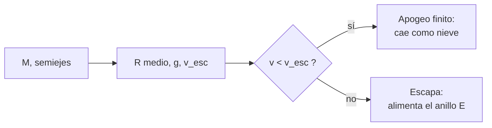

# B56-C10 — Océanos de Encélado

<!-- nav:top -->
[🏠 Programa](../../../../README.md) · [📚 Bloque B56](../../../tronco-comun/B56-astrobiologia-y-vida-extraterrestre.md) · [← Anterior: B56-C09 — Océanos de Europa](../B56-C09-oceanos-de-europa/CLASE.md) · [Siguiente: B56-C11 — Atmósfera y superficie de Titán →](../B56-C11-atmosfera-y-superficie-de-titan/CLASE.md)
<!-- /nav -->

## 1. Ubicación, nivel y alcance

Clase 10 del bloque B56. Nivel N3. Tomas la gravitación ([B05-C10](../../B05/B05-C10-gravitacion-universal/CLASE.md)) y la conservación de la energía ([B05-C07](../../B05/B05-C07-conservacion-de-energia-mecanica/CLASE.md)) para estudiar **qué ocurre con las partículas que salen del penacho de Encélado**: cuánto suben, cuándo escapan. Encélado es un satélite de Saturno. No evalúas la química del océano ni la hidrotermalidad (bloque [B55](../../../tronco-comun/B55-astroquimica-y-geoquimica-extraterrestre.md)) ni afirmas que haya vida.

## 2. Por qué esta clase existe

El penacho permite muestrear un océano sin aterrizar. Para diseñar un sobrevuelo hace falta saber hasta dónde llegan los granos y cuáles escapan al anillo E. La decisión central: **dada la rapidez de lanzamiento de un grano, ¿vuelve a la superficie o escapa?**

## 3. Lo que podrás hacer al terminar

1. Definir penacho, velocidad de escape, apogeo y balística radial.
2. Calcular el radio medio, la gravedad y la velocidad de escape de Encélado desde su masa y sus semiejes.
3. Hallar la altura de apogeo por energía y por integración RK4.
4. Comparar la rapidez del penacho con la de escape.
5. Explicar por qué el resultado ignora el arrastre del gas y a Saturno.
6. Nombrar qué datos no se consultaron.

La evidencia es la **ficha del penacho de Encélado** del ejercicio 12 (sección 20).

## 4. Con qué llegas y cómo comprobarlo

1. ¿Qué es la energía mecánica `v²/2 − GM/r`?
2. ¿Qué es la media geométrica de tres números?
3. ¿Qué es un método RK4?
4. ¿Cómo se pasa de mph a m/s?
5. ¿Qué es un semieje de un elipsoide?

<details>
<summary>Ver respuestas</summary>

1. Energía por unidad de masa, constante sin fuerzas disipativas. 2. `(abc)^{1/3}`. 3. Un integrador de cuarto orden. 4. Multiplicar por 0,447. 5. La mitad de un diámetro principal.
</details>

Con cuatro o cinco aciertos, sigue; si no, repasa B05-C07 y B11.

## 5. Un caso real: lo que dice la NASA

La hoja de satélites saturninos (actualizada el 2025-07-22, consultada el 2026-11-09, S1) da para Encélado masa `1,08 × 10²⁰ kg`, dimensiones triaxiales `257 × 251 × 248 km` y densidad `1610 kg/m³`. La página de la NASA (S2) dice que un océano global alimenta los chorros, que Cassini descubrió en 2005 partículas de hielo y gas que salen a unos 800 mph (≈ 400 m/s), que la mayor parte vuelve como nieve, que el hielo mide en promedio 20–25 km y 1–5 km en el polo sur, y que el penacho tiene materia orgánica unas 20 veces más densa de lo esperado. Es el **ejemplo conductor**.

## 6. Vocabulario

El **penacho** es el chorro de hielo y gas que sale de fracturas del polo sur. La **velocidad de escape** es `√(2GM/R)`. El **apogeo** es el punto más alto de una trayectoria. Una trayectoria **balística radial** sube y cae por la sola gravedad. El **anillo E** es el anillo de Saturno formado por material del penacho.

## 7. Modelo mental: lanzar una piedra en un mundo pequeño

En un cuerpo de gravedad muy baja, una piedra lanzada con poca rapidez sube cientos de km; con la rapidez de escape, no vuelve.



*Descripción textual:* con masa y radio se calcula la velocidad de escape; el grano vuelve si su rapidez es menor y escapa si es mayor.

Analogía: una pelota lanzada en la Luna sube mucho más que en la Tierra. Su límite: aquí también actúa el gas del chorro y Saturno, que el modelo ignora.

## 8. La explicación, paso a paso

### 8.1 Coherencia de los datos

La densidad calculada con `M` y los semiejes es `1612 kg/m³` frente a `1610` de la hoja. Esto respalda la lectura de `257 × 251 × 248 km` como semiejes (la hoja los llama «dimensiones»).

### 8.2 Radio medio, gravedad y escape

`R = (abc)^{1/3} = 252,0 km`; `g = GM/R² = 0,1135 m/s²`; `v_esc = 239,2 m/s`.

### 8.3 Apogeo por energía

Con energía constante, `r_max = 1/(1/R − v²/(2GM))` si `v < v_esc`. Para `v = 100 m/s`: altura de `53,37 km`; para `200 m/s`: `585,49 km`; para `230 m/s`: `3089,38 km`.

### 8.4 Verificación por RK4

Integrando `r'' = −GM/r²` desde la superficie, el apogeo coincide con el de la energía a menos de `10⁻⁶` en los tres casos.

### 8.5 Comparación con el penacho

A 400 m/s el grano es `1,67 v_esc`: en el modelo sin gas ni Saturno escapa. La realidad es una distribución de rapideces, y la mayor parte del material vuelve como nieve, como dice la fuente; el modelo con una sola rapidez no reproduce eso.

## 9. Magnitudes, símbolos y unidades

| Símbolo | Qué es | Unidad | Valor / nota |
|---|---|---|---|
| `M` | masa de Encélado | kg | `1,08 × 10²⁰` (S1) |
| `a, b, c` | semiejes | km | 257; 251; 248 (S1) |
| `R` | radio medio geométrico | km | 252,0 |
| `g` | gravedad superficial | m/s² | 0,1135 |
| `v_esc` | velocidad de escape | m/s | 239,2 |
| `G` | constante de gravitación | `m³ kg⁻¹ s⁻²` | `6,674 30 × 10⁻¹¹` (S3) |

## 10. Convenciones y referencias

Cuerpo esférico de radio `R`; lanzamiento radial desde la superficie; sin rotación, gas ni Saturno. 400 m/s es la cifra de la NASA como orden de magnitud.

## 11. De dónde sale lo que afirmamos

| ID | Fuente | Localizador | Respalda | Estado |
|---|---|---|---|---|
| S1 | NASA/NSSDC, *Saturnian Satellite Fact Sheet* (actualizada 2025-07-22) | https://nssdc.gsfc.nasa.gov/planetary/factsheet/saturniansatfact.html | Masa, dimensiones, densidad | Consultada el 2026-11-09 |
| S2 | NASA, *Enceladus* | https://science.nasa.gov/saturn/moons/enceladus/ | Océano, penacho a ~400 m/s, espesores del hielo, orgánicos | Consultada el 2026-11-09 |
| S3 | NIST, *Fundamental Physical Constants — Complete Listing* (CODATA 2022) | https://physics.nist.gov/cuu/Constants/Table/allascii.txt | `G` | Consultada el 2026-11-09 |

Límites: la interpretación de las dimensiones como semiejes es mía, respaldada por la densidad; el hidrógeno del penacho (Waite et al., 2017) no se consultó; la página de la NASA no menciona hidrógeno.

## 12. Cómo ver las trayectorias

Equivalente accesible a una gráfica de altura contra rapidez:

| `v` (m/s) | Altura de apogeo (km) |
|---|---|
| 100 | 53,4 |
| 200 | 585,5 |
| 230 | 3089,4 |
| ≥ 239,2 | escapa |

Descripción larga: la altura crece muy deprisa al acercarse a la rapidez de escape.

## 13. Ejemplo trabajado: ¿hasta dónde sube un grano a 150 m/s?

**Paso 1 · Datos.** `v = 150 m/s`, `R = 252,0 km`, `GM = 7,208 × 10⁹ m³/s²`.

**Paso 2 · Energía.** `v²/(2GM) = 22 500/(1,4416 × 10¹⁰) = 1,561 × 10⁻⁶ m⁻¹`.

**Paso 3 · Apogeo.** `1/R = 3,968 × 10⁻⁶`; resta `2,407 × 10⁻⁶`; `r_max = 415,5 km`.

**Paso 4 · Sentido.** Altura `163,5 km`. Es un resultado del modelo, no una medición.

## 14. Distintos enfoques

**Balística por energía (esta clase):** exacta para el modelo. **RK4:** comprueba la integración. **Modelo con gas, rotación y Saturno:** necesario para predecir el anillo E. Para una primera ficha basta el primero.

## 15. Práctica guiada

**Ejercicio 1 · con los pasos indicados.** Calcula `GM` de Encélado. *Pasos:* `6,674 30 × 10⁻¹¹ × 1,08 × 10²⁰`.

<details><summary>Solución comentada</summary>

`GM = 7,208 × 10⁹ m³/s²`.
</details>

**Ejercicio 2 · con una pista.** Calcula `g`. *Pista:* `GM/R²`.

<details><summary>Solución comentada</summary>

`7,208 × 10⁹/(2,52 × 10⁵)² = 0,1135 m/s²` (8.2).
</details>

**Ejercicio 3 · casi autónomo.** Calcula `v_esc`.

<details><summary>Solución comentada</summary>

`√(2 × 7,208 × 10⁹/2,52 × 10⁵) = 239,2 m/s` (8.2).
</details>

## 16. Práctica autónoma, transferencia e integrador

**Ejercicio 4.** Estima la altura con `v²/(2g)` para 100 m/s y compárala con 53,4 km.

<details><summary>Solución comentada</summary>

`10⁴/(0,227) = 44,1 km`; menor porque `g` disminuye con la altura (8.3).
</details>

**Ejercicio 5.** ¿Qué fracción de `v_esc` es 100 m/s?

<details><summary>Solución comentada</summary>

`0,418`; la energía cinética es `0,175` de la de escape.
</details>

**Ejercicio 6.** ¿Cómo se pasa 800 mph a m/s?

<details><summary>Solución comentada</summary>

`800 × 0,44704 = 357,6 m/s`; la NASA da «unos 400 m/s» como orden de magnitud.
</details>

**Ejercicio 7.** ¿Por qué la mayor parte del material vuelve si 400 m/s > `v_esc`?

<details><summary>Solución comentada</summary>

Porque las rapideces reales son una distribución con mucho material más lento y el gas frena granos; el modelo de una sola rapidez no lo recoge (8.5).
</details>

**Ejercicio 8.** Verifica la densidad `1612 kg/m³`.

<details><summary>Solución comentada</summary>

`V = 4π/3 × 257 × 251 × 248 × 10⁹ = 6,70 × 10¹⁶ m³`; `1,08 × 10²⁰/6,70 × 10¹⁶ = 1612` (8.1).
</details>

**Ejercicio 9 · transferencia.** Un titular dice: «el penacho prueba que hay vida». Respóndele.

<details><summary>Solución comentada</summary>

Prueba un océano y material orgánico según la NASA, no vida. Las biofirmas exigen descartar procesos sin vida (C15).
</details>

**Ejercicio 10 · transferencia.** Una sonda pasa a 100 km de altura. ¿Qué rapidez mínima debe tener un grano para alcanzarla?

<details><summary>Solución comentada</summary>

Entre 100 y 200 m/s; por energía, unos 130 m/s (interpolación de 8.3 o ejercicio de 13).
</details>

**Ejercicio 11 · transferencia.** ¿Qué cambia si Encélado girara?

<details><summary>Solución comentada</summary>

Un grano heredaría velocidad tangencial; el apogeo sería algo mayor para lanzamientos hacia el este. El modelo no lo incluye.
</details>

**Ejercicio 12 · integrador.** Elabora tu *ficha del penacho*: calcula `R`, `g`, `v_esc`, el apogeo para tres rapideces elegidas y compáralas con 400 m/s, y lista dos efectos omitidos.

<details><summary>Solución modelo</summary>

`R = 252,0 km`, `g = 0,1135`, `v_esc = 239,2`; apogeos 53,4; 585,5; 3089,4 km (100, 200, 230 m/s); 400 m/s escapa; omitidos: gas y Saturno. Rotulado como modelo.
</details>

## 17. Laboratorio: balística del penacho

El script [penacho_de_encelado.py](penacho_de_encelado.py) calcula `R`, `g`, `v_esc` y el apogeo por energía y por RK4, y **comprueba** densidad (< 1 %) y coincidencia de apogeos (`10⁻⁶`).

**Datos:** S1–S3. **Predice antes de ejecutar:** ¿escapa 400 m/s? (sí, 1,67 veces `v_esc`.) **Ejecución del 2026-11-09 (Python 3.12.9):**

```text
Python 3.12.9 (biblioteca estandar)
Densidad desde los semiejes = 1612 kg/m3 (hoja: 1610)
R medio = 252.0 km ; g = 0.1135 m/s2 ; v_esc = 239.2 m/s
v =   100 m/s -> altura de apogeo: energia   53.37 km ; RK4   53.37 km
v =   200 m/s -> altura de apogeo: energia  585.49 km ; RK4  585.49 km
v =   230 m/s -> altura de apogeo: energia 3089.38 km ; RK4 3089.38 km
v = 400 m/s (NASA) = 1.67 x v_esc -> escapa (sin arrastre ni Saturno)
Pruebas superadas.
```

```bash
python programa/clases/B56/B56-C10-oceanos-de-encelado/penacho_de_encelado.py
```

**Límites:** radial, sin gas, rotación ni Saturno; una rapidez única.

## 18. Errores frecuentes y cómo corregirlos

**Usar el radio ecuatorial en vez del medio.** Se corrige con el ejercicio 8.

**Mezclar mph y m/s.** Se corrige con el ejercicio 6.

**Usar `v²/2g` con `g` constante.** Se corrige con el ejercicio 4.

**Concluir vida del penacho.** Se corrige con el ejercicio 9.

**Tomar 400 m/s como única rapidez.** Se corrige con el ejercicio 7.

## 19. Cómo sabrás que vas bien

Tras 8.2: ¿sabes obtener `v_esc`? Ejercicio 3. Tras 8.3: ¿cómo cambia el apogeo? Ejercicio 4. Tras el laboratorio: ¿qué prueba RK4? (que la fórmula de energía es correcta).

## 20. Qué entregas y cómo se evalúa

El producto es tu **ficha del penacho de Encélado** (ejercicio 12).

| Criterio | Inicial | En desarrollo | Logrado | Destacado |
|---|---|---|---|---|
| Conceptos | Los confunde | Parciales | Escape y apogeo claros | Discute la distribución de rapideces |
| Cálculo | Sin unidades | Con errores | Valores correctos | Dos vías |
| Límites | Ninguno | Uno | Gas y Saturno | Cuantifica su efecto |
| Rótulos | Sin rotular | Parciales | Modelo rotulado | No afirma vida |
| Fuentes | Sin fuente | Sin fecha | S1–S3 con fecha | Declara el hidrógeno no consultado |

**Condiciones críticas (no se compensan con promedio):** no presentar la balística simple como predicción del anillo E; no afirmar vida; citar solo lo consultado.

## 21. Ética, seguridad y límites

La clase es educativa y no concluye sobre vida en Encélado. Accesibilidad: tablas equivalentes a las gráficas, fórmulas en texto, ejercicios sin conexión.

## 22. Para cerrar y seguir

Con `v_esc = 239 m/s`, un grano a 400 m/s escaparía en el modelo, y uno a 100 m/s sube 53 km; la realidad es una distribución. Queda una pregunta: ¿qué atmósfera y qué superficie tiene un mundo con lagos de hidrocarburos? Veamos Titán.

**Glosario español–inglés.** penacho · *plume*; velocidad de escape · *escape velocity*; apogeo · *apoapsis*; anillo E · *E ring*; balística · *ballistics*.

**Continuidad.** [B56-C11](../B56-C11-atmosfera-y-superficie-de-titan/CLASE.md) estudia la atmósfera de Titán.

**Referencias:** ver sección 11.

<!-- nav:bottom -->
---

[← Anterior: B56-C09 — Océanos de Europa](../B56-C09-oceanos-de-europa/CLASE.md) · [📚 Bloque B56](../../../tronco-comun/B56-astrobiologia-y-vida-extraterrestre.md) · [Siguiente: B56-C11 — Atmósfera y superficie de Titán →](../B56-C11-atmosfera-y-superficie-de-titan/CLASE.md)
<!-- /nav -->
