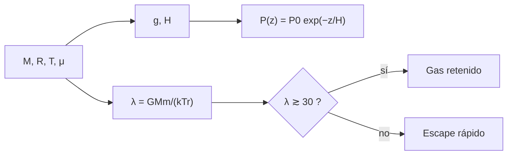

# B56-C11 — Atmósfera y superficie de Titán

<!-- nav:top -->
[🏠 Programa](../../../../README.md) · [📚 Bloque B56](../../../tronco-comun/B56-astrobiologia-y-vida-extraterrestre.md) · [← Anterior: B56-C10 — Océanos de Encélado](../B56-C10-oceanos-de-encelado/CLASE.md) · [Siguiente: B56-C12 — Exoplanetas potencialmente habitables →](../B56-C12-exoplanetas-potencialmente-habitables/CLASE.md)
<!-- /nav -->

## 1. Ubicación, nivel y alcance

Clase 11 del bloque B56. Nivel N3. Tomas los gases ([B05-C14](../../B05/B05-C14-gases-y-presion/CLASE.md)) y la gravitación ([B05-C10](../../B05/B05-C10-gravitacion-universal/CLASE.md)) para describir **cómo varía la presión con la altura en la atmósfera de Titán y qué gases puede retener**. Titán es el mayor satélite de Saturno. No tratas la química orgánica de su atmósfera ni la geología de sus lagos (bloques [B54](../../../tronco-comun/B54-atmosferas-y-climatologia-planetaria.md) y [B55](../../../tronco-comun/B55-astroquimica-y-geoquimica-extraterrestre.md)).

## 2. Por qué esta clase existe

Titán es el único satélite con una atmósfera densa y con líquidos en superficie (de hidrocarburos). Para planear una entrada atmosférica o un vuelo hay que conocer la altura de escala y qué gases escapan. La decisión central: **con su masa, radio, temperatura y composición, ¿cuál es la altura de escala y qué gases retiene?**

## 3. Lo que podrás hacer al terminar

1. Definir altura de escala, equilibrio hidrostático y parámetro de Jeans.
2. Calcular `g` desde masa y radio y comprobar la densidad de la hoja.
3. Calcular la altura de escala y la presión a una altitud, y verificarla con RK4.
4. Calcular el parámetro de Jeans para H₂, CH₄ y N₂ y compararlo con la rapidez de escape.
5. Distinguir lo consultado (masa, radio) de lo ilustrativo (`T`, `P`, composición).
6. Nombrar qué deja fuera el modelo isotermo.

La evidencia es la **ficha atmosférica de Titán** del ejercicio 12 (sección 20).

## 4. Con qué llegas y cómo comprobarlo

1. ¿Qué dice `P = nkT`?
2. ¿Qué es el equilibrio hidrostático `dP/dz = −ρg`?
3. ¿Qué es la masa molar de N₂?
4. ¿Qué es una exponencial decreciente?
5. ¿Qué es la energía térmica `kT`?

<details>
<summary>Ver respuestas</summary>

1. La presión de un gas ideal. 2. Que la presión sostiene el peso del aire. 3. `28 g/mol`. 4. `e^{−z/H}`. 5. La energía típica por partícula.
</details>

Con cuatro o cinco aciertos, sigue; si no, repasa B05-C14.

## 5. Un caso real: lo que sí y lo que no dicen las fuentes

La hoja de satélites saturninos (S1, consultada el 2026-11-09) da para Titán masa `1345,5 × 10²⁰ kg`, radio medio `2575 km` y densidad `1880 kg/m³`. La página de la NASA (S2) dice que es el único satélite con atmósfera densa, que tiene nubes, lluvia, ríos, lagos y mares de metano y etano líquidos, y que la misión Dragonfly (despegue en 2028) estudiará química prebiótica; **no da** presión, temperatura ni composición. Por eso `P₀ = 1,5 × 10⁵ Pa`, `T = 94 K` y `μ = 28 g/mol` (N₂) son **ilustrativos, no consultados**. Es el **ejemplo conductor**.

## 6. Vocabulario

La **altura de escala** `H = kT/(m g)` es la altura en que la presión cae un factor `e`. El **equilibrio hidrostático** iguala el gradiente de presión al peso del gas. El **parámetro de Jeans** `λ = GMm/(kTr)` compara la energía de escape con la térmica; si es grande (≳ 30) el gas se retiene. La **exobase** es la altura sobre la cual las colisiones son raras. Un **hidrocarburo** es un compuesto de carbono e hidrógeno, como el metano.

## 7. Modelo mental: una pila de colchones

Cada capa soporta el peso de las de arriba: la presión crece hacia abajo. En una atmósfera isoterma, cae un factor `e` cada altura de escala.



*Descripción textual:* con masa, radio, temperatura y composición se obtiene la altura de escala y la presión con la altura; el parámetro de Jeans dice si el gas se retiene.

Analogía: una pila de colchones. Su límite: la temperatura real cambia con la altura en Titán.

## 8. La explicación, paso a paso

### 8.1 Gravedad

Densidad desde `M` y `R`: `1881 kg/m³` (hoja: 1880). `g = GM/R² = 1,354 m/s²`.

### 8.2 Altura de escala

Con `T = 94 K` y N₂: `H = kT/(m g) = 20,6 km`. En la Tierra, con una `g` siete veces mayor, `H` es del orden de 8 km (valor ilustrativo).

### 8.3 Presión con la altura

`P(z) = P₀ e^{−z/H}`; a 100 km, `P = 1171,8 Pa`. RK4 sobre `dP/dz = −Pmg/(kT)` da el mismo valor a `10⁻⁶`.

### 8.4 Parámetro de Jeans

En la exobase (`r = R + 1000 km`, `T = 150 K`, ilustrativos): H₂ `4,1` (escapa), CH₄ `32,3` (se retiene con holgura moderada) y N₂ `56,4` (se retiene). El H₂ no se mantiene; el nitrógeno sí.

### 8.5 Lo que el modelo deja fuera

Perfil de temperatura real, composición variable, escape no térmico, química fotolítica y efecto de las mareas de Saturno.

## 9. Magnitudes, símbolos y unidades

| Símbolo | Qué es | Unidad | Valor / nota |
|---|---|---|---|
| `M`, `R` | masa y radio | kg; m | `1,3455 × 10²³`; `2,575 × 10⁶` (S1) |
| `g` | gravedad superficial | m/s² | 1,354 |
| `T`, `P₀`, `μ` | temperatura, presión, masa molar | K; Pa; g/mol | 94; `1,5 × 10⁵`; 28 (ilustrativos) |
| `H` | altura de escala | km | 20,6 |
| `λ` | parámetro de Jeans | — | 4,1 (H₂); 32,3 (CH₄); 56,4 (N₂) |
| `k`, `N_A`, `G` | constantes | — | NIST (S3) |

## 10. Convenciones y referencias

Atmósfera isoterma, `g` constante en el cálculo de `P(z)`; exobase a 1000 km y 150 K, todo **ilustrativo**. Masa molar de N₂ como media.

## 11. De dónde sale lo que afirmamos

| ID | Fuente | Localizador | Respalda | Estado |
|---|---|---|---|---|
| S1 | NASA/NSSDC, *Saturnian Satellite Fact Sheet* (actualizada 2025-07-22) | https://nssdc.gsfc.nasa.gov/planetary/factsheet/saturniansatfact.html | Masa, radio, densidad | Consultada el 2026-11-09 |
| S2 | NASA, *Titan* | https://science.nasa.gov/saturn/moons/titan/ | Atmósfera densa, lagos de metano y etano, Dragonfly 2028 | Consultada el 2026-11-09 |
| S3 | NIST, *Fundamental Physical Constants — Complete Listing* (CODATA 2022) | https://physics.nist.gov/cuu/Constants/Table/allascii.txt | `G`, `k`, `N_A` | Consultada el 2026-11-09 |

Límites: `T`, `P₀`, `μ`, la exobase y la composición **no se consultaron** y son ilustrativas; la página de la NASA no da cifras atmosféricas; no se consultó Huygens.

## 12. Cómo ver la atmósfera

Equivalente accesible a una gráfica de `P` contra altura (ilustrativa):

| Altura (km) | `P` (Pa) |
|---|---|
| 0 | 150 000 |
| 20,6 | ≈ 55 200 |
| 100 | 1 171,8 |

Descripción larga: la presión cae un factor `e` cada 20,6 km; a 100 km queda menos del 1 %.

## 13. Ejemplo trabajado: ¿qué presión hay a 50 km?

**Paso 1 · Datos.** `P₀ = 1,5 × 10⁵ Pa`, `H = 20,6 km` (ilustrativos).

**Paso 2 · Exponente.** `50/20,6 = 2,427`.

**Paso 3 · Cálculo.** `P = 1,5 × 10⁵ × e^{−2,427} = 1,5 × 10⁵ × 0,0883 = 1,32 × 10⁴ Pa`.

**Paso 4 · Sentido.** Un 9 % de la presión de superficie. Resultado ilustrativo.

## 14. Distintos enfoques

**Isoterma con `g` constante (esta clase):** simple. **Perfil real de `T(z)`:** exige datos. **Modelos fotoquímicos:** incluyen composición. Para una ficha sirve el primero.

## 15. Práctica guiada

**Ejercicio 1 · con los pasos indicados.** Calcula `g` de Titán. *Pasos:* `GM = 6,674 30 × 10⁻¹¹ × 1,3455 × 10²³`.

<details><summary>Solución comentada</summary>

`GM = 8,980 × 10¹²`; `R² = 6,631 × 10¹²`; `g = 1,354 m/s²` (8.1).
</details>

**Ejercicio 2 · con una pista.** Calcula `H` con `T = 94 K`. *Pista:* `m = 0,028/N_A`.

<details><summary>Solución comentada</summary>

`m = 4,65 × 10⁻²⁶ kg`; `kT = 1,298 × 10⁻²¹`; `H = 1,298 × 10⁻²¹/(4,65 × 10⁻²⁶ × 1,354) = 20,6 km` (8.2).
</details>

**Ejercicio 3 · casi autónomo.** Calcula `P` a una altura de dos alturas de escala.

<details><summary>Solución comentada</summary>

`1,5 × 10⁵ e^{−2} = 2,03 × 10⁴ Pa`.
</details>

## 16. Práctica autónoma, transferencia e integrador

**Ejercicio 4.** Si `T` subiera a 150 K, ¿cómo cambia `H`?

<details><summary>Solución comentada</summary>

Proporcional a `T`: `20,6 × 150/94 = 32,9 km`.
</details>

**Ejercicio 5.** ¿Por qué `H` de Titán es mayor que el de un mundo más masivo a igual `T`?

<details><summary>Solución comentada</summary>

Porque `H ∝ 1/g`; menor gravedad, mayor altura de escala (8.2).
</details>

**Ejercicio 6.** Calcula `v_esc` en la superficie.

<details><summary>Solución comentada</summary>

`√(2 × 8,98 × 10¹²/2,575 × 10⁶) = 2641 m/s`.
</details>

**Ejercicio 7.** Interpreta `λ = 4,1` del H₂.

<details><summary>Solución comentada</summary>

La energía térmica es comparable a la de escape: el H₂ escapa deprisa (8.4).
</details>

**Ejercicio 8.** ¿Qué pasa con `λ` si la exobase estuviera a 100 K?

<details><summary>Solución comentada</summary>

Aumenta por `150/100 = 1,5`: el N₂ pasa a `84,6`; el H₂ a `6,2`.
</details>

**Ejercicio 9 · transferencia.** Un titular dice: «Titán tiene lagos, luego tiene vida». Respóndele.

<details><summary>Solución comentada</summary>

Los lagos son de hidrocarburos según la NASA; son un solvente posible (C06), no evidencia de vida.
</details>

**Ejercicio 10 · transferencia.** ¿Qué dato falta para planear una entrada atmosférica?

<details><summary>Solución comentada</summary>

El perfil real de temperatura y densidad con la altura; la clase usa un perfil isotermo ilustrativo.
</details>

**Ejercicio 11 · transferencia.** ¿Por qué se usa la masa molar media?

<details><summary>Solución comentada</summary>

Porque la atmósfera es una mezcla; con la media se trata como un solo gas. Falta la composición, no consultada.
</details>

**Ejercicio 12 · integrador.** Elabora tu *ficha atmosférica de Titán*: calcula `g`, `H` y `P` a 50 y 100 km con valores ilustrativos de `T` y `P₀` elegidos por ti, y `λ` para dos gases, y rotula lo consultado y lo ilustrativo.

<details><summary>Solución modelo</summary>

Con `T = 94 K`, `P₀ = 1,5 × 10⁵`: `g = 1,354`, `H = 20,6 km`, `P(50) = 1,32 × 10⁴ Pa`, `P(100) = 1172 Pa`; `λ(H₂) = 4,1`, `λ(N₂) = 56,4`. Consultado: `M`, `R`; ilustrativo el resto.
</details>

## 17. Laboratorio: atmósfera isoterma

El script [atmosfera_de_titan.py](atmosfera_de_titan.py) calcula `g`, `H`, `P(z)` por forma cerrada y RK4 (`10⁻⁶`) y `λ` por dos expresiones (`10⁻¹²`).

**Datos:** `M`, `R` de S1; el resto ilustrativo. **Predice antes de ejecutar:** ¿qué gas tiene `λ` menor? (H₂.) **Ejecución del 2026-11-09 (Python 3.12.9):**

```text
Python 3.12.9 (biblioteca estandar)
Densidad desde M y R = 1881 kg/m3 (hoja: 1880)
g = 1.354 m/s2 ; H = 20.6 km (T = 94 K, N2, ilustrativo)
P(100 km): exponencial 1171.8 Pa ; RK4 1171.8 Pa
H2 : lambda de Jeans en la exobase =     4.1
CH4: lambda de Jeans en la exobase =    32.3
N2 : lambda de Jeans en la exobase =    56.4
Pruebas superadas.
```

```bash
python programa/clases/B56/B56-C11-atmosfera-y-superficie-de-titan/atmosfera_de_titan.py
```

**Límites:** isoterma, `g` constante, valores ilustrativos; no reproduce la atmósfera real.

## 18. Errores frecuentes y cómo corregirlos

**Tomar valores ilustrativos por datos.** Se corrige con la sección 5.

**Usar kg/mol en vez de kg.** Se corrige con el ejercicio 2.

**Olvidar `H ∝ T/g`.** Se corrige con los ejercicios 4 y 5.

**Concluir vida de los lagos.** Se corrige con el ejercicio 9.

**Aplicar `λ` sin la exobase.** Se corrige con la sección 8.4.

## 19. Cómo sabrás que vas bien

Tras 8.2: ¿puedes calcular `H`? Ejercicio 2. Tras 8.4: ¿qué gas escapa? Ejercicio 7. Tras el laboratorio: ¿qué prueba RK4? (que la exponencial resuelve la ecuación hidrostática).

## 20. Qué entregas y cómo se evalúa

El producto es tu **ficha atmosférica de Titán** (ejercicio 12).

| Criterio | Inicial | En desarrollo | Logrado | Destacado |
|---|---|---|---|---|
| Conceptos | Los confunde | Parciales | `H`, `λ` claros | Discute exobase |
| Cálculo | Sin unidades | Con errores | Valores correctos | Dos vías |
| Rótulos | Sin rotular | Parciales | Ilustrativo rotulado | Separa consultado y supuesto |
| Límites | Ninguno | Uno | Isoterma y composición | Propone qué medir |
| Fuentes | Sin fuente | Sin fecha | S1–S3 con fecha | Declara que la NASA no da cifras atmosféricas |

**Condiciones críticas (no se compensan con promedio):** rotular `T`, `P₀`, `μ` como ilustrativos; no afirmar vida; citar solo lo consultado.

## 21. Ética, seguridad y límites

La clase es educativa y no concluye sobre vida en Titán. Accesibilidad: tablas equivalentes a las gráficas, fórmulas en texto, ejercicios sin conexión.

## 22. Para cerrar y seguir

Con `g = 1,354 m/s²`, Titán tiene una altura de escala de unos 20 km en el ejemplo ilustrativo y retiene N₂ y CH₄ pero no H₂. Queda una pregunta: ¿cómo se reconoce un planeta habitable fuera del Sistema Solar?

**Glosario español–inglés.** altura de escala · *scale height*; equilibrio hidrostático · *hydrostatic equilibrium*; parámetro de Jeans · *Jeans parameter*; exobase · *exobase*; hidrocarburo · *hydrocarbon*.

**Continuidad.** [B56-C12](../B56-C12-exoplanetas-potencialmente-habitables/CLASE.md) calcula la zona habitable de otras estrellas.

**Referencias:** ver sección 11.

<!-- nav:bottom -->
---

[← Anterior: B56-C10 — Océanos de Encélado](../B56-C10-oceanos-de-encelado/CLASE.md) · [📚 Bloque B56](../../../tronco-comun/B56-astrobiologia-y-vida-extraterrestre.md) · [Siguiente: B56-C12 — Exoplanetas potencialmente habitables →](../B56-C12-exoplanetas-potencialmente-habitables/CLASE.md)
<!-- /nav -->
