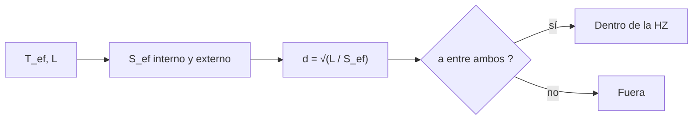

# B56-C12 — Exoplanetas potencialmente habitables

<!-- nav:top -->
[🏠 Programa](../../../../README.md) · [📚 Bloque B56](../../../tronco-comun/B56-astrobiologia-y-vida-extraterrestre.md) · [← Anterior: B56-C11 — Atmósfera y superficie de Titán](../B56-C11-atmosfera-y-superficie-de-titan/CLASE.md) · [Siguiente: B56-C13 — Biofirmas químicas →](../B56-C13-biofirmas-quimicas/CLASE.md)
<!-- /nav -->

## 1. Ubicación, nivel y alcance

Clase 12 del bloque B56. Nivel N3. Tomas la ley del cuadrado inverso de la luz y las temperaturas estelares para calcular **entre qué distancias de una estrella un planeta podría tener agua líquida en superficie** según un modelo publicado. «Potencialmente habitable» significa solo que el flujo estelar cae en un rango; no que el planeta tenga atmósfera, agua o vida. Los exoplanetas como sistema se estudian en [B52](../../../tronco-comun/B52-formacion-y-dinamica-de-sistemas-planetarios.md).

## 2. Por qué esta clase existe

Elegir blancos para buscar biofirmas exige un criterio objetivo. La zona habitable lo ofrece, con limitaciones. La decisión central: **dada la temperatura efectiva y la luminosidad de una estrella, ¿entre qué distancias cae la zona habitable y está un planeta dado dentro?**

## 3. Lo que podrás hacer al terminar

1. Definir flujo estelar efectivo, zona habitable, borde interno y externo.
2. Calcular el flujo que recibe un planeta en unidades del terrestre.
3. Evaluar los límites con la parametrización polinómica de Kopparapu et al.
4. Comprobar que el modelo reproduce las cifras del resumen para el Sol.
5. Decidir si un planeta sintético está dentro de la zona habitable.
6. Nombrar por qué «dentro» no es «habitable».

La evidencia es la **ficha de habitabilidad de un exoplaneta sintético** del ejercicio 12 (sección 20).

## 4. Con qué llegas y cómo comprobarlo

1. ¿Cómo disminuye el flujo con la distancia?
2. ¿Qué es la luminosidad en unidades solares?
3. ¿Qué es un polinomio de cuarto grado?
4. ¿Qué es la temperatura efectiva?
5. ¿Qué es una unidad astronómica?

<details>
<summary>Ver respuestas</summary>

1. Como `1/d²`. 2. El cociente entre la luminosidad de la estrella y la del Sol. 3. `a₀ + a₁x + … + a₄x⁴`. 4. La temperatura de un cuerpo negro con la misma luminosidad y radio. 5. Unos `1,496 × 10¹¹ m`.
</details>

Con cuatro o cinco aciertos, sigue; si no, repasa B05-C18 y B24-C03.

## 5. Un caso real: la zona habitable del Sol

El resumen de Kopparapu et al. (2013) informa que, para el Sol, la pérdida de agua (borde interno) ocurre a `0,99 UA` y el máximo invernadero de CO₂ (borde externo) a `1,70 UA`, frente a los `0,95–1,67 UA` de estimaciones previas; el modelo cubre estrellas F, G, K y M con `2600 K ≤ T_ef ≤ 7200 K` (S1, consultado el 2026-11-09). Es el **ejemplo conductor**.

## 6. Vocabulario

El **flujo estelar efectivo** `S_ef` es el flujo recibido en unidades del terrestre. La **zona habitable** es el rango de distancias donde un planeta de tipo terrestre con atmósfera adecuada podría tener agua líquida en superficie. El **borde interno** es la pérdida de agua; el **externo**, el máximo invernadero de CO₂. La **distancia límite** es `d = √(L/S_ef)` con `L` en luminosidades solares y `d` en UA.

## 7. Modelo mental: un anillo alrededor de la estrella

La zona habitable es un anillo: demasiado cerca, el agua se pierde; demasiado lejos, el CO₂ no basta para calentar. El anillo se aleja y se hace más ancho para estrellas más luminosas.



*Descripción textual:* con la temperatura efectiva se calculan los flujos límite, con la luminosidad se obtienen las distancias, y se compara la órbita del planeta.

Analogía: sentarse cerca o lejos de una fogata. Su límite: el planeta también necesita atmósfera, masa y estabilidad.

## 8. La explicación, paso a paso

### 8.1 Parametrización

`S_ef(T_ef) = S₀ + a T* + b T*² + c T*³ + d T*⁴` con `T* = T_ef − 5780 K`. Los coeficientes de la tabla del artículo **no se consultaron** (solo el resumen): están tomados de memoria y se validan con las cifras del resumen. Los valores que no sean esas dos cifras son **ilustrativos** hasta cotejarlos con el artículo.

### 8.2 Verificación para el Sol

Con `T_ef = 5780 K` y `L = 1`: borde interno `0,993 UA`, externo `1,705 UA`. Ambos dentro de `0,01 UA` de `0,99` y `1,70`.

### 8.3 Estrellas sintéticas

Tipo G sintética (5780 K, `L = 1`): `0,993–1,705 UA`. Tipo K (4500 K, `L = 0,20`): `0,466–0,851 UA`. Tipo M (3300 K, `L = 0,0015`): `0,042–0,080 UA`. Las enanas M tienen la zona muy cerca.

### 8.4 Un planeta sintético

A `0,06 UA` de la estrella M: flujo `L/a² = 0,0015/0,0036 = 0,42 S_⊕`. Los límites a 3300 K son `0,234` (externo) y `0,863` (interno) en unidades de `S_⊕`; `0,234 < 0,42 < 0,863`: dentro.

### 8.5 Lo que «dentro» no significa

El modelo supone un planeta de una masa terrestre con atmósfera de N₂–CO₂–H₂O, sin nubes ni la rotación sincrónica de planetas cercanos a enanas M. «Dentro» significa solo que el flujo es compatible con agua líquida bajo esos supuestos.

## 9. Magnitudes, símbolos y unidades

| Símbolo | Qué es | Unidad | Valor / nota |
|---|---|---|---|
| `T_ef` | temperatura efectiva | K | 2600 a 7200 |
| `L` | luminosidad | `L☉` | 1; 0,20; 0,0015 (sintéticas) |
| `S_ef` | flujo efectivo | `S_⊕` | de 8.1 |
| `d` | distancia límite | UA | de 8.2 |
| `a` | semieje del planeta | UA | 0,06 (sintético) |

## 10. Convenciones y referencias

Flujo en unidades del terrestre; polinomio válido de 2600 a 7200 K. Estrellas y planeta **sintéticos**. Coeficientes **no consultados**.

## 11. De dónde sale lo que afirmamos

| ID | Fuente | Localizador | Respalda | Estado |
|---|---|---|---|---|
| S1 | Kopparapu et al., *Habitable Zones Around Main-Sequence Stars: New Estimates*, arXiv:1301.6674 | https://arxiv.org/abs/1301.6674 | 0,99 UA y 1,70 UA para el Sol; rango 2600–7200 K | Solo resumen, consultado el 2026-11-09 |

Límites: los coeficientes y los valores de las estrellas K y M no se verificaron contra el artículo; solo se comprobaron las dos cifras del Sol; las estrellas y el planeta son sintéticos.

## 12. Cómo ver las zonas

Equivalente accesible a un diagrama de zonas:

| Estrella (sintética) | Interno (UA) | Externo (UA) |
|---|---|---|
| G (5780 K, 1) | 0,993 | 1,705 |
| K (4500 K, 0,20) | 0,466 | 0,851 |
| M (3300 K, 0,0015) | 0,042 | 0,080 |

Descripción larga: la zona se estrecha y se acerca a la estrella al bajar la luminosidad.

## 13. Ejemplo trabajado: ¿está a 0,05 UA de la M dentro?

**Paso 1 · Datos.** `a = 0,05 UA`, `L = 0,0015`.

**Paso 2 · Flujo.** `0,0015/0,0025 = 0,60 S_⊕`.

**Paso 3 · Límites.** `0,234 < 0,60 < 0,863`.

**Paso 4 · Sentido.** Dentro. Resultado ilustrativo sobre una estrella sintética.

## 14. Distintos criterios

**Zona habitable conservadora (esta clase):** sencilla. **Zonas optimistas (Venus reciente, Marte temprano):** más amplias. **Modelos climáticos 3D:** consideran nubes y rotación. Para filtrar blancos sirve la primera.

## 15. Práctica guiada

**Ejercicio 1 · con los pasos indicados.** Calcula el flujo a 0,08 UA de la estrella M. *Pasos:* `L/a²`.

<details><summary>Solución comentada</summary>

`0,0015/0,0064 = 0,234 S_⊕`, justo en el borde externo (8.4).
</details>

**Ejercicio 2 · con una pista.** Calcula `d` con `L = 0,20` y `S_ef = 0,863`. *Pista:* `√(L/S)`.

<details><summary>Solución comentada</summary>

`√(0,20/0,863) = 0,48 UA` (cercano al borde de 8.3, `T_ef` distinta).
</details>

**Ejercicio 3 · casi autónomo.** ¿Cuánto flujo recibe un planeta a 1,5 UA del Sol?

<details><summary>Solución comentada</summary>

`1/2,25 = 0,444 S_⊕`.
</details>

## 16. Práctica autónoma, transferencia e integrador

**Ejercicio 4.** ¿Por qué las enanas M tienen la zona tan cerca?

<details><summary>Solución comentada</summary>

Porque `L` es muy baja y `d ∝ √L` (8.3).
</details>

**Ejercicio 5.** Si `L` se multiplica por 4, ¿cuánto cambia `d`?

<details><summary>Solución comentada</summary>

Se multiplica por 2.
</details>

**Ejercicio 6.** Un planeta a 0,03 UA de la M sintética: ¿flujo y veredicto?

<details><summary>Solución comentada</summary>

`0,0015/0,0009 = 1,67 S_⊕ > 0,863`: demasiado caliente, fuera.
</details>

**Ejercicio 7.** ¿Qué verificó el laboratorio y qué no?

<details><summary>Solución comentada</summary>

Que el Sol reproduce 0,99 y 1,70 UA; no se verificó nada para otras estrellas (11).
</details>

**Ejercicio 8.** ¿Qué es el borde interno según el modelo?

<details><summary>Solución comentada</summary>

La pérdida de agua (8.1, sección 5).
</details>

**Ejercicio 9 · transferencia.** Un titular dice: «hallan un planeta en la zona habitable, luego es habitable». Respóndele.

<details><summary>Solución comentada</summary>

«Dentro» solo indica flujo compatible; falta atmósfera, masa, agua y estabilidad (8.5).
</details>

**Ejercicio 10 · transferencia.** ¿Qué observación necesitarías para saber si tiene atmósfera?

<details><summary>Solución comentada</summary>

Espectroscopía de tránsito o emisión (C14).
</details>

**Ejercicio 11 · transferencia.** Un artículo da otros coeficientes. ¿Qué haces?

<details><summary>Solución comentada</summary>

Compararlos con los del artículo original y rehacer la verificación; los de esta clase no están contrastados con la tabla.
</details>

**Ejercicio 12 · integrador.** Elabora tu *ficha de habitabilidad de un exoplaneta sintético*: elige `T_ef`, `L` y `a` (sintéticos), calcula los bordes y el flujo, decide si está dentro y lista tres factores que el modelo ignora.

<details><summary>Solución modelo</summary>

Con 4500 K, `L = 0,20`, `a = 0,6 UA`: bordes `0,466–0,851`; dentro. Ignora nubes, rotación sincrónica y composición. Rotulado como sintético.
</details>

## 17. Laboratorio: zona habitable

El script [zona_habitable.py](zona_habitable.py) evalúa los polinomios, **comprueba** que el Sol reproduce `0,99` y `1,70 UA` (± 0,01) y que `interno < externo`, y decide el caso del planeta sintético.

**Datos:** coeficientes no consultados; estrellas sintéticas. **Predice antes de ejecutar:** ¿qué tan ancha es la zona de la M sintética? (unas 0,04 UA.) **Ejecución del 2026-11-09 (Python 3.12.9):**

```text
Python 3.12.9 (biblioteca estandar)
Sol (T_ef = 5780 K, L = 1): borde interno 0.993 UA ; borde externo 1.705 UA
tipo G sintetica   T_ef=  5780 K L= 1.0000: HZ = 0.993 a 1.705 UA
tipo K sintetica   T_ef=  4500 K L= 0.2000: HZ = 0.466 a 0.851 UA
tipo M sintetica   T_ef=  3300 K L= 0.0015: HZ = 0.042 a 0.080 UA
Planeta sintetico a 0.06 UA de la M: flujo = 0.42 S_Tierra ; limites: 0.234 a 0.863
Pruebas superadas.
```

```bash
python programa/clases/B56/B56-C12-exoplanetas-potencialmente-habitables/zona_habitable.py
```

**Límites:** planeta de una masa terrestre; sin nubes; coeficientes sin contrastar.

## 18. Errores frecuentes y cómo corregirlos

**Confundir zona habitable con habitabilidad.** Se corrige con el ejercicio 9.

**Olvidar que `d ∝ √L`.** Se corrige con el ejercicio 5.

**Aplicar fuera de 2600–7200 K.** Se corrige con la sección 9.

**Tomar los coeficientes como verificados.** Se corrige con el ejercicio 11.

**Mezclar UA y metros.** Se corrige con la sección 10.

## 19. Cómo sabrás que vas bien

Tras 8.2: ¿sabes verificar el Sol? Ejercicio 7. Tras 8.4: ¿decides si está dentro? Ejercicios 1 y 6. Tras el laboratorio: ¿qué comprueba? (solo el caso del Sol).

## 20. Qué entregas y cómo se evalúa

El producto es tu **ficha de habitabilidad de un exoplaneta sintético** (ejercicio 12).

| Criterio | Inicial | En desarrollo | Logrado | Destacado |
|---|---|---|---|---|
| Conceptos | Los confunde | Parciales | HZ y flujo claros | Distingue «dentro» y «habitable» |
| Cálculo | Sin unidades | Con errores | Bordes y flujo correctos | Verifica con el Sol |
| Rótulos | Sin rotular | Parciales | Sintético rotulado | Declara coeficientes no consultados |
| Límites | Ninguno | Uno | Tres factores | Cuantifica su efecto |
| Fuentes | Sin fuente | Sin fecha | S1 con fecha y «solo resumen» | Propone cotejar la tabla |

**Condiciones críticas (no se compensan con promedio):** rotular los coeficientes como no consultados; no afirmar habitabilidad; citar solo lo consultado.

## 21. Ética, seguridad y límites

La clase es educativa y no afirma habitabilidad de ningún planeta real. Accesibilidad: tablas equivalentes a las gráficas, fórmulas en texto, ejercicios sin conexión.

## 22. Para cerrar y seguir

La zona habitable del Sol va de 0,99 a 1,70 UA en el modelo de Kopparapu et al., y se acerca y se estrecha para estrellas menos luminosas. Queda una pregunta: ¿cómo se detectaría vida desde lejos? Empezamos por la química de una atmósfera.

**Glosario español–inglés.** zona habitable · *habitable zone*; flujo estelar efectivo · *effective stellar flux*; pérdida de agua · *water loss*; máximo invernadero · *maximum greenhouse*; enana M · *M dwarf*.

**Continuidad.** [B56-C13](../B56-C13-biofirmas-quimicas/CLASE.md) estudia el desequilibrio químico como biofirma.

**Referencias:** ver sección 11.

<!-- nav:bottom -->
---

[← Anterior: B56-C11 — Atmósfera y superficie de Titán](../B56-C11-atmosfera-y-superficie-de-titan/CLASE.md) · [📚 Bloque B56](../../../tronco-comun/B56-astrobiologia-y-vida-extraterrestre.md) · [Siguiente: B56-C13 — Biofirmas químicas →](../B56-C13-biofirmas-quimicas/CLASE.md)
<!-- /nav -->
