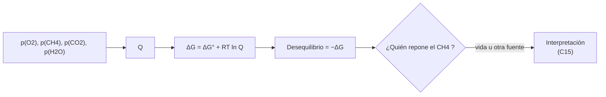

# B56-C13 — Biofirmas químicas

<!-- nav:top -->
[🏠 Programa](../../../../README.md) · [📚 Bloque B56](../../../tronco-comun/B56-astrobiologia-y-vida-extraterrestre.md) · [← Anterior: B56-C12 — Exoplanetas potencialmente habitables](../B56-C12-exoplanetas-potencialmente-habitables/CLASE.md) · [Siguiente: B56-C14 — Biofirmas espectrales →](../B56-C14-biofirmas-espectrales/CLASE.md)
<!-- /nav -->

## 1. Ubicación, nivel y alcance

Clase 13 del bloque B56. Nivel N3. Tomas la termoquímica ([B06-C12](../../B06/B06-C12-termoquimica-y-energia-de-reaccion/CLASE.md)) y el equilibrio ([B06-C13](../../B06/B06-C13-equilibrio-quimico/CLASE.md)) para medir **cuán lejos del equilibrio químico está una atmósfera**, una de las ideas con que se propone reconocer vida a distancia. Es solo la parte química; las firmas en el espectro se ven en [C14](../B56-C14-biofirmas-espectrales/CLASE.md) y los falsos positivos en [C15](../B56-C15-falsos-positivos-de-biofirmas/CLASE.md).

## 2. Por qué esta clase existe

Una biosfera mantiene en la atmósfera gases que reaccionarían entre sí (como oxígeno y metano) y por eso la composición se aleja del equilibrio. La decisión central: **dadas las presiones parciales, ¿cuánta energía libre por mol de CH₄ hay en el desequilibrio CH₄–O₂?**

## 3. Lo que podrás hacer al terminar

1. Definir biofirma, desequilibrio químico y energía libre disponible.
2. Calcular `ΔG` de `CH₄ + 2 O₂ → CO₂ + 2 H₂O(g)` con presiones parciales.
3. Hallar la presión de CH₄ de equilibrio con logaritmos.
4. Comparar dos atmósferas (una sintética «tipo Tierra» y una con composición de Marte).
5. Explicar por qué un gran desequilibrio no demuestra vida.
6. Nombrar qué deja fuera el cálculo.

La evidencia es la **medida de desequilibrio de una atmósfera** del ejercicio 12 (sección 20).

## 4. Con qué llegas y cómo comprobarlo

1. ¿Qué dice `ΔG = ΔG° + RT ln Q`?
2. ¿Qué son las presiones parciales?
3. ¿Qué es `log₁₀ 10⁻¹⁴⁶`?
4. ¿Qué es la fracción molar?
5. ¿Qué significa equilibrio químico?

<details>
<summary>Ver respuestas</summary>

1. La energía libre depende de las concentraciones. 2. La presión que ejercería cada gas solo. 3. `−146`. 4. Moles de un gas entre moles totales. 5. Un estado donde `ΔG = 0` y no hay cambio neto.
</details>

Con cuatro o cinco aciertos, sigue; si no, repasa B06-C13 y [C07](../B56-C07-energia-quimica-para-la-vida/CLASE.md).

## 5. Un caso real: el par oxígeno–metano

El marco de Schwieterman et al. (2018) revisa las biofirmas remotamente detectables, incluidas las gaseosas y los métodos para detectar desequilibrio químico a distancia (S1, solo resumen, consultado el 2026-11-09). Tomamos el par `CH₄ + O₂` como **ejemplo conductor**: en una atmósfera sintética «tipo Tierra» (`p(O₂) = 0,21`, `p(CH₄) = 1,8 × 10⁻⁶`, `p(CO₂) = 4,2 × 10⁻⁴`, `p(H₂O) = 10⁻²` bar) los gases coexisten fuera de equilibrio. Las cifras son **sintéticas**, no una medición.

## 6. Vocabulario

Una **biofirma** es una señal que sugiere vida pasada o presente. Un **gas de desequilibrio** es uno que reaccionaría con otro presente. El **desequilibrio químico** es la distancia de una mezcla a su equilibrio, que se mide con `−ΔG`. La **presión de equilibrio** es la presión del reactivo agotable que daría `ΔG = 0`. Un **falso positivo** es una señal que parece biofirma pero tiene origen sin vida.

## 7. Modelo mental: una cuesta que no se baja sola

Una mezcla de O₂ y CH₄ está en la cima de una cuesta; la reacción la haría descender, pero algo vuelve a subirla (la vida, en la hipótesis). La energía de esa cuesta se mide con `ΔG`.



*Descripción textual:* se calcula `Q`, luego `ΔG`; la magnitud del desequilibrio exige explicar quién repone el gas que la reacción consumiría.

Analogía: un lago en la montaña con un arroyo que lo rellena. Su límite: otro arroyo podría ser un volcán, no vida.

## 8. La explicación, paso a paso

### 8.1 Reacción y energía estándar

`CH₄ + 2 O₂ → CO₂ + 2 H₂O(g)`. Con `ΔG_f°` de CH₄ (−50,72), CO₂ (−394,36) y H₂O(g) (−228,57) kJ/mol (**ilustrativos, no consultados**): `ΔG° = −800,78 kJ/mol` y `log₁₀ K = 140,3`.

### 8.2 Atmósfera sintética tipo Tierra

`Q = p(CO₂)p(H₂O)²/(p(CH₄)p(O₂)²) = 0,53`; `ΔG = −802,4 kJ/mol de CH₄`. En equilibrio con ese O₂, el CH₄ sería `10^{−146,3} bar`: la diferencia es de unos 140 órdenes de magnitud.

### 8.3 Composición de Marte

Con la composición de la hoja de datos de la NASA (95,1 % CO₂, 0,16 % O₂, 210 ppm H₂O, presión 636 Pa; S2) y un CH₄ **sintético** de fracción molar `10⁻⁹`: `ΔG = −759,6 kJ/mol` y `log₁₀ p_eq(CH₄) = −144,3`. Que el número sea negativo y grande refleja sobre todo `ΔG°`, no un hallazgo.

### 8.4 Verificación

Al poner CH₄ en su presión de equilibrio (`10^{−146,3}`, representable en coma flotante), `ΔG` vale `−1,1 × 10⁻¹³ kJ/mol` (cero numérico). Con todas las presiones a 1 bar, `Q = 1` y `ΔG = ΔG°`.

### 8.5 Lo que el cálculo deja fuera

La cinética (muchas mezclas desequilibradas persisten por falta de catalizador), las fotorreacciones y las fuentes sin vida (volcanes). Un desequilibrio grande sugiere un proceso que repone el gas; no dice cuál.

## 9. Magnitudes, símbolos y unidades

| Símbolo | Qué es | Unidad | Valor / nota |
|---|---|---|---|
| `R` | constante molar de los gases | `J mol⁻¹ K⁻¹` | `8,314 462 618` (S3) |
| `ΔG°` | energía libre estándar | `kJ mol⁻¹` | `−800,78` (ilustrativa) |
| `p_i` | presiones parciales | bar | sintéticas |
| `ΔG` | energía libre de la mezcla | `kJ mol⁻¹` | −802,4 (tipo Tierra) |
| `p_eq(CH₄)` | presión de equilibrio | bar | `10^{−146,3}` |

## 10. Convenciones y referencias

298,15 K; gas ideal; presiones en bar. Valores de tabla **no consultados**; atmósfera «tipo Tierra» y CH₄ de Marte **sintéticos**; la composición de Marte (salvo el CH₄) es de S2.

## 11. De dónde sale lo que afirmamos

| ID | Fuente | Localizador | Respalda | Estado |
|---|---|---|---|---|
| S1 | Schwieterman et al., *Exoplanet Biosignatures: A Review of Remotely Detectable Signs of Life*, Astrobiology 18(6), arXiv:1705.05791 | https://arxiv.org/abs/1705.05791 | Existen biofirmas gaseosas y métodos para detectar desequilibrio químico remotamente | Solo resumen, consultado el 2026-11-09 |
| S2 | NASA/NSSDC, *Mars Fact Sheet* | https://nssdc.gsfc.nasa.gov/planetary/factsheet/marsfact.html | Composición y presión de Marte | Consultada el 2026-11-09 |
| S3 | NIST, *Fundamental Physical Constants — Complete Listing* (CODATA 2022) | https://physics.nist.gov/cuu/Constants/Table/allascii.txt | `R` | Consultada el 2026-11-09 |

Límites: de S1 solo el resumen; las energías de formación no se consultaron; el CH₄ de Marte es sintético y no se afirma nada sobre metano real.

## 12. Cómo ver el desequilibrio

Equivalente accesible a una comparación:

| Atmósfera | `ΔG` (kJ/mol CH₄) | `log₁₀ p_eq(CH₄)` |
|---|---|---|
| Sintética tipo Tierra | −802,4 | −146,3 |
| Marte (CH₄ sintético) | −759,6 | −144,3 |

Descripción larga: ambas están a unos 140 órdenes de magnitud del equilibrio para el CH₄; la medida distingue poco entre ellas.

## 13. Ejemplo trabajado: `ΔG` con `p(CH₄) = 10⁻⁸ bar`

**Paso 1 · Datos.** `p(O₂) = 0,21`, `p(CO₂) = 4,2 × 10⁻⁴`, `p(H₂O) = 10⁻²`, `p(CH₄) = 10⁻⁸` (sintéticos).

**Paso 2 · `Q`.** `4,2 × 10⁻⁴ × 10⁻⁴/(10⁻⁸ × 0,0441) = 95,2`.

**Paso 3 · `ΔG`.** `RT ln Q = 2,479 × 4,556 = 11,3 kJ/mol`; `ΔG = −789,5 kJ/mol`.

**Paso 4 · Sentido.** Cambiar el CH₄ cien veces apenas altera `ΔG`; el desequilibrio dominante es `ΔG°`. Por eso esta medida sola discrimina poco.

## 14. Distintos enfoques

**`ΔG` del par (esta clase):** simple. **Energía libre total de la mezcla (minimización de Gibbs):** más completa. **Modelos fotoquímicos:** incluyen vida útil. Para una introducción sirve el primero.

## 15. Práctica guiada

**Ejercicio 1 · con los pasos indicados.** Calcula `ΔG°`. *Pasos:* productos menos reactivos.

<details><summary>Solución comentada</summary>

`−394,36 + 2(−228,57) − (−50,72) = −800,78 kJ/mol` (8.1).
</details>

**Ejercicio 2 · con una pista.** Calcula `Q` si todas las presiones valen 1. *Pista:* `1^n`.

<details><summary>Solución comentada</summary>

`Q = 1`; `ΔG = ΔG°`.
</details>

**Ejercicio 3 · casi autónomo.** Calcula `log₁₀ K`.

<details><summary>Solución comentada</summary>

`800 780/(8,3145 × 298,15 × 2,3026) = 140,3` (8.1).
</details>

## 16. Práctica autónoma, transferencia e integrador

**Ejercicio 4.** ¿Por qué se trabaja con logaritmos?

<details><summary>Solución comentada</summary>

Porque `10^{−146}` desborda ciertos cálculos intermedios y porque las magnitudes abarcan muchos órdenes (8.4).
</details>

**Ejercicio 5.** Si `p(O₂)` baja diez veces, ¿cómo cambia `ΔG`?

<details><summary>Solución comentada</summary>

`Q` sube 100 veces y `ΔG` sube `RT ln 100 = 11,4 kJ/mol`.
</details>

**Ejercicio 6.** Calcula `ΔG` en el ejemplo 13 si `p(CH₄) = 10⁻¹⁰`.

<details><summary>Solución comentada</summary>

`Q = 9520`; `RT ln Q = 22,7`; `ΔG = −778,1 kJ/mol`.
</details>

**Ejercicio 7.** ¿Qué indica `p_eq = 10^{−146}`?

<details><summary>Solución comentada</summary>

Que en equilibrio el CH₄ prácticamente no existiría; que exista implica una fuente que lo repone (8.5).
</details>

**Ejercicio 8.** ¿Cuál es la limitación principal de usar solo `ΔG`?

<details><summary>Solución comentada</summary>

Ignora la cinética: la reacción puede no ocurrir aunque sea favorable (8.5).
</details>

**Ejercicio 9 · transferencia.** Un titular dice: «detectan CH₄ y O₂, luego hay vida». Respóndele.

<details><summary>Solución comentada</summary>

Un desequilibrio exige explicar la fuente; hay procesos sin vida que producen ambos gases. Se discute en [C15](../B56-C15-falsos-positivos-de-biofirmas/CLASE.md) y en el marco de Meadows et al.

</details>

**Ejercicio 10 · transferencia.** ¿Qué observación distinguiría una fuente volcánica?

<details><summary>Solución comentada</summary>

Otros gases asociados (por ejemplo SO₂) y el contexto geológico; la clase no los calcula.
</details>

**Ejercicio 11 · transferencia.** ¿Por qué la atmósfera de Marte con un CH₄ sintético no prueba nada?

<details><summary>Solución comentada</summary>

Porque el CH₄ lo elegimos nosotros; el ejercicio muestra el método, no una medición (10).
</details>

**Ejercicio 12 · integrador.** Elabora tu *medida de desequilibrio*: elige una atmósfera sintética de cuatro presiones parciales, calcula `Q`, `ΔG` y `p_eq(CH₄)`, y di qué mediciones adicionales necesitarías para interpretarla.

<details><summary>Solución modelo</summary>

Con las del ejemplo 13: `ΔG = −789,5`, `p_eq = 10^{−146,3}`. Faltan cinética, fuentes volcánicas y fotoquímica. Rotulado como sintético.
</details>

## 17. Laboratorio: desequilibrio CH₄–O₂

El script [desequilibrio_quimico.py](desequilibrio_quimico.py) calcula `ΔG`, la presión de equilibrio en logaritmos y **comprueba** que `ΔG = 0` en el equilibrio (`10⁻⁶`) y `ΔG = ΔG°` a 1 bar.

**Datos:** `R` de NIST; Marte de la hoja de la NASA; el resto, ilustrativo o sintético. **Predice antes de ejecutar:** ¿qué signo tiene `ΔG`? (negativo.) **Ejecución del 2026-11-09 (Python 3.12.9):**

```text
Python 3.12.9 (biblioteca estandar)
Delta G0 = -800.78 kJ/mol ; log10 K = 140.3
sintetica tipo Tierra              Delta G =   -802.36 kJ/mol de CH4 ; log10 p(CH4) equilibrio =   -146.3
Marte (hoja NASA; CH4 sintetico)   Delta G =   -759.60 kJ/mol de CH4 ; log10 p(CH4) equilibrio =   -144.3
Delta G con CH4 en equilibrio = -1.14e-13 kJ/mol
Pruebas superadas.
```

```bash
python programa/clases/B56/B56-C13-biofirmas-quimicas/desequilibrio_quimico.py
```

**Límites:** reacción única, gas ideal, sin cinética; el cálculo no detecta vida.

## 18. Errores frecuentes y cómo corregirlos

**Tomar el desequilibrio como prueba de vida.** Se corrige con el ejercicio 9.

**Olvidar la cinética.** Se corrige con el ejercicio 8.

**Usar pascales en vez de bar.** Se corrige con la sección 10.

**Creer que el CH₄ de Marte es un dato.** Se corrige con el ejercicio 11.

**Calcular sin logaritmos.** Se corrige con el ejercicio 4.

## 19. Cómo sabrás que vas bien

Tras 8.1: ¿sabes calcular `ΔG°`? Ejercicio 1. Tras 8.2: ¿qué mide `p_eq`? Ejercicio 7. Tras el laboratorio: ¿qué prueba el cero numérico? (la consistencia de `K` y `Q`).

## 20. Qué entregas y cómo se evalúa

El producto es tu **medida de desequilibrio** (ejercicio 12).

| Criterio | Inicial | En desarrollo | Logrado | Destacado |
|---|---|---|---|---|
| Conceptos | Los confunde | Parciales | Biofirma y desequilibrio claros | Discute cinética |
| Cálculo | Sin unidades | Con errores | `Q`, `ΔG`, `p_eq` correctos | Con logaritmos |
| Interpretación | Concluye vida | Sin razón | Pide la fuente | Cita falsos positivos |
| Rótulos | Sin rotular | Parciales | Sintético rotulado | Declara lo no consultado |
| Fuentes | Sin fuente | Sin fecha | S1–S3 con fecha | Declara «solo resumen» |

**Condiciones críticas (no se compensan con promedio):** rotular las presiones como sintéticas; no afirmar vida a partir del desequilibrio; citar solo lo consultado.

## 21. Ética, seguridad y límites

La clase es educativa y no detecta vida. Accesibilidad: tablas equivalentes a las gráficas, fórmulas en texto, ejercicios sin conexión.

## 22. Para cerrar y seguir

El par CH₄–O₂ tiene un `ΔG` de unos −800 kJ/mol, muy lejos del equilibrio, pero esa magnitud sola no distingue entre vida y otros procesos. Queda una pregunta: ¿cómo se ve ese gas en el espectro de un planeta?

**Glosario español–inglés.** biofirma · *biosignature*; desequilibrio químico · *chemical disequilibrium*; presión parcial · *partial pressure*; falso positivo · *false positive*; energía libre · *free energy*.

**Continuidad.** [B56-C14](../B56-C14-biofirmas-espectrales/CLASE.md) calcula la señal de una atmósfera en un tránsito.

**Referencias:** ver sección 11.

<!-- nav:bottom -->
---

[← Anterior: B56-C12 — Exoplanetas potencialmente habitables](../B56-C12-exoplanetas-potencialmente-habitables/CLASE.md) · [📚 Bloque B56](../../../tronco-comun/B56-astrobiologia-y-vida-extraterrestre.md) · [Siguiente: B56-C14 — Biofirmas espectrales →](../B56-C14-biofirmas-espectrales/CLASE.md)
<!-- /nav -->
