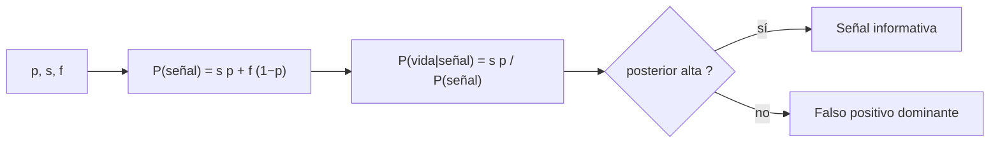

# B56-C15 — Falsos positivos de biofirmas

<!-- nav:top -->
[🏠 Programa](../../../../README.md) · [📚 Bloque B56](../../../tronco-comun/B56-astrobiologia-y-vida-extraterrestre.md) · [← Anterior: B56-C14 — Biofirmas espectrales](../B56-C14-biofirmas-espectrales/CLASE.md) · [Siguiente: B56-C16 — Tecnofirmas y búsqueda SETI →](../B56-C16-tecnofirmas-y-busqueda-seti/CLASE.md)
<!-- /nav -->

## 1. Ubicación, nivel y alcance

Clase 15 del bloque B56. Nivel N3. Tomas la probabilidad condicionada ([B12](../../../tronco-comun/B12-probabilidad-estadistica-e-incertidumbre.md)) para razonar **qué tan probable es que haya vida cuando se detecta una biofirma que también puede producirse sin vida**. Usas el teorema de Bayes con números sintéticos; no estimas ninguna probabilidad real de vida. Las firmas químicas y espectrales se vieron en [C13](../B56-C13-biofirmas-quimicas/CLASE.md) y [C14](../B56-C14-biofirmas-espectrales/CLASE.md).

## 2. Por qué esta clase existe

Una detección no es una prueba. Si la señal puede producirse por procesos sin vida, su significado depende de cuán frecuentes son. La decisión central: **dada una probabilidad previa de vida, la sensibilidad de la señal y su tasa de falsos positivos, ¿cuál es la probabilidad de vida dada la detección?**

## 3. Lo que podrás hacer al terminar

1. Definir probabilidad previa, sensibilidad, falso positivo y probabilidad posterior.
2. Aplicar el teorema de Bayes y comprobarlo con un conteo de población.
3. Calcular cómo cambian la previa y la tasa de falsos positivos el resultado.
4. Combinar dos señales independientes multiplicando las razones de probabilidades.
5. Explicar por qué una detección fuerte puede dar una posterior baja.
6. Nombrar qué supuestos de independencia pueden fallar.

La evidencia es la **tabla de probabilidad posterior** del ejercicio 12 (sección 20).

## 4. Con qué llegas y cómo comprobarlo

1. ¿Qué es `P(A|B)`?
2. ¿Qué son las razones de probabilidades (odds)?
3. ¿Qué es una fracción exacta?
4. ¿Qué es la independencia condicional?
5. ¿Qué es una tasa?

<details>
<summary>Ver respuestas</summary>

1. La probabilidad de A dado B. 2. `p/(1 − p)`. 3. Un cociente de enteros sin redondeo. 4. Dos señales independientes dado el estado del mundo. 5. Un cociente por unidad.
</details>

Con cuatro o cinco aciertos, sigue; si no, repasa B12.

## 5. Un caso real: el oxígeno como biofirma ambigua

Meadows et al. (2018) sostienen que el oxígeno atmosférico es una biofirma potencialmente fuerte pero ambigua: puede haber falsos negativos (la vida de la Tierra primitiva produjo oxígeno que no se acumuló) y falsos positivos (procesos sin vida que producen oxígeno en algunos entornos); recomiendan observaciones del contexto planetario para distinguirlos (S1, solo resumen, consultado el 2026-11-09). Los números de la clase son **sintéticos**. **Ejemplo conductor:** previa `p = 0,01`, sensibilidad `s = 0,90` y falsos positivos `f = 0,01`.

## 6. Vocabulario

La **previa** `p` es la probabilidad de vida antes de observar. La **sensibilidad** `s = P(señal | vida)`. La **tasa de falsos positivos** `f = P(señal | no vida)`. La **posterior** `P(vida | señal)`. Los **odds** son `p/(1 − p)`. La **razón de verosimilitud** es `s/f`.

## 7. Modelo mental: una red con agujeros

La señal es una red que atrapa casi toda la vida (`s`), pero también algo de lo que no es vida (`f`). Si hay mucha más «no vida» que vida, la captura estará dominada por falsos positivos.



*Descripción textual:* se calcula la probabilidad total de la señal y la fracción de ella que viene de la vida.

Analogía: un detector de humo sensible en una cocina con tostadora. Su límite: aquí las tasas son constantes y conocidas, lo que no ocurre en la realidad.

## 8. La explicación, paso a paso

### 8.1 Teorema de Bayes

`P(vida|señal) = s p/(s p + f (1 − p))`. Con el ejemplo conductor: `0,009/(0,009 + 0,0099) = 0,4762`.

### 8.2 Verificación por conteo

En una población de `10⁶` casos: 10 000 con vida y 990 000 sin ella. Señales verdaderas: 9000; falsas: 9900. Fracción: `9000/18 900 = 0,4762`. Coinciden con fracciones exactas.

### 8.3 Efecto de la previa y de `f`

Con `s = 0,90`: (`p = 0,01`, `f = 0,001`) → `0,9009`; (`p = 0,001`, `f = 0,001`) → `0,4739`; (`p = 0,001`, `f = 0,01`) → `0,0826`. Una detección sensible puede dejar la posterior baja si la previa es pequeña y `f` es grande.

### 8.4 Dos señales independientes

Con `p = 0,01`, `s = 0,90`, `f = 0,05`: la posterior tras dos señales independientes es `0,7660`. La actualización secuencial y la conjunta coinciden, y los odds posteriores son los previos por `(s/f)²`.

### 8.5 Lo que el modelo deja fuera

La independencia entre señales (el oxígeno y el ozono dependen del mismo proceso), la incertidumbre sobre `f` y sobre la previa, y el hecho de que `f` depende del contexto planetario.

## 9. Magnitudes, símbolos y unidades

| Símbolo | Qué es | Unidad | Valor / nota |
|---|---|---|---|
| `p` | previa de vida | adimensional | 0,01 (sintética) |
| `s` | sensibilidad | adimensional | 0,90 (sintética) |
| `f` | falsos positivos | adimensional | 0,01 (sintética) |
| `P(V|S)` | posterior | adimensional | 0,4762 |

## 10. Convenciones y referencias

Aritmética exacta con `Fraction`; poblaciones de `10⁶` para el conteo. **Todos los números son sintéticos**.

## 11. De dónde sale lo que afirmamos

| ID | Fuente | Localizador | Respalda | Estado |
|---|---|---|---|---|
| S1 | Meadows et al., *Exoplanet Biosignatures: Understanding Oxygen as a Biosignature in the Context of Its Environment*, arXiv:1705.07560 | https://arxiv.org/abs/1705.07560 | El oxígeno es una biofirma ambigua; hay falsos positivos y falsos negativos | Solo resumen, consultado el 2026-11-09 |
| S2 | COSPAR, *COSPAR Policy on Planetary Protection*, Space Research Today n.º 224, 2026 | https://cosparhq.cnes.fr/assets/uploads/2026/01/SRT_224_Editorial_PPP-Nov-2025.pdf | Sección 4.5: los «falsos positivos» en detección de vida y retorno de muestras | Texto completo extraído el 2026-11-09 |

Límites: no se cita ninguna probabilidad previa ni tasa de falsos positivos real; el teorema de Bayes es un resultado estándar verificado por conteo.

## 12. Cómo ver la posterior

Equivalente accesible a una tabla (`s = 0,90`):

| Previa | `f` | Posterior |
|---|---|---|
| 0,01 | 0,01 | 0,4762 |
| 0,01 | 0,001 | 0,9009 |
| 0,001 | 0,001 | 0,4739 |
| 0,001 | 0,01 | 0,0826 |

Descripción larga: la posterior sube al bajar `f` y baja al bajar la previa.

## 13. Ejemplo trabajado: previa 0,05, `s = 0,8`, `f = 0,02`

**Paso 1 · Datos.** Sintéticos.

**Paso 2 · Numerador.** `0,8 × 0,05 = 0,04`.

**Paso 3 · Denominador.** `0,04 + 0,02 × 0,95 = 0,059`.

**Paso 4 · Posterior.** `0,04/0,059 = 0,678`. Más probable que no, pero lejos de la certeza.

## 14. Distintos enfoques

**Bayes con valores puntuales (esta clase):** simple. **Bayes con distribuciones sobre `p` y `f`:** incorpora incertidumbre. **Evaluación cualitativa por escalas:** estructura la evidencia sin números. Para ilustrar sirve el primero.

## 15. Práctica guiada

**Ejercicio 1 · con los pasos indicados.** Calcula los odds de `p = 0,2`. *Pasos:* `p/(1 − p)`.

<details><summary>Solución comentada</summary>

`0,2/0,8 = 0,25`.
</details>

**Ejercicio 2 · con una pista.** Calcula la razón de verosimilitud con `s = 0,9` y `f = 0,05`. *Pista:* `s/f`.

<details><summary>Solución comentada</summary>

`18`.
</details>

**Ejercicio 3 · casi autónomo.** Calcula la posterior con `p = 0,01`, `s = 0,9`, `f = 0,05`.

<details><summary>Solución comentada</summary>

`0,009/(0,009 + 0,0495) = 0,1538`.
</details>

## 16. Práctica autónoma, transferencia e integrador

**Ejercicio 4.** Verifica el resultado del ejercicio 3 con odds.

<details><summary>Solución comentada</summary>

Odds previos `0,0101 × 18 = 0,1818`; probabilidad `0,1818/1,1818 = 0,1538` (8.4).
</details>

**Ejercicio 5.** ¿Qué `f` da posterior 0,9 con `p = 0,01` y `s = 0,9`?

<details><summary>Solución comentada</summary>

Odds posteriores `9`; `s/f = 9/0,0101 = 891`; `f = 0,00101`.
</details>

**Ejercicio 6.** ¿Cuántas señales independientes con `LR = 18` llevan los odds previos 0,0101 a superar 1?

<details><summary>Solución comentada</summary>

`0,0101 × 18² = 3,27`: dos señales bastan (8.4).
</details>

**Ejercicio 7.** ¿Qué pasa si las dos señales están correlacionadas?

<details><summary>Solución comentada</summary>

El producto sobrestima la evidencia; la posterior real es menor (8.5).
</details>

**Ejercicio 8.** ¿Por qué se usan fracciones exactas?

<details><summary>Solución comentada</summary>

Para comparar las tres vías con igualdad exacta sin error de redondeo.
</details>

**Ejercicio 9 · transferencia.** Un titular dice: «la señal tiene 90 % de sensibilidad, luego hay 90 % de probabilidad de vida». Respóndele.

<details><summary>Solución comentada</summary>

Confunde `P(señal|vida)` con `P(vida|señal)`. Con `p = 0,01`, `f = 0,01` la posterior es 0,476 (8.1).
</details>

**Ejercicio 10 · transferencia.** ¿Qué hace baja la previa en la práctica?

<details><summary>Solución comentada</summary>

No se conoce; se explora un rango. Lo importante es mostrar cómo cambia la conclusión con ella (8.3).
</details>

**Ejercicio 11 · transferencia.** ¿Cómo se reduce `f` en una observación real?

<details><summary>Solución comentada</summary>

Con observaciones del contexto planetario (S1): otras líneas que excluyan procesos sin vida.
</details>

**Ejercicio 12 · integrador.** Elabora tu *tabla de probabilidad posterior*: elige tres previas y tres `f` sintéticos con `s` fija, calcula las nueve posteriores, y señala dónde la señal es informativa y dónde no.

<details><summary>Solución modelo</summary>

Con `s = 0,9`, previas 0,1; 0,01; 0,001 y `f` 0,1; 0,01; 0,001: la posterior supera 0,9 solo cuando `f` es pequeña respecto de `p` (por ejemplo `p = 0,1`, `f = 0,01`: 0,909). Todo sintético.
</details>

## 17. Laboratorio: probabilidad posterior

El script [probabilidad_posterior.py](probabilidad_posterior.py) calcula la posterior por Bayes y por conteo de población (igualdad exacta), y la actualización con dos señales (secuencial = conjunta = odds multiplicadas).

**Datos:** sintéticos. **Predice antes de ejecutar:** ¿qué posterior da `p = f = 0,01` con `s = 0,9`? (0,476.) **Ejecución del 2026-11-09 (Python 3.12.9):**

```text
Python 3.12.9 (biblioteca estandar)
previa 0.010, sens 0.90, falsos pos 0.010 -> P(vida|senal) = 0.4762
previa 0.010, sens 0.90, falsos pos 0.001 -> P(vida|senal) = 0.9009
previa 0.001, sens 0.90, falsos pos 0.001 -> P(vida|senal) = 0.4739
previa 0.001, sens 0.90, falsos pos 0.010 -> P(vida|senal) = 0.0826
Dos senales independientes: 0.7660 (secuencial = conjunta = odds multiplicadas)
Pruebas superadas.
```

```bash
python programa/clases/B56/B56-C15-falsos-positivos-de-biofirmas/probabilidad_posterior.py
```

**Límites:** independencia, tasas constantes, números sintéticos.

## 18. Errores frecuentes y cómo corregirlos

**Confundir `P(señal|vida)` con `P(vida|señal)`.** Se corrige con el ejercicio 9.

**Ignorar la previa.** Se corrige con la sección 8.3.

**Multiplicar señales dependientes.** Se corrige con el ejercicio 7.

**Tomar números sintéticos como estimaciones.** Se corrige con la sección 10.

**Olvidar que `f` depende del contexto.** Se corrige con el ejercicio 11.

## 19. Cómo sabrás que vas bien

Tras 8.1: ¿calculas una posterior? Ejercicio 3. Tras 8.4: ¿combinas dos señales? Ejercicios 4 y 6. Tras el laboratorio: ¿qué prueba el conteo? (que Bayes es consistente).

## 20. Qué entregas y cómo se evalúa

El producto es tu **tabla de probabilidad posterior** (ejercicio 12).

| Criterio | Inicial | En desarrollo | Logrado | Destacado |
|---|---|---|---|---|
| Conceptos | Los confunde | Parciales | Previa, `s`, `f` claros | Distingue los dos condicionales |
| Cálculo | Con errores | Una vía | Bayes y conteo | Con odds |
| Interpretación | Sin lectura | Parcial | Dónde es informativa | Cuestiona independencia |
| Rótulos | Sin rotular | Parciales | Sintético rotulado | No presenta como estimación |
| Fuentes | Sin fuente | Sin fecha | S1–S2 con fecha | Declara «solo resumen» |

**Condiciones críticas (no se compensan con promedio):** rotular todo como sintético; no concluir una probabilidad real de vida; citar solo lo consultado.

## 21. Ética, seguridad y límites

La clase es educativa y no estima la probabilidad de vida en ningún mundo. Accesibilidad: tablas equivalentes a las gráficas, fórmulas en texto, ejercicios sin conexión.

## 22. Para cerrar y seguir

Una biofirma sensible puede dar una posterior baja si hay muchos falsos positivos o la previa es pequeña; reducir `f` con el contexto planetario es lo que hace informativa a una señal. Queda una pregunta: ¿y si la señal viniera de tecnología?

**Glosario español–inglés.** probabilidad previa · *prior probability*; probabilidad posterior · *posterior probability*; falso positivo · *false positive*; sensibilidad · *sensitivity*; razón de verosimilitud · *likelihood ratio*.

**Continuidad.** [B56-C16](../B56-C16-tecnofirmas-y-busqueda-seti/CLASE.md) trata las tecnofirmas y la búsqueda SETI.

**Referencias:** ver sección 11.

<!-- nav:bottom -->
---

[← Anterior: B56-C14 — Biofirmas espectrales](../B56-C14-biofirmas-espectrales/CLASE.md) · [📚 Bloque B56](../../../tronco-comun/B56-astrobiologia-y-vida-extraterrestre.md) · [Siguiente: B56-C16 — Tecnofirmas y búsqueda SETI →](../B56-C16-tecnofirmas-y-busqueda-seti/CLASE.md)
<!-- /nav -->
