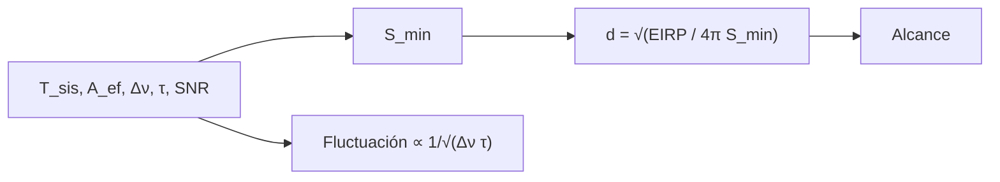

# B56-C16 — Tecnofirmas y búsqueda SETI

<!-- nav:top -->
[🏠 Programa](../../../../README.md) · [📚 Bloque B56](../../../tronco-comun/B56-astrobiologia-y-vida-extraterrestre.md) · [← Anterior: B56-C15 — Falsos positivos de biofirmas](../B56-C15-falsos-positivos-de-biofirmas/CLASE.md) · [Siguiente: B56-C17 — Control de contaminación biológica →](../B56-C17-control-de-contaminacion-biologica/CLASE.md)
<!-- /nav -->

## 1. Ubicación, nivel y alcance

Clase 16 del bloque B56. Nivel N3. Tomas el ruido y las unidades de radio ([B49](../../../tronco-comun/B49-antenas-y-receptores-de-radioastronomia.md)) y la ley de Wien ([B05-C18](../../B05/B05-C18-electromagnetismo-y-radiacion/CLASE.md)) para estimar **la sensibilidad de una búsqueda de radio de banda estrecha y el pico de emisión de un calor residual**. Una **tecnofirma** es una señal de tecnología. No estimas la probabilidad de que existan civilizaciones ni usas datos de ninguna búsqueda.

## 2. Por qué esta clase existe

Buscar tecnología exige saber qué flujo mínimo detecta un receptor y qué potencia debería tener un transmisor a una distancia dada. La decisión central: **dados la temperatura del sistema, el área efectiva, el ancho de banda y el tiempo de integración, ¿qué flujo mínimo se detecta y hasta qué distancia llega un transmisor dado?**

## 3. Lo que podrás hacer al terminar

1. Definir tecnofirma, EIRP, flujo mínimo detectable y ecuación del radiómetro.
2. Calcular `S_min = SNR (2kT/A_ef) √(Δν/(n_pol τ))`.
3. Calcular el alcance `d = √(EIRP/(4π S_min))`.
4. Comprobar la ley `1/√(Δν τ)` con una simulación.
5. Calcular el pico de Wien de un calor residual a 300 K resolviendo la ecuación trascendente.
6. Nombrar qué deja fuera el modelo.

La evidencia es la **ficha de alcance de una búsqueda** del ejercicio 12 (sección 20).

## 4. Con qué llegas y cómo comprobarlo

1. ¿Qué es la temperatura de sistema?
2. ¿Qué es el área efectiva?
3. ¿Qué es el ruido térmico `kTΔν`?
4. ¿Qué es la ley del cuadrado inverso?
5. ¿Qué es una bisección?

<details>
<summary>Ver respuestas</summary>

1. La temperatura equivalente del ruido del receptor. 2. El área de la antena que capta la señal. 3. La potencia de ruido en un ancho de banda. 4. El flujo cae como `1/d²`. 5. Un método para hallar raíces.
</details>

Con cuatro o cinco aciertos, sigue; si no, repasa B49 y B05-C18.

## 5. Un caso real: dos tipos de búsqueda

El resumen de Wright et al. (2014) describe una búsqueda de civilizaciones con grandes suministros de energía por su calor residual en el infrarrojo medio con datos de WISE y Spitzer; identifica el polvo como principal fuente de falsos positivos y un primer resultado nulo para civilizaciones de tipo III de Kardashev (S1, solo resumen, consultado el 2026-11-09). El **ejemplo conductor sintético** es un receptor de radio con `T_sis = 25 K`, `A_ef = 5000 m²`, `Δν = 1 Hz`, `τ = 100 s`, dos polarizaciones y `SNR = 10`, frente a un transmisor de `EIRP = 2 × 10¹³ W`. Ningún valor es de un instrumento real.

## 6. Vocabulario

Una **tecnofirma** es una señal que indicaría tecnología. La **EIRP** es la potencia isotrópica equivalente radiada. El **flujo mínimo detectable** es la menor densidad de flujo que supera el umbral de SNR. La **ecuación del radiómetro** dice que la fluctuación relativa del ruido promediado es `1/√(Δν τ)`. Una **señal de banda estrecha** ocupa un ancho muy pequeño. El **calor residual** es energía reemitida en el infrarrojo.

## 7. Modelo mental: oír una voz entre estática

La estática tiene fluctuaciones; promediar más tiempo o más ancho de banda las reduce como la raíz de su producto. Una voz es detectable si supera esas fluctuaciones.



*Descripción textual:* de los parámetros del receptor se obtiene el flujo mínimo, del que se deriva el alcance para un transmisor dado.

Analogía: una linterna que se ve a cierta distancia en la niebla. Su límite: el ruido del cielo y la interferencia no son blancos.

## 8. La explicación, paso a paso

### 8.1 Flujo mínimo

`S_min = SNR (2kT_sis/A_ef) √(Δν/(n_pol τ))`. Con los valores del ejemplo: `S_min = 9,76 × 10⁻²⁶ W/m²`. (`k` de NIST, S2.)

### 8.2 Alcance

`d = √(EIRP/(4π S_min)) = 4,04 × 10¹⁸ m ≈ 131 pc` (con `1 pc = 3,0857 × 10¹⁶ m`, valor ilustrativo).

### 8.3 Integrar más

Con 4 veces más tiempo de integración, `S_min` baja a la mitad (el laboratorio lo verifica exactamente).

### 8.4 Radiómetro por simulación

La fluctuación relativa de la potencia media de `N` muestras de ruido (semilla 99) da `1,014` para `N = 1` y `0,254` para `N = 16`; el cociente es `3,98` (esperado 4, tolerancia 3 %).

### 8.5 Calor residual

La longitud de onda del pico de Wien es `λ = hc/(x kT)` con `x` solución de `x = 5(1 − e^{−x})`, que da `x = 4,965114`. Para `T = 300 K`: `λ = 9,66 μm`. Es el orden de magnitud de las búsquedas en el infrarrojo medio; no se afirma que ninguna civilización exista.

## 9. Magnitudes, símbolos y unidades

| Símbolo | Qué es | Unidad | Valor / nota |
|---|---|---|---|
| `k` | constante de Boltzmann | `J K⁻¹` | `1,380 649 × 10⁻²³` (S2) |
| `h`, `c` | Planck, velocidad de la luz | — | NIST (S2) |
| `T_sis`, `A_ef` | temperatura de sistema, área | K; m² | 25; 5000 (sintéticos) |
| `Δν`, `τ` | ancho de banda, integración | Hz; s | 1; 100 (sintéticos) |
| `S_min` | flujo mínimo | W/m² | `9,76 × 10⁻²⁶` |
| `d` | alcance | m; pc | `4,04 × 10¹⁸`; 131 |

## 10. Convenciones y referencias

Ruido blanco, dos polarizaciones, señal en un canal. EIRP y receptor **sintéticos**. El valor del parsec es estándar ilustrativo.

## 11. De dónde sale lo que afirmamos

| ID | Fuente | Localizador | Respalda | Estado |
|---|---|---|---|---|
| S1 | Wright et al., *The Ĝ Infrared Search for Extraterrestrial Civilizations with Large Energy Supplies. II.*, arXiv:1408.1134 | https://arxiv.org/abs/1408.1134 | Búsqueda de calor residual con WISE/Spitzer; el polvo es fuente principal de falsos positivos; primer resultado nulo para tipo III | Solo resumen, consultado el 2026-11-09 |
| S2 | NIST, *Fundamental Physical Constants — Complete Listing* (CODATA 2022) | https://physics.nist.gov/cuu/Constants/Table/allascii.txt | `k`, `h`, `c` | Consultada el 2026-11-09 |

Límites: de S1 solo el resumen; la ecuación del radiómetro es un resultado estándar verificado por simulación; no se consultó ningún artículo sobre búsquedas de radio; no se citan resultados de SETI de radio.

## 12. Cómo ver el alcance

Equivalente accesible a una tabla:

| Integración `τ` (s) | `S_min` (W/m²) |
|---|---|
| 100 | `9,76 × 10⁻²⁶` |
| 400 | `4,88 × 10⁻²⁶` |

Descripción larga: cuadruplicar el tiempo reduce el flujo mínimo a la mitad, y el alcance aumenta por `√2`.

## 13. Ejemplo trabajado: alcance con integración de 400 s

**Paso 1 · Datos.** `S_min = 4,88 × 10⁻²⁶ W/m²`, `EIRP = 2 × 10¹³ W`.

**Paso 2 · Alcance.** `d = √(2 × 10¹³/(4π × 4,88 × 10⁻²⁶)) = √(3,26 × 10³⁷) = 5,7 × 10¹⁸ m`.

**Paso 3 · Parsecs.** `185 pc`.

**Paso 4 · Sentido.** Un 41 % más alcance por 4 veces más tiempo. Resultado sintético.

## 14. Distintos enfoques

**Radiómetro con ruido blanco (esta clase):** simple. **Búsqueda con sensibilidad dependiente de la frecuencia:** más realista. **Búsquedas en infrarrojo (calor residual):** otro tipo de tecnofirma. Para una ficha sirve la primera.

## 15. Práctica guiada

**Ejercicio 1 · con los pasos indicados.** Calcula `2kT` para 25 K. *Pasos:* `2 × 1,380 649 × 10⁻²³ × 25`.

<details><summary>Solución comentada</summary>

`6,903 × 10⁻²² J`.
</details>

**Ejercicio 2 · con una pista.** Calcula `√(Δν/(n_pol τ))`. *Pista:* `1/200`.

<details><summary>Solución comentada</summary>

`√(1/200) = 0,0707`.
</details>

**Ejercicio 3 · casi autónomo.** Calcula `S_min` para SNR 10.

<details><summary>Solución comentada</summary>

`10 × 6,903 × 10⁻²² × 0,0707/5000 = 9,76 × 10⁻²⁶ W/m²` (8.1).
</details>

## 16. Práctica autónoma, transferencia e integrador

**Ejercicio 4.** ¿Cómo cambia `S_min` con `Δν = 4 Hz`?

<details><summary>Solución comentada</summary>

Se duplica (`√4`): `1,95 × 10⁻²⁵`.
</details>

**Ejercicio 5.** ¿Qué EIRP haría falta a 10 pc?

<details><summary>Solución comentada</summary>

`4π d² S = 4π (3,0857 × 10¹⁷)² × 9,76 × 10⁻²⁶ = 1,17 × 10¹¹ W`.
</details>

**Ejercicio 6.** Calcula `λ` del pico de Wien a 600 K.

<details><summary>Solución comentada</summary>

`9,66 × 300/600 = 4,83 μm`.
</details>

**Ejercicio 7.** ¿Por qué el polvo es una fuente de falsos positivos en el infrarrojo?

<details><summary>Solución comentada</summary>

Porque el polvo calentado también emite a esas longitudes de onda (S1).
</details>

**Ejercicio 8.** ¿Qué fluctuación esperarías con `N = 100`?

<details><summary>Solución comentada</summary>

`1/√100 = 0,1`.
</details>

**Ejercicio 9 · transferencia.** Un titular dice: «el silencio de la búsqueda prueba que estamos solos». Respóndele.

<details><summary>Solución comentada</summary>

Un resultado nulo solo acota lo que el receptor podía detectar: con estos parámetros, EIRP de `2 × 10¹³ W` hasta unos 131 pc, y solo en un canal y dirección.
</details>

**Ejercicio 10 · transferencia.** ¿Qué hace una interferencia terrestre?

<details><summary>Solución comentada</summary>

Genera falsos positivos; una detección candidata debe verificarse con observaciones independientes.
</details>

**Ejercicio 11 · transferencia.** ¿Cómo se relaciona esta clase con C15?

<details><summary>Solución comentada</summary>

Una señal candidata necesita su propia tasa de falsos positivos; el razonamiento bayesiano es el mismo.
</details>

**Ejercicio 12 · integrador.** Elabora tu *ficha de alcance de una búsqueda*: elige `T_sis`, `A_ef`, `Δν`, `τ` y SNR (sintéticos), calcula `S_min`, el alcance para una EIRP elegida y lista tres supuestos.

<details><summary>Solución modelo</summary>

Con los del ejemplo: `S_min = 9,76 × 10⁻²⁶`, alcance 131 pc. Supuestos: ruido blanco, un canal, sin interferencia. Rotulado como sintético.
</details>

## 17. Laboratorio: sensibilidad de una búsqueda

El script [alcance_de_busqueda.py](alcance_de_busqueda.py) calcula `S_min`, el alcance, la ley del radiómetro por simulación (3 %) y `x` de Wien por bisección (`10⁻⁵`).

**Datos:** `k`, `h`, `c` de NIST; receptor y transmisor sintéticos. **Predice antes de ejecutar:** ¿qué cociente de fluctuaciones da N = 1 frente a N = 16? (4.) **Ejecución del 2026-11-09 (Python 3.12.9):**

```text
Python 3.12.9 (biblioteca estandar)
S_min = 9.76e-26 W/m2 ; alcance para EIRP 2e13 W = 4.04e+18 m = 131 pc
Fluctuacion relativa de la potencia media: N=1 -> 1.014 ; N=16 -> 0.254 ; cociente = 3.98 (esperado 4)
x de Wien = 4.965114 ; pico a 300 K en lambda = 9.66 micras
Pruebas superadas.
```

```bash
python programa/clases/B56/B56-C16-tecnofirmas-y-busqueda-seti/alcance_de_busqueda.py
```

**Límites:** ruido blanco, sin interferencia ni dispersión; no describe ninguna búsqueda real.

## 18. Errores frecuentes y cómo corregirlos

**Confundir EIRP y potencia del transmisor.** Se corrige con el vocabulario.

**Olvidar las dos polarizaciones.** Se corrige con el ejercicio 2.

**Concluir «estamos solos» de un resultado nulo.** Se corrige con el ejercicio 9.

**Ignorar interferencias.** Se corrige con el ejercicio 10.

**Presentar el receptor como real.** Se corrige con la sección 10.

## 19. Cómo sabrás que vas bien

Tras 8.1: ¿calculas `S_min`? Ejercicio 3. Tras 8.2: ¿el alcance? Ejercicio 5. Tras el laboratorio: ¿qué prueba la simulación? (la ley del radiómetro).

## 20. Qué entregas y cómo se evalúa

El producto es tu **ficha de alcance de una búsqueda** (ejercicio 12).

| Criterio | Inicial | En desarrollo | Logrado | Destacado |
|---|---|---|---|---|
| Conceptos | Los confunde | Parciales | EIRP, `S_min`, radiómetro claros | Discute falsos positivos |
| Cálculo | Sin unidades | Con errores | `S_min` y alcance correctos | Con simulación |
| Interpretación | Concluye sin límites | Parcial | Acota lo detectable | Relaciona con C15 |
| Rótulos | Sin rotular | Parciales | Sintético rotulado | No habla de civilizaciones reales |
| Fuentes | Sin fuente | Sin fecha | S1–S2 con fecha | Declara «solo resumen» |

**Condiciones críticas (no se compensan con promedio):** rotular el receptor y el transmisor como sintéticos; no concluir sobre la existencia de civilizaciones; citar solo lo consultado.

## 21. Ética, seguridad y límites

La clase es educativa; no transmite señales ni propone mensajes. La comunicación de una detección se trata en [C19](../B56-C19-etica-del-descubrimiento-de-vida/CLASE.md). Accesibilidad: tablas equivalentes a las gráficas, fórmulas en texto, ejercicios sin conexión.

## 22. Para cerrar y seguir

La sensibilidad de una búsqueda de radio mejora como la raíz del producto ancho de banda por tiempo, y un resultado nulo solo acota lo que el receptor podía detectar. Queda una pregunta del lado de la exploración: ¿cómo evitamos llevar nuestra propia vida a otros mundos?

**Glosario español–inglés.** tecnofirma · *technosignature*; EIRP · *EIRP*; flujo mínimo detectable · *minimum detectable flux*; ecuación del radiómetro · *radiometer equation*; calor residual · *waste heat*.

**Continuidad.** [B56-C17](../B56-C17-control-de-contaminacion-biologica/CLASE.md) trata el control de la contaminación biológica de las naves.

**Referencias:** ver sección 11.

<!-- nav:bottom -->
---

[← Anterior: B56-C15 — Falsos positivos de biofirmas](../B56-C15-falsos-positivos-de-biofirmas/CLASE.md) · [📚 Bloque B56](../../../tronco-comun/B56-astrobiologia-y-vida-extraterrestre.md) · [Siguiente: B56-C17 — Control de contaminación biológica →](../B56-C17-control-de-contaminacion-biologica/CLASE.md)
<!-- /nav -->
