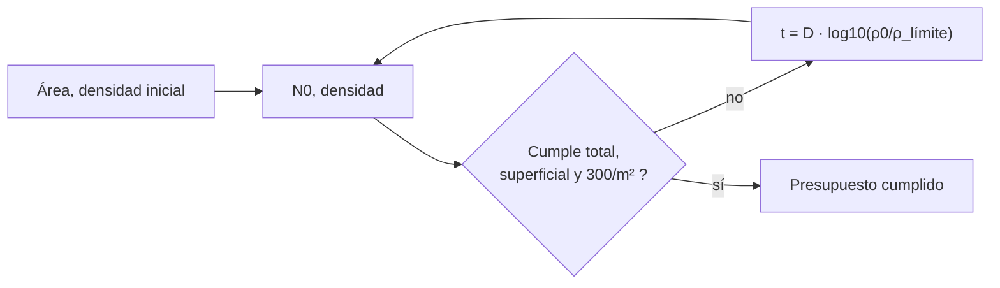

# B56-C17 — Control de contaminación biológica

<!-- nav:top -->
[🏠 Programa](../../../../README.md) · [📚 Bloque B56](../../../tronco-comun/B56-astrobiologia-y-vida-extraterrestre.md) · [← Anterior: B56-C16 — Tecnofirmas y búsqueda SETI](../B56-C16-tecnofirmas-y-busqueda-seti/CLASE.md) · [Siguiente: B56-C18 — Protección planetaria COSPAR →](../B56-C18-proteccion-planetaria-cospar/CLASE.md)
<!-- /nav -->

## 1. Ubicación, nivel y alcance

Clase 17 del bloque B56. Nivel N3. Tomas la cinética de primer orden ([B06-C14](../../B06/B06-C14-cinetica-quimica-inicial/CLASE.md)) y la probabilidad de Poisson ([B12](../../../tronco-comun/B12-probabilidad-estadistica-e-incertidumbre.md)) para calcular **cuánta reducción de esporas necesita una nave y qué límites numéricos debe cumplir** según la política COSPAR 2026 para misiones de categoría IVa a Marte. Es un cálculo de presupuesto; no describe ningún protocolo de laboratorio ni de esterilización. El marco de categorías es tema de [C18](../B56-C18-proteccion-planetaria-cospar/CLASE.md).

## 2. Por qué esta clase existe

Una nave que lleva microorganismos terrestres puede contaminar otro mundo y confundir una futura búsqueda de vida. La política fija límites cuantitativos. La decisión central: **dada la carga biológica inicial de una nave, ¿cumple los límites y cuántas reducciones logarítmicas necesita?**

## 3. Lo que podrás hacer al terminar

1. Definir carga biológica, espora (en el sentido de la política), valor D y reducción logarítmica.
2. Comprobar los tres límites de categoría IVa: total, superficial y densidad.
3. Calcular el tiempo necesario con `t = D log₁₀(N₀/N)`.
4. Verificar la cinética con una integración de Euler.
5. Calcular la probabilidad de que una muestra no contenga esporas.
6. Nombrar qué deja fuera un presupuesto numérico.

La evidencia es el **presupuesto de carga biológica** del ejercicio 12 (sección 20).

## 4. Con qué llegas y cómo comprobarlo

1. ¿Qué es una cinética de primer orden?
2. ¿Qué es `log₁₀ 100`?
3. ¿Qué es una distribución de Poisson?
4. ¿Qué es una densidad por m²?
5. ¿Qué es un método de Euler?

<details>
<summary>Ver respuestas</summary>

1. La velocidad es proporcional a la cantidad: `dN/dt = −kN`. 2. 2. 3. La probabilidad de `k` sucesos raros con media `λ`. 4. Un conteo dividido entre el área. 5. Un integrador de primer orden.
</details>

Con cuatro o cinco aciertos, sigue; si no, repasa B06-C14 y B12.

## 5. Un caso real: los límites de la categoría IVa

La política COSPAR 2026 (S1, texto completo consultado el 2026-11-09), sección 6.1.2.2.2, exige a las misiones de categoría IVa a Marte: carga biológica total en Marte `≤ 5 × 10⁵` esporas (superficial, de contacto y encapsulada), carga superficial `≤ 3 × 10⁵` esporas y densidad media `≤ 300 esporas/m²`. En la sección 4.3 define «espora» como microorganismos mesófilos, heterótrofos y aerobios que sobreviven a un choque térmico de 80 °C durante 15 minutos y se cultivan en agar triptona-soja a 32 °C durante 72 h. **Ejemplo conductor sintético:** nave de 40 m² con 2000 esporas/m² iniciales y un valor D de 2 h (ilustrativos).

## 6. Vocabulario

La **carga biológica** es el número de microorganismos viables en una nave. Una **espora** (en el sentido de la política) es el indicador definido en 5. El **valor D** es el tiempo para reducir la población 10 veces. La **reducción logarítmica** es `log₁₀(N₀/N)`. La **densidad** es esporas por m². La **probabilidad de contaminación** es la de introducir organismos viables en un ambiente donde podrían crecer.

## 7. Modelo mental: vaciar una bañera por proporción

La población baja un mismo porcentaje en cada unidad de tiempo, nunca llega exactamente a cero. Cada «D» de tiempo la divide entre diez.



*Descripción textual:* se compara la carga con los tres límites; si no se cumple, se calcula el tiempo de reducción necesario con el valor D.

Analogía: bajar el volumen de la música por décimas. Su límite: las esporas reales tienen colas y subpoblaciones más resistentes.

## 8. La explicación, paso a paso

### 8.1 Los tres límites

Para 40 m² a 2000/m²: total `80 000 ≤ 5 × 10⁵` (cumple), superficial `80 000 ≤ 3 × 10⁵` (cumple), densidad `2000 > 300` (**no cumple**). El límite que domina es la densidad.

### 8.2 Reducción necesaria

`log₁₀(2000/300) = 0,824`. Con `D = 2 h`: `t = 1,65 h`.

### 8.3 Verificación por Euler

Tras ese tiempo, la forma cerrada da `12 000` esporas (`300/m²`); Euler con paso `10⁻⁴ h` da `11 998,9` (diferencia 0,009 %). La tolerancia es `10⁻³`.

### 8.4 Probabilidad de ausencia

Para una muestra de `0,01 m²` a `300/m²` (media 3), la probabilidad de no hallar ninguna espora es `e^{−3} = 0,050`. Un resultado de «cero esporas» en una muestra pequeña es poco informativo.

### 8.5 Qué cuándo domina cada límite

La densidad de 300/m² iguala los `3 × 10⁵` superficiales a `1000 m²`. Para áreas menores domina la densidad; para mayores, el total superficial. El presupuesto numérico no sustituye el ensayo ni la verificación microbiológica, ni cubre la categoría de la misión.

## 9. Magnitudes, símbolos y unidades

| Símbolo | Qué es | Unidad | Valor / nota |
|---|---|---|---|
| `A` | área de la nave | m² | 40 (sintética) |
| `ρ₀` | densidad inicial | esporas/m² | 2000 (sintética) |
| `D` | valor D | h | 2 (sintético) |
| `ρ_lím` | densidad máxima | esporas/m² | 300 (S1) |
| `N_tot`, `N_sup` | límites total y superficial | esporas | `5 × 10⁵`; `3 × 10⁵` (S1) |
| `t` | tiempo | h | 1,65 |

## 10. Convenciones y referencias

Cinética de primer orden sin cola; esporas distribuidas al azar; tiempo en horas. La nave, la densidad y el valor D son **sintéticos**.

## 11. De dónde sale lo que afirmamos

| ID | Fuente | Localizador | Respalda | Estado |
|---|---|---|---|---|
| S1 | COSPAR, *COSPAR Policy on Planetary Protection*, Space Research Today n.º 224, enero de 2026 (doi 10.60970/012026SRT224/PPP) | https://cosparhq.cnes.fr/assets/uploads/2026/01/SRT_224_Editorial_PPP-Nov-2025.pdf | Límites de 6.1.2.2.2 y definición de espora (4.3) | Texto completo extraído con PyMuPDF el 2026-11-09 |

Límites: la política vigente prevalece sobre esta clase; el valor D y el proceso son ilustrativos; no se describe ningún método de reducción; no se consultaron guías de implementación.

## 12. Cómo ver el presupuesto

Equivalente accesible a una tabla:

| Magnitud | Inicial | Límite | Cumple |
|---|---|---|---|
| Total | 80 000 | `5 × 10⁵` | sí |
| Superficial | 80 000 | `3 × 10⁵` | sí |
| Densidad | 2000/m² | 300/m² | no |

Descripción larga: dos límites se cumplen y uno no; una reducción de 0,824 log lo resuelve.

## 13. Ejemplo trabajado: nave de 100 m² a 5000/m²

**Paso 1 · Datos.** `A = 100 m²`, `ρ₀ = 5000/m²`, `D = 2 h` (sintéticos).

**Paso 2 · Límites.** Total `5 × 10⁵ ≤ 5 × 10⁵` (justo); superficial `5 × 10⁵ > 3 × 10⁵` (no); densidad no.

**Paso 3 · Reducción.** Para 300/m²: `log₁₀(5000/300) = 1,222`; `t = 2,44 h`.

**Paso 4 · Sentido.** Tras eso, total `30 000`, cumple los tres. Resultado sintético.

## 14. Distintos enfoques

**Presupuesto por límites numéricos (esta clase):** directo. **Análisis probabilístico de contaminación:** exigido por la política para otras categorías. **Verificación microbiológica:** necesaria en la práctica. Para entender el orden de magnitud sirve el primero.

## 15. Práctica guiada

**Ejercicio 1 · con los pasos indicados.** Calcula la carga total de 25 m² a 800/m². *Pasos:* producto.

<details><summary>Solución comentada</summary>

`20 000` esporas; cumple total y superficial; densidad `800 > 300`.
</details>

**Ejercicio 2 · con una pista.** ¿Cuántas reducciones logarítmicas requiere el caso anterior? *Pista:* `log₁₀(800/300)`.

<details><summary>Solución comentada</summary>

`0,426` (8.2).
</details>

**Ejercicio 3 · casi autónomo.** ¿Qué tiempo con `D = 1,5 h`?

<details><summary>Solución comentada</summary>

`1,5 × 0,426 = 0,64 h`.
</details>

## 16. Práctica autónoma, transferencia e integrador

**Ejercicio 4.** ¿Qué fracción queda tras `t = D`?

<details><summary>Solución comentada</summary>

`10⁻¹ = 10 %`.
</details>

**Ejercicio 5.** ¿Qué densidad queda tras 3 h con `D = 2 h` desde 2000/m²?

<details><summary>Solución comentada</summary>

`2000 × 10^{−1,5} = 63,2` esporas/m².
</details>

**Ejercicio 6.** ¿A qué área iguala el límite total de `5 × 10⁵` con 300/m²?

<details><summary>Solución comentada</summary>

`5 × 10⁵/300 = 1667 m²` (el total encapsulado se suma aparte).
</details>

**Ejercicio 7.** ¿Por qué un cultivo con cero colonias no prueba cero esporas?

<details><summary>Solución comentada</summary>

Porque con media 3 la probabilidad de cero es 5 % (8.4) y porque el método detecta solo las cultivables.
</details>

**Ejercicio 8.** ¿Qué verifica el método de Euler?

<details><summary>Solución comentada</summary>

Que la forma cerrada satisface la ecuación diferencial (8.3).
</details>

**Ejercicio 9 · transferencia.** Un colega dice: «cumplimos 5 × 10⁵ en total, estamos en regla». Respóndele.

<details><summary>Solución comentada</summary>

Faltan el límite superficial y el de densidad (8.1).
</details>

**Ejercicio 10 · transferencia.** ¿Qué categoría de misión necesita estos límites?

<details><summary>Solución comentada</summary>

La IVa a Marte (aterrizador sin instrumentos de vida actual); ver [C18](../B56-C18-proteccion-planetaria-cospar/CLASE.md). Otras categorías tienen otros requisitos.
</details>

**Ejercicio 11 · transferencia.** ¿Qué puede hacer que una subpoblación sobreviva más de lo previsto?

<details><summary>Solución comentada</summary>

La cinética no ideal («cola»), que el modelo excluye (10).
</details>

**Ejercicio 12 · integrador.** Elabora tu *presupuesto de carga biológica*: elige área, densidad inicial y `D` (sintéticos), verifica los tres límites, calcula la reducción y el tiempo, y lista dos limitaciones.

<details><summary>Solución modelo</summary>

Con 60 m², 1500/m², `D = 2`: total 90 000 ok; superficial ok; densidad no; `log = 0,699`; `t = 1,40 h`. Limitaciones: cinética con cola y muestreo. Todo sintético.
</details>

## 17. Laboratorio: reducción de esporas

El script [carga_biologica.py](carga_biologica.py) comprueba los tres límites, calcula la reducción y el tiempo, verifica con Euler (`10⁻³`) y calcula la probabilidad de ausencia.

**Datos:** límites de S1; nave y D sintéticos. **Predice antes de ejecutar:** ¿qué límite se incumple? (la densidad.) **Ejecución del 2026-11-09 (Python 3.12.9):**

```text
Python 3.12.9 (biblioteca estandar)
Inicial: 80000 esporas en 40 m2 (2000/m2) ; cumple (total, superficie, densidad): (True, True, False)
Reduccion necesaria para 300/m2: 0.824 log ; tiempo = 1.65 h con D = 2.0 h
Tras ese tiempo: cerrada = 12000.00 ; Euler = 11998.93 esporas ; densidad = 300.0/m2
P(0 esporas en una muestra de 0,01 m2 a 300/m2) = 0.050
Area a la que 300/m2 alcanza 3e5 esporas = 1000 m2
Pruebas superadas.
```

```bash
python programa/clases/B56/B56-C17-control-de-contaminacion-biologica/carga_biologica.py
```

**Límites:** presupuesto numérico sintético; no describe métodos ni valida procesos.

## 18. Errores frecuentes y cómo corregirlos

**Comprobar solo el total.** Se corrige con el ejercicio 9.

**Creer que se llega a cero.** Se corrige con el ejercicio 7.

**Confundir D con tiempo total.** Se corrige con el ejercicio 4.

**Usar los límites de IVa en otra categoría.** Se corrige con el ejercicio 10.

**Presentar los parámetros como reales.** Se corrige con la sección 10.

## 19. Cómo sabrás que vas bien

Tras 8.1: ¿verificas los tres límites? Ejercicio 1. Tras 8.2: ¿calculas el tiempo? Ejercicio 3. Tras el laboratorio: ¿qué prueba Euler? (la cinética de primer orden).

## 20. Qué entregas y cómo se evalúa

El producto es tu **presupuesto de carga biológica** (ejercicio 12).

| Criterio | Inicial | En desarrollo | Logrado | Destacado |
|---|---|---|---|---|
| Conceptos | Los confunde | Parciales | Espora, D y límites claros | Discute la cola |
| Cálculo | Sin unidades | Con errores | Reducción y tiempo correctos | Con Euler |
| Cumplimiento | Un límite | Dos | Tres límites | Identifica el dominante |
| Rótulos | Sin rotular | Parciales | Sintético rotulado | No presenta como proceso real |
| Fuentes | Sin fuente | Sin fecha | S1 con fecha | Declara que la política prevalece |

**Condiciones críticas (no se compensan con promedio):** rotular los parámetros como sintéticos; no presentar un presupuesto como certificación; citar solo lo consultado.

## 21. Ética, seguridad y límites

La clase es educativa: no da procedimientos de esterilización ni de cultivo de microorganismos y no certifica nada. La política vigente prevalece. Accesibilidad: tablas equivalentes a las gráficas, fórmulas en texto, ejercicios sin conexión.

## 22. Para cerrar y seguir

La categoría IVa a Marte exige total `≤ 5 × 10⁵`, superficial `≤ 3 × 10⁵` y `≤ 300 esporas/m²`; una nave sintética de 2000/m² necesita 0,82 reducciones logarítmicas. Queda una pregunta: ¿cómo se clasifica cada misión y qué exige cada categoría?

**Glosario español–inglés.** carga biológica · *bioburden*; espora · *spore*; valor D · *D-value*; reducción logarítmica · *log reduction*; contaminación directa · *forward contamination*.

**Continuidad.** [B56-C18](../B56-C18-proteccion-planetaria-cospar/CLASE.md) clasifica misiones en las categorías de la política.

**Referencias:** ver sección 11.

<!-- nav:bottom -->
---

[← Anterior: B56-C16 — Tecnofirmas y búsqueda SETI](../B56-C16-tecnofirmas-y-busqueda-seti/CLASE.md) · [📚 Bloque B56](../../../tronco-comun/B56-astrobiologia-y-vida-extraterrestre.md) · [Siguiente: B56-C18 — Protección planetaria COSPAR →](../B56-C18-proteccion-planetaria-cospar/CLASE.md)
<!-- /nav -->
