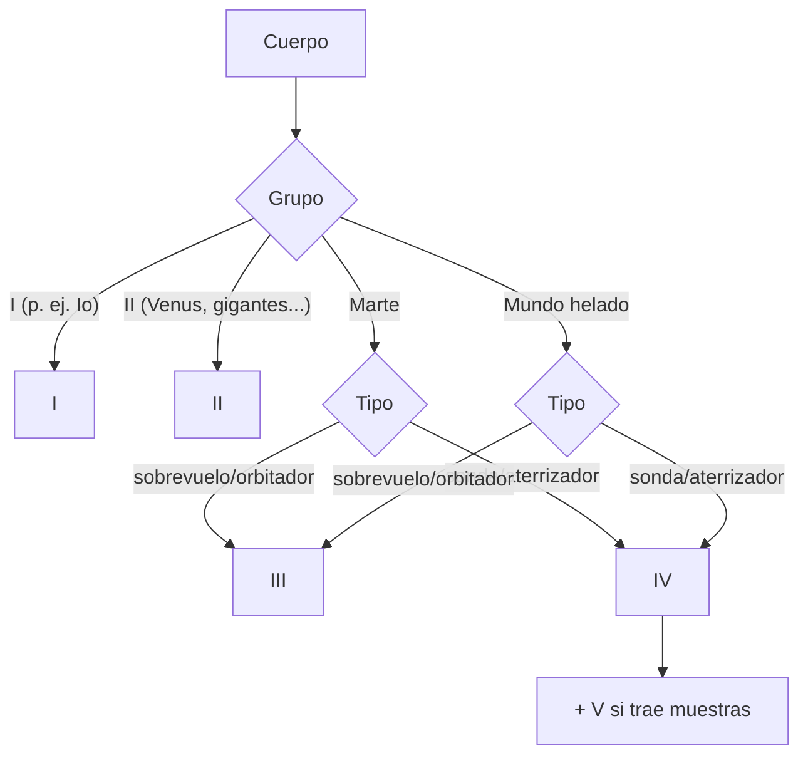

# B56-C18 — Protección planetaria COSPAR

<!-- nav:top -->
[🏠 Programa](../../../../README.md) · [📚 Bloque B56](../../../tronco-comun/B56-astrobiologia-y-vida-extraterrestre.md) · [← Anterior: B56-C17 — Control de contaminación biológica](../B56-C17-control-de-contaminacion-biologica/CLASE.md) · [Siguiente: B56-C19 — Ética del descubrimiento de vida →](../B56-C19-etica-del-descubrimiento-de-vida/CLASE.md)
<!-- /nav -->

## 1. Ubicación, nivel y alcance

Clase 18 del bloque B56. Nivel N3. Tomas los límites de [C05](../B56-C05-extremofilos-y-limites-ambientales/CLASE.md) y [C17](../B56-C17-control-de-contaminacion-biologica/CLASE.md) para ubicar una misión en **las categorías de la política de protección planetaria de COSPAR** (versión de 2026) y leer sus exigencias. Esta clase codifica un **subconjunto** de la Tabla 1 como tabla de decisión; la política completa prevalece. El derecho espacial se estudia en [B119](../../../tronco-comun/B119-derecho-seguridad-y-geopolitica-espacial.md) y las muestras en [B63](../../../tronco-comun/B63-exploracion-in-situ-y-analisis-de-muestras-planetarias.md).

## 2. Por qué esta clase existe

La política protege los otros mundos de la contaminación (para no estropear la búsqueda de vida) y la Tierra del material devuelto. Saber en qué categoría cae una misión determina su documentación, su limpieza y sus restricciones. La decisión central: **dado el cuerpo y el tipo de misión, ¿qué categoría corresponde y qué se exige?**

## 3. Lo que podrás hacer al terminar

1. Definir categoría de protección planetaria, mundo helado, retorno restringido y no restringido.
2. Clasificar misiones con una tabla de decisión.
3. Explicar por qué los mundos helados son III o IV por defecto y cuándo pueden ser II.
4. Citar los umbrales de probabilidad `10⁻⁴` y el período de 1000 años.
5. Verificar la tabla de decisión con una enumeración exhaustiva.
6. Nombrar qué deja fuera el subconjunto codificado.

La evidencia es la **clasificación de misiones** del ejercicio 12 (sección 20).

## 4. Con qué llegas y cómo comprobarlo

1. ¿Qué es un sobrevuelo, un orbitador, una sonda?
2. ¿Qué es una tabla de decisión?
3. ¿Qué es una probabilidad de `10⁻⁴`?
4. ¿Qué es un retorno de muestras?
5. ¿Qué es un cuerpo helado?

<details>
<summary>Ver respuestas</summary>

1. Pasar de largo, orbitar y aterrizar o entrar. 2. Una regla que asigna una salida a cada combinación de entradas. 3. Una vez en diez mil. 4. Traer material de otro cuerpo a la Tierra. 5. Uno cuya capa exterior es sobre todo hielo de agua.
</details>

Con cuatro o cinco aciertos, sigue; si no, repasa [C17](../B56-C17-control-de-contaminacion-biologica/CLASE.md).

## 5. Un caso real: la política de 2026

La política (S1, texto completo extraído el 2026-11-09; Space Research Today n.º 224, enero de 2026) incorpora una categoría específica para los **mundos helados**: cuerpos con una capa exterior predominantemente de hielo de agua y masa suficiente para ser casi esféricos. Por defecto, sus misiones son **categoría III** (sobrevuelo u orbitador) o **IV** (sonda o aterrizador); pueden ser categoría II solo con un análisis que demuestre que la probabilidad de introducir cualquier componente de la nave en ambientes por encima del límite de temperatura (LLT) dentro de un período de exploración biológica de **1000 años** es menor que `1 × 10⁻⁴`. Es el **ejemplo conductor**.

## 6. Vocabulario

La **categoría** (I a V) refleja el interés científico del cuerpo y el riesgo de contaminación. La **categoría V** se añade a las misiones que traen muestras a la Tierra; es **restringida** o **no restringida**. Un **mundo helado** es el definido en 5. El **período de exploración biológica** (PBE) es el lapso en que la contaminación es crítica: 1000 años para mundos helados y 50 para Marte. El **LLT** es el límite inferior de temperatura de replicación, −28 °C.

## 7. Modelo mental: un árbol de decisiones

Primero, el tipo de cuerpo; luego, el tipo de misión; la categoría sale de la combinación.



*Descripción textual:* según el cuerpo, la categoría es fija (I, II) o depende del tipo de misión (III o IV para Marte y mundos helados); el retorno de muestras añade la categoría V.

Analogía: el nivel de precaución de un laboratorio según el agente. Su límite: aquí la política tiene matices (subdivisiones IVa–IVc, IIa–IIb) que no están codificados.

## 8. La explicación, paso a paso

### 8.1 Tabla codificada

Subconjunto de la Tabla 1: asteroides no diferenciados e Io (I); Venus, Luna, cometas, asteroides condríticos carbonáceos y planetas gigantes (II); Marte (III orbitador, IV aterrizador); Europa, Encélado y Titán, mundos helados (III orbitador, IV aterrizador por defecto; II con análisis).

### 8.2 Retorno de muestras

La categoría V se suma a la de ida. Para Marte y mundos helados el retorno es **restringido**; para la Luna es no restringido. Un retorno restringido exige contención de toda muestra sin esterilizar y prohíbe el impacto destructivo al regreso (S1).

### 8.3 Pruebas del laboratorio

Se verifican once casos esperados (por ejemplo `marte/sonda → IV`, `europa/sobrevuelo → III`, `marte/retorno → IV + V restringido`, `luna/retorno → II + V no restringido`) y se enumeran las 42 combinaciones sin error.

### 8.4 Números de la política

Para mundos helados en categoría II o III: probabilidad de inoculación `< 1 × 10⁻⁴` en 1000 años, es decir una media anual de `10⁻⁷`. Para categoría III a Marte: probabilidad de impacto `≤ 10⁻²` en los primeros 20 años y `≤ 5 × 10⁻²` de 20 a 50 años, o cumplir la limpieza de IVa (C17).

### 8.5 Lo que el subconjunto deja fuera

Misiones tripuladas, subcategorías IIa/IIb y IVa–IVc, Ceres, objetos transneptunianos y la lista de mundos helados. La política vigente y el panel de COSPAR prevalecen.

## 9. Magnitudes, símbolos y unidades

| Símbolo | Qué es | Unidad | Valor / nota |
|---|---|---|---|
| Categoría | I a V | — | de la Tabla 1 (S1) |
| PBE (helados) | período | años | 1000 (S1) |
| PBE (Marte) | período | años | 50 (S1) |
| Probabilidad límite | helados | adimensional | `< 1 × 10⁻⁴` (S1) |
| LLT | temperatura mínima | °C | −28 (S1) |

## 10. Convenciones y referencias

Categorías en números romanos; tipos «sobrevuelo/orbitador», «sonda/aterrizador» y «retorno». Las misiones de prueba son **sintéticas**.

## 11. De dónde sale lo que afirmamos

| ID | Fuente | Localizador | Respalda | Estado |
|---|---|---|---|---|
| S1 | COSPAR, *COSPAR Policy on Planetary Protection*, Space Research Today n.º 224, enero de 2026 (doi 10.60970/012026SRT224/PPP) | https://cosparhq.cnes.fr/assets/uploads/2026/01/SRT_224_Editorial_PPP-Nov-2025.pdf | Categorías, Tabla 1, mundos helados, PBE, probabilidades, categoría V | Texto completo extraído con PyMuPDF el 2026-11-09 |
| S2 | COSPAR, página de la política | https://cosparhq.cnes.fr/cospar-policy-on-planetary-protection/ | Versión de enero de 2026; aprobada por la Mesa el 2025-11-07; incluye una política unificada para mundos helados | Consultada el 2026-11-09 |

Límites: se codifica un subconjunto; la tabla no sustituye la política; no se consultaron las guías de implementación, la sección 6.6 (Marte tripulado) ni los apéndices.

## 12. Cómo ver la tabla

Equivalente accesible a la tabla de decisión:

| Cuerpo | Sobrevuelo/orbitador | Sonda/aterrizador | Retorno |
|---|---|---|---|
| Io | I | I | — |
| Venus | II | II | II + V no restringido |
| Marte | III | IV | IV + V restringido |
| Europa, Encélado, Titán | III | IV | IV + V restringido |

Descripción larga: Marte y los mundos helados suben de III a IV cuando hay aterrizaje; el retorno añade V restringido.

## 13. Ejemplo trabajado: ¿qué categoría tiene un orbitador a Encélado?

**Paso 1 · Cuerpo.** Encélado es un mundo helado (lista de mundos helados de S1, no leída en detalle).

**Paso 2 · Tipo.** Orbitador.

**Paso 3 · Categoría.** III por defecto; II solo con el análisis `< 10⁻⁴` en 1000 años.

**Paso 4 · Sentido.** La política obliga a probar que la nave no llegará a ambientes habitables antes de bajarla de categoría. Resultado de la tabla, no un juicio sobre una misión real.

## 14. Distintos enfoques

**Tabla de decisión (esta clase):** clara pero parcial. **Lectura de la política completa:** necesaria. **Evaluación por panel de expertos:** la que aplica COSPAR a casos concretos. Para aprender la lógica sirve la primera.

## 15. Práctica guiada

**Ejercicio 1 · con los pasos indicados.** Clasifica un aterrizador a Marte. *Pasos:* cuerpo Marte; tipo aterrizador.

<details><summary>Solución comentada</summary>

Categoría IV (8.1).
</details>

**Ejercicio 2 · con una pista.** Clasifica un sobrevuelo de Venus. *Pista:* grupo II.

<details><summary>Solución comentada</summary>

Categoría II.
</details>

**Ejercicio 3 · casi autónomo.** Clasifica un retorno de muestras desde la Luna.

<details><summary>Solución comentada</summary>

II + V no restringido (8.2).
</details>

## 16. Práctica autónoma, transferencia e integrador

**Ejercicio 4.** ¿Por qué Io es categoría I?

<details><summary>Solución comentada</summary>

Porque la tabla lo lista entre los cuerpos sin interés directo para la evolución química o el origen de la vida (S1, Tabla 1).
</details>

**Ejercicio 5.** Un aterrizador a Titán: ¿categoría?

<details><summary>Solución comentada</summary>

IV por defecto, al ser mundo helado.
</details>

**Ejercicio 6.** Calcula la probabilidad anual media de `10⁻⁴` en 1000 años.

<details><summary>Solución comentada</summary>

`10⁻⁷` (8.4).
</details>

**Ejercicio 7.** ¿Qué pasa con un sobrevuelo a Marte con probabilidad de impacto 0,03 a 10 años?

<details><summary>Solución comentada</summary>

Supera `10⁻²` en los primeros 20 años; debe cumplir la limpieza de IVa o reducir la probabilidad (8.4).
</details>

**Ejercicio 8.** ¿Qué verifica la enumeración de 42 combinaciones?

<details><summary>Solución comentada</summary>

Que toda combinación produce una categoría válida; no que la categoría sea la oficial en casos fuera del subconjunto.
</details>

**Ejercicio 9 · transferencia.** Un colega dice: «Europa es solo un orbitador, luego es categoría II». Respóndele.

<details><summary>Solución comentada</summary>

Es III por defecto; II exige el análisis de probabilidad (8.1, sección 5).
</details>

**Ejercicio 10 · transferencia.** ¿Por qué el retorno desde Marte es restringido?

<details><summary>Solución comentada</summary>

Porque no se descarta por consenso que haya entidades replicantes nativas; la política exige contención hasta analizar (S1; sección 8.2).
</details>

**Ejercicio 11 · transferencia.** ¿Qué haces si tu misión no está en el subconjunto codificado?

<details><summary>Solución comentada</summary>

Consultas la política vigente y a su panel; la tabla de la clase no decide (8.5).
</details>

**Ejercicio 12 · integrador.** Elabora tu *clasificación de misiones*: clasifica seis misiones sintéticas (cuerpo y tipo), indica la categoría y una exigencia clave de cada una según la política, y señala cuáles quedan fuera del subconjunto.

<details><summary>Solución modelo</summary>

Por ejemplo: orbitador a Encélado (III; justificar `< 10⁻⁴` para II); aterrizador a Marte (IV; limpieza de IVa); retorno desde Marte (IV + V restringido; contención); sobrevuelo a Júpiter (II); misión tripulada a Marte (fuera del subconjunto). Sintético.
</details>

## 17. Laboratorio: tabla de categorías

El script [categorias_cospar.py](categorias_cospar.py) codifica el subconjunto de la Tabla 1, **comprueba** once casos esperados y enumera las 42 combinaciones.

**Datos:** Tabla 1 de S1. **Predice antes de ejecutar:** ¿qué categoría da `marte/retorno`? (IV + V restringido.) **Ejecución del 2026-11-09 (Python 3.12.9):**

```text
io         sonda/aterrizador      -> I
venus      sobrevuelo/orbitador   -> II
saturno    sonda/aterrizador      -> II
marte      sobrevuelo/orbitador   -> III
marte      sonda/aterrizador      -> IV
europa     sobrevuelo/orbitador   -> III
europa     sonda/aterrizador      -> IV
encelado   sobrevuelo/orbitador   -> III
titan      sonda/aterrizador      -> IV
marte      retorno                -> IV + V restringido
luna       retorno                -> II + V no restringido
Enumeradas 42 combinaciones sin error.
Probabilidad anual media equivalente de acceso a ambientes > LLT: 1.0e-07
Pruebas superadas.
```

```bash
python programa/clases/B56/B56-C18-proteccion-planetaria-cospar/categorias_cospar.py
```

**Límites:** subconjunto de la Tabla 1; no sustituye la política.

## 18. Errores frecuentes y cómo corregirlos

**Tomar la tabla de la clase por la política.** Se corrige con el ejercicio 11.

**Suponer que los mundos helados son II.** Se corrige con el ejercicio 9.

**Olvidar la categoría V del retorno.** Se corrige con el ejercicio 3.

**Confundir PBE de Marte y de mundos helados.** Se corrige con la sección 9.

**Ignorar que la política se actualiza.** Se corrige con la sección 11.

## 19. Cómo sabrás que vas bien

Tras 8.1: ¿clasificas una misión? Ejercicios 1 y 2. Tras 8.2: ¿qué añade el retorno? Ejercicio 3. Tras el laboratorio: ¿qué prueba la enumeración? (completitud de la tabla codificada).

## 20. Qué entregas y cómo se evalúa

El producto es tu **clasificación de misiones** (ejercicio 12).

| Criterio | Inicial | En desarrollo | Logrado | Destacado |
|---|---|---|---|---|
| Categorías | Las confunde | Parciales | Seis correctas | Señala los casos fuera del subconjunto |
| Exigencias | Sin citar | Parciales | Una por misión | Con números de S1 |
| Retorno | Ignorado | Parcial | V restringido/no restringido | Explica la contención |
| Rótulos | Sin rotular | Parciales | Misiones sintéticas rotuladas | Declara que la política prevalece |
| Fuentes | Sin fuente | Sin fecha | S1–S2 con fecha | Declara lo no leído |

**Condiciones críticas (no se compensan con promedio):** declarar que la tabla es un subconjunto; no presentar la clasificación como oficial; citar solo lo consultado.

## 21. Ética, seguridad y límites

La clase es educativa y no sustituye la política ni el asesoramiento del panel de COSPAR. Accesibilidad: tablas equivalentes a las gráficas, fórmulas en texto, ejercicios sin conexión.

## 22. Para cerrar y seguir

La categoría de una misión sale del cuerpo y del tipo de misión; los mundos helados son III o IV por defecto y el retorno desde Marte es restringido. Queda una pregunta: ¿cómo debe comunicarse y gestionarse el descubrimiento de vida?

**Glosario español–inglés.** protección planetaria · *planetary protection*; mundo helado · *icy world*; retorno restringido · *restricted Earth return*; período de exploración biológica · *period of biological exploration*; contaminación directa · *forward contamination*.

**Continuidad.** [B56-C19](../B56-C19-etica-del-descubrimiento-de-vida/CLASE.md) trata la acumulación de evidencia y la ética de comunicar un descubrimiento.

**Referencias:** ver sección 11.

<!-- nav:bottom -->
---

[← Anterior: B56-C17 — Control de contaminación biológica](../B56-C17-control-de-contaminacion-biologica/CLASE.md) · [📚 Bloque B56](../../../tronco-comun/B56-astrobiologia-y-vida-extraterrestre.md) · [Siguiente: B56-C19 — Ética del descubrimiento de vida →](../B56-C19-etica-del-descubrimiento-de-vida/CLASE.md)
<!-- /nav -->
