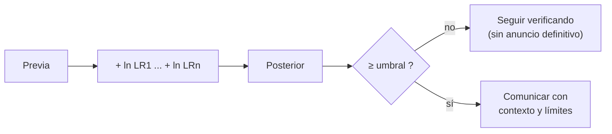

# B56-C19 — Ética del descubrimiento de vida

<!-- nav:top -->
[🏠 Programa](../../../../README.md) · [📚 Bloque B56](../../../tronco-comun/B56-astrobiologia-y-vida-extraterrestre.md) · [← Anterior: B56-C18 — Protección planetaria COSPAR](../B56-C18-proteccion-planetaria-cospar/CLASE.md) · [Siguiente: B56-C20 — Diseño de misión astrobiológica conceptual →](../B56-C20-diseno-de-mision-astrobiologica-conceptual/CLASE.md)
<!-- /nav -->

## 1. Ubicación, nivel y alcance

Clase 19 del bloque B56. Nivel N3. Tomas el razonamiento bayesiano de [C15](../B56-C15-falsos-positivos-de-biofirmas/CLASE.md) y la protección de [C18](../B56-C18-proteccion-planetaria-cospar/CLASE.md) para plantear **cómo acumular evidencia de forma explícita y cuándo comunicar un candidato**. Es una clase de criterio: calculas con log-odds sintéticos y discutes umbrales, no decides una política. El derecho espacial vive en [B119](../../../tronco-comun/B119-derecho-seguridad-y-geopolitica-espacial.md) y la divulgación en [B130](../../../tronco-comun/B130-comunicacion-y-divulgacion-cientifica.md).

## 2. Por qué esta clase existe

Anunciar demasiado pronto un hallazgo puede dañar la ciencia y la confianza pública; ocultarlo puede dañar la transparencia. Hace falta una forma explícita de saber cuánta evidencia hay. La decisión central: **dada una previa y una lista de líneas de evidencia independientes, ¿qué probabilidad se alcanza y qué umbral de comunicación cruza?**

## 3. Lo que podrás hacer al terminar

1. Definir log-odds, razón de verosimilitud, evidencia independiente y umbral de comunicación.
2. Acumular evidencia multiplicando razones de verosimilitud y sumando logaritmos.
3. Verificar el cálculo por dos vías, exacta y logarítmica.
4. Analizar cómo una línea refutadora deshace la anterior.
5. Discutir criterios éticos para comunicar un candidato.
6. Nombrar qué contexto normativo existe (política COSPAR, Tratado del Espacio).

La evidencia es el **protocolo de comunicación de un candidato** del ejercicio 12 (sección 20).

## 4. Con qué llegas y cómo comprobarlo

1. ¿Qué son los odds?
2. ¿Qué es un logaritmo natural?
3. ¿Qué es la independencia?
4. ¿Qué es un falso positivo?
5. ¿Qué es la contención de una muestra?

<details>
<summary>Ver respuestas</summary>

1. `p/(1 − p)`. 2. El inverso de `e^x`. 3. Que una evidencia no depende de otra dado el estado. 4. Una señal que parece de interés pero no lo es. 5. Mantener un material aislado para evitar su liberación.
</details>

Con cuatro o cinco aciertos, sigue; si no, repasa [C15](../B56-C15-falsos-positivos-de-biofirmas/CLASE.md).

## 5. Un caso real: lo que dice la política

La política COSPAR 2026 (S1, texto completo consultado el 2026-11-09) establece que, para retornos «restringidos», si se detecta la existencia de una entidad replicante no terrestre, la muestra debe permanecer contenida salvo que se trate con un procedimiento de esterilización eficaz, y reconoce en su sección 4.5 que un «falso positivo» en la detección de vida podría impedir distribuir la muestra desde contención y conducir a un rigor innecesario. Describe además la política como instrumento voluntario de referencia para las naciones espaciales, con base en el Tratado del Espacio. Es el **ejemplo conductor**, junto con una acumulación **sintética** de cuatro líneas de evidencia.

## 6. Vocabulario

Los **log-odds** son `ln[p/(1 − p)]`. Una **línea de evidencia** es una observación independiente con razón de verosimilitud `LR`. Un **umbral de comunicación** es la probabilidad desde la cual se informa. La **transparencia** es informar con apertura y a tiempo. La **precaución** es evitar daños aunque la evidencia sea incompleta. La **contención** es el aislamiento de una muestra.

## 7. Modelo mental: una balanza que se inclina de a poco

Cada línea de evidencia añade peso (positivo si favorece, negativo si refuta). El umbral es la marca en la balanza a partir de la cual se actúa.



*Descripción textual:* se suman los logaritmos de las razones de verosimilitud a los log-odds de la previa, se obtiene la posterior y se compara con los umbrales.

Analogía: los pesos de una balanza de laboratorio. Su límite: los umbrales éticos no salen de un cálculo.

## 8. La explicación, paso a paso

### 8.1 Suma de log-odds

`ln(odds_post) = ln(odds_prev) + Σ ln(LR_i)` si las líneas son independientes. Equivale a multiplicar los odds por el producto de las `LR`.

### 8.2 Un caso sintético

Previa `10⁻³`. Líneas: compuesto candidato (`LR = 20`), patrón isotópico (`LR = 5`), contexto geológico que excluye origen abiótico (`LR = 3`), réplica independiente (`LR = 10`). Posteriores acumuladas: `0,0196`; `0,0910`; `0,2309`; `0,7502`. Solo tras la cuarta línea se supera el umbral de `0,5`.

### 8.3 Dos vías

El laboratorio calcula con fracciones exactas (producto de odds) y con logaritmos (suma); difieren menos de `10⁻¹²`. Además comprueba que una línea con `LR = 1/20` deshace la de `LR = 20`.

### 8.4 Qué umbral usar

Los umbrales `0,5`, `0,9` y `0,99` del ejercicio son **ilustrativos**: no hay una escala adoptada aquí. Que el cálculo sea correcto no resuelve el valor ético del umbral: depende del daño de un falso anuncio frente al de un silencio.

### 8.5 Lo que el cálculo deja fuera

La dependencia entre líneas, la incertidumbre de las `LR`, quién es el destinatario de la comunicación y las obligaciones legales. La política de COSPAR exige contención ante una posible entidad replicante, sea cual sea la probabilidad; el cálculo de esta clase no la reemplaza.

## 9. Magnitudes, símbolos y unidades

| Símbolo | Qué es | Unidad | Valor / nota |
|---|---|---|---|
| `p₀` | previa | adimensional | `10⁻³` (sintética) |
| `LR_i` | razón de verosimilitud | adimensional | 20; 5; 3; 10 (sintéticas) |
| `L` | log-odds | — | `ln[p/(1 − p)]` |
| `p` | posterior | adimensional | 0,0196 … 0,7502 |
| Umbrales | comunicación | adimensional | 0,5; 0,9; 0,99 (ilustrativos) |

## 10. Convenciones y referencias

Independencia condicional, logaritmo natural. Todo el caso es **sintético**.

## 11. De dónde sale lo que afirmamos

| ID | Fuente | Localizador | Respalda | Estado |
|---|---|---|---|---|
| S1 | COSPAR, *COSPAR Policy on Planetary Protection*, Space Research Today n.º 224, enero de 2026 (doi 10.60970/012026SRT224/PPP) | https://cosparhq.cnes.fr/assets/uploads/2026/01/SRT_224_Editorial_PPP-Nov-2025.pdf | Contención ante entidad replicante no terrestre; sección 4.5; base en el Tratado del Espacio | Texto completo extraído con PyMuPDF el 2026-11-09 |
| S2 | Meadows et al., arXiv:1705.07560 | https://arxiv.org/abs/1705.07560 | Confianza en una detección depende de descartar fuentes abióticas | Solo resumen, consultado el 2026-11-09 |

Límites: no se consultó ningún texto jurídico del Tratado ni de la ONU; no se consultó ninguna escala de confianza de detección de vida; los umbrales y las `LR` son sintéticos.

## 12. Cómo ver la acumulación

Equivalente accesible a una tabla:

| Línea (sintética) | `LR` | Posterior |
|---|---|---|
| Previa | — | 0,0010 |
| Compuesto candidato | 20 | 0,0196 |
| Patrón isotópico | 5 | 0,0910 |
| Contexto geológico | 3 | 0,2309 |
| Réplica independiente | 10 | 0,7502 |

Descripción larga: cada línea sube la posterior; solo con las cuatro se supera 0,5.

## 13. Ejemplo trabajado: ¿y si la réplica da `LR = 0,5`?

**Paso 1 · Odds tras tres líneas.** Posterior 0,2309 → odds `0,3003`.

**Paso 2 · Línea contraria.** Multiplicar por 0,5 → odds `0,1502`.

**Paso 3 · Posterior.** `0,1502/1,1502 = 0,1306`.

**Paso 4 · Sentido.** La réplica negativa devuelve la posterior a menos de 0,15; el protocolo debería seguir verificando. Resultado sintético.

## 14. Distintos enfoques

**Log-odds con umbrales (esta clase):** explícito. **Escalas cualitativas de confianza:** estructuran sin números. **Revisión por pares y por paneles:** el mecanismo real. Para ilustrar la lógica sirve el primero.

## 15. Práctica guiada

**Ejercicio 1 · con los pasos indicados.** Convierte `p = 0,001` en log-odds. *Pasos:* `ln(0,001/0,999)`.

<details><summary>Solución comentada</summary>

`−6,907`.
</details>

**Ejercicio 2 · con una pista.** Suma `ln 20 + ln 5`. *Pista:* `ln 100`.

<details><summary>Solución comentada</summary>

`4,605`; los odds se multiplican por 100.
</details>

**Ejercicio 3 · casi autónomo.** Calcula la posterior tras la línea de `LR = 20`.

<details><summary>Solución comentada</summary>

Odds `0,001001 × 20 = 0,02002`; `p = 0,0196` (8.2).
</details>

## 16. Práctica autónoma, transferencia e integrador

**Ejercicio 4.** ¿Cuántas líneas de `LR = 10` llevan `10⁻³` a más de 0,5?

<details><summary>Solución comentada</summary>

Odds necesarios `1`; `0,001 × 10ⁿ ≥ 1` → `n = 3`.
</details>

**Ejercicio 5.** ¿Qué `LR` anula la línea de `LR = 20`?

<details><summary>Solución comentada</summary>

`1/20 = 0,05` (8.3).
</details>

**Ejercicio 6.** ¿Por qué sumar logaritmos equivale a multiplicar odds?

<details><summary>Solución comentada</summary>

Porque `ln(ab) = ln a + ln b` (8.1).
</details>

**Ejercicio 7.** ¿Qué pasa si dos líneas son la misma observación repetida?

<details><summary>Solución comentada</summary>

No son independientes; contarla dos veces sobrestima la posterior (8.5).
</details>

**Ejercicio 8.** ¿Qué umbral elegirías para un comunicado científico previo y por qué?

<details><summary>Solución comentada</summary>

No hay respuesta única: depende del coste de un falso anuncio frente al de callar; se justifica por escrito (8.4).
</details>

**Ejercicio 9 · transferencia.** Un colega dice: «tenemos 75 %, anunciemos vida». Respóndele.

<details><summary>Solución comentada</summary>

La cifra es sintética y depende de supuestos; el anuncio debe describir la evidencia y sus límites, y la política exige contención de muestras mientras se verifica (sección 5).
</details>

**Ejercicio 10 · transferencia.** ¿Quién debería enterarse primero de un candidato?

<details><summary>Solución comentada</summary>

Una cuestión de protocolo: la comunidad científica por revisión y los organismos responsables; la clase no la resuelve (8.4).
</details>

**Ejercicio 11 · transferencia.** ¿Qué deber ético hay si el candidato es una contaminación terrestre?

<details><summary>Solución comentada</summary>

Informar el hallazgo como contaminación; el control de contaminación (C17) existe para evitarlo.
</details>

**Ejercicio 12 · integrador.** Elabora tu *protocolo de comunicación de un candidato*: define previa, cuatro líneas con `LR` y tus umbrales de comunicación (sintéticos), calcula las posteriores, y escribe quién informa a quién en cada umbral y qué límites declara.

<details><summary>Solución modelo</summary>

Con las del caso: 0,5 → informe interno y réplicas; 0,9 → revisión externa; 0,99 → comunicado público con límites. Rotulado como propuesta sintética.
</details>

## 17. Laboratorio: acumulación de evidencia

El script [acumulacion_de_evidencia.py](acumulacion_de_evidencia.py) acumula las `LR` por fracciones exactas y por logaritmos (`10⁻¹²`) y comprueba que una línea refutadora deshace la anterior.

**Datos:** sintéticos. **Predice antes de ejecutar:** ¿qué umbrales se superan tras las cuatro líneas? (solo 0,5.) **Ejecución del 2026-11-09 (Python 3.12.9):**

```text
Python 3.12.9 (biblioteca estandar)
Previa 0.0010 -> odds 0.00100
+ compuesto candidato                          LR=  20 -> P = 0.0196 ; umbrales superados: ninguno
+ patron isotopico                             LR=   5 -> P = 0.0910 ; umbrales superados: ninguno
+ contexto geologico excluye origen abiotico   LR=   3 -> P = 0.2309 ; umbrales superados: ninguno
+ replica independiente                        LR=  10 -> P = 0.7502 ; umbrales superados: [0.5]
Pruebas superadas.
```

```bash
python programa/clases/B56/B56-C19-etica-del-descubrimiento-de-vida/acumulacion_de_evidencia.py
```

**Límites:** independencia asumida; umbrales ilustrativos; el cálculo no decide cuestiones éticas.

## 18. Errores frecuentes y cómo corregirlos

**Contar dos veces la misma observación.** Se corrige con el ejercicio 7.

**Tomar la posterior como probabilidad real.** Se corrige con el ejercicio 9.

**Creer que el cálculo fija el umbral.** Se corrige con el ejercicio 8.

**Olvidar la contención.** Se corrige con la sección 5.

**Ignorar la contaminación terrestre.** Se corrige con el ejercicio 11.

## 19. Cómo sabrás que vas bien

Tras 8.1: ¿sumas log-odds? Ejercicios 1 y 2. Tras 8.3: ¿qué deshace una línea? Ejercicio 5. Tras el laboratorio: ¿qué prueban las dos vías? (consistencia del cálculo).

## 20. Qué entregas y cómo se evalúa

El producto es tu **protocolo de comunicación de un candidato** (ejercicio 12).

| Criterio | Inicial | En desarrollo | Logrado | Destacado |
|---|---|---|---|---|
| Cálculo | Con errores | Una vía | Dos vías | Detecta dependencia |
| Umbrales | Sin justificar | Parciales | Tres justificados | Discute costes |
| Responsabilidades | Ninguna | Vagas | Quién informa a quién | Con contención |
| Rótulos | Sin rotular | Parciales | Sintético rotulado | Declara que es propuesta |
| Fuentes | Sin fuente | Sin fecha | S1–S2 con fecha | Declara lo jurídico no consultado |

**Condiciones críticas (no se compensan con promedio):** rotular previa, `LR` y umbrales como sintéticos; no presentar un anuncio como definitivo; citar solo lo consultado.

## 21. Ética, seguridad y límites

La clase es educativa: no define una política de comunicación ni sustituye a los organismos competentes. Transparencia y precaución pueden tensionarse; la clase las nombra, no las resuelve. Accesibilidad: tablas equivalentes a las gráficas, fórmulas en texto, ejercicios sin conexión.

## 22. Para cerrar y seguir

La evidencia se acumula sumando log-odds, y una línea refutadora puede deshacer el avance; el umbral de comunicación es una decisión ética, no un resultado de cálculo. Queda integrar lo aprendido en una misión conceptual.

**Glosario español–inglés.** log-odds · *log-odds*; razón de verosimilitud · *likelihood ratio*; umbral · *threshold*; transparencia · *transparency*; precaución · *precaution*; contención · *containment*.

**Continuidad.** [B56-C20](../B56-C20-diseno-de-mision-astrobiologica-conceptual/CLASE.md) integra el bloque en el diseño conceptual de una misión.

**Referencias:** ver sección 11.

<!-- nav:bottom -->
---

[← Anterior: B56-C18 — Protección planetaria COSPAR](../B56-C18-proteccion-planetaria-cospar/CLASE.md) · [📚 Bloque B56](../../../tronco-comun/B56-astrobiologia-y-vida-extraterrestre.md) · [Siguiente: B56-C20 — Diseño de misión astrobiológica conceptual →](../B56-C20-diseno-de-mision-astrobiologica-conceptual/CLASE.md)
<!-- /nav -->
