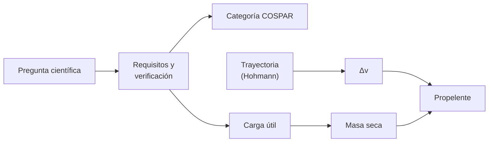

# B56-C20 — Diseño de misión astrobiológica conceptual

<!-- nav:top -->
[🏠 Programa](../../../../README.md) · [📚 Bloque B56](../../../tronco-comun/B56-astrobiologia-y-vida-extraterrestre.md) · [← Anterior: B56-C19 — Ética del descubrimiento de vida](../B56-C19-etica-del-descubrimiento-de-vida/CLASE.md) · [Siguiente: B56-C21 — Polimerización prebiótica experimental: oligómeros y condiciones de laboratorio →](../B56-C21-polimerizacion-prebiotica-experimental-oligomeros-y-condiciones-de-laboratorio/CLASE.md)
<!-- /nav -->

## 1. Ubicación, nivel y alcance

Clase 20 del bloque B56 y cierre integrador de la malla base. Nivel N3. Tomas la mecánica orbital ([B05-C10](../../B05/B05-C10-gravitacion-universal/CLASE.md)), los límites de [C05](../B56-C05-extremofilos-y-limites-ambientales/CLASE.md) y la protección de [C18](../B56-C18-proteccion-planetaria-cospar/CLASE.md) para esbozar **una misión astrobiológica conceptual** con requisitos, un presupuesto de Δv y de propelente y su verificación. Es un ejercicio de ingeniería conceptual; no es el diseño de una misión real. El diseño de misiones en detalle pertenece a otros bloques del programa.

## 2. Por qué esta clase existe

Una misión que busca vida combina ciencia, ingeniería y protección planetaria. Para decidir si es viable hay que traducir la pregunta científica en requisitos y comprobar que el presupuesto cierra. La decisión central: **dado un objetivo (buscar biofirmas en Marte), ¿qué requisitos, qué categoría de protección y qué presupuesto de propelente necesita?**

## 3. Lo que podrás hacer al terminar

1. Definir requisito, criterio de verificación, Δv de Hohmann y ecuación del cohete.
2. Escribir tres requisitos con su verificación y su categoría de protección.
3. Calcular los Δv y el tiempo de vuelo de una transferencia de Hohmann entre órbitas circulares.
4. Verificar el tiempo de vuelo con una integración RK4.
5. Calcular la masa de propelente con la ecuación del cohete.
6. Nombrar qué deja fuera el esbozo (ventanas, órbitas de aparcamiento, captura).

La evidencia es el **esbozo de misión con presupuesto** del ejercicio 12 (sección 20).

## 4. Con qué llegas y cómo comprobarlo

1. ¿Qué es la ecuación vis-viva?
2. ¿Qué es una transferencia de Hohmann?
3. ¿Qué es el impulso específico?
4. ¿Qué es un requisito verificable?
5. ¿Qué categoría tiene un aterrizador a Marte (C18)?

<details>
<summary>Ver respuestas</summary>

1. `v² = μ(2/r − 1/a)`. 2. Una elipse tangente a dos órbitas circulares. 3. El empuje por unidad de caudal de peso de propelente. 4. Uno que se comprueba con una prueba, análisis o inspección. 5. IV.
</details>

Con cuatro o cinco aciertos, sigue; si no, repasa B05-C10 y [C18](../B56-C18-proteccion-planetaria-cospar/CLASE.md).

## 5. Un caso real: Marte y el semieje publicado

La hoja de datos de Marte de la NASA (S1, consultada el 2026-11-09) da el semieje mayor `227,956 × 10⁶ km`. Con él y una órbita terrestre circular de 1 UA, el **ejemplo conductor** es una misión conceptual de aterrizaje a Marte con instrumentos de búsqueda de biofirmas. Por su tipo (aterrizador que investiga vida actual) sería de categoría **IVb** según la política (S2); el GM del Sol y la UA son valores estándar **no consultados**, y el impulso específico y la masa seca son **sintéticos**.

## 6. Vocabulario

Un **requisito** es una condición que la misión debe cumplir. La **verificación** es el método (análisis, prueba, inspección) con el que se comprueba. El **Δv** es el cambio de velocidad necesario. La **transferencia de Hohmann** es la de menor Δv entre dos órbitas circulares coplanares. La **ecuación del cohete** liga Δv y masas: `m₀/m_f = exp(Δv/(Isp g₀))`. La **masa seca** es la de la nave sin propelente.

## 7. Modelo mental: de la pregunta al presupuesto

La pregunta científica genera requisitos; los requisitos fijan la categoría y la carga útil; la trayectoria fija el Δv; el Δv fija el propelente.



*Descripción textual:* de la pregunta salen requisitos, categoría y carga útil; de la trayectoria, el Δv; con la masa seca se obtiene el propelente.

Analogía: planificar un viaje: destino, equipaje, ruta y combustible. Su límite: una misión real itera todo varias veces.

## 8. La explicación, paso a paso

### 8.1 Requisitos de ejemplo

R1: detectar compuestos orgánicos en muestras a profundidad definida (verificación: prueba del instrumento). R2: cumplir la limpieza de la categoría correspondiente (C17; verificación: ensayo y análisis). R3: operar un tiempo mínimo en superficie (verificación: análisis de energía). Son ejemplos **ilustrativos**.

### 8.2 Categoría

Un aterrizador a Marte que investiga vida actual es categoría IVb: se aplican los límites de IVa más requisitos adicionales (S2). Los detalles de IVb no se leyeron aquí.

### 8.3 Δv de Hohmann

Con `μ = 1,327 124 400 18 × 10²⁰ m³/s²` (no consultado), `r₁ = 1 UA` y `r₂ = 227,956 × 10⁹ m`: Δv de salida (exceso heliocéntrico) `2,945 km/s`, de llegada `2,649 km/s` y tiempo de vuelo `258,9 d`.

### 8.4 Verificación por integración

Integrando con RK4 (paso de 1 h) la media órbita de transferencia, el tiempo es `258,88 d`; coincide con la forma cerrada a menos de `10⁻⁶`.

### 8.5 Propelente

Con `Isp = 320 s` y masa seca `1000 kg` (sintéticos): para `Δv = 2,945 km/s`, `m₀/m_f = 2,556` y propelente `1556 kg`; para `Δv = 5,594 km/s` (salida más llegada), `5,946` y `4946 kg`. El esbozo ignora la salida del pozo de la Tierra, la captura en Marte y el aterrizaje.

## 9. Magnitudes, símbolos y unidades

| Símbolo | Qué es | Unidad | Valor / nota |
|---|---|---|---|
| `μ` | GM del Sol | `m³ s⁻²` | `1,327 124 400 18 × 10²⁰` (no consultado) |
| `r₁`, `r₂` | radios de órbita | m | `1,495 978 707 × 10¹¹` (no consultado); `227,956 × 10⁹` (S1) |
| `Δv₁`, `Δv₂` | impulsos | km/s | 2,945; 2,649 |
| `t` | tiempo de vuelo | d | 258,9 |
| `Isp` | impulso específico | s | 320 (sintético) |
| `m_seca` | masa seca | kg | 1000 (sintética) |

## 10. Convenciones y referencias

Órbitas circulares y coplanares, impulsos instantáneos, Δv de exceso heliocéntrico. El impulso específico y la masa seca son **sintéticos**; `μ` y la UA, **no consultados**.

## 11. De dónde sale lo que afirmamos

| ID | Fuente | Localizador | Respalda | Estado |
|---|---|---|---|---|
| S1 | NASA/NSSDC, *Mars Fact Sheet* (actualizada 2025-05-19) | https://nssdc.gsfc.nasa.gov/planetary/factsheet/marsfact.html | Semieje mayor de Marte | Consultada el 2026-11-09 |
| S2 | COSPAR, *COSPAR Policy on Planetary Protection*, Space Research Today n.º 224, enero de 2026 | https://cosparhq.cnes.fr/assets/uploads/2026/01/SRT_224_Editorial_PPP-Nov-2025.pdf | Categorías IVa/IVb para Marte; límites de IVa | Texto completo extraído el 2026-11-09 |

Límites: la Hohmann y la ecuación del cohete son resultados estándar verificados por integración; `μ`, la UA, el `Isp` y la masa seca no tienen fuente consultada; la subcategoría IVb no se detalla.

## 12. Cómo ver el presupuesto

Equivalente accesible a una tabla:

| Fase | Δv (km/s) | `m₀/m_f` | Propelente (kg, masa seca 1000) |
|---|---|---|---|
| Salida | 2,945 | 2,556 | 1556 |
| Salida + llegada | 5,594 | 5,946 | 4946 |

Descripción larga: sumar la llegada triplica casi el propelente; el coste crece exponencialmente con el Δv.

## 13. Ejemplo trabajado: propelente con `Isp = 450 s`

**Paso 1 · Datos.** `Δv = 5,594 km/s`, `Isp = 450 s`, masa seca 1000 kg (sintéticos).

**Paso 2 · Velocidad de escape efectiva.** `450 × 9,80665 = 4413 m/s`.

**Paso 3 · Razón.** `exp(5594/4413) = exp(1,2676) = 3,552`.

**Paso 4 · Propelente.** `1000 × 2,552 = 2552 kg`. Sentido: un motor más eficiente reduce el propelente a la mitad. Resultado sintético.

## 14. Distintos enfoques

**Hohmann con órbitas circulares (esta clase):** cota inferior simple. **Optimización de trayectoria con efemérides:** ventanas reales. **Diseño por iteración de misión:** converge requisitos, masa y costo. Para un esbozo sirve la primera.

## 15. Práctica guiada

**Ejercicio 1 · con los pasos indicados.** Calcula el semieje de la transferencia. *Pasos:* `(r₁ + r₂)/2`.

<details><summary>Solución comentada</summary>

`(1,496 × 10¹¹ + 2,280 × 10¹¹)/2 = 1,888 × 10¹¹ m`.
</details>

**Ejercicio 2 · con una pista.** Calcula la velocidad circular de la Tierra. *Pista:* `√(μ/r₁)`.

<details><summary>Solución comentada</summary>

`√(1,3271 × 10²⁰/1,496 × 10¹¹) = 29,78 km/s`.
</details>

**Ejercicio 3 · casi autónomo.** Calcula `m₀/m_f` con `Δv = 3 km/s` e `Isp = 320 s`.

<details><summary>Solución comentada</summary>

`exp(3000/3138) = 2,60`.
</details>

## 16. Práctica autónoma, transferencia e integrador

**Ejercicio 4.** ¿Por qué el tiempo de vuelo es media órbita de la elipse?

<details><summary>Solución comentada</summary>

Porque va del perihelio (1 UA) al afelio (órbita de Marte); `t = π√(a³/μ)` (8.3).
</details>

**Ejercicio 5.** Si la masa seca sube a 1500 kg, ¿cuánto propelente para 2,945 km/s?

<details><summary>Solución comentada</summary>

`1500 × 1,556 = 2334 kg`.
</details>

**Ejercicio 6.** ¿Qué requisito añadirías para la protección planetaria?

<details><summary>Solución comentada</summary>

Que la carga biológica cumpla los límites de IVa (C17), verificado por ensayo y análisis.
</details>

**Ejercicio 7.** ¿Qué verifica la integración RK4?

<details><summary>Solución comentada</summary>

Que la ley de Kepler del tiempo de vuelo es consistente con la gravedad newtoniana (8.4).
</details>

**Ejercicio 8.** ¿Por qué se llama «cota» al Δv de Hohmann?

<details><summary>Solución comentada</summary>

Porque es el mínimo para órbitas circulares coplanares; una misión real necesita más por ventanas y maniobras (8.5).
</details>

**Ejercicio 9 · transferencia.** Un compañero dice: «con 1556 kg de propelente llegamos y aterrizamos». Respóndele.

<details><summary>Solución comentada</summary>

Ese valor cubre solo el impulso de salida; faltan llegada, captura y descenso (8.5).
</details>

**Ejercicio 10 · transferencia.** ¿Qué categoría tendría un orbitador a Marte sin aterrizador?

<details><summary>Solución comentada</summary>

III (C18).
</details>

**Ejercicio 11 · transferencia.** ¿Qué decisión de diseño reduciría más el propelente?

<details><summary>Solución comentada</summary>

Reducir la masa seca o mejorar el `Isp`: el propelente crece exponencialmente con `Δv/(Isp g₀)`.
</details>

**Ejercicio 12 · integrador.** Elabora tu *esbozo de misión con presupuesto*: define el objetivo, tres requisitos con verificación, la categoría COSPAR, el Δv y el propelente con `Isp` y masa seca elegidos (sintéticos), y tres riesgos.

<details><summary>Solución modelo</summary>

Objetivo: biofirmas en Marte; requisitos R1–R3 (8.1); categoría IVb (8.2); Δv 5,594 km/s y propelente 4946 kg con `Isp = 320` y 1000 kg secos; riesgos: contaminación, ventanas, aterrizaje. Rotulado como conceptual.
</details>

## 17. Laboratorio: Hohmann y ecuación del cohete

El script [presupuesto_de_mision.py](presupuesto_de_mision.py) calcula los Δv, el tiempo de vuelo, lo verifica con RK4 (`10⁻⁶`) y calcula el propelente.

**Datos:** semieje de Marte de S1; `μ` y UA no consultados; `Isp` y masa sintéticos. **Predice antes de ejecutar:** ¿cuánto dura el vuelo? (unos 259 d.) **Ejecución del 2026-11-09 (Python 3.12.9):**

```text
Python 3.12.9 (biblioteca estandar)
Delta v de salida = 2.945 km/s ; de llegada = 2.649 km/s ; tiempo de vuelo = 258.9 d
Tiempo de vuelo por RK4 = 258.88 d
Delta v = 2.945 km/s -> m0/mf = 2.556 ; propelente = 1556 kg para 1000 kg secos
Delta v = 5.594 km/s -> m0/mf = 5.946 ; propelente = 4946 kg para 1000 kg secos
Pruebas superadas.
```

```bash
python programa/clases/B56/B56-C20-diseno-de-mision-astrobiologica-conceptual/presupuesto_de_mision.py
```

**Límites:** órbitas circulares coplanares, impulsos instantáneos; no es el diseño de una misión real.

## 18. Errores frecuentes y cómo corregirlos

**Presentar el esbozo como diseño real.** Se corrige con la sección 10.

**Olvidar la llegada.** Se corrige con el ejercicio 9.

**Ignorar la protección planetaria.** Se corrige con el ejercicio 6.

**Tratar el propelente como lineal.** Se corrige con el ejercicio 11.

**Mezclar unidades (m, km).** Se corrige con el ejercicio 1.

## 19. Cómo sabrás que vas bien

Tras 8.3: ¿calculas el Δv? Ejercicio 2. Tras 8.5: ¿cómo cambia el propelente? Ejercicios 3 y 5. Tras el laboratorio: ¿qué prueba RK4? (la consistencia del tiempo de vuelo).

## 20. Qué entregas y cómo se evalúa

El producto es tu **esbozo de misión con presupuesto** (ejercicio 12).

| Criterio | Inicial | En desarrollo | Logrado | Destacado |
|---|---|---|---|---|
| Requisitos | Vagos | Sin verificación | Tres con verificación | Trazados a la pregunta |
| Protección | Ignorada | Parcial | Categoría y límites | Requisitos derivados |
| Presupuesto | Sin unidades | Con errores | Δv y propelente correctos | Con sensibilidad |
| Rótulos | Sin rotular | Parciales | Sintético rotulado | Declara lo no consultado |
| Fuentes | Sin fuente | Sin fecha | S1–S2 con fecha | Declara que la política prevalece |

**Condiciones críticas (no se compensan con promedio):** rotular `Isp`, masa y `μ`; no presentar el esbozo como misión real; citar solo lo consultado.

## 21. Ética, seguridad y límites

La clase es educativa y no diseña hardware real ni afirma viabilidad. La protección planetaria prevalece sobre cualquier optimización. Accesibilidad: tablas equivalentes a las gráficas, fórmulas en texto, ejercicios sin conexión.

## 22. Para cerrar y seguir

Un esbozo de misión traduce una pregunta en requisitos, una categoría de protección y un presupuesto: en el ejemplo, 5,6 km/s de Δv y casi 5 toneladas de propelente por tonelada seca. Queda la ampliación `0.2.0`: cómo se forman en el laboratorio los oligómeros prebióticos.

**Glosario español–inglés.** requisito · *requirement*; verificación · *verification*; transferencia de Hohmann · *Hohmann transfer*; ecuación del cohete · *rocket equation*; masa seca · *dry mass*; impulso específico · *specific impulse*.

**Continuidad.** [B56-C21](../B56-C21-polimerizacion-prebiotica-experimental-oligomeros-y-condiciones-de-laboratorio/CLASE.md) vuelve al origen con la polimerización prebiótica experimental.

**Referencias:** ver sección 11.

<!-- nav:bottom -->
---

[← Anterior: B56-C19 — Ética del descubrimiento de vida](../B56-C19-etica-del-descubrimiento-de-vida/CLASE.md) · [📚 Bloque B56](../../../tronco-comun/B56-astrobiologia-y-vida-extraterrestre.md) · [Siguiente: B56-C21 — Polimerización prebiótica experimental: oligómeros y condiciones de laboratorio →](../B56-C21-polimerizacion-prebiotica-experimental-oligomeros-y-condiciones-de-laboratorio/CLASE.md)
<!-- /nav -->
