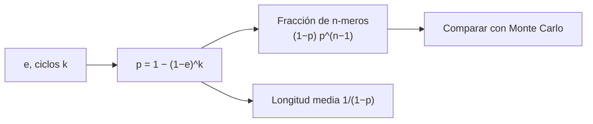

# B56-C21 — Polimerización prebiótica experimental: oligómeros y condiciones de laboratorio

<!-- nav:top -->
[🏠 Programa](../../../../README.md) · [📚 Bloque B56](../../../tronco-comun/B56-astrobiologia-y-vida-extraterrestre.md) · [← Anterior: B56-C20 — Diseño de misión astrobiológica conceptual](../B56-C20-diseno-de-mision-astrobiologica-conceptual/CLASE.md) · [Siguiente: B57-C01 — Fundamentos de teledetección →](../../../tronco-comun/B57-observacion-terrestre-y-geociencias-orbitales.md#b57-c01)
<!-- /nav -->

## 1. Ubicación, nivel y alcance

Clase 21 del bloque B56, de la ampliación `0.2.0`. Nivel N3. Complementa a [C03](../B56-C03-origen-de-moleculas-autorreplicantes/CLASE.md), que trata el origen de replicadores, y a [C04](../B56-C04-hipotesis-de-abiogenesis/CLASE.md), con una pregunta que esas clases dejan abierta: **qué longitudes de oligómeros produce una polimerización experimental y cómo la mejoran los ciclos húmedo–seco**. Usas un modelo estadístico (Flory) con datos sintéticos; no das procedimientos de laboratorio ni reproduces experimentos.

## 2. Por qué esta clase existe

C03 trata el origen de autorreplicantes, pero ninguna clase trata la polimerización experimental y sus límites. Antes de que un replicador pueda copiarse, hay que formar cadenas lo bastante largas. La decisión central: **dada la eficiencia de enlace por ciclo, ¿qué distribución de longitudes de oligómeros se espera y cuántos ciclos hacen falta para una longitud media dada?**

## 3. Lo que podrás hacer al terminar

1. Definir monómero, oligómero, extensión de reacción y ciclo húmedo–seco.
2. Calcular la fracción de cadenas de longitud `n` y la longitud media con el modelo de Flory.
3. Modelar la extensión tras `k` ciclos y verificar la fórmula cerrada.
4. Contrastar la fórmula con una simulación Monte Carlo de semilla fija.
5. Explicar por qué la longitud media crece muy deprisa cerca de `p = 1`.
6. Distinguir lo reportado en la literatura (resúmenes) de lo simulado.

La evidencia es la **distribución de oligómeros de un experimento sintético** del ejercicio 12 (sección 20).

## 4. Con qué llegas y cómo comprobarlo

1. ¿Qué es una distribución geométrica?
2. ¿Qué es una simulación con semilla fija?
3. ¿Qué es un monómero?
4. ¿Qué es la serie geométrica `Σ pⁿ`?
5. ¿Qué es un ciclo húmedo–seco?

<details>
<summary>Ver respuestas</summary>

1. La de los ensayos hasta el primer fallo: `(1 − p)pⁿ⁻¹`. 2. Una simulación aleatoria reproducible. 3. Una unidad que se une a otras para formar un polímero. 4. `1/(1 − p)` si `p < 1`. 5. Alternancia de hidratación y secado de una mezcla.
</details>

Con cuatro o cinco aciertos, sigue; si no, repasa B12 y [C04](../B56-C04-hipotesis-de-abiogenesis/CLASE.md).

## 5. Un caso real: lo que reporta la literatura

El resumen de Simonis et al. (2026, *Scientific Reports*) informa de la síntesis abiótica de polímeros resistentes a la ARNasa a partir de AMP y UMP no activados y de ribosa-5'-fosfato bajo ciclos húmedo–seco simulados; SAXS sugiere agregados de unas 120 unidades (S1, solo resumen). El de Alejandre et al. (2025, *Communications Chemistry*) describe un **modelo teórico y computacional** de polimerización y replicación de ARN en una interfaz arcilla–agua, con cadenas de más de 15 nucleótidos (S2, solo resumen; no es un experimento). **Ejemplo conductor sintético:** monómeros con eficiencia de enlace `e = 0,30` por ciclo.

## 6. Vocabulario

Un **monómero** es la unidad; un **oligómero**, una cadena corta de monómeros. La **extensión de reacción** `p` es la probabilidad de que un extremo haya reaccionado. Un **ciclo húmedo–seco** alterna agua y secado, favoreciendo la unión por pérdida de agua. La **distribución de Flory** da la fracción de cadenas de longitud `n`: `(1 − p) pⁿ⁻¹`. La **longitud media en número** es `1/(1 − p)`.

## 7. Modelo mental: eslabones que se enganchan al azar

Cada extremo se engancha al siguiente con probabilidad `p`. Las cadenas largas son raras pero existen; al subir `p` el promedio sube muy rápido.



*Descripción textual:* de la eficiencia y los ciclos se obtiene la extensión; de ella, la distribución y la longitud media, que se comparan con una simulación.

Analogía: dar la mano en una fila donde cada par se une con cierta probabilidad. Su límite: aquí la reactividad no depende de la longitud ni hay hidrólisis.

## 8. La explicación, paso a paso

### 8.1 Extensión tras ciclos

Con `p_{k+1} = p_k + (1 − p_k) e` desde `p₀ = 0`: `p_k = 1 − (1 − e)^k`. Con `e = 0,30`: `k = 1 → 0,3000`; `k = 3 → 0,6570`; `k = 6 → 0,8824`; `k = 10 → 0,9718`.

### 8.2 Longitud media

`1/(1 − p)`: `1,43; 2,92; 8,50; 35,40` para esos ciclos. De seis a diez ciclos la longitud media se multiplica por más de cuatro.

### 8.3 Distribución para `p = 0,8824`

Fracción en número de `n`-meros: `n = 1`: `0,1176`; `n = 2`: `0,1038`; `n = 5`: `0,0713`; `n = 10`: `0,0381`.

### 8.4 Verificación Monte Carlo

Una simulación de `200 000` monómeros (semilla 31415) da `0,1166; 0,1060; 0,0696; 0,0392` para esos `n` (todas a menos de 0,01 de la fórmula) y una longitud media de `8,446` frente a `8,500` (0,6 %).

### 8.5 Lo que el modelo deja fuera

Hidrólisis (que acorta cadenas), ciclización, dependencia de la reactividad con la longitud, el enlace correcto (3'-5' frente a 2'-5') y el papel del mineral o la superficie. Los resultados experimentales reales no se leen de este modelo.

## 9. Magnitudes, símbolos y unidades

| Símbolo | Qué es | Unidad | Valor / nota |
|---|---|---|---|
| `e` | eficiencia por ciclo | adimensional | 0,30 (sintética) |
| `k` | número de ciclos | — | 1 a 10 |
| `p` | extensión de reacción | adimensional | `1 − (1 − e)^k` |
| `n` | longitud de cadena | monómeros | 1, 2, 5, 10 |
| `X̄` | longitud media | monómeros | `1/(1 − p)` |

## 10. Convenciones y referencias

Reactividad independiente de la longitud; sin hidrólisis ni ciclización; semilla 31415. Todos los números son **sintéticos**.

## 11. De dónde sale lo que afirmamos

| ID | Fuente | Localizador | Respalda | Estado |
|---|---|---|---|---|
| S1 | Simonis et al., *Abiotic synthesis of RNase-resistant phosphodiester and pyrophosphate-linked polymers via thermodynamically controlled wet-dry cycling*, Sci. Rep. 16, 2026 | https://doi.org/10.1038/s41598-026-56548-9 | Contexto: polímeros abióticos con ciclos húmedo–seco; agregados de ~120 unidades por SAXS | Solo resumen (Europe PMC), consultado el 2026-11-09 |
| S2 | Alejandre et al., *Polymerization and replication of primordial RNA induced by clay-water interface dynamics*, Commun. Chem. 8, 2025 | https://doi.org/10.1038/s42004-025-01632-w | Contexto: modelo computacional de polimerización en interfaz arcilla–agua; >15 nt | Solo resumen (Europe PMC), consultado el 2026-11-09 |
| S3 | Pianowski, *Approaching life in a test tube with prebiotic chemistry*, Commun. Chem. 9, 2026 | https://doi.org/10.1038/s42004-026-02257-3 | Contexto: revisión cronológica de hipótesis y experimentos de química prebiótica | Solo resumen (Europe PMC), consultado el 2026-11-09 |

Límites: de S1–S3 solo los resúmenes; no se citan rendimientos ni condiciones experimentales; el modelo de Flory es un resultado estándar de polimerización por pasos verificado numéricamente aquí; nada de esta clase reproduce un experimento.

## 12. Cómo ver la distribución

Equivalente accesible a un histograma (`p = 0,8824`):

| `n` | Flory | Monte Carlo |
|---|---|---|
| 1 | 0,1176 | 0,1166 |
| 2 | 0,1038 | 0,1060 |
| 5 | 0,0713 | 0,0696 |
| 10 | 0,0381 | 0,0392 |

Descripción larga: la fracción decae despacio con `n`; la simulación sigue la fórmula dentro del ruido estadístico.

## 13. Ejemplo trabajado: ¿cuántos ciclos para una longitud media de 20?

**Paso 1 · Dato.** `X̄ = 20` (sintético).

**Paso 2 · Extensión.** `1/(1 − p) = 20` → `p = 0,95`.

**Paso 3 · Ciclos.** `(1 − e)^k = 0,05` → `k = ln 0,05/ln 0,7 = 8,40`; 9 ciclos.

**Paso 4 · Sentido.** Con `e = 0,30` hacen falta unos 9 ciclos. Resultado de un modelo con números sintéticos.

## 14. Distintos enfoques

**Flory (esta clase):** analítico, sin hidrólisis. **Modelos cinéticos con hidrólisis:** dan un equilibrio de longitudes. **Experimento:** la referencia, con sus condiciones. Para entender la forma de la distribución sirve el primero.

## 15. Práctica guiada

**Ejercicio 1 · con los pasos indicados.** Calcula `p` tras 3 ciclos con `e = 0,30`. *Pasos:* `1 − 0,7³`.

<details><summary>Solución comentada</summary>

`1 − 0,343 = 0,657` (8.1).
</details>

**Ejercicio 2 · con una pista.** Calcula la longitud media para `p = 0,657`. *Pista:* `1/(1 − p)`.

<details><summary>Solución comentada</summary>

`1/0,343 = 2,92` (8.2).
</details>

**Ejercicio 3 · casi autónomo.** ¿Qué fracción de las cadenas son dímeros con `p = 0,657`?

<details><summary>Solución comentada</summary>

`(1 − p)p = 0,343 × 0,657 = 0,2254`.
</details>

## 16. Práctica autónoma, transferencia e integrador

**Ejercicio 4.** Calcula la fracción de cadenas de 10 monómeros con `p = 0,9`.

<details><summary>Solución comentada</summary>

`0,1 × 0,9⁹ = 0,0387`.
</details>

**Ejercicio 5.** ¿Qué pasa con la longitud media si `p` sube de 0,9 a 0,99?

<details><summary>Solución comentada</summary>

Pasa de 10 a 100: se multiplica por 10 (8.2).
</details>

**Ejercicio 6.** ¿Cuántos ciclos con `e = 0,5` dan `p ≥ 0,99`?

<details><summary>Solución comentada</summary>

`0,5^k ≤ 0,01` → `k ≥ 6,64`: 7 ciclos.
</details>

**Ejercicio 7.** Explica por qué la simulación usa muchos monómeros.

<details><summary>Solución comentada</summary>

Para reducir el ruido estadístico: con pocas cadenas la fracción de dímeros fluctúa más de 0,01 (el laboratorio pasó de 20 000 a 200 000 monómeros).
</details>

**Ejercicio 8.** ¿Qué efecto tendría la hidrólisis?

<details><summary>Solución comentada</summary>

Rompe enlaces y acorta la longitud media; el modelo la omite (8.5).
</details>

**Ejercicio 9 · transferencia.** Un titular dice: «polimerizan ARN sin enzimas, luego se explica el origen de la vida». Respóndele.

<details><summary>Solución comentada</summary>

Formar oligómeros es una condición necesaria, no suficiente: faltan información, replicación y selección (C03, C04). Los resúmenes consultados no permiten concluir más.
</details>

**Ejercicio 10 · transferencia.** Un artículo reporta cadenas de más de 15 nt en un modelo computacional. ¿Qué cuidado tienes al citarlo?

<details><summary>Solución comentada</summary>

Decir que es un modelo, no un experimento (S2).
</details>

**Ejercicio 11 · transferencia.** ¿Cómo compararías tu `e` con un experimento?

<details><summary>Solución comentada</summary>

Ajustando la distribución observada de longitudes a `(1 − p)pⁿ⁻¹` y despejando `p` y `e`; la clase no tiene datos experimentales.
</details>

**Ejercicio 12 · integrador.** Elabora tu *distribución de oligómeros*: elige `e` y el número de ciclos (sintéticos), calcula `p`, la longitud media y las fracciones de `n = 1, 2, 5, 10`, simula con una semilla, compara y lista dos efectos omitidos.

<details><summary>Solución modelo</summary>

Con `e = 0,30`, 6 ciclos: `p = 0,8824`, `X̄ = 8,50`; fracciones del 12; simulación a 0,01. Omitidos: hidrólisis y selectividad del enlace. Rotulado como sintético.
</details>

## 17. Laboratorio: distribución de Flory

El script [oligomeros.py](oligomeros.py) calcula `p` por ciclos (iterado y cerrado), la longitud media y las fracciones, y **comprueba** una simulación Monte Carlo (0,01 en fracción y 2 % en longitud media).

**Datos:** sintéticos. **Predice antes de ejecutar:** ¿qué longitud media tras 10 ciclos? (35,4.) **Ejecución del 2026-11-09 (Python 3.12.9):**

```text
Python 3.12.9 (biblioteca estandar)
ciclos =  1: p = 0.3000 ; longitud media =   1.43
ciclos =  3: p = 0.6570 ; longitud media =   2.92
ciclos =  6: p = 0.8824 ; longitud media =   8.50
ciclos = 10: p = 0.9718 ; longitud media =  35.40
n= 1: observada 0.1166 ; Flory 0.1176
n= 2: observada 0.1060 ; Flory 0.1038
n= 5: observada 0.0696 ; Flory 0.0713
n=10: observada 0.0392 ; Flory 0.0381
Longitud media simulada = 8.446 ; teorica = 8.500
Pruebas superadas.
```

```bash
python programa/clases/B56/B56-C21-polimerizacion-prebiotica-experimental-oligomeros-y-condiciones-de-laboratorio/oligomeros.py
```

**Límites:** sin hidrólisis ni ciclización; reactividad independiente de la longitud; datos sintéticos.

## 18. Errores frecuentes y cómo corregirlos

**Confundir fracción en número y en masa.** Se corrige con la sección 8.2.

**Presentar un modelo como experimento.** Se corrige con el ejercicio 10.

**Olvidar la hidrólisis.** Se corrige con el ejercicio 8.

**Concluir el origen de la vida de la polimerización.** Se corrige con el ejercicio 9.

**Tomar `e` como medido.** Se corrige con la sección 10.

## 19. Cómo sabrás que vas bien

Tras 8.1: ¿calculas `p`? Ejercicio 1. Tras 8.3: ¿la fracción de `n`-meros? Ejercicio 4. Tras el laboratorio: ¿qué prueba la simulación? (que la fórmula describe el proceso de unión al azar).

## 20. Qué entregas y cómo se evalúa

El producto es tu **distribución de oligómeros** (ejercicio 12).

| Criterio | Inicial | En desarrollo | Logrado | Destacado |
|---|---|---|---|---|
| Conceptos | Los confunde | Parciales | `p`, Flory, longitud media | Discute hidrólisis |
| Cálculo | Sin unidades | Con errores | Fracciones correctas | Con simulación |
| Comparación | Sin contrastar | Parcial | Monte Carlo coincide | Explica el ruido |
| Rótulos | Sin rotular | Parciales | Sintético rotulado | Separa modelo y experimento |
| Fuentes | Sin fuente | Sin fecha | S1–S3 con fecha y «solo resumen» | No cita rendimientos |

**Condiciones críticas (no se compensan con promedio):** rotular todo como sintético; no presentar el modelo como experimento; citar solo lo consultado.

## 21. Ética, seguridad y límites

La clase es educativa y no da protocolos de síntesis ni condiciones de laboratorio; los resúmenes se citan solo como contexto. Accesibilidad: tablas equivalentes a las gráficas, fórmulas en texto, ejercicios sin conexión.

## 22. Para cerrar y seguir

Con una eficiencia sintética de 0,30 por ciclo, la longitud media pasa de 1,4 a 35 monómeros entre uno y diez ciclos, y la distribución de longitudes sigue la forma de Flory. Con esto se cierra el bloque: de la definición de vida a la química que podría haberla precedido y a las reglas para buscarla y protegerla.

**Glosario español–inglés.** monómero · *monomer*; oligómero · *oligomer*; extensión de reacción · *extent of reaction*; ciclo húmedo–seco · *wet-dry cycle*; distribución de Flory · *Flory distribution*.

**Continuidad.** Fin del bloque: la [guía de B56](../../../tronco-comun/B56-astrobiologia-y-vida-extraterrestre.md) resume el recorrido.

**Referencias:** ver sección 11.

<!-- nav:bottom -->
---

[← Anterior: B56-C20 — Diseño de misión astrobiológica conceptual](../B56-C20-diseno-de-mision-astrobiologica-conceptual/CLASE.md) · [📚 Bloque B56](../../../tronco-comun/B56-astrobiologia-y-vida-extraterrestre.md) · [Siguiente: B57-C01 — Fundamentos de teledetección →](../../../tronco-comun/B57-observacion-terrestre-y-geociencias-orbitales.md#b57-c01)
<!-- /nav -->
