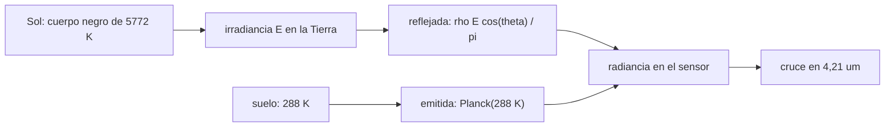

# B57-C01 — Fundamentos de teledetección

<!-- nav:top -->
[🏠 Programa](../../../../README.md) · [📚 Bloque B57](../../../tronco-comun/B57-observacion-terrestre-y-geociencias-orbitales.md) · [← Anterior: B56-C21 — Polimerización prebiótica experimental: oligómeros y condiciones de laboratorio](../../B56/B56-C21-polimerizacion-prebiotica-experimental-oligomeros-y-condiciones-de-laboratorio/CLASE.md) · [Siguiente: B57-C02 — Resolución espacial y temporal →](../B57-C02-resolucion-espacial-y-temporal/CLASE.md)
<!-- /nav -->

## 1. Ubicación, nivel y alcance

Clase 1 del bloque B57 y primera del área de observación de la Tierra. Un satélite no ve «la Tierra»: ve **radiancia**, la energía por unidad de área, ángulo sólido y longitud de onda que llega a su abertura. Aquí calculas con la ley de Planck cuánta radiancia refleja una superficie iluminada por el Sol y cuánta emite por su temperatura, y localizas la longitud de onda en que ambas se igualan. Usas [B10](../../../tronco-comun/B10-algebra-lineal-y-matematicas-geometricas.md) solo como apoyo de cálculo. Todo el modelo es **ilustrativo**: no se usa ninguna imagen observada.

## 2. Por qué esta clase existe

Casi todas las técnicas del bloque eligen una región del espectro: óptica y de infrarrojo cercano para reflectancia, infrarrojo térmico para temperatura, microondas para radar. Esa elección nace de una pregunta física: **¿en qué longitudes de onda domina la luz solar reflejada y en cuáles domina la emisión propia?**

## 3. Lo que podrás hacer al terminar

1. Calcular la radiancia espectral de Planck en W m⁻² sr⁻¹ m⁻¹ para una temperatura y una longitud de onda.
2. Comprobar numéricamente la ley de Stefan–Boltzmann y la ley de Wien.
3. Estimar la radiancia solar reflejada por una superficie lambertiana de reflectancia dada.
4. Localizar la longitud de onda de cruce entre reflexión y emisión (4,21 µm en el caso ilustrativo).
5. Explicar por qué se usan bandas visibles/infrarrojas cercanas para reflectancia y bandas de 10–12 µm para temperatura.

La evidencia es la **ficha de la radiación que ve un sensor** del ejercicio 12 (sección 20).

## 4. Con qué llegas y cómo comprobarlo

1. ¿Qué es una longitud de onda y en qué unidad se mide?
2. ¿Qué mide la temperatura en kelvin?
3. ¿Qué es una integral numérica?
4. ¿Qué es un valor ilustrativo?
5. ¿Qué es una verificación?

<details>
<summary>Ver respuestas</summary>

1. La distancia entre crestas de una onda; en el caso visible, del orden de 0,5 µm = 500 nm. 2. Una escala absoluta; 288 K son unos 15 °C. 3. Una suma de áreas pequeñas que aproxima el área bajo una curva. 4. Un valor propuesto para el ejemplo, no medido. 5. Comparar un cálculo con un caso independiente, aquí con la ley de Stefan–Boltzmann.
</details>

Con cuatro o cinco aciertos, sigue; si no, repasa los prerrequisitos.

## 5. Un caso de contexto y casos de referencia

Un píxel de suelo con reflectancia `0,30` es iluminado por el Sol con un ángulo cenital de `30°`. El Sol se modela como cuerpo negro de `5772 K` visto desde `1 UA` (radio solar `6,957 × 10⁸ m`) y la superficie emite como cuerpo negro de `288 K`. Es el **ejemplo conductor**; los parámetros son **ilustrativos** y el resultado es una **simulación**, no una observación.

## 6. Vocabulario

La **radiancia** `L` es la potencia por unidad de área proyectada, ángulo sólido y longitud de onda (W m⁻² sr⁻¹ m⁻¹). La **irradiancia** `E` es la potencia por unidad de área que llega a una superficie. La **reflectancia** `ρ` es la fracción de la irradiancia que la superficie devuelve; una superficie **lambertiana** la devuelve igual en todas las direcciones, con `L = ρ E cos θ / π`. La **emisividad** es la fracción de lo que emitiría un cuerpo negro. El **tope de la atmósfera** (TOA) es el nivel de referencia donde el modelo evalúa la radiancia.

## 7. Modelo mental: dos fuentes de luz sobre el mismo píxel

El sensor recibe la suma de lo que el píxel **refleja** del Sol y de lo que **emite** por su calor. Según la longitud de onda manda una u otra.



*Descripción textual:* el Sol alimenta la parte reflejada y la temperatura del suelo alimenta la parte emitida; la suma llega al sensor y las curvas se cruzan cerca de 4,2 µm.

Analogía: una habitación con una lámpara (luz reflejada en la pared) y una estufa (calor propio de la pared): a simple vista se ve la lámpara y con una cámara térmica se ve la estufa. Límite: aquí no hay atmósfera que absorba parte de la señal.

## 8. La explicación, paso a paso

### 8.1 La función de Planck

La radiancia espectral de un cuerpo negro es `B(λ,T) = 2hc² / λ⁵ · 1/(exp(hc/λk_BT) − 1)`, con `h = 6,62607015 × 10⁻³⁴ J s`, `c = 299 792 458 m/s` y `k_B = 1,380649 × 10⁻²³ J/K`. Integrada sobre todas las longitudes de onda y el hemisferio da `σT⁴`, con `σ = 5,670374e-08 W m⁻² K⁻⁴` derivada de esas constantes.

### 8.2 Dos comprobaciones independientes

| Cuerpo | integral π·B frente a σT⁴ (error relativo) | máximo numérico (µm) | ley de Wien (µm) |
|---|---|---|---|
| Sol, 5772 K | 9,93e-11 | 0,5020 | 0,5020 |
| Suelo, 288 K | 7,93e-07 | 10,0617 | 10,0617 |

La integral numérica concuerda con Stefan–Boltzmann y el máximo con Wien, de modo que la función está bien programada.

### 8.3 Reflejada frente a emitida

En `0,55 µm` la radiancia reflejada es `1,446e+08` y la emitida `8,44e-25 W m⁻² sr⁻¹ m⁻¹`: manda la luz solar. En `11 µm` la reflejada es `1,63e+04` y la emitida `7,966e+06`: manda la emisión propia. Las curvas se cruzan en `4,21 µm`.

### 8.4 Lectura

La banda visible mide **reflectancia**; la banda de 10–12 µm mide **temperatura**; entre ambas (hacia 3–5 µm) las dos contribuciones compiten y por eso esa zona exige cuidado. El cruce depende de la reflectancia, del ángulo solar y de la temperatura elegidos.

## 9. Magnitudes, símbolos y unidades

| Símbolo | Qué es | Unidad | Valor / nota |
|---|---|---|---|
| `B` | radiancia espectral de Planck | W m⁻² sr⁻¹ m⁻¹ | − |
| `T` | temperatura | K | 5772; 288 |
| `ρ` | reflectancia | adimensional | 0,30 (ilustrativa) |
| `θ` | ángulo cenital solar | grado | 30 |
| `λ_cruce` | cruce reflejada–emitida | µm | 4,21 |

## 10. Convenciones y referencias

Radiancia espectral por unidad de longitud de onda en metros; longitud de onda en µm solo en tablas. Referencia: tope de la atmósfera, sin absorción. Superficie lambertiana y emisividad 1. Las constantes `h`, `c`, `k_B` son los valores exactos del SI; no se consultó una página para esta sesión.

## 11. De dónde sale lo que afirmamos

| ID | Fuente | Localizador | Respalda | Estado |
|---|---|---|---|---|
| — | Sin fuente externa | — | relaciones estándar que verifica el laboratorio | No se consultó una fuente para esta clase |

**Límites de las fuentes.** No se consultó ninguna fuente para esta clase: las constantes del SI y las temperaturas son valores de referencia no consultados en la sesión, y los parámetros de la escena son ilustrativos. El Sol no es un cuerpo negro perfecto.

## 12. Cómo ver los resultados

| Magnitud | Valor |
|---|---|
| radiancia reflejada en 0,55 µm | 1,446e+08 W m⁻² sr⁻¹ m⁻¹ |
| radiancia emitida en 11 µm | 7,966e+06 W m⁻² sr⁻¹ m⁻¹ |
| cruce reflejada = emitida | 4,21 µm |
| error de la integral frente a σT⁴ (Sol) | 9,93e-11 |

Descripción larga: a longitudes de onda cortas la curva reflejada queda muy por encima de la emitida; a largas ocurre lo contrario y el cruce marca el cambio de régimen.

## 13. Ejemplo trabajado: la radiancia reflejada en 0,55 µm

**Paso 1 · Irradiancia.** `E = π B(0,55 µm; 5772 K)(R☉/d)²`, con `R☉/d = 4,651 × 10⁻³`.

**Paso 2 · Factor geométrico.** `cos 30° = 0,8660`.

**Paso 3 · Radiancia.** `L = 0,30 · E · 0,8660 / π = 1,446e+08 W m⁻² sr⁻¹ m⁻¹`.

**Paso 4 · Comparación.** La emisión propia en la misma longitud de onda es `8,44e-25`: despreciable.

## 14. Distintas formas de abordar el problema

**Por radiancia espectral:** la curva de Planck en cada λ. **Por energía total:** `σT⁴`. **Por posición del máximo:** la ley de Wien. **Por cruce:** la longitud de onda en que reflejada y emitida se igualan. Cada vía responde algo distinto y se comprueban entre sí.

## 15. Práctica guiada

**Ejercicio 1 · con los pasos indicados.** Aplica Wien a `T = 5772 K`. *Pasos:* divide `2897,77 µm K` entre `T`.

<details><summary>Solución comentada</summary>

`2897,77/5772 = 0,502 µm`, en el verde del visible; coincide con la tabla 8.2.
</details>

**Ejercicio 2 · con una pista.** Predice el máximo de emisión del suelo de 288 K. *Pista:* misma ley.

<details><summary>Solución comentada</summary>

`2897,77/288 = 10,06 µm`, en el infrarrojo térmico (tabla 8.2).
</details>

**Ejercicio 3 · casi autónomo.** ¿Por qué una banda de 0,55 µm no sirve para medir temperatura del suelo? Usa 8.3.

<details><summary>Solución comentada</summary>

Porque a 0,55 µm la radiancia emitida es muchísimo menor que la reflejada y la señal térmica queda enterrada.
</details>

## 16. Práctica autónoma, transferencia e integrador

**Ejercicio 4.** Si la reflectancia sube de 0,30 a 0,60, ¿cuánto cambia la radiancia reflejada?

<details><summary>Solución comentada</summary>

Se duplica, porque `L` es proporcional a `ρ`.
</details>

**Ejercicio 5.** Si el ángulo cenital pasa de 30° a 60°, ¿en qué factor cambia `L`? Usa `cos`.

<details><summary>Solución comentada</summary>

`cos 60°/cos 30° = 0,5/0,866 = 0,577`: baja un 42 %.
</details>

**Ejercicio 6.** Para un cuerpo de 300 K, ¿qué pasa con la integral `∫πB dλ` respecto de 288 K?

<details><summary>Solución comentada</summary>

Escala como `T⁴`: `(300/288)⁴ = 1,177`, un 17,7 % más.
</details>

**Ejercicio 7.** ¿Por qué el error de la integral es pequeño pero no cero? Usa 8.2.

<details><summary>Solución comentada</summary>

Porque la integral numérica trunca el rango de longitudes de onda y usa un número finito de puntos.
</details>

**Ejercicio 8.** Explica en una frase por qué el cruce no es una constante universal.

<details><summary>Solución comentada</summary>

Depende de `ρ`, del ángulo solar y de la temperatura de la superficie; en el caso ilustrativo vale 4,21 µm.
</details>

**Ejercicio 9 · transferencia.** **Transferencia.** Un colega dice que su imagen de 4 µm mide solo temperatura. Respóndele con 8.4.

<details><summary>Solución comentada</summary>

Cerca de 4 µm la luz solar reflejada y la emisión propia son comparables; hay que separar las dos contribuciones antes de hablar de temperatura.
</details>

**Ejercicio 10 · transferencia.** **Transferencia.** ¿Qué cambia en un satélite que mira de noche?

<details><summary>Solución comentada</summary>

Desaparece el término reflejado solar y solo queda la emisión; por eso las bandas térmicas son útiles también de noche.
</details>

**Ejercicio 11 · transferencia.** **Transferencia.** ¿Qué falta en este modelo para compararlo con una imagen real?

<details><summary>Solución comentada</summary>

La atmósfera (absorción y emisión propia), la respuesta del sensor, la anisotropía de la superficie y la emisividad real; hacen falta datos observados con procedencia.
</details>

**Ejercicio 12 · integrador.** **Integrador.** Elabora tu *ficha de la radiación que ve un sensor*: la tabla de comprobaciones de Planck (8.2), las radiancias reflejada y emitida en dos longitudes de onda (8.3) y el cruce, con unidades y la lista de supuestos.

<details><summary>Solución modelo</summary>

Tabla 8.2 (errores de la integral y del máximo), tabla de 8.3 con las cuatro radiancias en W m⁻² sr⁻¹ m⁻¹, cruce en 4,21 µm y supuestos: cuerpo negro, superficie lambertiana, sin atmósfera, parámetros ilustrativos.
</details>

## 17. Laboratorio: radiancia reflejada y emitida con la función de Planck

El script [radiancia.py](radiancia.py) calcula la función de Planck, la contrasta con Stefan–Boltzmann y Wien y halla el cruce entre luz reflejada y emisión propia (**comprueba** el error de la integral < 0,2 %, el máximo frente a Wien < 0,5 % y el orden de magnitud de las radiancias).

**Datos:** constantes del SI exactas (no consultadas en la sesión) y parámetros **ilustrativos**; sin datos observados. **Predice antes de ejecutar:** ¿en qué región manda la emisión propia? (más allá del cruce, 4,2 µm; el 11 µm es térmico.) **Ejecución del 2026-11-09 (Python 3.12.9):**

```text
Python 3.12.9 (biblioteca estandar)
sigma derivada = 5.670374e-08 W m^-2 K^-4
sol: integral pi*B vs sigma T^4: error relativo = 9.93e-11 ; maximo de Planck = 0.5020 um ; Wien = 0.5020 um
tierra: integral pi*B vs sigma T^4: error relativo = 7.93e-07 ; maximo de Planck = 10.0617 um ; Wien = 10.0617 um
0.55 um: reflejada = 1.4460e+08 ; emitida = 8.440e-25 W m^-2 sr^-1 m^-1
11 um: reflejada = 1.634e+04 ; emitida = 7.9658e+06 W m^-2 sr^-1 m^-1
Longitud de onda de cruce (reflejada = emitida) = 4.21 um
Pruebas superadas.
```

```bash
python programa/clases/B57/B57-C01-fundamentos-de-teledeteccion/radiancia.py
```

**Límites:** cuerpo negro, sin atmósfera y una sola geometría. El resultado es una simulación, no una observación.

## 18. Errores frecuentes y cómo corregirlos

**Mezclar radiancia e irradiancia.** La primera es por ángulo sólido y la segunda no; se corrige con la sección 6 y el factor `1/π`.

**Usar nm en la fórmula con metros.** Convierte todo a metros dentro de `B` (sección 10).

**Creer que el visible mide temperatura.** Se corrige con 8.3.

**Presentar la simulación como observación.** Se corrige con la sección 5: son parámetros ilustrativos.

## 19. Cómo sabrás que vas bien

Tras la sección 8: ¿qué resultado esperabas y cuál obtuviste? Si dudas, repasa el ejemplo 13. Tras el laboratorio: ¿qué comprueba? (ver la sección 17).

## 20. Qué entregas y cómo se evalúa

El producto es tu **ficha de la radiación que ve un sensor** (ejercicio 12).

| Criterio | Inicial | En desarrollo | Logrado | Destacado |
|---|---|---|---|---|
| Conceptos | Los confunde | Parciales | Conceptos de la clase | Explica los límites |
| Cálculo | Sin unidades | Con errores | Tablas completas con unidades | Calcula casos nuevos |
| Numérico | Sin comprobar | Un caso | Contraste con el caso analítico | Interpreta las diferencias |
| Fuentes | Sin fuente | Sin fecha | Fuentes con fecha | Declara lo no consultado |
| Límites | No los nombra | Uno | Tres | Discute qué falta del modelo |

**Condiciones críticas (no se compensan con promedio):** rotular el caso como ilustrativo; no presentar el modelo como una observación; citar solo lo consultado.

## 21. Ética, seguridad y límites

Clase educativa: el modelo es simplificado y sin atmósfera. Accesibilidad: tablas equivalentes a las gráficas, fórmulas en texto, ejercicios sin conexión.

## 22. Para cerrar y seguir

En el caso ilustrativo la luz solar domina por debajo de `4,2 µm` y la emisión propia por encima, lo que explica por qué un sensor usa bandas distintas para reflectancia y temperatura. Queda una pregunta: ¿con qué detalle espacial y temporal se mide esa radiancia?

**Glosario español–inglés.** radiancia · *radiance*; irradiancia · *irradiance*; reflectancia · *reflectance*; cuerpo negro · *blackbody*; tope de la atmósfera · *top of atmosphere (TOA)*.

**Continuidad.** [B57-C02](../B57-C02-resolucion-espacial-y-temporal/CLASE.md) estudia resolución espacial y temporal.

**Referencias:** ver sección 11.

<!-- nav:bottom -->
---

[← Anterior: B56-C21 — Polimerización prebiótica experimental: oligómeros y condiciones de laboratorio](../../B56/B56-C21-polimerizacion-prebiotica-experimental-oligomeros-y-condiciones-de-laboratorio/CLASE.md) · [📚 Bloque B57](../../../tronco-comun/B57-observacion-terrestre-y-geociencias-orbitales.md) · [Siguiente: B57-C02 — Resolución espacial y temporal →](../B57-C02-resolucion-espacial-y-temporal/CLASE.md)
<!-- /nav -->
