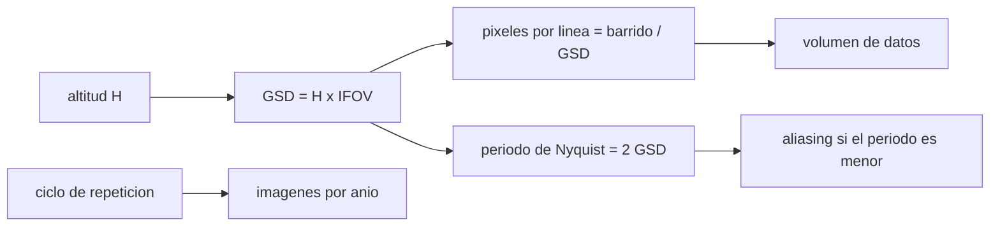

# B57-C02 — Resolución espacial y temporal

<!-- nav:top -->
[🏠 Programa](../../../../README.md) · [📚 Bloque B57](../../../tronco-comun/B57-observacion-terrestre-y-geociencias-orbitales.md) · [← Anterior: B57-C01 — Fundamentos de teledetección](../B57-C01-fundamentos-de-teledeteccion/CLASE.md) · [Siguiente: B57-C03 — Resolución radiométrica y espectral →](../B57-C03-resolucion-radiometrica-y-espectral/CLASE.md)
<!-- /nav -->

## 1. Ubicación, nivel y alcance

Clase 2 del bloque B57. Resolución es una palabra con muchos significados: aquí te quedas con la **espacial** (cuánto suelo representa un píxel y cuánto abarca la imagen) y la **temporal** (cada cuánto se vuelve a mirar el mismo lugar). Usas aritmética y una transformada de Fourier directa para ver el **aliasing**. Las cifras de Landsat 8 y de Sentinel-2 se citan de páginas consultadas; la señal con aliasing es **sintética**.

## 2. Por qué esta clase existe

Un satélite con píxeles de 30 m no ve una casa y uno que vuelve cada 16 días no ve una tormenta. La decisión central: **¿qué tamaño de píxel, qué ancho de barrido y qué ciclo de repetición necesita el fenómeno que quiero estudiar?**

## 3. Lo que podrás hacer al terminar

1. Calcular el IFOV y el GSD a partir de la altitud y viceversa.
2. Calcular los píxeles por línea de una escena y el volumen de datos de una banda.
3. Estimar el GSD en el borde del barrido con la aproximación de Tierra plana.
4. Predecir el periodo aparente de una señal con aliasing y comprobarlo con una DFT.
5. Traducir un ciclo de repetición en imágenes por año y punto, y reconocer el límite de las nubes.

La evidencia es la **ficha de resoluciones espacial y temporal** del ejercicio 12 (sección 20).

## 4. Con qué llegas y cómo comprobarlo

1. ¿Qué es un ángulo en radianes?
2. ¿Qué es un píxel?
3. ¿Qué es una frecuencia espacial?
4. ¿Qué es una simulación con datos sintéticos?
5. ¿Qué es una verificación?

<details>
<summary>Ver respuestas</summary>

1. El cociente arco/radio; un microrradián es un milímetro a un kilómetro. 2. La unidad mínima de una imagen, con un solo valor por banda. 3. Cuántos ciclos de una variación caben en una unidad de longitud. 4. Un cálculo con datos generados por una fórmula, no medidos. 5. Comparar un cálculo con un caso independiente.
</details>

Con cuatro o cinco aciertos, sigue; si no, repasa los prerrequisitos.

## 5. Un caso de contexto y casos de referencia

Landsat 8 vuela a `705 km`, tiene píxeles de `30 m` y un barrido de `185 km`; Sentinel-2 tiene `290 km` de barrido y píxeles de `10 m` en cuatro bandas. Un paisaje de campos con surcos cada `50 m` se muestrea con `30 m`. Es el **ejemplo conductor**: la geometría es **publicada**, el paisaje es **sintético**.

## 6. Vocabulario

El **GSD** (*ground sampling distance*) es la distancia en el suelo entre centros de píxeles contiguos. El **IFOV** es el ángulo que subtiende un píxel visto desde el sensor. El **barrido** es el ancho de la franja que se imagina en cada pasada. La **resolución temporal** es el intervalo entre observaciones del mismo punto; el **ciclo de repetición** es el tiempo tras el cual la traza se repite. El **aliasing** es la falsa frecuencia que aparece cuando se muestrea por debajo de dos muestras por ciclo (límite de Nyquist).

## 7. Modelo mental: una rejilla puesta sobre el paisaje

La imagen es una **rejilla de muestras** del paisaje. El tamaño de la rejilla fija el detalle, el ancho de la franja fija la cobertura y el ciclo fija la frecuencia con que la rejilla se vuelve a colocar.



*Descripción textual:* la altitud y el IFOV fijan el GSD; de él salen los píxeles por línea, el límite de Nyquist y el volumen, mientras el ciclo fija las imágenes por año.

Analogía: mirar un tejido con una malla de ventana: si la malla es más gruesa que el hilo, ves un dibujo falso (moiré). Límite: el moiré es una analogía visual del aliasing, no su medida.

## 8. La explicación, paso a paso

### 8.1 Geometría de una línea

En el nadir `GSD = H · IFOV`. Con `H = 705 km` y `GSD = 30 m`, `IFOV = 42,553 µrad`. Una línea de Landsat 8 tiene `185 km / 30 m = 6167` píxeles y una de Sentinel-2 `290 km / 10 m = 29000`. Una banda de escena de `185 × 185 km` a 16 bits ocupa `76,1 MB`.

### 8.2 El borde del barrido

En el borde, el rayo se inclina `7,47°` respecto del nadir y, con Tierra plana, el GSD transversal crece como `1/cos²θ` hasta `30,516 m`. Es un efecto pequeño con 185 km; en barridos mayores o con la curvatura de la Tierra se calcula con la geometría esférica.

### 8.3 Aliasing

Con paso `g = 30 m` el periodo de Nyquist es `60 m`. Una señal de `100 m` es resoluble; las de `50 m` y `20 m` se pliegan.

| periodo real (m) | aparente medido por DFT (m) | aparente teórico (m) |
|---|---|---|
| 50 | 75,00 | 75,00 |
| 20 | 60,00 | 60,00 |
| 100 | 100,00 | 100,00 |

### 8.4 Resolución temporal

Un ciclo de 16 días da como máximo `22,8` pasadas por año sobre un punto; sumar un segundo satélite con 8 días de desfase lleva el máximo a `45,6`. Son límites geométricos: las nubes y los datos válidos los reducen.

## 9. Magnitudes, símbolos y unidades

| Símbolo | Qué es | Unidad | Valor / nota |
|---|---|---|---|
| `H` | altitud | m | 705 000 |
| `GSD` | distancia de muestreo en el suelo | m | 30; 10 |
| `IFOV` | ángulo por píxel | µrad | 42,553 |
| `T_ciclo` | ciclo de repetición | días | 16; 8 con desfase |
| `P_N` | periodo de Nyquist | m | 60 |

## 10. Convenciones y referencias

Distancias en el suelo en metros; ángulos desde el nadir; Tierra plana en 8.2. Resolución espacial entendida como GSD (la resolución efectiva también depende de la función de dispersión del sensor, que esta clase no modela).

## 11. De dónde sale lo que afirmamos

| ID | Fuente | Localizador | Respalda | Estado |
|---|---|---|---|---|
| S1 | USGS, *Landsat 8 (bandas OLI y TIRS, barrido, órbita)* | https://www.usgs.gov/landsat-missions/landsat-8 | altitud 705 km, píxeles de 30 m, barrido de 185 km, ciclo de 16 días con 8 días de desfase con Landsat 9, 12 bits entregados en 16 bits. | Consultada 2026-11-09 (primeros 100.000 de 143.802 caracteres) |
| S2 | Copernicus, SentiWiki, *Sentinel-2 mission* | https://sentiwiki.copernicus.eu/web/s2-mission | barrido de 290 km, píxeles de 10 m en cuatro bandas, 12 bits adquiridos y 16 bits almacenados. | Consultada 2026-11-09 |

**Límites de las fuentes.** Las cifras de las dos misiones son las que mostraron las páginas el 2026-11-09; no se consultó un documento técnico de producto. La escena con aliasing es sintética.

## 12. Cómo ver los resultados

| Magnitud | Valor |
|---|---|
| IFOV | 42,553 µrad |
| píxeles por línea (Landsat 8 / Sentinel-2) | 6167 / 29000 |
| GSD en el borde (185 km) | 30,516 m |
| periodo aparente de la señal de 20 m | 60,0 m |

Descripción larga: una señal de 100 m se mide con su periodo correcto, y las de 50 m y 20 m aparecen como señales de 75 m y 60 m, lo que muestra cómo el muestreo puede inventar estructura.

## 13. Ejemplo trabajado: el periodo aparente de la señal de 20 m

**Paso 1 · Frecuencias.** `f = 1/20 = 0,05 ciclos/m`; `f_s = 1/30 = 0,0333 ciclos/m`.

**Paso 2 · Pliegue.** El múltiplo de `f_s` más cercano a `f` es `f_s`; la diferencia es `0,05 − 0,0333 = 0,01667 ciclos/m`.

**Paso 3 · Periodo aparente.** `1/0,01667 = 60 m`, y la DFT da 60,00 m.

## 14. Distintas formas de abordar el problema

**Por geometría:** `GSD = H·IFOV`. **Por conteo:** píxeles por línea. **Por espectro:** periodo de Nyquist y aliasing. **Por calendario:** imágenes por año y punto. Las cuatro vías hablan de la misma pregunta: qué se puede ver y cuándo.

## 15. Práctica guiada

**Ejercicio 1 · con los pasos indicados.** Calcula el GSD para `IFOV = 42,55 µrad` y `H = 705 km`. *Pasos:* multiplica (sección 8.1).

<details><summary>Solución comentada</summary>

`42,55 × 10⁻⁶ × 705 000 = 30,0 m`.
</details>

**Ejercicio 2 · con una pista.** ¿Cuántos píxeles tiene una línea de Landsat 8? *Pista:* divide el barrido entre el GSD.

<details><summary>Solución comentada</summary>

`185 000/30 = 6167`.
</details>

**Ejercicio 3 · casi autónomo.** ¿Y una línea de Sentinel-2 a 10 m? Usa 8.1.

<details><summary>Solución comentada</summary>

`290 000/10 = 29000`: casi cinco veces más píxeles por línea.
</details>

## 16. Práctica autónoma, transferencia e integrador

**Ejercicio 4.** Una señal de `20 m` se muestrea cada `30 m`. ¿Qué periodo aparente tiene? Usa 13.

<details><summary>Solución comentada</summary>

`60 m`; la DFT del laboratorio da 60,00 m.
</details>

**Ejercicio 5.** ¿Cuál es el periodo de Nyquist con `GSD = 10 m`?

<details><summary>Solución comentada</summary>

`20 m`: las estructuras menores se pliegan.
</details>

**Ejercicio 6.** ¿Cuántos MB tiene una banda de `185 × 185 km` a 30 m y 16 bits?

<details><summary>Solución comentada</summary>

`76,1 MB` (sección 8.1).
</details>

**Ejercicio 7.** ¿Cuántas pasadas por año hay con ciclo de 16 días y de 8 días?

<details><summary>Solución comentada</summary>

`22,8` y `45,6` como máximo.
</details>

**Ejercicio 8.** Explica por qué el GSD crece hacia el borde del barrido (8.2).

<details><summary>Solución comentada</summary>

Porque el rayo llega inclinado y cada ángulo cubre más suelo, con factor `1/cos²θ` transversal en Tierra plana.
</details>

**Ejercicio 9 · transferencia.** **Transferencia.** Quieres vigilar parcelas de 20 m. ¿Sirve un GSD de 30 m? Responde con 8.3.

<details><summary>Solución comentada</summary>

No: 20 m está por debajo del límite de Nyquist de 60 m y la parcela se pliega o desaparece; hace falta un GSD de 10 m o menos.
</details>

**Ejercicio 10 · transferencia.** **Transferencia.** Una inundación dura 3 días en una zona con ciclo de 16 días. ¿Qué te falta?

<details><summary>Solución comentada</summary>

Resolución temporal: puede pasar sin ser observada; hace falta una constelación o un sensor con otra órbita (clase C23).
</details>

**Ejercicio 11 · transferencia.** **Transferencia.** ¿Por qué «resolución» sin adjetivo es ambiguo?

<details><summary>Solución comentada</summary>

Puede ser espacial, temporal, radiométrica o espectral; cada una es una propiedad distinta del sensor (clase C03).
</details>

**Ejercicio 12 · integrador.** **Integrador.** Elabora tu *ficha de resoluciones espacial y temporal*: la tabla de geometría (IFOV, píxeles por línea, GSD en el borde), la tabla de aliasing y las imágenes por año, con unidades.

<details><summary>Solución modelo</summary>

Secciones 8.1 a 8.4 con las cifras de la ejecución, citando S1 y S2 para la geometría publicada y rotulando la escena de aliasing como sintética.
</details>

## 17. Laboratorio: geometría de muestreo y aliasing

El script [muestreo.py](muestreo.py) calcula IFOV, píxeles por línea y GSD en el borde, y mide el aliasing con una DFT sobre una sinusoide sintética (**comprueba** IFOV·H = GSD y el periodo aparente de la DFT frente al teórico con 1 %).

**Datos:** geometría publicada (S1 y S2) y señal **sintética**; ninguna imagen observada. **Predice antes de ejecutar:** ¿qué periodo aparente tendrá la señal de 20 m? (60 m.) **Ejecución del 2026-11-09 (Python 3.12.9):**

```text
Python 3.12.9 (biblioteca estandar)
IFOV = GSD/H = 42.553 urad
Pixeles por linea: Landsat 8 (185 km / 30 m) = 6167 ; Sentinel-2 (290 km / 10 m) = 29000
Borde del barrido: angulo = 7.47 grados ; GSD cruzado = 30.516 m (Tierra plana)
Una banda de escena 185 x 185 km a 16 bits = 76.1 MB
Imagenes por anio y punto sin nubes: 16 dias -> 22.8 ; 8 dias -> 45.6
Aliasing con GSD = 30 m (periodo real -> aparente medido por DFT / teorico):
    50 m -> 75.00 m / 75.00 m
    20 m -> 60.00 m / 60.00 m
   100 m -> 100.00 m / 100.00 m
Periodo de Nyquist (2 GSD) = 60 m
Pruebas superadas.
```

```bash
python programa/clases/B57/B57-C02-resolucion-espacial-y-temporal/muestreo.py
```

**Límites:** Tierra plana, un solo nadir y una señal unidimensional; no se modela la función de dispersión del sensor.

## 18. Errores frecuentes y cómo corregirlos

**Confundir GSD con resolución efectiva.** La función de dispersión del sensor hace que la resolución real sea peor; se declara en la sección 10.

**Dividir el barrido en kilómetros entre el GSD en metros.** Convierte todo a metros (sección 9).

**Creer que más píxeles equivalen a más detalle.** El detalle lo fija el GSD, no el número de píxeles; ver 8.1.

**Tomar el ciclo de repetición como imágenes útiles.** Las nubes reducen los datos válidos (8.4).

## 19. Cómo sabrás que vas bien

Tras la sección 8: ¿qué resultado esperabas y cuál obtuviste? Si dudas, repasa el ejemplo 13. Tras el laboratorio: ¿qué comprueba? (ver la sección 17).

## 20. Qué entregas y cómo se evalúa

El producto es tu **ficha de resoluciones espacial y temporal** (ejercicio 12).

| Criterio | Inicial | En desarrollo | Logrado | Destacado |
|---|---|---|---|---|
| Conceptos | Los confunde | Parciales | Conceptos de la clase | Explica los límites |
| Cálculo | Sin unidades | Con errores | Tablas completas con unidades | Calcula casos nuevos |
| Numérico | Sin comprobar | Un caso | Contraste con el caso analítico | Interpreta las diferencias |
| Fuentes | Sin fuente | Sin fecha | Fuentes con fecha | Declara lo no consultado |
| Límites | No los nombra | Uno | Tres | Discute qué falta del modelo |

**Condiciones críticas (no se compensan con promedio):** rotular la escena como sintética; citar la geometría solo con su fecha; no presentar el modelo de Tierra plana como exacto.

## 21. Ética, seguridad y límites

Clase educativa: el modelo es simplificado. Accesibilidad: tablas equivalentes a las gráficas, fórmulas en texto, ejercicios sin conexión.

## 22. Para cerrar y seguir

Con `30 m`, una línea de Landsat 8 tiene `6167` píxeles y una estructura de `20 m` aparece como una de `60 m`. Queda una pregunta: ¿cuántos niveles de brillo y cuántas bandas distingue cada píxel?

**Glosario español–inglés.** distancia de muestreo en el suelo · *ground sampling distance (GSD)*; campo de visión instantáneo · *instantaneous field of view (IFOV)*; barrido · *swath*; aliasing · *aliasing*; ciclo de repetición · *repeat cycle*.

**Continuidad.** [B57-C03](../B57-C03-resolucion-radiometrica-y-espectral/CLASE.md) estudia resolución radiométrica y espectral.

**Referencias:** ver sección 11.

<!-- nav:bottom -->
---

[← Anterior: B57-C01 — Fundamentos de teledetección](../B57-C01-fundamentos-de-teledeteccion/CLASE.md) · [📚 Bloque B57](../../../tronco-comun/B57-observacion-terrestre-y-geociencias-orbitales.md) · [Siguiente: B57-C03 — Resolución radiométrica y espectral →](../B57-C03-resolucion-radiometrica-y-espectral/CLASE.md)
<!-- /nav -->
