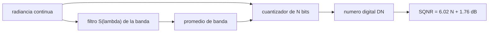

# B57-C03 — Resolución radiométrica y espectral

<!-- nav:top -->
[🏠 Programa](../../../../README.md) · [📚 Bloque B57](../../../tronco-comun/B57-observacion-terrestre-y-geociencias-orbitales.md) · [← Anterior: B57-C02 — Resolución espacial y temporal](../B57-C02-resolucion-espacial-y-temporal/CLASE.md) · [Siguiente: B57-C04 — Satélites ópticos de observación →](../B57-C04-satelites-opticos-de-observacion/CLASE.md)
<!-- /nav -->

## 1. Ubicación, nivel y alcance

Clase 3 del bloque B57. Completa el cuadro de las resoluciones con la **radiométrica** (cuántos niveles de brillo distingue el sensor) y la **espectral** (qué rango de longitudes de onda integra cada banda). Cuantizas una señal conocida, mides la relación señal–ruido de cuantización y compruebas cuándo el promedio de una banda coincide con el valor en su centro. Las cifras de bits y bandas son las de Landsat 8 (página consultada); el rango de radiancia y los espectros son **ilustrativos o sintéticos**.

## 2. Por qué esta clase existe

Dos sensores con el mismo píxel pueden dar información muy distinta si uno distingue 256 niveles y otro 65.536, o si una banda es ancha y otra estrecha. La decisión central: **¿cuántos bits y qué ancho de banda hacen falta para ver el cambio que me interesa?**

## 3. Lo que podrás hacer al terminar

1. Calcular los niveles de una cuantización de N bits y el paso en unidades de radiancia.
2. Predecir la relación señal–ruido de cuantización (6,02 N + 1,76 dB) y medirla.
3. Calcular el promedio de una banda gaussiana sobre un espectro.
4. Reconocer cuándo el promedio de banda coincide con el valor central (espectro lineal) y cuándo no (escalón).
5. Distinguir entre bits adquiridos y bits almacenados.

La evidencia es la **ficha de resoluciones radiométrica y espectral** del ejercicio 12 (sección 20).

## 4. Con qué llegas y cómo comprobarlo

1. ¿Cuántos valores distintos tiene un número de 8 bits?
2. ¿Qué es un decibelio?
3. ¿Qué es una media ponderada?
4. ¿Qué es una banda espectral?
5. ¿Qué es un dato sintético?

<details>
<summary>Ver respuestas</summary>

1. 256. 2. Diez veces el logaritmo decimal de un cociente de potencias. 3. Una media en que cada valor pesa distinto. 4. Un intervalo de longitudes de onda que el sensor integra. 5. Un dato generado por una fórmula, no medido.
</details>

Con cuatro o cinco aciertos, sigue; si no, repasa los prerrequisitos.

## 5. Un caso de contexto y casos de referencia

La banda 5 de Landsat 8 (infrarrojo cercano) abarca `0,85–0,88 µm` y el instrumento OLI adquiere con `12 bits` (`4096` niveles), entregados escalados a 16 bits. Es el **ejemplo conductor**: bits y banda son **publicados**; el rango de radiancia de `0–300 W m⁻² sr⁻¹ µm⁻¹` y los espectros de prueba son **ilustrativos**.

## 6. Vocabulario

La **cuantización** convierte una señal continua en `2^N` niveles. El **paso de cuantización** `q` es el tamaño de un nivel. La **SQNR** es el cociente entre la potencia de la señal y la del error de cuantización. La **banda espectral** tiene una **respuesta espectral** `S(λ)`; su **ancho a media altura** (FWHM) mide cuán estrecha es. La **resolución espectral** es el ancho de las bandas y su número.

## 7. Modelo mental: una regla con marcas y un filtro de color

La radiometría es la regla (cuántas marcas tiene) y la espectral es el filtro (qué color deja pasar).



*Descripción textual:* la radiancia pasa primero por el filtro de la banda y luego por el cuantizador, que la convierte en un número digital cuyo ruido depende de N.

Analogía: medir una altura con una regla de más o menos marcas, y mirar a través de un vidrio coloreado más o menos estrecho. Límite: el ruido real de un detector se suma al de cuantización y puede ser mayor.

## 8. La explicación, paso a paso

### 8.1 Niveles y SQNR

Con `N` bits hay `2^N` niveles. Para una sinusoide a plena escala, la SQNR teórica es `6,02 N + 1,76 dB`.

| bits | niveles | SQNR medida (dB) | SQNR teórica (dB) |
|---|---|---|---|
| 8 | 256 | 49,79 | 49,92 |
| 12 | 4096 | 73,97 | 74,00 |
| 16 | 65536 | 98,08 | 98,08 |

Cada bit adicional agrega unos 6 dB.

### 8.2 Paso de cuantización

Si el rango ilustrativo es `0–300 W m⁻² sr⁻¹ µm⁻¹`, el paso es `1,1719` con 8 bits y `0,0732` con 12 bits. El cuantizador no puede distinguir diferencias menores que el paso.

### 8.3 Promedio de banda

Con una banda gaussiana de 30 nm centrada en 0,865 µm, un espectro **lineal** da un promedio de `0,23250`, igual al valor central `0,23250`: por simetría la respuesta no sesga una recta. Un espectro con **escalón** en el centro da `0,300` (la media de los dos lados), pero si la banda se corre 10 nm el promedio sube a `0,414`: la elección de la banda cambia el número.

### 8.4 Lectura

Más bits reducen el error de cuantización, no el ruido del detector. Bandas estrechas permiten ver rasgos finos (bordes de absorción) a costa de menos fotones. Los 12 bits adquiridos se almacenan en 16 bits sin ganar información.

## 9. Magnitudes, símbolos y unidades

| Símbolo | Qué es | Unidad | Valor / nota |
|---|---|---|---|
| `N` | bits | — | 8; 12; 16 |
| `q` | paso de cuantización | W m⁻² sr⁻¹ µm⁻¹ | 0,0732 (12 bits, ilustrativo) |
| `SQNR` | relación señal–ruido de cuantización | dB | 73,97 (12 bits) |
| `FWHM` | ancho de banda a media altura | µm | 0,03 |
| `S(λ)` | respuesta espectral | adimensional | gaussiana (sintética) |

## 10. Convenciones y referencias

Sinusoide a plena escala sobre [−1, 1]; banda con respuesta gaussiana y FWHM igual al ancho de los límites publicados. En la práctica la respuesta espectral real de OLI se mide en laboratorio y no es gaussiana; esta clase no la usa.

## 11. De dónde sale lo que afirmamos

| ID | Fuente | Localizador | Respalda | Estado |
|---|---|---|---|---|
| S1 | USGS, *Landsat 8 (bandas OLI y TIRS, barrido, órbita)* | https://www.usgs.gov/landsat-missions/landsat-8 | banda 5 de 0,85–0,88 µm, banda 4 de 0,64–0,67 µm, OLI de 12 bits (4096 niveles) escalado a 16 bits. | Consultada 2026-11-09 (primeros 100.000 de 143.802 caracteres) |

**Límites de las fuentes.** Solo se tomaron bits y límites de banda de la página; la respuesta espectral relativa y el ruido del detector no se consultaron. Rango de radiancia y espectros son ilustrativos.

## 12. Cómo ver los resultados

| Magnitud | Valor |
|---|---|
| SQNR de 12 bits (medida / teórica) | 73,97 / 74,00 dB |
| niveles con 12 bits | 4096 |
| banda con escalón: centrada / corrida | 0,300 / 0,414 |

Descripción larga: cada bit suma unos 6 dB y el promedio de banda sobre un escalón depende de dónde se coloque la banda.

## 13. Ejemplo trabajado: la SQNR de 12 bits

**Paso 1 · Niveles.** `2^12 = 4096`.

**Paso 2 · Fórmula.** `6,02 × 12 + 1,76 = 74,00 dB`.

**Paso 3 · Medida.** El laboratorio cuantiza una sinusoide y mide `73,97 dB`.

**Paso 4 · Diferencia.** Menos de 0,5 dB: la fórmula describe bien el cuantizador.

## 14. Distintas formas de abordar el problema

**Por niveles:** `2^N`. **Por dB:** `6,02 N + 1,76`. **Por paso físico:** rango/`2^N` en unidades de radiancia. **Por banda:** promedio ponderado por `S(λ)`. Se eligen según se pregunte por ruido digital o por contenido espectral.

## 15. Práctica guiada

**Ejercicio 1 · con los pasos indicados.** ¿Cuántos niveles tiene un sensor de 12 bits? *Pasos:* `2^N`.

<details><summary>Solución comentada</summary>

`4096`.
</details>

**Ejercicio 2 · con una pista.** Calcula la SQNR teórica de 10 bits. *Pista:* `6,02 N + 1,76`.

<details><summary>Solución comentada</summary>

`6,02 × 10 + 1,76 = 61,96 dB`.
</details>

**Ejercicio 3 · casi autónomo.** Con rango `0–300` y 12 bits, ¿cuánto vale el paso? Usa 8.2.

<details><summary>Solución comentada</summary>

`300/4096 = 0,0732` W m⁻² sr⁻¹ µm⁻¹.
</details>

## 16. Práctica autónoma, transferencia e integrador

**Ejercicio 4.** ¿Cuánto mejora la SQNR al pasar de 8 a 12 bits?

<details><summary>Solución comentada</summary>

`4 × 6,02 = 24,1 dB`; la tabla da 73,97 − 49,79.
</details>

**Ejercicio 5.** ¿Cuál es el ancho de la banda 4 del rojo? Usa la sección 11.

<details><summary>Solución comentada</summary>

`0,67 − 0,64 = 0,03 µm = 30 nm`.
</details>

**Ejercicio 6.** Si el espectro es una recta, ¿cuánto vale el promedio de banda simétrica? Usa 8.3.

<details><summary>Solución comentada</summary>

El valor en el centro (aquí 0,23250).
</details>

**Ejercicio 7.** ¿Qué pasa con el promedio sobre un escalón si la banda se corre?

<details><summary>Solución comentada</summary>

Cambia (de 0,300 a 0,414); la banda ya no es simétrica respecto del escalón.
</details>

**Ejercicio 8.** Explica por qué guardar 12 bits en 16 bits no aumenta la información.

<details><summary>Solución comentada</summary>

Porque solo hay 4096 niveles posibles; los otros bits se rellenan por escalado.
</details>

**Ejercicio 9 · transferencia.** **Transferencia.** Un sensor de 8 bits satura sobre nieve. ¿Qué cambio ayuda más: bits o rango? 

<details><summary>Solución comentada</summary>

El rango (o la ganancia): si se satura, más bits sin ampliar el rango no recuperan los valores perdidos.
</details>

**Ejercicio 10 · transferencia.** **Transferencia.** Quieres detectar un borde de absorción de 10 nm. ¿Sirve una banda de 30 nm?

<details><summary>Solución comentada</summary>

No es lo ideal: la banda promedia el borde con su entorno; hace falta una banda más estrecha o un sensor hiperespectral (clase C22).
</details>

**Ejercicio 11 · transferencia.** **Transferencia.** ¿Por qué la SQNR de la fórmula no es el SNR final de una imagen?

<details><summary>Solución comentada</summary>

Porque el SNR incluye el ruido de fotones y del detector, que suele dominar sobre el de cuantización (clase C04).
</details>

**Ejercicio 12 · integrador.** **Integrador.** Elabora tu *ficha de resoluciones radiométrica y espectral*: la tabla de bits, niveles y SQNR, el paso de cuantización en unidades físicas y el promedio de banda para un espectro lineal y uno con escalón.

<details><summary>Solución modelo</summary>

Tablas 8.1 y 8.2 y los dos promedios de 8.3, con la lista de supuestos (cuantizador uniforme, respuesta gaussiana, datos sintéticos).
</details>

## 17. Laboratorio: cuantización y respuesta de banda

El script [cuantizacion.py](cuantizacion.py) cuantiza una sinusoide, mide la SQNR frente a la teoría y compara el promedio de una banda gaussiana en dos espectros sintéticos (**comprueba** la SQNR frente a 6,02 N + 1,76 dB con 0,5 dB y el promedio de banda lineal frente al valor central).

**Datos:** bits y límites de banda publicados (S1) y espectros **sintéticos**; rango de radiancia **ilustrativo**. **Predice antes de ejecutar:** ¿cuántos dB más da pasar de 8 a 12 bits? (unos 24.) **Ejecución del 2026-11-09 (Python 3.12.9):**

```text
Python 3.12.9 ; numpy 2.4.4
bits  niveles   SQNR medida [dB]  SQNR teorica [dB]
   8      256              49.79              49.92
  12     4096              73.97              74.00
  16    65536              98.08              98.08
Paso de cuantizacion para 0-300 W m^-2 sr^-1 um^-1 (ilustrativo): 8 bits = 1.1719 ; 12 bits = 0.0732
Espectro lineal: promedio de banda = 0.23250 ; valor en el centro = 0.23250
Espectro con escalon: banda centrada = 0.3002 ; banda corrida 10 nm = 0.4135
Pruebas superadas.
```

```bash
python programa/clases/B57/B57-C03-resolucion-radiometrica-y-espectral/cuantizacion.py
```

**Límites:** no incluye ruido del detector ni la respuesta espectral real de OLI.

## 18. Errores frecuentes y cómo corregirlos

**Creer que más bits equivalen a menos ruido total.** Solo reducen el de cuantización (8.4).

**Confundir bits adquiridos con almacenados.** Se corrige con la sección 11.

**Tomar el centro de banda como el valor de cualquier espectro.** Solo vale en el caso lineal (8.3).

**Olvidar convertir nm a µm.** Revisa la sección 9.

## 19. Cómo sabrás que vas bien

Tras la sección 8: ¿qué resultado esperabas y cuál obtuviste? Si dudas, repasa el ejemplo 13. Tras el laboratorio: ¿qué comprueba? (ver la sección 17).

## 20. Qué entregas y cómo se evalúa

El producto es tu **ficha de resoluciones radiométrica y espectral** (ejercicio 12).

| Criterio | Inicial | En desarrollo | Logrado | Destacado |
|---|---|---|---|---|
| Conceptos | Los confunde | Parciales | Conceptos de la clase | Explica los límites |
| Cálculo | Sin unidades | Con errores | Tablas completas con unidades | Calcula casos nuevos |
| Numérico | Sin comprobar | Un caso | Contraste con el caso analítico | Interpreta las diferencias |
| Fuentes | Sin fuente | Sin fecha | Fuentes con fecha | Declara lo no consultado |
| Límites | No los nombra | Uno | Tres | Discute qué falta del modelo |

**Condiciones críticas (no se compensan con promedio):** rotular los espectros como sintéticos; no presentar la respuesta gaussiana como la del sensor real; citar solo lo consultado.

## 21. Ética, seguridad y límites

Clase educativa: modelos simplificados. Accesibilidad: tablas equivalentes a las gráficas, fórmulas en texto, ejercicios sin conexión.

## 22. Para cerrar y seguir

Un cuantizador de 12 bits da `74,0 dB` de SQNR y un escalón cambia el promedio de banda de `0,300` a `0,414` según dónde caiga la banda. Queda una pregunta: ¿cómo se construye un satélite óptico que entregue esas bandas?

**Glosario español–inglés.** cuantización · *quantization*; resolución radiométrica · *radiometric resolution*; resolución espectral · *spectral resolution*; respuesta espectral · *spectral response*; ancho a media altura · *full width at half maximum (FWHM)*.

**Continuidad.** [B57-C04](../B57-C04-satelites-opticos-de-observacion/CLASE.md) estudia satélites ópticos de observación.

**Referencias:** ver sección 11.

<!-- nav:bottom -->
---

[← Anterior: B57-C02 — Resolución espacial y temporal](../B57-C02-resolucion-espacial-y-temporal/CLASE.md) · [📚 Bloque B57](../../../tronco-comun/B57-observacion-terrestre-y-geociencias-orbitales.md) · [Siguiente: B57-C04 — Satélites ópticos de observación →](../B57-C04-satelites-opticos-de-observacion/CLASE.md)
<!-- /nav -->
