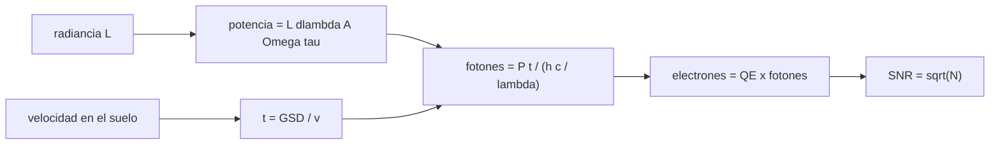

# B57-C04 — Satélites ópticos de observación

<!-- nav:top -->
[🏠 Programa](../../../../README.md) · [📚 Bloque B57](../../../tronco-comun/B57-observacion-terrestre-y-geociencias-orbitales.md) · [← Anterior: B57-C03 — Resolución radiométrica y espectral](../B57-C03-resolucion-radiometrica-y-espectral/CLASE.md) · [Siguiente: B57-C05 — Imágenes multiespectrales →](../B57-C05-imagenes-multiespectrales/CLASE.md)
<!-- /nav -->

## 1. Ubicación, nivel y alcance

Clase 4 del bloque B57. Un satélite óptico es una cámara que se mueve a 7 km/s: su cuerpo fija cuánta luz junta, su apertura fija el límite de difracción y su tiempo de integración fija el ruido. Calculas la velocidad sobre el suelo, el tiempo que el sensor mira cada píxel, los electrones recogidos y la SNR de fotones, y compruebas con una simulación de Poisson. Usa la geometría de Landsat 8 (consultada); apertura, transmisión y radiancia son **ilustrativas**.

## 2. Por qué esta clase existe

Un sensor puede tener muchos píxeles y aun así ser inútil porque cada píxel recoge pocos fotones. La decisión central: **¿cuánta apertura y cuánto tiempo de integración hacen falta para que la señal supere el ruido de fotones?**

## 3. Lo que podrás hacer al terminar

1. Calcular la velocidad orbital y la velocidad sobre el suelo de una órbita circular.
2. Calcular el tiempo de integración de un sensor de barrido y la étendue de un píxel.
3. Estimar los electrones por píxel y la SNR de fotones, y verificarla con Poisson.
4. Calcular el límite de difracción y la apertura mínima para un GSD dado.
5. Distinguir los sensores limitados por difracción de los limitados por detector.

La evidencia es la **ficha de un sensor óptico espacial** del ejercicio 12 (sección 20).

## 4. Con qué llegas y cómo comprobarlo

1. ¿Qué es la velocidad orbital circular?
2. ¿Qué es un fotón y qué energía tiene?
3. ¿Qué es una distribución de Poisson?
4. ¿Qué es la apertura de un telescopio?
5. ¿Qué es un valor ilustrativo?

<details>
<summary>Ver respuestas</summary>

1. `√(GM/r)`; unos 7,5 km/s a esa altitud. 2. Un cuanto de luz de energía `hc/λ`. 3. La de los recuentos de eventos independientes; su desviación es `√N`. 4. El diámetro de su abertura de entrada. 5. Uno propuesto para el ejemplo, no medido.
</details>

Con cuatro o cinco aciertos, sigue; si no, repasa los prerrequisitos.

## 5. Un caso de contexto y casos de referencia

Un sensor de barrido mira a nadir desde `705 km` con `GSD = 30 m`, apertura `0,10 m` (**ilustrativa**), banda de `0,03 µm` centrada en `0,865 µm` y una radiancia de `50 W m⁻² sr⁻¹ µm⁻¹` (**ilustrativa**). Es el **ejemplo conductor**; no es el diseño de ningún instrumento real.

## 6. Vocabulario

El **barredor** (*pushbroom*) forma la imagen línea a línea con el movimiento del satélite. La **étendue** `A·Ω` es el producto del área de la abertura y el ángulo sólido de un píxel. El **tiempo de integración** es lo que el satélite tarda en avanzar un GSD. La **eficiencia cuántica** `QE` es la fracción de fotones que genera un electrón. El **ruido de fotones** (o de disparo) es de tamaño `√N`; el **criterio de Rayleigh** da el límite de difracción `1,22 λ/D`.

## 7. Modelo mental: un cubo recogiendo lluvia

Los fotones caen como gotas: el píxel es un cubo que se llena mientras el satélite avanza. Más abertura o más tiempo llenan más el cubo y la fluctuación relativa baja.



*Descripción textual:* la radiancia y la geometría dan la potencia, la velocidad sobre el suelo da el tiempo, y de ahí salen fotones, electrones y la SNR de fotones.

Analogía: recoger lluvia con un cubo: más boca y más tiempo, más agua y menos fluctuación relativa. Límite: no incluye el ruido de lectura ni la corriente oscura, que suman ruido extra.

## 8. La explicación, paso a paso

### 8.1 Velocidad y tiempo

Con `GM = 3,986004418 × 10¹⁴ m³ s⁻²` y `R = 6378,137 km` (referencia WGS84, no consultada), la velocidad orbital circular a `705 km` es `7,502 km/s`. Proyectada al suelo es `6,755 km/s`, de modo que un píxel de 30 m se integra durante `4,441 ms`.

### 8.2 Fotones, electrones y SNR

Con `A = π(0,05)² m²` y `Ω = IFOV²`, la étendue vale `1,422e-11 m² sr`. La potencia en la banda da `2,310e+05` electrones por píxel con `τ = 0,7` y `QE = 0,8`. La SNR de fotones teórica es `√N = 480,7` y la de una simulación de Poisson de 200 000 píxeles es `481,5`.

### 8.3 Difracción

El límite de Rayleigh con `D = 0,10 m` y `λ = 0,865 µm` es `7,440 m` en el suelo, muy por debajo de los 30 m: el sensor está **limitado por el detector**, no por la difracción. La apertura mínima para que la difracción iguale 30 m sería `24,8 mm`.

### 8.4 Lectura

Para ganar SNR conviene más integrar más tiempo (agrupar líneas, TDI) o ampliar la banda que aumentar los píxeles. Los valores son ilustrativos: el SNR de un instrumento real se especifica con ensayos y no con este cálculo.

## 9. Magnitudes, símbolos y unidades

| Símbolo | Qué es | Unidad | Valor / nota |
|---|---|---|---|
| `H` | altitud | m | 705 000 |
| `v` | velocidad sobre el suelo | km/s | 6,755 |
| `t` | tiempo de integración | ms | 4,441 |
| `N` | electrones por píxel | e⁻ | 2,310e+05 |
| `SNR` | relación señal–ruido de fotones | — | 480,7 |

## 10. Convenciones y referencias

Órbita circular a nadir; sistema inercial para `v_orb` y velocidad proyectada al suelo con el factor `R/(R+H)`; longitudes de onda en metros dentro de las fórmulas. Sensor sin ruido de lectura.

## 11. De dónde sale lo que afirmamos

| ID | Fuente | Localizador | Respalda | Estado |
|---|---|---|---|---|
| S1 | USGS, *Landsat 8 (bandas OLI y TIRS, barrido, órbita)* | https://www.usgs.gov/landsat-missions/landsat-8 | altitud de 705 km, píxel de 30 m, barrido de 185 km y banda 5 de 0,85–0,88 µm. | Consultada 2026-11-09 (primeros 100.000 de 143.802 caracteres) |

**Límites de las fuentes.** Solo se consultó la geometría. Apertura, transmisión, eficiencia cuántica y radiancia son ilustrativas; GM y R son valores de referencia no consultados en la sesión.

## 12. Cómo ver los resultados

| Magnitud | Valor |
|---|---|
| tiempo de integración | 4,441 ms |
| electrones por píxel | 2,310e+05 |
| SNR de fotones (teórica / simulada) | 480,7 / 481,5 |
| límite de difracción | 7,440 m |

Descripción larga: la señal por píxel es grande frente a su raíz, así que el ruido de fotones es pequeño, y la difracción no limita a este GSD.

## 13. Ejemplo trabajado: el tiempo de integración

**Paso 1 · Velocidad orbital.** `√(GM/(R+H)) = 7,502 km/s`.

**Paso 2 · Proyección.** `× R/(R+H) = 6,755 km/s`.

**Paso 3 · Tiempo.** `30 m / 6,755 km/s = 4,441 ms`.

## 14. Distintas formas de abordar el problema

**Por fotones:** `N` y `√N`. **Por simulación:** Poisson con semilla fija. **Por difracción:** `1,22 λ H/D`. **Por tiempo:** `GSD/v`. La primera y la segunda se comprueban entre sí.

## 15. Práctica guiada

**Ejercicio 1 · con los pasos indicados.** Calcula la energía de un fotón de `0,865 µm`. *Pasos:* `hc/λ`.

<details><summary>Solución comentada</summary>

`6,626e-34 × 2,998e8 / 0,865e-6 = 2,30e-19 J`.
</details>

**Ejercicio 2 · con una pista.** ¿Cuál es el tiempo de integración con `v = 6,8 km/s` y `GSD = 30 m`? *Pista:* divide.

<details><summary>Solución comentada</summary>

`30/6800 = 4,4 ms`.
</details>

**Ejercicio 3 · casi autónomo.** Si se duplica la apertura, ¿en qué factor cambia el SNR de fotones? Usa 8.2.

<details><summary>Solución comentada</summary>

La étendue sube 4 veces; el SNR sube `√4 = 2`.
</details>

## 16. Práctica autónoma, transferencia e integrador

**Ejercicio 4.** Si se integran 4 líneas (TDI), ¿cuánto sube el SNR?

<details><summary>Solución comentada</summary>

Sube `√4 = 2`; el tiempo efectivo se multiplica por 4.
</details>

**Ejercicio 5.** ¿Qué apertura da difracción de 30 m a `0,865 µm`? Usa 8.3.

<details><summary>Solución comentada</summary>

`24,8 mm`.
</details>

**Ejercicio 6.** Con `N = 1,4e5` electrones, ¿cuál es la SNR?

<details><summary>Solución comentada</summary>

`√(1,4e5) = 374`.
</details>

**Ejercicio 7.** Si la radiancia baja a 5 (sobre agua), ¿cuánto baja la SNR?

<details><summary>Solución comentada</summary>

N baja 10 veces; la SNR baja `√10 = 3,16` veces.
</details>

**Ejercicio 8.** Explica por qué `v` sobre el suelo es menor que la orbital.

<details><summary>Solución comentada</summary>

Porque el punto del suelo está más cerca del eje de rotación: factor `R/(R+H)`.
</details>

**Ejercicio 9 · transferencia.** **Transferencia.** Quieres un GSD de 1 m a 705 km. ¿Qué apertura mínima por difracción hay a `0,865 µm`?

<details><summary>Solución comentada</summary>

`1,22 × 0,865e-6 × 705e3 / 1 = 0,744 m`: un telescopio mucho mayor.
</details>

**Ejercicio 10 · transferencia.** **Transferencia.** ¿Por qué un sensor con muchos píxeles puede dar imágenes ruidosas?

<details><summary>Solución comentada</summary>

Porque cada píxel recoge menos fotones si el tiempo y la apertura no aumentan.
</details>

**Ejercicio 11 · transferencia.** **Transferencia.** ¿Qué falta para convertir este cálculo en una especificación de SNR?

<details><summary>Solución comentada</summary>

Ruido de lectura, corriente oscura, calibración y ensayos del instrumento; aquí solo hay fotones.
</details>

**Ejercicio 12 · integrador.** **Integrador.** Elabora tu *ficha de un sensor óptico espacial*: la tabla de velocidad, tiempo, electrones, SNR teórica y simulada, y el límite de difracción, con los supuestos.

<details><summary>Solución modelo</summary>

Secciones 8.1 a 8.3 con los valores de la ejecución, indicando que apertura, transmisión, eficiencia cuántica y radiancia son ilustrativas y que no hay ruido de lectura.
</details>

## 17. Laboratorio: fotones, SNR y difracción de un sensor de barrido

El script [sensor_optico.py](sensor_optico.py) calcula la velocidad sobre el suelo, el tiempo de integración, los electrones por píxel y su SNR, y verifica con Poisson (**comprueba** la SNR simulada frente a √N con 2 % y que la difracción queda por debajo de 30 m).

**Datos:** geometría publicada (S1) y parámetros **ilustrativos**; valores de referencia GM y R no consultados. **Predice antes de ejecutar:** ¿cuántos electrones por píxel? (del orden de 10⁵.) **Ejecución del 2026-11-09 (Python 3.12.9):**

```text
Python 3.12.9 ; numpy 2.4.4
Velocidad orbital = 7.502 km/s ; velocidad sobre el suelo = 6.755 km/s ; tiempo de integracion por pixel = 4.441 ms
Etendue A*Omega = 1.422e-11 m^2 sr
Electrones por pixel = 2.310e+05 ; SNR de fotones teorica = 480.7 ; simulada = 481.5
Limite de difraccion (Rayleigh, D = 0.10 m, 0.865 um) = 7.440 m en el suelo ; apertura minima para 30 m = 24.8 mm
Pruebas superadas.
```

```bash
python programa/clases/B57/B57-C04-satelites-opticos-de-observacion/sensor_optico.py
```

**Límites:** sin ruido de lectura, sin corriente oscura y sin función de transferencia de modulación.

## 18. Errores frecuentes y cómo corregirlos

**Usar la velocidad orbital como si fuera la del suelo.** Aplica el factor `R/(R+H)` (8.1).

**Olvidar convertir µm a m.** Revisa la sección 9.

**Creer que la difracción limita siempre.** A 30 m no limita (8.3).

**Presentar la SNR como la de un instrumento real.** Es ilustrativa (sección 5).

## 19. Cómo sabrás que vas bien

Tras la sección 8: ¿qué resultado esperabas y cuál obtuviste? Si dudas, repasa el ejemplo 13. Tras el laboratorio: ¿qué comprueba? (ver la sección 17).

## 20. Qué entregas y cómo se evalúa

El producto es tu **ficha de un sensor óptico espacial** (ejercicio 12).

| Criterio | Inicial | En desarrollo | Logrado | Destacado |
|---|---|---|---|---|
| Conceptos | Los confunde | Parciales | Conceptos de la clase | Explica los límites |
| Cálculo | Sin unidades | Con errores | Tablas completas con unidades | Calcula casos nuevos |
| Numérico | Sin comprobar | Un caso | Contraste con el caso analítico | Interpreta las diferencias |
| Fuentes | Sin fuente | Sin fecha | Fuentes con fecha | Declara lo no consultado |
| Límites | No los nombra | Uno | Tres | Discute qué falta del modelo |

**Condiciones críticas (no se compensan con promedio):** rotular apertura, transmisión y radiancia como ilustrativas; no presentar la SNR como la de Landsat; citar solo lo consultado.

## 21. Ética, seguridad y límites

Clase educativa: modelos simplificados y sin ruido de lectura. Accesibilidad: tablas equivalentes a las gráficas, fórmulas en texto, ejercicios sin conexión.

## 22. Para cerrar y seguir

Con una apertura de 10 cm el sensor recoge `2,31e+05` electrones por píxel y una SNR de fotones de `481`. Queda una pregunta: ¿cómo se combinan las bandas para formar imágenes útiles?

**Glosario español–inglés.** barredor · *pushbroom*; étendue · *étendue*; eficiencia cuántica · *quantum efficiency*; ruido de fotones · *shot noise*; límite de difracción · *diffraction limit*.

**Continuidad.** [B57-C05](../B57-C05-imagenes-multiespectrales/CLASE.md) estudia imágenes multiespectrales.

**Referencias:** ver sección 11.

<!-- nav:bottom -->
---

[← Anterior: B57-C03 — Resolución radiométrica y espectral](../B57-C03-resolucion-radiometrica-y-espectral/CLASE.md) · [📚 Bloque B57](../../../tronco-comun/B57-observacion-terrestre-y-geociencias-orbitales.md) · [Siguiente: B57-C05 — Imágenes multiespectrales →](../B57-C05-imagenes-multiespectrales/CLASE.md)
<!-- /nav -->
