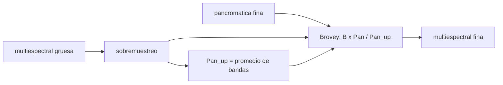

# B57-C05 — Imágenes multiespectrales

<!-- nav:top -->
[🏠 Programa](../../../../README.md) · [📚 Bloque B57](../../../tronco-comun/B57-observacion-terrestre-y-geociencias-orbitales.md) · [← Anterior: B57-C04 — Satélites ópticos de observación](../B57-C04-satelites-opticos-de-observacion/CLASE.md) · [Siguiente: B57-C06 — Índices de vegetación →](../B57-C06-indices-de-vegetacion/CLASE.md)
<!-- /nav -->

## 1. Ubicación, nivel y alcance

Clase 5 del bloque B57. Una imagen multiespectral es un apilamiento de imágenes de la misma escena en bandas distintas. Aquí construyes una escena **sintética** con cuatro cubiertas, calculas la razón entre bandas que las distingue y fusionas las bandas de baja resolución con una pancromática de alta resolución. Los límites de banda de Landsat 8 son los consultados; reflectancias y escena son **ilustrativas**.

## 2. Por qué esta clase existe

Con una sola banda el agua oscura, la sombra y el asfalto se confunden; con varias, cada cubierta deja una firma distinta. La decisión central: **¿qué combinación de bandas separa las cubiertas que me interesan y cómo recupero detalle espacial sin falsear los colores?**

## 3. Lo que podrás hacer al terminar

1. Describir una imagen multiespectral como un cubo (filas × columnas × bandas).
2. Calcular razones entre bandas y comparar cubiertas.
3. Aplicar la fusión de Brovey con una pancromática.
4. Comprobar que la fusión conserva las razones entre bandas.
5. Reconocer los límites de la fusión cuando el detalle no es común a todas las bandas.

La evidencia es la **ficha de una imagen multiespectral** del ejercicio 12 (sección 20).

## 4. Con qué llegas y cómo comprobarlo

1. ¿Qué es un cubo de datos?
2. ¿Qué es una razón entre bandas?
3. ¿Qué es una pancromática?
4. ¿Qué es el RMSE?
5. ¿Qué es un dato sintético?

<details>
<summary>Ver respuestas</summary>

1. Un arreglo de filas, columnas y bandas. 2. El cociente de dos bandas, píxel a píxel. 3. Una banda ancha de alta resolución que cubre el visible. 4. La raíz del error cuadrático medio. 5. Uno generado por una fórmula.
</details>

Con cuatro o cinco aciertos, sigue; si no, repasa los prerrequisitos.

## 5. Un caso de contexto y casos de referencia

Una escena de `64 × 64` píxeles con agua, suelo, vegetación y zona urbana, con reflectancias **ilustrativas** en azul, verde, rojo e infrarrojo cercano (las bandas 2 a 5 de Landsat 8, de `0,450–0,51`, `0,53–0,59`, `0,64–0,67` y `0,85–0,88 µm`). La pancromática de Landsat 8 es de `15 m`, frente a `30 m` de las demás. Es el **ejemplo conductor**; la escena es **sintética**.

## 6. Vocabulario

Una **banda** es una imagen en un intervalo espectral. Una **composición** asigna bandas a los canales rojo, verde y azul de la pantalla; la de **falso color** usa el infrarrojo cercano. La **razón de bandas** es el cociente de dos de ellas. La **fusión pancromática** (*pansharpening*) combina baja resolución espectral-espacial con alta resolución espacial. El **sobremuestreo** reparte cada píxel grueso en varios finos.

## 7. Modelo mental: pintar un dibujo fino con colores gruesos

La pancromática es el dibujo a lápiz (mucho detalle, sin color) y las bandas son las manchas de color (poco detalle). La fusión pinta las manchas dentro del dibujo.



*Descripción textual:* la multiespectral gruesa se sobremuestrea, se calcula su intensidad, y se multiplica cada banda por el cociente entre la pancromática fina y esa intensidad.

Analogía: colorear un dibujo de líneas finas con rotuladores gruesos. Límite: si el dibujo tiene detalles que no existen en el color (por ejemplo sombras de otro tono), la fusión los mezcla.

## 8. La explicación, paso a paso

### 8.1 Razones entre bandas

Con las reflectancias ilustrativas, la razón `NIR/rojo` por cubierta es: agua `0,33`, suelo `1,27`, vegetación `9,01` y urbano `1,09`. La vegetación destaca porque absorbe el rojo y refleja el infrarrojo cercano (comportamiento descrito por NASA, ver 11).

### 8.2 Degradar y fusionar

Se promedia la verdad en bloques de `2 × 2` (baja resolución) y se reconstruye de dos maneras: vecino más cercano y fusión de Brovey con la pancromática.

| método | RMSE respecto de la verdad (reflectancia) |
|---|---|
| vecino más cercano | 0,04147 |
| Brovey con pancromática | 0,00429 |

La fusión mejora el RMSE en un factor 9,7.

### 8.3 Propiedad de la fusión

Como Brovey multiplica todas las bandas por el mismo factor en cada píxel, la razón `NIR/rojo` no cambia: la diferencia máxima es `1,78e-15`. Esto conserva el color relativo.

### 8.4 Lectura

La mejora es grande porque casi todo el detalle fino es multiplicativo y común a las cuatro bandas; el error que queda viene del detalle propio del infrarrojo cercano en la vegetación y del ruido independiente de cada banda, ambos incluidos a propósito. En una escena real hay detalle que solo existe en algunas bandas (sombras, agua turbia) y la fusión puede distorsionar la firma espectral; por eso se usa para ver y no para medir.

## 9. Magnitudes, símbolos y unidades

| Símbolo | Qué es | Unidad | Valor / nota |
|---|---|---|---|
| `R_b` | reflectancia en la banda b | adimensional | 0–1 (ilustrativa) |
| `NIR/rojo` | razón de bandas | — | 9,01 (vegetación sintética) |
| `RMSE` | error cuadrático medio | reflectancia | 0,00429 (Brovey) |
| GSD | tamaño de píxel | m | 30 (bandas); 15 (pancromática) |

## 10. Convenciones y referencias

Píxeles cuadrados; orden de bandas azul, verde, rojo, NIR; reflectancias de superficie sin atmósfera. Textura multiplicativa común a todas las bandas.

## 11. De dónde sale lo que afirmamos

| ID | Fuente | Localizador | Respalda | Estado |
|---|---|---|---|---|
| S1 | USGS, *Landsat 8 (bandas OLI y TIRS, barrido, órbita)* | https://www.usgs.gov/landsat-missions/landsat-8 | límites de las bandas 2 a 5, resolución de 30 m y de la pancromática de 15 m. | Consultada 2026-11-09 (primeros 100.000 de 143.802 caracteres) |
| S2 | NASA Earth Observatory, *Measuring Vegetation (NDVI and EVI)* | https://science.nasa.gov/earth/earth-observatory/measuring-vegetation-ndvi-evi | absorción del visible por la clorofila y reflexión alta del infrarrojo cercano en vegetación sana. | Consultada 2026-11-09 |

**Límites de las fuentes.** No se consultó una referencia metodológica de la fusión de Brovey: la fórmula se contrasta solo con su propiedad algebraica y con la verdad sintética. Las reflectancias son ilustrativas.

## 12. Cómo ver los resultados

| Magnitud | Valor |
|---|---|
| NIR/rojo de la vegetación sintética | 9,01 |
| RMSE vecino / Brovey | 0,04147 / 0,00429 |
| mejora de la fusión | 9,7 × |
| conservación de la razón NIR/rojo | 1,8e-15 |

Descripción larga: la fusión reduce el error de reconstrucción y deja intactas las razones entre bandas.

## 13. Ejemplo trabajado: la razón NIR/rojo de la vegetación

**Paso 1 · Valores.** Reflectancias ilustrativas rojo `0,05` y NIR `0,45`.

**Paso 2 · Razón.** `0,45/0,05 = 9,0`.

**Paso 3 · Con la textura.** Como la textura multiplica ambas bandas, la razón media es 9,01.

## 14. Distintas formas de abordar el problema

**Por color:** composiciones RGB y de falso color. **Por razón:** `NIR/rojo` y otras. **Por fusión:** Brovey, con la pancromática. Cada una destaca algo y deforma otra cosa.

## 15. Práctica guiada

**Ejercicio 1 · con los pasos indicados.** ¿Cuántas bandas tiene el cubo sintético? *Pasos:* cuenta (sección 5).

<details><summary>Solución comentada</summary>

Cuatro: azul, verde, rojo e infrarrojo cercano.
</details>

**Ejercicio 2 · con una pista.** Calcula la razón NIR/rojo del suelo sin textura: rojo `0,22`, NIR `0,28`. *Pista:* divide.

<details><summary>Solución comentada</summary>

`0,28/0,22 = 1,27`.
</details>

**Ejercicio 3 · casi autónomo.** ¿Qué cubierta tiene la razón mayor? Usa 8.1.

<details><summary>Solución comentada</summary>

La vegetación sintética (9,01).
</details>

## 16. Práctica autónoma, transferencia e integrador

**Ejercicio 4.** Un píxel grueso tiene bandas `(0,04; 0,09; 0,05; 0,45)` y su intensidad es `0,1575`. La pancromática fina es `0,2`. Calcula la banda NIR fusionada.

<details><summary>Solución comentada</summary>

`0,45 × 0,2/0,1575 = 0,571`.
</details>

**Ejercicio 5.** ¿Cambia la razón NIR/rojo tras la fusión del ejercicio anterior?

<details><summary>Solución comentada</summary>

No: ambas bandas se multiplican por `0,2/0,1575`; la razón sigue en 9.
</details>

**Ejercicio 6.** ¿Cuál es el factor del RMSE entre vecino y Brovey?

<details><summary>Solución comentada</summary>

9,7 (tabla 8.2).
</details>

**Ejercicio 7.** Describe en una frase qué es una composición de falso color.

<details><summary>Solución comentada</summary>

Una imagen RGB en que se asignan bandas no visibles (por ejemplo el NIR) a un canal de pantalla.
</details>

**Ejercicio 8.** Explica por qué la vegetación aparece roja en falso color NIR-rojo-verde.

<details><summary>Solución comentada</summary>

Porque el NIR, muy alto en vegetación, se asigna al canal rojo.
</details>

**Ejercicio 9 · transferencia.** **Transferencia.** Una sombra oscurece solo el visible en la imagen fina. ¿Qué le pasa a Brovey?

<details><summary>Solución comentada</summary>

Atribuye el oscurecimiento a todas las bandas y distorsiona la firma; es la limitación de 8.4.
</details>

**Ejercicio 10 · transferencia.** **Transferencia.** ¿Se puede usar la imagen fusionada para calcular un índice cuantitativo?

<details><summary>Solución comentada</summary>

Con cautela: la fusión conserva razones pero no la radiometría de cada banda; se prefiere calcular el índice sobre las bandas originales.
</details>

**Ejercicio 11 · transferencia.** **Transferencia.** ¿Qué datos reales harían falta para validar este método?

<details><summary>Solución comentada</summary>

Escenas con una referencia de alta resolución en todas las bandas y su procedencia.
</details>

**Ejercicio 12 · integrador.** **Integrador.** Elabora tu *ficha de una imagen multiespectral*: la tabla de razones NIR/rojo por cubierta, la comparación de RMSE entre métodos y la verificación de la razón conservada.

<details><summary>Solución modelo</summary>

Secciones 8.1 a 8.3 con los valores de la ejecución, rotulando la escena como sintética y señalando la limitación de 8.4.
</details>

## 17. Laboratorio: razones de bandas y fusión de Brovey

El script [multiespectral.py](multiespectral.py) genera una escena sintética de cuatro cubiertas, calcula razones NIR/rojo, degrada y fusiona con una pancromática (**comprueba** que la fusión conserva la razón NIR/rojo a 1e-9 y que el RMSE de Brovey es menor que la mitad del del vecino más cercano).

**Datos:** escena y reflectancias **sintéticas / ilustrativas**; límites de banda publicados (S1). **Predice antes de ejecutar:** ¿se conservará la razón NIR/rojo tras la fusión? (sí, por construcción.) **Ejecución del 2026-11-09 (Python 3.12.9):**

```text
Python 3.12.9 ; numpy 2.4.4
Razon NIR/rojo por cubierta (sintetica):
  agua           0.33
  suelo          1.27
  vegetacion     9.01
  urbano         1.09
RMSE vecino mas cercano = 0.04147 ; RMSE Brovey = 0.00429 ; mejora = 9.7x
Maxima diferencia de la razon NIR/rojo tras la fusion = 1.78e-15
Pruebas superadas.
```

```bash
python programa/clases/B57/B57-C05-imagenes-multiespectrales/multiespectral.py
```

**Límites:** el detalle fino es común a todas las bandas por construcción; en datos reales la fusión puede distorsionar la firma espectral.

## 18. Errores frecuentes y cómo corregirlos

**Creer que la fusión añade información espectral.** Solo añade detalle espacial (8.4).

**Calcular un índice sobre la imagen fusionada sin avisar.** Declara el origen de las bandas (ejercicio 10).

**Confundir falso color con color real.** Se corrige con 6.

**Presentar la escena como una imagen observada.** Es sintética (sección 5).

## 19. Cómo sabrás que vas bien

Tras la sección 8: ¿qué resultado esperabas y cuál obtuviste? Si dudas, repasa el ejemplo 13. Tras el laboratorio: ¿qué comprueba? (ver la sección 17).

## 20. Qué entregas y cómo se evalúa

El producto es tu **ficha de una imagen multiespectral** (ejercicio 12).

| Criterio | Inicial | En desarrollo | Logrado | Destacado |
|---|---|---|---|---|
| Conceptos | Los confunde | Parciales | Conceptos de la clase | Explica los límites |
| Cálculo | Sin unidades | Con errores | Tablas completas con unidades | Calcula casos nuevos |
| Numérico | Sin comprobar | Un caso | Contraste con el caso analítico | Interpreta las diferencias |
| Fuentes | Sin fuente | Sin fecha | Fuentes con fecha | Declara lo no consultado |
| Límites | No los nombra | Uno | Tres | Discute qué falta del modelo |

**Condiciones críticas (no se compensan con promedio):** rotular la escena como sintética; no presentar la fusión como una medición; citar solo lo consultado.

## 21. Ética, seguridad y límites

Clase educativa: escena sintética. Accesibilidad: tablas equivalentes a las gráficas, fórmulas en texto, ejercicios sin conexión.

## 22. Para cerrar y seguir

La razón NIR/rojo separa la vegetación sintética (`9,0`) del suelo (`1,27`) y la fusión de Brovey mejora el RMSE 9,7 veces sin alterar esa razón. Queda una pregunta: ¿cómo se resume esa información en un índice de vegetación?

**Glosario español–inglés.** imagen multiespectral · *multispectral image*; razón de bandas · *band ratio*; falso color · *false colour*; fusión pancromática · *pansharpening*; sobremuestreo · *upsampling*.

**Continuidad.** [B57-C06](../B57-C06-indices-de-vegetacion/CLASE.md) estudia índices de vegetación.

**Referencias:** ver sección 11.

<!-- nav:bottom -->
---

[← Anterior: B57-C04 — Satélites ópticos de observación](../B57-C04-satelites-opticos-de-observacion/CLASE.md) · [📚 Bloque B57](../../../tronco-comun/B57-observacion-terrestre-y-geociencias-orbitales.md) · [Siguiente: B57-C06 — Índices de vegetación →](../B57-C06-indices-de-vegetacion/CLASE.md)
<!-- /nav -->
