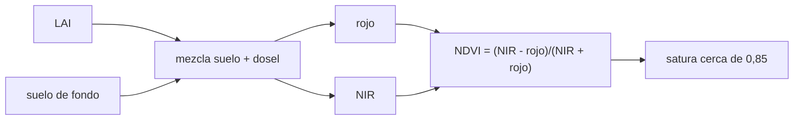

# B57-C06 — Índices de vegetación

<!-- nav:top -->
[🏠 Programa](../../../../README.md) · [📚 Bloque B57](../../../tronco-comun/B57-observacion-terrestre-y-geociencias-orbitales.md) · [← Anterior: B57-C05 — Imágenes multiespectrales](../B57-C05-imagenes-multiespectrales/CLASE.md) · [Siguiente: B57-C07 — Sistemas radar SAR →](../B57-C07-sistemas-radar-sar/CLASE.md)
<!-- /nav -->

## 1. Ubicación, nivel y alcance

Clase 6 del bloque B57. Un índice de vegetación condensa dos bandas en un número que sube con la vegetación verde. Calculas el NDVI con un dosel **sintético**, ves que se **satura** cuando la vegetación es densa, que depende del suelo de fondo y cómo el SAVI lo reduce. La definición del NDVI y sus rangos son los de NASA (consultada); la fórmula del SAVI es conocida pero **no se consultó** una referencia.

## 2. Por qué esta clase existe

Un índice facilita comparar fechas y lugares, pero también esconde supuestos. La decisión central: **¿cuándo el NDVI mide de verdad la cantidad de vegetación y cuándo lo engañan la saturación o el suelo?**

## 3. Lo que podrás hacer al terminar

1. Calcular el NDVI y el SAVI desde bandas roja e infrarroja cercana.
2. Usar las bandas 4 y 5 de Landsat 8 para el NDVI.
3. Reconocer la saturación del NDVI con la vegetación densa.
4. Medir cuánto cambia el NDVI y el SAVI con el suelo de fondo.
5. Comprobar una derivada analítica con una diferencia finita.

La evidencia es la **ficha de índices de vegetación** del ejercicio 12 (sección 20).

## 4. Con qué llegas y cómo comprobarlo

1. ¿Qué refleja la vegetación sana en el visible y en el infrarrojo cercano?
2. ¿Qué es un cociente normalizado?
3. ¿Qué es el LAI?
4. ¿Qué es una derivada?
5. ¿Qué es un modelo ilustrativo?

<details>
<summary>Ver respuestas</summary>

1. Absorbe el visible (clorofila) y refleja mucho infrarrojo cercano. 2. Una diferencia dividida por la suma. 3. El área de hojas por área de suelo, adimensional. 4. La tasa de cambio de una función. 5. Uno propuesto para el ejemplo, no ajustado a datos.
</details>

Con cuatro o cinco aciertos, sigue; si no, repasa los prerrequisitos.

## 5. Un caso de contexto y casos de referencia

Un pastizal sintético crece de `LAI = 0` a `8`. Su reflectancia en el rojo y el infrarrojo cercano sigue un modelo **ilustrativo** que mezcla suelo y dosel. Tú calculas el NDVI en cada etapa y lo comparas con los rangos de NASA: arbustos y pastizales hacia `0,2–0,3`, selvas hacia `0,6–0,8`. Es el **ejemplo conductor**; los datos son **sintéticos**.

## 6. Vocabulario

El **NDVI** es `(NIR − rojo)/(NIR + rojo)` y va de −1 a +1. El **SAVI** agrega una constante `L` al denominador para atenuar el efecto del suelo. El **LAI** (índice de área foliar) mide el follaje. La **saturación** es la pérdida de sensibilidad del índice cuando la vegetación es densa. El **suelo de fondo** es el suelo visible bajo y entre las plantas.

## 7. Modelo mental: un vaso que se llena y se rebalsa

El NDVI sube rápido cuando se agregan las primeras hojas y casi no cambia al agregar más, como un vaso cerca del borde.



*Descripción textual:* el LAI y el suelo fijan las reflectancias roja e infrarroja; de ellas sale el NDVI, que tiende a un límite del dosel puro.

Analogía: un vaso que se llena: al principio el nivel sube rápido; cerca del borde casi no cambia. Límite: el NDVI no se rebalsa de verdad, solo pierde sensibilidad.

## 8. La explicación, paso a paso

### 8.1 NDVI frente al LAI

| LAI | 0 | 2 | 4 | 6 | 8 |
|---|---|---|---|---|---|
| NDVI sintético | 0,200 | 0,710 | 0,821 | 0,844 | 0,850 |

El dosel puro daría `0,852`. El NDVI llega a 0,6 con `LAI = 1,27`. Entre `LAI 0` y `2` el NDVI gana `0,510`; entre `4` y `6`, solo `0,024`: eso es la saturación.

### 8.2 Efecto del suelo

Con `LAI = 1`, un suelo claro da `NDVI = 0,544` y uno oscuro `0,622`: diferencia `0,079`. Con SAVI (`L = 0,5`) las cifras son `0,404` y `0,387`: diferencia `0,017`.

### 8.3 Sensibilidad analítica

`∂NDVI/∂NIR = 2·rojo/(NIR + rojo)²`. En `NIR = 0,45` y `rojo = 0,05` coincide con una diferencia finita con error relativo `1,1e-10`.

### 8.4 Lectura

Los rangos de NASA (suelo desnudo ≤ 0,1; pastizal 0,2–0,3; selva 0,6–0,8) son orientativos y el modelo ilustrativo los reproduce en forma cualitativa. Un NDVI de 0,7 no distingue entre `LAI 4` y `LAI 8`, y un cambio de suelo mueve el NDVI tanto como una diferencia real de vegetación en zonas ralas. Por eso se declara el índice usado y se evita leer el NDVI como una medida lineal de biomasa.

## 9. Magnitudes, símbolos y unidades

| Símbolo | Qué es | Unidad | Valor / nota |
|---|---|---|---|
| `NDVI` | índice de vegetación de diferencia normalizada | — | −1 a +1; 0,852 límite sintético |
| `SAVI` | índice ajustado por suelo | — | `L = 0,5` |
| `LAI` | índice de área foliar | — | 0–8 |
| `ρ_rojo`, `ρ_NIR` | reflectancias de superficie | adimensional | ilustrativas |

## 10. Convenciones y referencias

Reflectancias de superficie (no radiancias ni números digitales). NDVI con bandas 4 y 5 de Landsat 8 en la práctica. Sin atmósfera: la corrección atmosférica es el tema de la clase C26.

## 11. De dónde sale lo que afirmamos

| ID | Fuente | Localizador | Respalda | Estado |
|---|---|---|---|---|
| S1 | NASA Earth Observatory, *Measuring Vegetation (NDVI and EVI)* | https://science.nasa.gov/earth/earth-observatory/measuring-vegetation-ndvi-evi | fórmula `(NIR − VIS)/(NIR + VIS)`, rango de −1 a +1, valores de 0,2–0,3 en pastizales y 0,6–0,8 en selvas, absorción de visible y reflexión de infrarrojo cercano. | Consultada 2026-11-09 |
| S2 | USGS, *Landsat 8 (bandas OLI y TIRS, barrido, órbita)* | https://www.usgs.gov/landsat-missions/landsat-8 | bandas 4 (rojo, 0,64–0,67 µm) y 5 (infrarrojo cercano, 0,85–0,88 µm). | Consultada 2026-11-09 (primeros 100.000 de 143.802 caracteres) |

**Límites de las fuentes.** El SAVI y su constante `L = 0,5` no se consultaron en una fuente; se usan como fórmula conocida y solo se contrastan con el modelo sintético. La página de NASA no daba rango para el agua ni para el suelo desnudo.

## 12. Cómo ver los resultados

| Magnitud | Valor |
|---|---|
| NDVI sintético con LAI 2 / 8 | 0,710 / 0,850 |
| ganancia 0→2 frente a 4→6 | 0,510 frente a 0,024 |
| efecto del suelo en NDVI / SAVI | 0,079 / 0,017 |

Descripción larga: la curva del NDVI sube rápido y se aplana, y el SAVI reduce la diferencia entre suelos a cerca de una quinta parte.

## 13. Ejemplo trabajado: el NDVI con LAI 2

**Paso 1 · Reflectancias.** Con el modelo ilustrativo, rojo = `R_suelo e^{−0,8·2} + 0,04(1 − e^{−1,6})` y NIR análogamente.

**Paso 2 · Cociente.** `NDVI = (NIR − rojo)/(NIR + rojo)`.

**Paso 3 · Resultado.** `0,710`, dentro del rango 0,6–0,8 de NASA para follaje denso.

## 14. Distintas formas de abordar el problema

**Por NDVI:** simple y sensible a vegetación ralo-moderada. **Por SAVI:** reduce el efecto del suelo. **Por derivada:** mide qué banda domina el cambio. Ninguno sustituye una medición de campo.

## 15. Práctica guiada

**Ejercicio 1 · con los pasos indicados.** Calcula el NDVI con NIR `0,45` y rojo `0,05`. *Pasos:* diferencia entre suma.

<details><summary>Solución comentada</summary>

`0,40/0,50 = 0,80`.
</details>

**Ejercicio 2 · con una pista.** Calcula el NDVI de un suelo con NIR `0,28` y rojo `0,22`. *Pista:* misma fórmula.

<details><summary>Solución comentada</summary>

`0,06/0,50 = 0,12`, cerca de los valores bajos de NASA para suelo.
</details>

**Ejercicio 3 · casi autónomo.** ¿Qué bandas de Landsat 8 usas para el NDVI? Mira la sección 11.

<details><summary>Solución comentada</summary>

Banda 5 (NIR) y banda 4 (rojo).
</details>

## 16. Práctica autónoma, transferencia e integrador

**Ejercicio 4.** ¿Por qué el NDVI no puede superar 1?

<details><summary>Solución comentada</summary>

Porque `|NIR − rojo| ≤ NIR + rojo` para reflectancias positivas.
</details>

**Ejercicio 5.** Calcula `∂NDVI/∂NIR` en `NIR = 0,45`, `rojo = 0,05`.

<details><summary>Solución comentada</summary>

`2 × 0,05/0,25 = 0,40` por unidad de reflectancia.
</details>

**Ejercicio 6.** Compara la ganancia de NDVI entre LAI 0–2 y 4–6.

<details><summary>Solución comentada</summary>

0,510 frente a 0,024: saturación.
</details>

**Ejercicio 7.** ¿Qué pasa con el NDVI si aumenta la reflectancia del suelo de fondo (LAI = 1)?

<details><summary>Solución comentada</summary>

Cambia; en el modelo, entre suelo claro y oscuro hay 0,079.
</details>

**Ejercicio 8.** Explica por qué el SAVI reduce esa diferencia.

<details><summary>Solución comentada</summary>

Porque la constante `L` en el denominador atenúa el peso del suelo oscuro en el cociente.
</details>

**Ejercicio 9 · transferencia.** **Transferencia.** Un lago da NDVI negativo. ¿Qué indica?

<details><summary>Solución comentada</summary>

El rojo supera al infrarrojo cercano; el agua absorbe el NIR. No es vegetación.
</details>

**Ejercicio 10 · transferencia.** **Transferencia.** Un agricultor quiere comparar dos cultivos densos con NDVI 0,82 y 0,86. ¿Es una diferencia real?

<details><summary>Solución comentada</summary>

No necesariamente: a esos valores el índice está saturado y el ruido o el suelo pueden explicar la diferencia.
</details>

**Ejercicio 11 · transferencia.** **Transferencia.** ¿Puedes comparar NDVI de dos sensores con bandas distintas sin más?

<details><summary>Solución comentada</summary>

No: los límites de banda cambian el valor; hay que declarar la banda y, si es posible, calibrar entre sensores.
</details>

**Ejercicio 12 · integrador.** **Integrador.** Elabora tu *ficha de índices de vegetación*: la curva del NDVI sintético frente al LAI, la diferencia por suelo para NDVI y SAVI, y la comprobación de la derivada, con sus supuestos.

<details><summary>Solución modelo</summary>

Tablas 8.1 y 8.2 y la derivada de 8.3, con una lista de supuestos (modelo ilustrativo, reflectancia de superficie, sin atmósfera).
</details>

## 17. Laboratorio: NDVI, SAVI y saturación

El script [indices.py](indices.py) calcula NDVI y SAVI de un dosel sintético, mide la saturación y el efecto del suelo y verifica una derivada (**comprueba** el NDVI en [−1, 1], la derivada analítica frente a la numérica y que la ganancia saturada es menor que el 20 % de la inicial).

**Datos:** dosel y suelos **sintéticos / ilustrativos**; definición del NDVI y bandas de Landsat 8 de fuentes consultadas. **Predice antes de ejecutar:** ¿ganará más NDVI el tramo LAI 0–2 o el 4–6? (el primero.) **Ejecución del 2026-11-09 (Python 3.12.9):**

```text
Python 3.12.9 ; numpy 2.4.4
NDVI sintetico segun LAI: LAI 0: 0.200 ; LAI 2: 0.710 ; LAI 4: 0.821 ; LAI 6: 0.844 ; LAI 8: 0.850
Limite NDVI del dosel puro = 0.852 ; LAI en que NDVI llega a 0.6 = 1.27
Ganancia de NDVI entre LAI 0 y 2 = 0.510 ; entre LAI 4 y 6 = 0.024
LAI = 1: NDVI suelo claro = 0.544 ; suelo oscuro = 0.622 ; diferencia = 0.079
LAI = 1: SAVI suelo claro = 0.404 ; suelo oscuro = 0.387 ; diferencia = 0.017
Error relativo de la derivada numerica = 1.10e-10
Pruebas superadas.
```

```bash
python programa/clases/B57/B57-C06-indices-de-vegetacion/indices.py
```

**Límites:** no es un modelo de transferencia radiativa ni incluye la atmósfera; el SAVI no se contrastó con una fuente.

## 18. Errores frecuentes y cómo corregirlos

**Leer el NDVI como biomasa lineal.** Satura (8.1).

**Comparar NDVI de sensores distintos sin declarar bandas.** Se corrige en el ejercicio 11.

**Calcular el índice sobre números digitales.** Usa reflectancia (sección 10).

**Olvidar el suelo de fondo.** Se mide en 8.2.

## 19. Cómo sabrás que vas bien

Tras la sección 8: ¿qué resultado esperabas y cuál obtuviste? Si dudas, repasa el ejemplo 13. Tras el laboratorio: ¿qué comprueba? (ver la sección 17).

## 20. Qué entregas y cómo se evalúa

El producto es tu **ficha de índices de vegetación** (ejercicio 12).

| Criterio | Inicial | En desarrollo | Logrado | Destacado |
|---|---|---|---|---|
| Conceptos | Los confunde | Parciales | Conceptos de la clase | Explica los límites |
| Cálculo | Sin unidades | Con errores | Tablas completas con unidades | Calcula casos nuevos |
| Numérico | Sin comprobar | Un caso | Contraste con el caso analítico | Interpreta las diferencias |
| Fuentes | Sin fuente | Sin fecha | Fuentes con fecha | Declara lo no consultado |
| Límites | No los nombra | Uno | Tres | Discute qué falta del modelo |

**Condiciones críticas (no se compensan con promedio):** rotular el dosel como sintético; no presentar el NDVI como biomasa; declarar que el SAVI no fue contrastado con una fuente.

## 21. Ética, seguridad y límites

Clase educativa: modelo ilustrativo. Accesibilidad: tablas equivalentes a las gráficas, fórmulas en texto, ejercicios sin conexión.

## 22. Para cerrar y seguir

El NDVI sintético sube de `0,20` a `0,71` en los dos primeros LAI y apenas de `0,82` a `0,84` después. Queda una pregunta: ¿cómo se mira la Tierra cuando hay nubes o es de noche?

**Glosario español–inglés.** índice de vegetación · *vegetation index*; saturación · *saturation*; suelo de fondo · *soil background*; índice de área foliar · *leaf area index (LAI)*; reflectancia de superficie · *surface reflectance*.

**Continuidad.** [B57-C07](../B57-C07-sistemas-radar-sar/CLASE.md) estudia sistemas radar SAR.

**Referencias:** ver sección 11.

<!-- nav:bottom -->
---

[← Anterior: B57-C05 — Imágenes multiespectrales](../B57-C05-imagenes-multiespectrales/CLASE.md) · [📚 Bloque B57](../../../tronco-comun/B57-observacion-terrestre-y-geociencias-orbitales.md) · [Siguiente: B57-C07 — Sistemas radar SAR →](../B57-C07-sistemas-radar-sar/CLASE.md)
<!-- /nav -->
