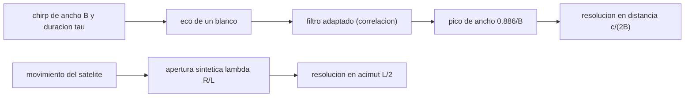

# B57-C07 — Sistemas radar SAR

<!-- nav:top -->
[🏠 Programa](../../../../README.md) · [📚 Bloque B57](../../../tronco-comun/B57-observacion-terrestre-y-geociencias-orbitales.md) · [← Anterior: B57-C06 — Índices de vegetación](../B57-C06-indices-de-vegetacion/CLASE.md) · [Siguiente: B57-C08 — Interferometría radar InSAR →](../B57-C08-interferometria-radar-insar/CLASE.md)
<!-- /nav -->

## 1. Ubicación, nivel y alcance

Clase 7 del bloque B57. Un radar de apertura sintética forma imágenes con microondas, que atraviesan nubes y no necesitan luz solar. Aprendes dos ideas: la **compresión de pulso** (un chirp largo se comprime a un pulso corto con un filtro adaptado) y la **apertura sintética** (el movimiento del satélite simula una antena larga). Los datos de Sentinel-1 son los de la página consultada; el chirp y la antena son **ilustrativos** y el eco es **sintético**.

## 2. Por qué esta clase existe

La luz visible no atraviesa nubes ni sirve de noche; las microondas sí. Pero un radar no «fotografía»: mide distancia y fase de ecos. La decisión central: **¿qué ancho de banda y qué antena dan la resolución que necesito en distancia y en acimut?**

## 3. Lo que podrás hacer al terminar

1. Calcular la longitud de onda de la banda C y la resolución en distancia `c/(2B)`.
2. Simular la compresión de un chirp con un filtro adaptado y medir su ancho a −3 dB.
3. Calcular la resolución en acimut `L/2` y la longitud de la apertura sintética.
4. Convertir resolución oblicua en resolución sobre el suelo con el ángulo de incidencia.
5. Distinguir los modos de adquisición de Sentinel-1 (barrido frente a resolución).

La evidencia es la **ficha de un sistema SAR** del ejercicio 12 (sección 20).

## 4. Con qué llegas y cómo comprobarlo

1. ¿Qué es la frecuencia de una onda y cómo se relaciona con la longitud de onda?
2. ¿Qué es una correlación de señales?
3. ¿Qué es un ángulo de incidencia?
4. ¿Qué es una transformada de Fourier?
5. ¿Qué es un blanco puntual?

<details>
<summary>Ver respuestas</summary>

1. `λ = c/f`. 2. Un producto desplazado que mide el parecido entre dos señales. 3. El ángulo entre el rayo y la vertical local. 4. Una descomposición en frecuencias; su producto equivale a una correlación. 5. Un reflector tan pequeño que no tiene estructura interna.
</details>

Con cuatro o cinco aciertos, sigue; si no, repasa los prerrequisitos.

## 5. Un caso de contexto y casos de referencia

Sentinel-1 trabaja en banda C a `5,405 GHz` (`λ ≈ 5,55 cm`) desde `693 km`; en modo IW da resoluciones de `5 m × 20 m` con `250 km` de barrido. Tú simulas un chirp **ilustrativo** de `100 MHz` y `10 µs` sobre un blanco puntual **sintético**. Es el **ejemplo conductor**: las cifras de Sentinel-1 son **publicadas**, el chirp no es el de ninguna misión.

## 6. Vocabulario

El **chirp** es un pulso cuya frecuencia varía linealmente. El **filtro adaptado** correlaciona el eco con una copia del pulso. El **producto tiempo–ancho de banda** `Bτ` es la ganancia de compresión. El **rango oblicuo** es la distancia radar–blanco; el **rango sobre el suelo** es su proyección. El **acimut** es la dirección del movimiento del satélite. La **apertura sintética** es el tramo de órbita en que un blanco está iluminado.

## 7. Modelo mental: gritar largo y escuchar el eco con una plantilla

El radar emite un pulso largo con frecuencia variable y, al recibirlo, lo compara con una plantilla del mismo pulso: donde calza, se obtiene un pico estrecho.



*Descripción textual:* la compresión de pulso fija la resolución en distancia y el movimiento del satélite, la resolución en acimut.

Analogía: reconocer una canción entre ruido comparando con la grabación original: la coincidencia da un pico claro. Límite: aquí hay un solo blanco y sin ruido.

## 8. La explicación, paso a paso

### 8.1 Longitud de onda y compresión

Con `f = 5,405 GHz`, `λ = 5,547 cm`. El chirp ilustrativo tiene `Bτ = 1000`. El filtro adaptado lo comprime a un pico de ancho a −3 dB igual a `8,647 ns`; la teoría da `0,886/B = 8,860 ns` (razón `0,976`).

### 8.2 Resolución en distancia

`δr = c/(2B) = 1,50 m` (oblicua). Con ancho a −3 dB queda `1,30 m`. Sobre el suelo, con incidencia de 35°, `δr/sen θ = 2,61 m`.

### 8.3 Resolución en acimut

Para un SAR de franja con antena de `12 m` (ilustrativa), `δa = L/2 = 6,0 m`, independiente de la distancia. Con `R = 846,0 km`, la apertura sintética tiene `λR/L = 3,91 km`.

### 8.4 Lectura

Los modos de Sentinel-1 (SM de unos 5 m en 80 km; IW de 5 × 20 m en 250 km; EW de 20 × 40 m en unos 400 km; WV de 5 m en viñetas de 20 × 20 km) muestran el compromiso entre barrido y resolución. El mayor lóbulo lateral cercano al pico del chirp sin ventana, medido en la simulación, es de `-13,5 dB`; en la práctica se aplican ventanas para bajarlo a costa de ensanchar el pico.

## 9. Magnitudes, símbolos y unidades

| Símbolo | Qué es | Unidad | Valor / nota |
|---|---|---|---|
| `f` | frecuencia | GHz | 5,405 |
| `λ` | longitud de onda | cm | 5,547 |
| `B` | ancho de banda del chirp | MHz | 100 (ilustrativo) |
| `δr` | resolución en distancia (oblicua) | m | 1,50 |
| `δa` | resolución en acimut | m | 6,0 |

## 10. Convenciones y referencias

Tierra plana para la distancia oblicua; ángulo de incidencia 35° (ilustrativo); distancias en metros y tiempos en segundos; el eco se trata como señal compleja. La resolución a −3 dB se mide en la salida comprimida sin ventana.

## 11. De dónde sale lo que afirmamos

| ID | Fuente | Localizador | Respalda | Estado |
|---|---|---|---|---|
| S1 | Copernicus, SentiWiki, *Sentinel-1 mission* | https://sentiwiki.copernicus.eu/web/s1-mission | banda C a 5,405 GHz, altitud de 693 km, modos SM, IW, EW y WV con sus barridos y resoluciones. | Consultada 2026-11-09 |

**Límites de las fuentes.** Solo se consultó una página de misión; el ancho de banda, la duración del pulso y la antena de la simulación son ilustrativos y no los de Sentinel-1. No se consultó una referencia de procesamiento SAR.

## 12. Cómo ver los resultados

| Magnitud | Valor |
|---|---|
| ancho a −3 dB (medido / teórico) | 8,647 / 8,860 ns |
| resolución en distancia | 1,50 m (oblicua) |
| resolución en acimut | 6,0 m |
| apertura sintética | 3,91 km |

Descripción larga: un chirp de 10 µs se comprime en un pico de pocos nanosegundos, y la antena sintética tiene kilómetros de largo.

## 13. Ejemplo trabajado: la resolución en distancia de 100 MHz

**Paso 1 · Ancho de banda.** `B = 100 MHz`.

**Paso 2 · Fórmula.** `δr = c/(2B) = 299 792 458/(2 × 10⁸) = 1,50 m`.

**Paso 3 · Suelo.** Con incidencia de 35°, `1,50 / sen 35° = 2,61 m`.

## 14. Distintas formas de abordar el problema

**Por ancho de banda:** `c/2B`. **Por simulación:** filtro adaptado y ancho a −3 dB. **Por geometría:** `L/2` y `λR/L`. La resolución en distancia depende de la señal y la de acimut, de la antena.

## 15. Práctica guiada

**Ejercicio 1 · con los pasos indicados.** Calcula `λ` para `f = 5,405 GHz`. *Pasos:* `c/f`.

<details><summary>Solución comentada</summary>

`299 792 458/5,405e9 = 5,547 cm`.
</details>

**Ejercicio 2 · con una pista.** ¿Qué resolución en distancia da `B = 50 MHz`? *Pista:* `c/(2B)`.

<details><summary>Solución comentada</summary>

`3,0 m` (oblicua).
</details>

**Ejercicio 3 · casi autónomo.** ¿Qué resolución en acimut da una antena de `10 m`? *Pista:* `L/2`.

<details><summary>Solución comentada</summary>

`5 m`.
</details>

## 16. Práctica autónoma, transferencia e integrador

**Ejercicio 4.** ¿Por qué la resolución en acimut no depende de la distancia? Usa 8.3.

<details><summary>Solución comentada</summary>

Porque la apertura sintética crece con `R` y compensa exactamente la apertura angular más estrecha.
</details>

**Ejercicio 5.** Calcula `Bτ` de `B = 100 MHz` y `τ = 10 µs`.

<details><summary>Solución comentada</summary>

`1000`.
</details>

**Ejercicio 6.** Convierte `1,5 m` oblicuos en distancia sobre el suelo con incidencia `30°`.

<details><summary>Solución comentada</summary>

`1,5/sen 30° = 3,0 m`.
</details>

**Ejercicio 7.** ¿Cuál es la longitud de apertura sintética para `R = 850 km`, `λ = 5,55 cm`, `L = 12 m`?

<details><summary>Solución comentada</summary>

`λR/L = 3,93 km`.
</details>

**Ejercicio 8.** ¿Por qué el pico comprimido es más estrecho que el pulso transmitido?

<details><summary>Solución comentada</summary>

Porque el filtro adaptado concentra la energía del chirp largo en un tiempo del orden de `1/B`.
</details>

**Ejercicio 9 · transferencia.** **Transferencia.** Una misión pide 1 m de resolución en distancia. ¿Qué ancho de banda necesita?

<details><summary>Solución comentada</summary>

`c/(2 × 1) = 150 MHz`.
</details>

**Ejercicio 10 · transferencia.** **Transferencia.** ¿Qué modo de Sentinel-1 eliges para vigilar el hielo marino y por qué?

<details><summary>Solución comentada</summary>

El EW: barrido de unos 400 km con resolución de 20 × 40 m, suficiente para escalas del hielo (S1).
</details>

**Ejercicio 11 · transferencia.** **Transferencia.** ¿Qué falta para convertir esta simulación en procesamiento SAR real?

<details><summary>Solución comentada</summary>

Migración de rango, compresión en acimut, calibración radiométrica, ruido y datos observados con procedencia.
</details>

**Ejercicio 12 · integrador.** **Integrador.** Elabora tu *ficha de un sistema SAR*: la tabla de resoluciones oblicua y sobre el suelo, la longitud de apertura sintética y la comparación del ancho medido con el teórico.

<details><summary>Solución modelo</summary>

Secciones 8.1 a 8.3 con los valores de la ejecución y los supuestos (blanco puntual, Tierra plana, parámetros ilustrativos).
</details>

## 17. Laboratorio: compresión de pulso y resoluciones de un SAR

El script [sar.py](sar.py) comprime un chirp con un filtro adaptado, mide su ancho a −3 dB y calcula las resoluciones y la apertura sintética (**comprueba** que el ancho medido coincide con 0,886/B con 3 %).

**Datos:** cifras de Sentinel-1 publicadas (S1); chirp, antena y eco **ilustrativos / sintéticos**. **Predice antes de ejecutar:** ¿qué razón tendrá el ancho medido frente al teórico? (cerca de 1.) **Ejecución del 2026-11-09 (Python 3.12.9):**

```text
Python 3.12.9 ; numpy 2.4.4
Longitud de onda = 5.547 cm ; producto tiempo-ancho de banda = 1000
Ancho a -3 dB de la salida comprimida = 8.647 ns ; teorico 0.886/B = 8.860 ns ; razon = 0.976
Resolucion en distancia c/(2B) = 1.50 m ; a -3 dB = 1.30 m ; sobre el suelo (incidencia 35 grados) = 2.61 m
Resolucion en acimut L/2 = 6.0 m ; distancia oblicua = 846.0 km ; apertura sintetica = 3.91 km
Mayor lobulo lateral cercano (entre 5 y 20 muestras del pico) = -13.5 dB
Pruebas superadas.
```

```bash
python programa/clases/B57/B57-C07-sistemas-radar-sar/sar.py
```

**Límites:** un solo blanco, sin ruido, sin migración de rango y con Tierra plana; no procesa datos de Sentinel-1.

## 18. Errores frecuentes y cómo corregirlos

**Confundir resolución oblicua con resolución sobre el suelo.** Divide por `sen θ` (8.2).

**Pensar que mayor antena da mejor acimut.** En un SAR de franja es `L/2`: antena menor, mejor acimut.

**Usar el ancho del pulso como resolución.** La resolución es `c/2B` tras comprimir.

**Presentar el chirp como el de Sentinel-1.** Es ilustrativo (sección 5).

## 19. Cómo sabrás que vas bien

Tras la sección 8: ¿qué resultado esperabas y cuál obtuviste? Si dudas, repasa el ejemplo 13. Tras el laboratorio: ¿qué comprueba? (ver la sección 17).

## 20. Qué entregas y cómo se evalúa

El producto es tu **ficha de un sistema SAR** (ejercicio 12).

| Criterio | Inicial | En desarrollo | Logrado | Destacado |
|---|---|---|---|---|
| Conceptos | Los confunde | Parciales | Conceptos de la clase | Explica los límites |
| Cálculo | Sin unidades | Con errores | Tablas completas con unidades | Calcula casos nuevos |
| Numérico | Sin comprobar | Un caso | Contraste con el caso analítico | Interpreta las diferencias |
| Fuentes | Sin fuente | Sin fecha | Fuentes con fecha | Declara lo no consultado |
| Límites | No los nombra | Uno | Tres | Discute qué falta del modelo |

**Condiciones críticas (no se compensan con promedio):** rotular chirp, antena y eco como ilustrativos o sintéticos; no presentar el resultado como un producto Sentinel-1; citar solo lo consultado.

## 21. Ética, seguridad y límites

Clase educativa: modelo simplificado de un solo blanco. Accesibilidad: tablas equivalentes a las gráficas, fórmulas en texto, ejercicios sin conexión.

## 22. Para cerrar y seguir

Un chirp de `100 MHz` da `1,50 m` en distancia y una antena de `12 m` da `6 m` en acimut. Queda una pregunta: ¿qué se puede medir con la fase de dos imágenes radar?

**Glosario español–inglés.** radar de apertura sintética · *synthetic aperture radar (SAR)*; filtro adaptado · *matched filter*; compresión de pulso · *pulse compression*; rango oblicuo · *slant range*; acimut · *azimuth*.

**Continuidad.** [B57-C08](../B57-C08-interferometria-radar-insar/CLASE.md) estudia interferometría radar InSAR.

**Referencias:** ver sección 11.

<!-- nav:bottom -->
---

[← Anterior: B57-C06 — Índices de vegetación](../B57-C06-indices-de-vegetacion/CLASE.md) · [📚 Bloque B57](../../../tronco-comun/B57-observacion-terrestre-y-geociencias-orbitales.md) · [Siguiente: B57-C08 — Interferometría radar InSAR →](../B57-C08-interferometria-radar-insar/CLASE.md)
<!-- /nav -->
