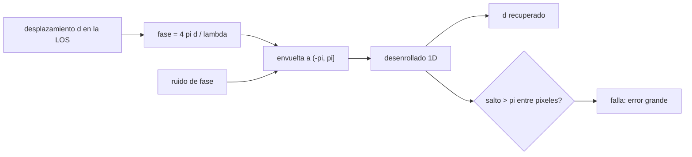

# B57-C08 — Interferometría radar InSAR

<!-- nav:top -->
[🏠 Programa](../../../../README.md) · [📚 Bloque B57](../../../tronco-comun/B57-observacion-terrestre-y-geociencias-orbitales.md) · [← Anterior: B57-C07 — Sistemas radar SAR](../B57-C07-sistemas-radar-sar/CLASE.md) · [Siguiente: B57-C09 — Altimetría satelital →](../B57-C09-altimetria-satelital/CLASE.md)
<!-- /nav -->

## 1. Ubicación, nivel y alcance

Clase 8 del bloque B57. Dos imágenes radar del mismo lugar tomadas en fechas distintas tienen fases distintas si el suelo se movió entre ambas. Esa diferencia de fase, convertida con la longitud de onda, mide el desplazamiento en la línea de visión con precisión de milímetros. Simulas una cubeta de hundimiento **sintética**, la conviertes en franjas y la recuperas desenrollando la fase; también ves el caso en que el desenrollado falla. Longitud de onda y ciclos de repetición son los de Sentinel-1 (consultados).

## 2. Por qué esta clase existe

El radar es la única herramienta orbital que mide movimientos del suelo de milímetros a escala regional, pero la fase solo se conoce módulo `2π`. La decisión central: **¿cuándo se puede reconstruir el desplazamiento y cuándo el desenrollado de la fase deja de ser fiable?**

## 3. Lo que podrás hacer al terminar

1. Convertir fase interferométrica en desplazamiento en la línea de visión y viceversa.
2. Calcular el tamaño de una franja (`λ/2`) y el número de franjas de una deformación.
3. Estimar el error de desplazamiento por el ruido de fase.
4. Desenrollar la fase 1D y medir el error frente a la verdad sintética.
5. Reconocer el límite de pendiente de `λ/4` por píxel y los casos en que el desenrollado falla.

La evidencia es la **ficha de una medición InSAR** del ejercicio 12 (sección 20).

## 4. Con qué llegas y cómo comprobarlo

1. ¿Qué es la fase de una onda?
2. ¿Qué es una fase envuelta?
3. ¿Qué es la línea de visión (LOS)?
4. ¿Qué es un ruido gaussiano?
5. ¿Qué es un dato sintético?

<details>
<summary>Ver respuestas</summary>

1. La posición dentro del ciclo, en radianes. 2. La fase reducida al intervalo de `2π`. 3. La dirección entre el sensor y el punto del suelo. 4. Una perturbación aleatoria con distribución normal. 5. Uno generado por una fórmula, no medido.
</details>

Con cuatro o cinco aciertos, sigue; si no, repasa los prerrequisitos.

## 5. Un caso de contexto y casos de referencia

Un valle se hunde `15 cm` en la LOS formando una cubeta gaussiana. Con banda C (`λ ≈ 5,55 cm`) esa deformación equivale a unas `5,4` franjas. Se comparan dos casos: una cubeta ancha (`w = 3 km`) y una estrecha (`w = 100 m`), ambas con píxeles de `20 m` (**ilustrativo**). Es el **ejemplo conductor**; la deformación y el ruido son **sintéticos**.

## 6. Vocabulario

La **fase interferométrica** es `φ = 4πd/λ` para un desplazamiento `d` en la LOS (el factor 4π incluye ida y vuelta). Una **franja** es un ciclo de `2π`, equivalente a `λ/2` de desplazamiento. El **desenrollado** reconstruye la fase continua a partir de la envuelta. La **coherencia** mide cuánto se parecen las dos imágenes en señal; si es baja, la fase es ruidosa. La **línea base temporal** es el intervalo entre las dos tomas.

## 7. Modelo mental: una regla con marcas cada media longitud de onda

La fase envuelta es una regla cuyas marcas se repiten cada `λ/2`: sabes en qué parte de la marca estás, pero no cuántas marcas llevas, hasta que cuentas siguiendo la regla de un píxel al otro.



*Descripción textual:* el desplazamiento genera la fase, que se envuelve y se contamina de ruido; el desenrollado suma ciclos y recupera el desplazamiento solo si el salto entre píxeles es menor que π.

Analogía: seguir una cuerda de nudos en la oscuridad: cuentas los nudos al pasar de uno a otro; si saltas varios de golpe, pierdes la cuenta. Límite: la fase real también incluye atmósfera y topografía que aquí no están.

## 8. La explicación, paso a paso

### 8.1 De desplazamiento a fase

Con `λ = 5,547 cm`, una franja corresponde a `2,773 cm` de desplazamiento en la LOS. El pico de `15 cm` da `34,0 rad` de fase, o `5,41` franjas. Un ruido de fase de `0,3 rad` equivale a `1,32 mm` de error.

### 8.2 Dos casos de desenrollado

| caso | salto máximo de la fase verdadera entre píxeles (rad) | rms tras desenrollar (mm) |
|---|---|---|
| ancho (`w = 3 km`) | 0,14 | 1,33 |
| estrecho (`w = 100 m`) | 4,07 | 62,7 |

En el caso ancho el salto entre píxeles es menor que `π`, el desenrollado cuenta bien las franjas y el error es del orden del ruido. En el estrecho el salto supera `π`: el desenrollado pierde ciclos y el error es de centímetros.

### 8.3 El límite

El desenrollado 1D es fiable mientras el desplazamiento entre píxeles contiguos sea menor que `λ/4 = 13,87 mm`. Un píxel de 20 m limita entonces la pendiente de la deformación; los volcanes y las fallas con gradientes fuertes la superan cerca de la fuente.

### 8.4 Lectura

La precisión milimétrica es una propiedad de la medición **relativa** entre puntos y fechas, con coherencia suficiente. El ciclo de 12 días de un satélite Sentinel-1 (6 con dos) fija con qué rapidez puede cambiar la deformación sin que se pierda la coherencia o se supere `λ/4` entre fechas. La atmósfera y la topografía añaden fase que esta simulación no incluye.

## 9. Magnitudes, símbolos y unidades

| Símbolo | Qué es | Unidad | Valor / nota |
|---|---|---|---|
| `λ` | longitud de onda | cm | 5,547 |
| `d` | desplazamiento en la LOS | m | 0,15 (sintético) |
| `φ` | fase interferométrica | rad | 34,0 en el pico |
| `σ_φ` | ruido de fase | rad | 0,3 (sintético) |
| `σ_d` | error de desplazamiento | mm | 1,32 |

## 10. Convenciones y referencias

Positivo en la fase es acercamiento al sensor o alejamiento según la convención del procesador; aquí el hundimiento se toma negativo y la fase sigue su signo. Desplazamiento solo en la LOS. Una dimensión. No hay atmósfera ni topografía.

## 11. De dónde sale lo que afirmamos

| ID | Fuente | Localizador | Respalda | Estado |
|---|---|---|---|---|
| S1 | Copernicus, SentiWiki, *Sentinel-1 mission* | https://sentiwiki.copernicus.eu/web/s1-mission | banda C a 5,405 GHz (λ ≈ 5,55 cm), ciclo de repetición de 12 días con un satélite y 6 con dos. | Consultada 2026-11-09 |

**Límites de las fuentes.** No se consultó una referencia metodológica de InSAR (la página de la ESA sobre el tema no abrió). La relación `φ = 4πd/λ` se contrasta con la simulación, no con una fuente.

## 12. Cómo ver los resultados

| Magnitud | Valor |
|---|---|
| franja en la LOS | 2,773 cm |
| error por ruido de fase | 1,32 mm |
| rms caso ancho / estrecho | 1,33 / 62,7 mm |

Descripción larga: el caso ancho se recupera con error de milímetros y el estrecho falla con error de centímetros.

## 13. Ejemplo trabajado: convertir 15 cm en franjas

**Paso 1 · Fase.** `φ = 4π × 0,15/0,05547 = 34,0 rad`.

**Paso 2 · Franjas.** `φ/2π = 5,41`.

**Paso 3 · Cotejo.** `0,15 m/(λ/2) = 5,41`: ambas vías coinciden.

## 14. Distintas formas de abordar el problema

**Por fase:** `4πd/λ`. **Por franjas:** `d/(λ/2)`. **Por simulación:** desenrollado frente a verdad. **Por límite:** `λ/4` por píxel. Cada vía responde a una pregunta distinta del mismo modelo.

## 15. Práctica guiada

**Ejercicio 1 · con los pasos indicados.** ¿Cuánto vale una franja en la LOS para `λ = 5,55 cm`? *Pasos:* `λ/2`.

<details><summary>Solución comentada</summary>

`2,77 cm`.
</details>

**Ejercicio 2 · con una pista.** ¿Qué fase produce un desplazamiento de `1 cm`? *Pista:* `4πd/λ`.

<details><summary>Solución comentada</summary>

`4π × 0,01/0,05547 = 2,27 rad`.
</details>

**Ejercicio 3 · casi autónomo.** ¿Cuántas franjas hay en `15 cm`? Usa 8.1.

<details><summary>Solución comentada</summary>

5,41.
</details>

## 16. Práctica autónoma, transferencia e integrador

**Ejercicio 4.** ¿Qué desplazamiento mide una fase de `0,3 rad`?

<details><summary>Solución comentada</summary>

`0,3 × 0,05547/(4π) = 1,32 mm`.
</details>

**Ejercicio 5.** ¿Cuál es el desplazamiento máximo por píxel para desenrollar con seguridad?

<details><summary>Solución comentada</summary>

`λ/4 = 13,87 mm`.
</details>

**Ejercicio 6.** ¿Por qué falla el caso estrecho? Usa 8.2.

<details><summary>Solución comentada</summary>

Porque el salto de fase entre píxeles contiguos supera `π`.
</details>

**Ejercicio 7.** Si el píxel fuera de 5 m en lugar de 20 m, ¿mejoraría el caso estrecho?

<details><summary>Solución comentada</summary>

Sí: el salto por píxel baja ~4 veces (a 1,0 rad aprox.) y queda bajo `π`.
</details>

**Ejercicio 8.** Explica por qué el factor es `4π` y no `2π`.

<details><summary>Solución comentada</summary>

Porque la onda recorre el camino de ida y vuelta: el cambio de camino es `2d`.
</details>

**Ejercicio 9 · transferencia.** **Transferencia.** Un deslizamiento se mueve 2 cm entre tomas de 12 días. ¿Se puede medir?

<details><summary>Solución comentada</summary>

Sí, si hay coherencia: 2 cm equivalen a 0,72 franja, que se mide sin ambigüedad (menos de una franja).
</details>

**Ejercicio 10 · transferencia.** **Transferencia.** Una zona agrícola cambia por cosechas entre tomas. ¿Qué le pasa a la medición?

<details><summary>Solución comentada</summary>

La coherencia cae y la fase pasa a ser ruido; la medición no es fiable.
</details>

**Ejercicio 11 · transferencia.** **Transferencia.** ¿Qué contribuciones faltan en esta simulación para tratarla como InSAR real?

<details><summary>Solución comentada</summary>

Atmósfera, topografía, órbitas, coherencia variable y desenrollado bidimensional.
</details>

**Ejercicio 12 · integrador.** **Integrador.** Elabora tu *ficha de una medición InSAR*: la tabla de los dos casos (salto máximo, saltos observados, rms), el tamaño de franja y el límite `λ/4`, con supuestos.

<details><summary>Solución modelo</summary>

Secciones 8.1 a 8.3 con los valores de la ejecución y la lista de contribuciones ausentes (atmósfera, topografía, órbita).
</details>

## 17. Laboratorio: fase, franjas y desenrollado

El script [insar.py](insar.py) simula una cubeta de hundimiento, la convierte en fase con ruido y mide el error del desenrollado en un caso suave y en uno empinado (**comprueba** que el caso suave se recupera con error < 3 σ_d y que el empinado falla (> 1 cm)).

**Datos:** longitud de onda y ciclos de Sentinel-1 publicados (S1); deformación y ruido **sintéticos**. **Predice antes de ejecutar:** ¿qué caso fallará? (el estrecho, porque el salto de fase supera π.) **Ejecución del 2026-11-09 (Python 3.12.9):**

```text
Python 3.12.9 ; numpy 2.4.4
lambda = 5.547 cm ; una franja = lambda/2 = 2.773 cm en la LOS ; sigma_d del ruido de fase (0.3 rad) = 1.32 mm
Fase del pico (d0 = 0.15 m) = 34.0 rad = 5.41 franjas
Caso suave: salto maximo de fase entre pixeles = 0.14 rad ; saltos de envoltura observados = 38 ; rms tras desenrollar = 1.33 mm
Caso empinado: salto maximo de fase entre pixeles = 4.07 rad ; saltos de envoltura observados = 9 ; rms tras desenrollar = 62.66 mm
Limite de desenrollado: deformacion maxima entre pixeles contiguos = lambda/4 = 13.87 mm
Pruebas superadas.
```

```bash
python programa/clases/B57/B57-C08-interferometria-radar-insar/insar.py
```

**Límites:** una dimensión, sin atmósfera ni topografía, con coherencia constante.

## 18. Errores frecuentes y cómo corregirlos

**Usar `2π` en lugar de `4π`.** El camino es de ida y vuelta (ejercicio 8).

**Creer que el desenrollado siempre recupera la deformación.** Falla con pendientes fuertes (8.2).

**Tomar el desplazamiento de la LOS como vertical.** La LOS mezcla vertical y horizontal; ver C17.

**Leer la simulación como una observación.** Es sintética (sección 5).

## 19. Cómo sabrás que vas bien

Tras la sección 8: ¿qué resultado esperabas y cuál obtuviste? Si dudas, repasa el ejemplo 13. Tras el laboratorio: ¿qué comprueba? (ver la sección 17).

## 20. Qué entregas y cómo se evalúa

El producto es tu **ficha de una medición InSAR** (ejercicio 12).

| Criterio | Inicial | En desarrollo | Logrado | Destacado |
|---|---|---|---|---|
| Conceptos | Los confunde | Parciales | Conceptos de la clase | Explica los límites |
| Cálculo | Sin unidades | Con errores | Tablas completas con unidades | Calcula casos nuevos |
| Numérico | Sin comprobar | Un caso | Contraste con el caso analítico | Interpreta las diferencias |
| Fuentes | Sin fuente | Sin fecha | Fuentes con fecha | Declara lo no consultado |
| Límites | No los nombra | Uno | Tres | Discute qué falta del modelo |

**Condiciones críticas (no se compensan con promedio):** rotular la deformación como sintética; no presentar la precisión milimétrica como garantía sin coherencia; citar solo lo consultado.

## 21. Ética, seguridad y límites

Clase educativa: no se mide ninguna deformación real. Accesibilidad: tablas equivalentes a las gráficas, fórmulas en texto, ejercicios sin conexión.

## 22. Para cerrar y seguir

Una franja equivale a `2,77 cm` de desplazamiento en la LOS y el desenrollado solo funciona si el salto entre píxeles es menor que `13,9 mm`. Queda una pregunta: ¿cómo se mide la altura del mar y del hielo desde la órbita?

**Glosario español–inglés.** interferometría radar · *interferometric SAR (InSAR)*; fase envuelta · *wrapped phase*; desenrollado de fase · *phase unwrapping*; franja · *fringe*; coherencia · *coherence*; línea de visión · *line of sight (LOS)*.

**Continuidad.** [B57-C09](../B57-C09-altimetria-satelital/CLASE.md) estudia altimetría satelital.

**Referencias:** ver sección 11.

<!-- nav:bottom -->
---

[← Anterior: B57-C07 — Sistemas radar SAR](../B57-C07-sistemas-radar-sar/CLASE.md) · [📚 Bloque B57](../../../tronco-comun/B57-observacion-terrestre-y-geociencias-orbitales.md) · [Siguiente: B57-C09 — Altimetría satelital →](../B57-C09-altimetria-satelital/CLASE.md)
<!-- /nav -->
