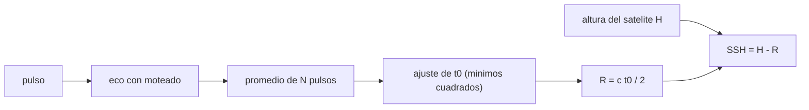

# B57-C09 — Altimetría satelital

<!-- nav:top -->
[🏠 Programa](../../../../README.md) · [📚 Bloque B57](../../../tronco-comun/B57-observacion-terrestre-y-geociencias-orbitales.md) · [← Anterior: B57-C08 — Interferometría radar InSAR](../B57-C08-interferometria-radar-insar/CLASE.md) · [Siguiente: B57-C10 — Geodesia mediante GNSS →](../B57-C10-geodesia-mediante-gnss/CLASE.md)
<!-- /nav -->

## 1. Ubicación, nivel y alcance

Clase 9 del bloque B57. Un altímetro mide cuánto tarda un pulso en ir al suelo y volver, y de ese tiempo sale la distancia; restando esa distancia a la altura del satélite se obtiene la altura de la superficie. Aquí simulas el eco **sintético** de una superficie marina, ajustas el instante de llegada y ves cómo el promedio de pulsos reduce el error. No se usa ninguna página de misión: la clase es un modelo.

## 2. Por qué esta clase existe

La altura del mar cambia unos milímetros por año, pero el eco de un pulso es ruidoso. La decisión central: **¿cuántos pulsos hay que promediar y cómo se ajusta el eco para que el error de distancia del ajuste se reduzca lo necesario?**

## 3. Lo que podrás hacer al terminar

1. Convertir tiempo de ida y vuelta en distancia (`R = ct/2`) y viceversa.
2. Calcular qué precisión temporal exige una precisión en distancia dada.
3. Ajustar el instante de subida de un eco por mínimos cuadrados.
4. Comprobar que el error baja como `1/√N` al promediar pulsos.
5. Calcular la altura de la superficie como `H − R` y reconocer las correcciones que faltan.

La evidencia es la **ficha de altimetría satelital** del ejercicio 12 (sección 20).

## 4. Con qué llegas y cómo comprobarlo

1. ¿Qué velocidad tiene la luz y qué distancia recorre en 1 ns?
2. ¿Qué es un mínimo cuadrado?
3. ¿Qué es el moteado (*speckle*)?
4. ¿Qué es un promedio de N medidas independientes?
5. ¿Qué es un dato sintético?

<details>
<summary>Ver respuestas</summary>

1. `299 792 458 m/s`; unos 30 cm. 2. El ajuste que minimiza la suma de los cuadrados de los residuos. 3. La fluctuación aleatoria de la potencia de un eco de superficie rugosa. 4. Reduce la desviación en `1/√N`. 5. Uno generado por una fórmula.
</details>

Con cuatro o cinco aciertos, sigue; si no, repasa los prerrequisitos.

## 5. Un caso de contexto y casos de referencia

Un satélite a `1336 km` (**ilustrativo**) mide el eco de un océano casi plano. La subida del eco tiene forma de función error con `σ = 2,5 ns` y llega en un instante `t0` desconocido dentro de una ventana de `128` compuertas de `3,125 ns`. Es el **ejemplo conductor**; todo es **sintético**.

## 6. Vocabulario

El **tiempo de ida y vuelta** `t` es lo que tarda el pulso; la **distancia** (*range*) es `R = ct/2`. La **forma de onda** es la potencia del eco en función del tiempo; su **flanco de subida** marca la superficie media. El **reajuste** (*retracking*) estima `t0` ajustando un modelo. La **altura de la superficie** es `SSH = H − R` más correcciones. El **moteado** hace que cada pulso sea ruidoso; se reduce **promediando** pulsos.

## 7. Modelo mental: medir una profundidad con un eco

Gritas en un pozo y mides cuánto tarda el eco: la profundidad es la mitad del tiempo por la velocidad. El eco real es borroso; ajustas su inicio promediando muchas veces.



*Descripción textual:* los pulsos se promedian, se ajusta el instante de subida, se convierte en distancia y se resta a la altura del satélite.

Analogía: medir un pozo con el eco: la mitad del tiempo por la velocidad del sonido. Límite: aquí la «velocidad» es la de la luz y el medio (atmósfera) la retrasa un poco, lo que se corrige en la clase C29.

## 8. La explicación, paso a paso

### 8.1 Del tiempo a la distancia

`R = ct/2`. Un centímetro de distancia corresponde a `66,7 ps` de tiempo de ida y vuelta, y 1 ns equivale a `14,99 cm`. Un satélite a `1336 km` de una superficie a `0,42 m` de altura recibe el eco tras `8,912830 ms`; invirtiendo la relación, `H − ct/2` recupera `0,4200 m` (el valor impuesto de 0,42 m, en doble precisión).

### 8.2 Reajuste y promedio

| pulsos promediados | sesgo de `t0` (ns) | error rms de `t0` (ns) | error rms de distancia (cm) |
|---|---|---|---|
| 25 | +0,0977 | 0,5944 | 8,91 |
| 100 | +0,0096 | 0,3007 | 4,51 |

La razón de errores entre 25 y 100 pulsos es `1,98`, cercana a `√4 = 2`: el promedio de pulsos con moteado independiente reduce el error como `1/√N`.

### 8.3 Lo que falta

La altura de la superficie requiere restar al `R` el retraso atmosférico, las mareas, la presión y el sesgo de estado del mar, y conocer la órbita del satélite con precisión de centímetros. Esta clase no las incluye: los ensayos del laboratorio (400 por caso) solo prueban el reajuste.

### 8.4 Lectura

La precisión de centímetros por pulso promediado no equivale a la exactitud de la altura del mar. La exactitud depende de la órbita, de las correcciones y de la calibración; la clase C29 trata las atmosféricas y C31 la validación.

## 9. Magnitudes, símbolos y unidades

| Símbolo | Qué es | Unidad | Valor / nota |
|---|---|---|---|
| `c` | velocidad de la luz | m/s | 299 792 458 |
| `t` | tiempo de ida y vuelta | s | 8,912830 ms |
| `R` | distancia satélite–superficie | m | — |
| `H` | altura del satélite | m | 1 336 000 (ilustrativa) |
| `σ_R` | error rms de la distancia | cm | 4,51 (N = 100) |

## 10. Convenciones y referencias

Alturas sobre el elipsoide de referencia (no se modela uno); tiempos en segundos; la forma del eco se modela como función error con σ conocida y amplitud libre; moteado exponencial independiente entre pulsos.

## 11. De dónde sale lo que afirmamos

| ID | Fuente | Localizador | Respalda | Estado |
|---|---|---|---|---|
| — | Sin fuente externa | — | relaciones estándar que verifica el laboratorio | No se consultó una fuente para esta clase |

**Límites de las fuentes.** No se consultó ninguna fuente de altimetría para esta clase (la página de Sentinel-6 no abrió). `R = ct/2` y el efecto del promedio se contrastan con el laboratorio. Todos los parámetros son ilustrativos.

## 12. Cómo ver los resultados

| Magnitud | Valor |
|---|---|
| 1 cm de distancia | 66,7 ps |
| error rms con 25 pulsos | 8,91 cm |
| error rms con 100 pulsos | 4,51 cm |
| razón de errores | 1,98 |

Descripción larga: cuadruplicar los pulsos promediados reduce el error a la mitad, como predice la teoría.

## 13. Ejemplo trabajado: la precisión temporal para 1 cm

**Paso 1 · Relación.** `δR = c δt/2`.

**Paso 2 · Despeje.** `δt = 2 δR/c = 2 × 0,01/299 792 458`.

**Paso 3 · Resultado.** `66,7 ps`.

## 14. Distintas formas de abordar el problema

**Por tiempo:** `R = ct/2`. **Por ajuste:** `t0` por mínimos cuadrados. **Por promedio:** `1/√N`. **Por altura:** `SSH = H − R` con correcciones. El ajuste y el promedio reducen el ruido; las correcciones eliminan el sesgo.

## 15. Práctica guiada

**Ejercicio 1 · con los pasos indicados.** ¿Cuántos centímetros corresponden a `1 ns`? *Pasos:* `c δt/2`.

<details><summary>Solución comentada</summary>

`14,99 cm`.
</details>

**Ejercicio 2 · con una pista.** ¿Qué `δt` equivale a `1 mm`? *Pista:* `2 δR/c`.

<details><summary>Solución comentada</summary>

`6,67 ps`.
</details>

**Ejercicio 3 · casi autónomo.** Un eco vuelve en `8,9 ms`. ¿Qué distancia es? Usa 8.1.

<details><summary>Solución comentada</summary>

`299 792 458 × 0,0089/2 = 1334 km`.
</details>

## 16. Práctica autónoma, transferencia e integrador

**Ejercicio 4.** Con N = 25 el error rms es 8,91 cm. ¿Cuánto se espera con N = 100?

<details><summary>Solución comentada</summary>

La mitad, unos `4,51 cm` (tabla 8.2).
</details>

**Ejercicio 5.** ¿Cuántos pulsos hacen falta para bajar el error a la cuarta parte de N = 25?

<details><summary>Solución comentada</summary>

`16 × 25 = 400`.
</details>

**Ejercicio 6.** ¿Por qué se ajusta la amplitud además de `t0`?

<details><summary>Solución comentada</summary>

Porque la potencia del eco no se conoce; si se fijara, un error de amplitud sesgaría `t0`.
</details>

**Ejercicio 7.** Si los pulsos no son independientes (están correlacionados), ¿qué pasa con el promedio?

<details><summary>Solución comentada</summary>

Reduce menos el error que `1/√N`; hay menos pulsos efectivos.
</details>

**Ejercicio 8.** Explica por qué la altura de la superficie necesita la órbita.

<details><summary>Solución comentada</summary>

Porque `SSH = H − R` y un error en `H` pasa directo a la SSH.
</details>

**Ejercicio 9 · transferencia.** **Transferencia.** Un colega afirma que 1 cm de error por pulso da altura del mar con 1 cm de exactitud. Respóndele.

<details><summary>Solución comentada</summary>

No: la exactitud depende de la órbita y de las correcciones atmosféricas y de estado del mar, que no están en el modelo (8.3).
</details>

**Ejercicio 10 · transferencia.** **Transferencia.** Queremos detectar 3 mm/año de cambio con series mensuales. ¿Por qué importa el error por mes?

<details><summary>Solución comentada</summary>

Porque la pendiente de una serie ruidosa tiene una incertidumbre que depende de ese error y de la longitud de la serie (clase C12).
</details>

**Ejercicio 11 · transferencia.** **Transferencia.** ¿Qué datos reales harían falta para validar este ajuste?

<details><summary>Solución comentada</summary>

Formas de onda observadas con procedencia, la órbita precisa y las correcciones del producto.
</details>

**Ejercicio 12 · integrador.** **Integrador.** Elabora tu *ficha de altimetría satelital*: la tabla del error del reajuste con 25 y 100 pulsos, la precisión temporal para 1 cm y la lista de correcciones ausentes.

<details><summary>Solución modelo</summary>

Secciones 8.1 a 8.3 con los valores de la ejecución y la lista de correcciones no modeladas (atmósfera, mareas, presión, estado del mar, órbita).
</details>

## 17. Laboratorio: tiempo de ida y vuelta y reajuste del eco

El script [altimetria.py](altimetria.py) calcula la relación entre tiempo y distancia, ajusta el instante de subida de un eco sintético con moteado y mide el error (**comprueba** que el sesgo es compatible con cero a 4 errores estándar y la razón entre errores con 25 y 100 pulsos entre 1,6 y 2,4).

**Datos:** eco, ruido y parámetros **sintéticos / ilustrativos**; sin datos de misión. **Predice antes de ejecutar:** ¿qué razón tendrá el error de 25 pulsos frente al de 100? (cerca de 2.) **Ejecución del 2026-11-09 (Python 3.12.9):**

```text
Python 3.12.9 ; numpy 2.4.4
1 cm de distancia = 66.7 ps de tiempo de ida y vuelta ; 1 ns = 14.99 cm
Tiempo de ida y vuelta para H - SSH = 1336 km - 0.42 m: 8.912830 ms ; SSH recuperada = 0.4200 m
N =  25 pulsos: sesgo = +0.0977 ns ; error rms de t0 = 0.5944 ns = 8.91 cm
N = 100 pulsos: sesgo = +0.0096 ns ; error rms de t0 = 0.3007 ns = 4.51 cm
Razon de errores rms (N = 25 / N = 100) = 1.98 (teoria 2)
Pruebas superadas.
```

```bash
python programa/clases/B57/B57-C09-altimetria-satelital/altimetria.py
```

**Límites:** sin correcciones, sin estado del mar y con amplitud y σ conocidas; no es un procesador de altimetría.

## 18. Errores frecuentes y cómo corregirlos

**Olvidar el factor 2.** El tiempo es de ida y vuelta (8.1).

**Creer que promediar elimina cualquier sesgo.** Solo reduce el ruido aleatorio (8.2).

**Confundir precisión con exactitud.** Se explica en 8.4.

**Presentar el eco sintético como un eco real.** Es sintético (sección 5).

## 19. Cómo sabrás que vas bien

Tras la sección 8: ¿qué resultado esperabas y cuál obtuviste? Si dudas, repasa el ejemplo 13. Tras el laboratorio: ¿qué comprueba? (ver la sección 17).

## 20. Qué entregas y cómo se evalúa

El producto es tu **ficha de altimetría satelital** (ejercicio 12).

| Criterio | Inicial | En desarrollo | Logrado | Destacado |
|---|---|---|---|---|
| Conceptos | Los confunde | Parciales | Conceptos de la clase | Explica los límites |
| Cálculo | Sin unidades | Con errores | Tablas completas con unidades | Calcula casos nuevos |
| Numérico | Sin comprobar | Un caso | Contraste con el caso analítico | Interpreta las diferencias |
| Fuentes | Sin fuente | Sin fecha | Fuentes con fecha | Declara lo no consultado |
| Límites | No los nombra | Uno | Tres | Discute qué falta del modelo |

**Condiciones críticas (no se compensan con promedio):** rotular el eco como sintético; no presentar el modelo como un procesador de misión; citar solo lo consultado (aquí, nada).

## 21. Ética, seguridad y límites

Clase educativa: modelo sin correcciones. Accesibilidad: tablas equivalentes a las gráficas, fórmulas en texto, ejercicios sin conexión.

## 22. Para cerrar y seguir

Un centímetro de distancia exige `67 ps` de precisión temporal y promediar 100 pulsos baja el error del reajuste a `4,5 cm`. Queda una pregunta: ¿cómo se determina una posición en la Tierra con constelaciones de satélites?

**Glosario español–inglés.** altimetría · *altimetry*; forma de onda · *waveform*; reajuste · *retracking*; moteado · *speckle*; altura de la superficie del mar · *sea surface height (SSH)*.

**Continuidad.** [B57-C10](../B57-C10-geodesia-mediante-gnss/CLASE.md) estudia geodesia mediante GNSS.

**Referencias:** ver sección 11.

<!-- nav:bottom -->
---

[← Anterior: B57-C08 — Interferometría radar InSAR](../B57-C08-interferometria-radar-insar/CLASE.md) · [📚 Bloque B57](../../../tronco-comun/B57-observacion-terrestre-y-geociencias-orbitales.md) · [Siguiente: B57-C10 — Geodesia mediante GNSS →](../B57-C10-geodesia-mediante-gnss/CLASE.md)
<!-- /nav -->
