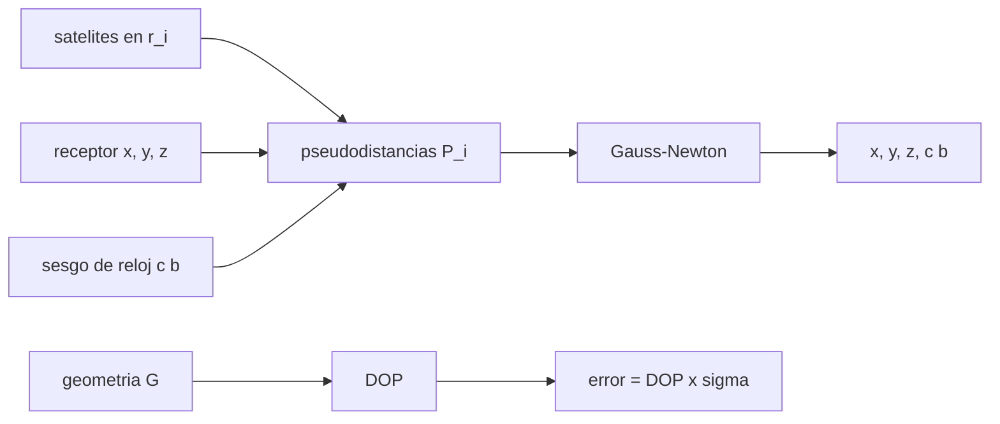

# B57-C10 — Geodesia mediante GNSS

<!-- nav:top -->
[🏠 Programa](../../../../README.md) · [📚 Bloque B57](../../../tronco-comun/B57-observacion-terrestre-y-geociencias-orbitales.md) · [← Anterior: B57-C09 — Altimetría satelital](../B57-C09-altimetria-satelital/CLASE.md) · [Siguiente: B57-C11 — LiDAR satelital →](../B57-C11-lidar-satelital/CLASE.md)
<!-- /nav -->

## 1. Ubicación, nivel y alcance

Clase 10 del bloque B57. Un receptor GNSS mide su distancia a varios satélites (con un error de reloj común) y resuelve su posición. Calculas la posición con mínimos cuadrados para una geometría **sintética**, estimas el factor de geometría (DOP) y lo verificas con una simulación Monte Carlo. No se consultó una página de GNSS en esta sesión: todos los valores son ilustrativos.

## 2. Por qué esta clase existe

La geodesia con GNSS mide posiciones de estaciones con precisión de milímetros a centímetros y sirve para ver cómo se mueve la corteza. Pero la precisión depende de la geometría de los satélites. La decisión central: **¿cuántos satélites y con qué distribución hacen falta para que el error de posición sea cercano al de la medición?**

## 3. Lo que podrás hacer al terminar

1. Plantear el sistema de pseudodistancias con sesgo de reloj y resolverlo con Gauss–Newton.
2. Calcular HDOP, VDOP, PDOP y TDOP desde la matriz de geometría.
3. Verificar con Monte Carlo que el error 3D es PDOP × σ.
4. Comparar una buena y una mala geometría de satélites.
5. Reconocer los errores no modelados (ionosfera, troposfera, multitrayecto, efemérides).

La evidencia es la **ficha de geodesia con GNSS** del ejercicio 12 (sección 20).

## 4. Con qué llegas y cómo comprobarlo

1. ¿Cuántas incógnitas tiene el problema?
2. ¿Qué es un sistema de mínimos cuadrados?
3. ¿Qué es un vector unitario?
4. ¿Qué es un ENU?
5. ¿Qué es un Monte Carlo?

<details>
<summary>Ver respuestas</summary>

1. Cuatro: posición `(x, y, z)` y sesgo de reloj. 2. El ajuste que minimiza el cuadrado de los residuos. 3. Un vector de longitud 1. 4. Un sistema local con ejes este, norte y arriba. 5. Repetir con números aleatorios para ver una distribución.
</details>

Con cuatro o cinco aciertos, sigue; si no, repasa los prerrequisitos.

## 5. Un caso de contexto y casos de referencia

Un receptor en `−33,45°` de latitud (valor **ilustrativo**) ve ocho satélites a distintos acimutes y elevaciones, o solo cuatro agrupados en un sector de 60° de acimut. Cada pseudodistancia lleva un sesgo de reloj de `0,3 ms` y un ruido de `1 m`. Es el **ejemplo conductor**; la geometría y el ruido son **sintéticos**.

## 6. Vocabulario

La **pseudodistancia** es la distancia aparente medida con el tiempo de viaje de la señal, con el sesgo del reloj del receptor. La **matriz de geometría** `G` tiene por fila el vector unitario receptor–satélite (con signo opuesto) y un 1 para el reloj. El **DOP** (*dilution of precision*) amplifica el error: `PDOP = √(Q₁₁+Q₂₂+Q₃₃)` con `Q = (GᵀG)⁻¹`. **HDOP** y **VDOP** separan lo horizontal de lo vertical.

## 7. Modelo mental: trilateración con un reloj torcido

Con tres distancias exactas ubicas un punto. Aquí el reloj del receptor suma el mismo error a todas, y por eso hace falta un cuarto satélite que lo desenrede.



*Descripción textual:* las pseudodistancias dependen de la posición y del sesgo; Gauss–Newton los resuelve, y la geometría de los satélites fija cuánto se amplifica el ruido.

Analogía: ubicarte por el eco de varias campanas con un reloj atrasado: si todas las campanas suenan desde el mismo lado, el error de posición en la otra dirección es enorme. Límite: aquí el medio es el vacío y no hay retrasos de ionosfera ni troposfera.

## 8. La explicación, paso a paso

### 8.1 Resolver la posición

Se parte del centro de la Tierra con sesgo cero. Con la geometría buena, el método converge en `6` iteraciones y recupera la posición con un error de `7,1e-09 m` sin ruido. Un sesgo de reloj de `0,3 ms` equivale a `89,9 km` de pseudodistancia y se recupera con error de `1,6e-17 s`.

### 8.2 DOP y simulación

| geometría | HDOP | VDOP | PDOP | TDOP | rms 3D simulado (m) | rms/(PDOP·σ) |
|---|---|---|---|---|---|---|
| ocho satélites repartidos | 1,31 | 2,48 | 2,80 | 1,77 | 2,80 | 1,001 |
| cuatro agrupados | 10,14 | 10,47 | 14,58 | 12,83 | 14,74 | 1,011 |

El error 3D simulado coincide con `PDOP × σ` en ambos casos: el DOP resume cuánto amplifica la geometría el ruido de medición.

### 8.3 Lectura

La geometría mala multiplica el error por un factor de `14,6` frente a `2,8`. En geodesia se promedian horas de datos y se modelan ionosfera, troposfera y órbitas para llegar a milímetros, algo que este modelo no hace.

### 8.4 Límites

La simulación supone ruido blanco independiente, esfera perfecta y satélites sin error de posición ni de reloj. Los errores sistemáticos reales son de otra naturaleza y no se reducen con el promedio como el ruido blanco.

## 9. Magnitudes, símbolos y unidades

| Símbolo | Qué es | Unidad | Valor / nota |
|---|---|---|---|
| `P` | pseudodistancia | m | — |
| `b` | sesgo de reloj del receptor | s | 3 × 10⁻⁴ (sintético) |
| `σ` | ruido de pseudodistancia | m | 1 (ilustrativo) |
| `PDOP` | dilución de precisión de posición | — | 2,80; 14,6 |
| `E_3D` | error rms 3D | m | 2,80; 14,7 |

## 10. Convenciones y referencias

Esfera de 6371 km (ilustrativa) y sistema de coordenadas centrado en la Tierra; DOP en ejes locales ENU; sesgo de reloj en segundos (el producto `c·b` está en metros). Sin relatividad ni rotación terrestre durante el vuelo de la señal.

## 11. De dónde sale lo que afirmamos

| ID | Fuente | Localizador | Respalda | Estado |
|---|---|---|---|---|
| — | Sin fuente externa | — | relaciones estándar que verifica el laboratorio | No se consultó una fuente para esta clase |

**Límites de las fuentes.** No se consultó ninguna fuente de GNSS para esta clase. Radio orbital, ruido y geometría son ilustrativos; el método de Gauss–Newton se verifica contra una solución sin ruido y contra el Monte Carlo.

## 12. Cómo ver los resultados

| Magnitud | Valor |
|---|---|
| PDOP buena / mala | 2,80 / 14,6 |
| rms 3D simulado buena / mala | 2,80 / 14,7 m |
| razón rms/(PDOP·σ) | 1,001 / 1,011 |

Descripción larga: agrupar los satélites multiplica el error por varias veces y el DOP lo predice con precisión.

## 13. Ejemplo trabajado: el error esperado con PDOP

**Paso 1 · DOP.** `PDOP = 2,80` con ocho satélites repartidos.

**Paso 2 · Ruido.** `σ = 1 m`.

**Paso 3 · Error.** `E_3D = PDOP × σ = 2,80 m`; la simulación da `2,80 m`.

## 14. Distintas formas de abordar el problema

**Por geometría:** DOP. **Por simulación:** Monte Carlo. **Por solución exacta:** error sin ruido de 10⁻⁹ m. Las tres vías confirman la solución.

## 15. Práctica guiada

**Ejercicio 1 · con los pasos indicados.** ¿Cuántos satélites mínimos hacen falta? *Pasos:* cuenta las incógnitas (sección 6).

<details><summary>Solución comentada</summary>

Cuatro: tres de posición y una de reloj.
</details>

**Ejercicio 2 · con una pista.** ¿A cuántos metros equivale un sesgo de `1 µs`? *Pista:* `c × b`.

<details><summary>Solución comentada</summary>

`299,8 m`.
</details>

**Ejercicio 3 · casi autónomo.** Con `PDOP = 2` y `σ = 1 m`, ¿cuál es el error 3D esperado?

<details><summary>Solución comentada</summary>

`2 m`.
</details>

## 16. Práctica autónoma, transferencia e integrador

**Ejercicio 4.** Con `PDOP = 14,6` y `σ = 1 m`, ¿cuánto vale el error?

<details><summary>Solución comentada</summary>

`14,6 m`; la simulación da `14,7 m`.
</details>

**Ejercicio 5.** ¿Por qué agrupar satélites aumenta el DOP?

<details><summary>Solución comentada</summary>

Porque los vectores unitarios son casi paralelos y `GᵀG` está mal condicionada.
</details>

**Ejercicio 6.** ¿Qué mide el VDOP frente al HDOP?

<details><summary>Solución comentada</summary>

El VDOP la amplificación vertical y el HDOP la horizontal; el vertical suele ser peor porque no hay satélites bajo el horizonte.
</details>

**Ejercicio 7.** Si se promedian 100 épocas independientes, ¿cuánto baja el error aleatorio?

<details><summary>Solución comentada</summary>

En `√100 = 10`.
</details>

**Ejercicio 8.** Explica por qué los errores sistemáticos no se reducen promediando.

<details><summary>Solución comentada</summary>

Porque no cambian entre épocas; el promedio solo reduce lo aleatorio.
</details>

**Ejercicio 9 · transferencia.** **Transferencia.** Una estación en un valle profundo solo ve satélites de un lado. ¿Qué espera?

<details><summary>Solución comentada</summary>

Un PDOP alto y, por tanto, un error grande en la dirección sin satélites.
</details>

**Ejercicio 10 · transferencia.** **Transferencia.** ¿Para qué sirve medir con GNSS en geodesia además de ubicar un punto?

<details><summary>Solución comentada</summary>

Para ver cómo cambia su posición en el tiempo (velocidad de placas, deformación), con series de coordenadas.
</details>

**Ejercicio 11 · transferencia.** **Transferencia.** ¿Qué se necesita para pasar de metros a milímetros?

<details><summary>Solución comentada</summary>

Modelar ionosfera y troposfera, usar órbitas precisas, fase de portadora y promedios largos.
</details>

**Ejercicio 12 · integrador.** **Integrador.** Elabora tu *ficha de geodesia con GNSS*: la tabla de DOP y error simulado para las dos geometrías, y la lista de errores no modelados.

<details><summary>Solución modelo</summary>

Tabla 8.2 con los valores de la ejecución y la lista de 8.4 (ionosfera, troposfera, multitrayecto, efemérides, relatividad).
</details>

## 17. Laboratorio: posición por pseudodistancias y DOP

El script [gnss.py](gnss.py) resuelve la posición con Gauss–Newton, calcula el DOP de dos geometrías y verifica el error con un Monte Carlo (**comprueba** el error sin ruido < 1e-6 m y el error simulado frente a PDOP·σ dentro de 5 %).

**Datos:** geometría, radio orbital, sesgo y ruido **sintéticos / ilustrativos**; sin datos observados. **Predice antes de ejecutar:** ¿qué geometría tendrá mayor error y por cuánto? (la agrupada, varias veces mayor.) **Ejecución del 2026-11-09 (Python 3.12.9):**

```text
Python 3.12.9 ; numpy 2.4.4
Un sesgo de reloj de 0.3 ms equivale a 89.9 km de pseudodistancia
Geometria buena: iteraciones = 6 ; error sin ruido = 7.11e-09 m ; error de sesgo = 1.63e-17 s
   HDOP = 1.31 ; VDOP = 2.48 ; PDOP = 2.80 ; TDOP = 1.77 ; rms 3D simulado = 2.80 m ; razon rms/(PDOP*sigma) = 1.001
Geometria mala: iteraciones = 6 ; error sin ruido = 7.17e-08 m ; error de sesgo = 2.22e-16 s
   HDOP = 10.14 ; VDOP = 10.47 ; PDOP = 14.58 ; TDOP = 12.83 ; rms 3D simulado = 14.74 m ; razon rms/(PDOP*sigma) = 1.011
Pruebas superadas.
```

```bash
python programa/clases/B57/B57-C10-geodesia-mediante-gnss/gnss.py
```

**Límites:** ruido blanco, sin errores sistemáticos y con esfera ilustrativa.

## 18. Errores frecuentes y cómo corregirlos

**Resolver con tres satélites y olvidar el reloj.** Hay cuatro incógnitas (sección 6).

**Creer que más satélites siempre mejora el DOP.** Depende de la distribución (8.2).

**Reportar precisión sin geometría.** Declara el DOP (8.2).

**Presentar el resultado como una posición real.** Es sintético (sección 5).

## 19. Cómo sabrás que vas bien

Tras la sección 8: ¿qué resultado esperabas y cuál obtuviste? Si dudas, repasa el ejemplo 13. Tras el laboratorio: ¿qué comprueba? (ver la sección 17).

## 20. Qué entregas y cómo se evalúa

El producto es tu **ficha de geodesia con GNSS** (ejercicio 12).

| Criterio | Inicial | En desarrollo | Logrado | Destacado |
|---|---|---|---|---|
| Conceptos | Los confunde | Parciales | Conceptos de la clase | Explica los límites |
| Cálculo | Sin unidades | Con errores | Tablas completas con unidades | Calcula casos nuevos |
| Numérico | Sin comprobar | Un caso | Contraste con el caso analítico | Interpreta las diferencias |
| Fuentes | Sin fuente | Sin fecha | Fuentes con fecha | Declara lo no consultado |
| Límites | No los nombra | Uno | Tres | Discute qué falta del modelo |

**Condiciones críticas (no se compensan con promedio):** rotular geometría y ruido como sintéticos; declarar los errores no modelados; citar solo lo consultado (aquí, nada).

## 21. Ética, seguridad y límites

Clase educativa: no se calcula la posición de ningún usuario real. Accesibilidad: tablas equivalentes a las gráficas, fórmulas en texto, ejercicios sin conexión.

## 22. Para cerrar y seguir

La geometría buena tiene `PDOP = 2,80` y la agrupada `14,6`; el error 3D simulado coincide con `PDOP × σ`. Queda una pregunta: ¿qué mide un láser desde la órbita?

**Glosario español–inglés.** sistema global de navegación por satélite · *global navigation satellite system (GNSS)*; pseudodistancia · *pseudorange*; dilución de la precisión · *dilution of precision (DOP)*; sesgo de reloj · *clock bias*; mínimos cuadrados · *least squares*.

**Continuidad.** [B57-C11](../B57-C11-lidar-satelital/CLASE.md) estudia liDAR satelital.

**Referencias:** ver sección 11.

<!-- nav:bottom -->
---

[← Anterior: B57-C09 — Altimetría satelital](../B57-C09-altimetria-satelital/CLASE.md) · [📚 Bloque B57](../../../tronco-comun/B57-observacion-terrestre-y-geociencias-orbitales.md) · [Siguiente: B57-C11 — LiDAR satelital →](../B57-C11-lidar-satelital/CLASE.md)
<!-- /nav -->
