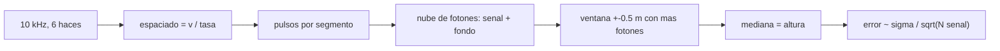

# B57-C11 — LiDAR satelital

<!-- nav:top -->
[🏠 Programa](../../../../README.md) · [📚 Bloque B57](../../../tronco-comun/B57-observacion-terrestre-y-geociencias-orbitales.md) · [← Anterior: B57-C10 — Geodesia mediante GNSS](../B57-C10-geodesia-mediante-gnss/CLASE.md) · [Siguiente: B57-C12 — Oceanografía desde órbita →](../B57-C12-oceanografia-desde-orbita/CLASE.md)
<!-- /nav -->

## 1. Ubicación, nivel y alcance

Clase 11 del bloque B57. Un LiDAR satelital de conteo de fotones dispara un láser verde miles de veces por segundo y registra los fotones que regresan, la mayoría de ellos ruido de fondo. Calculas cada cuántos metros cae un pulso, simulas una nube de fotones **sintética** sobre una superficie y buscas la altura con la ventana de más fotones. La tasa de pulsos y el número de haces son los de la página de NASA consultada; el resto es **ilustrativo**.

## 2. Por qué esta clase existe

Un láser mide alturas con precisión de centímetros, pero a la luz del día el fondo solar inunda el detector. La decisión central: **¿cuántos fotones de señal hacen falta para distinguir la superficie del ruido y con qué error?**

## 3. Lo que podrás hacer al terminar

1. Calcular el espaciado a lo largo de la traza como velocidad sobre el suelo entre tasa de pulsos.
2. Distinguir fotones de señal y de fondo en una nube de puntos.
3. Estimar la altura de un segmento con una ventana de máxima densidad y la mediana.
4. Comparar el error simulado con `σ/√N`.
5. Reconocer cuándo la señal débil hace fallar la búsqueda.

La evidencia es la **ficha de LiDAR satelital** del ejercicio 12 (sección 20).

## 4. Con qué llegas y cómo comprobarlo

1. ¿Qué es un fotón?
2. ¿Qué es una distribución de Poisson?
3. ¿Qué es una mediana?
4. ¿Qué es la velocidad sobre el suelo?
5. ¿Qué es un dato sintético?

<details>
<summary>Ver respuestas</summary>

1. Un cuanto de luz. 2. La de recuentos de eventos independientes. 3. El valor central de un conjunto ordenado. 4. La velocidad del punto subsatélite sobre la superficie. 5. Uno generado por una fórmula.
</details>

Con cuatro o cinco aciertos, sigue; si no, repasa los prerrequisitos.

## 5. Un caso de contexto y casos de referencia

El láser de ICESat-2 dispara unos `10 000` pulsos por segundo y se divide en `6` haces. Aquí un satélite **ilustrativo** a `500 km` observa segmentos planos de `100 m` con `0,15 m` de dispersión; el haz fuerte entrega 3 fotones de señal por pulso y hay 15 de fondo repartidos en `30 m` de altura. Es el **ejemplo conductor**; la nube es **sintética**.

## 6. Vocabulario

El **conteo de fotones** registra eventos individuales en vez de energía. Un **fotón de señal** viene del láser reflejado; uno de **fondo** viene del Sol o del ruido del detector. El **espaciado a lo largo de la traza** es la distancia en el suelo entre pulsos. Un **segmento** agrupa fotones de varios pulsos para estimar una altura. La **ventana de máxima densidad** es la altura con más fotones en un intervalo corto.

## 7. Modelo mental: encontrar un cartel en una nevada

Los fotones de fondo caen como copos por todas partes; los de señal se amontonan en la altura de la superficie. Buscas dónde se amontonan.



*Descripción textual:* la tasa y la velocidad fijan cuántos pulsos hay en un segmento, la nube mezcla señal y fondo, y la ventana más densa da la altura con un error que baja con el número de fotones de señal.

Analogía: hallar un cartel en una tormenta de nieve buscando dónde se acumulan más copos. Límite: si hay pocos fotones de señal, un montón de fondo puede parecer más denso.

## 8. La explicación, paso a paso

### 8.1 Geometría a lo largo de la traza

A `500 km` (ilustrativo) la velocidad sobre el suelo es `7,059 km/s`. A `10 kHz`, un pulso cae cada `0,706 m`, de modo que un segmento de `100 m` reúne `141` pulsos.

### 8.2 Señal y fondo

Con 3 fotones de señal por pulso hay `423` fotones de señal por segmento. El fondo aporta `70,5` fotones por metro de altura. La señal se concentra en unos 0,5 m y supera al fondo local por un factor grande.

### 8.3 Estimación

| caso | error rms (cm) | segmentos con error > 1 m |
|---|---|---|
| señal fuerte (3 fotones/pulso) | 1,16 | 0,0 % |
| señal débil (0,05 fotones/pulso) | 875,7 | 83,5 % |

El error esperado `σ/√N` es `0,73 cm`. Con señal débil, la ventana más densa suele ser de fondo y el error es de metros.

### 8.4 Lectura

La altura de un segmento tiene un error estadístico pequeño si la señal domina, pero no incluye sesgos de pendiente, rugosidad, nubes o la orientación del haz. Por eso el producto real distingue haces fuertes y débiles y filtra por confianza; aquí solo se muestra el principio.

## 9. Magnitudes, símbolos y unidades

| Símbolo | Qué es | Unidad | Valor / nota |
|---|---|---|---|
| `f` | tasa de pulsos | Hz | 10 000 |
| `d` | espaciado a lo largo de la traza | m | 0,706 |
| `N_s` | fotones de señal por segmento | — | 423 |
| `σ` | dispersión de la superficie | m | 0,15 (ilustrativa) |
| `ε` | error de altura | cm | 1,16 (fuerte) |

## 10. Convenciones y referencias

Alturas relativas a un plano local por segmento; fotones registrados como alturas puntuales; el fondo es uniforme en una ventana de 30 m. No se modela pendiente ni corrección de geoide.

## 11. De dónde sale lo que afirmamos

| ID | Fuente | Localizador | Respalda | Estado |
|---|---|---|---|---|
| S1 | NASA, *ICESat-2 (página general)* | https://icesat-2.gsfc.nasa.gov/ | tasa de unos 10 000 pulsos por segundo, división del láser en seis haces y lanzamiento del 15 de septiembre de 2018. | Consultada 2026-11-09 (solo traía la tasa de pulsos y los seis haces; el resto, no consultado) |

**Límites de las fuentes.** La página de NASA consultada no traía longitud de onda, huella, altitud ni precisión; esas cifras no se usan como publicadas. Altitud, fotones por pulso, dispersión y fondo son ilustrativos.

## 12. Cómo ver los resultados

| Magnitud | Valor |
|---|---|
| espaciado entre pulsos | 0,706 m |
| error rms con señal fuerte | 1,16 cm |
| error esperado σ/√N | 0,73 cm |
| fallos con señal débil | 83,5 % |

Descripción larga: con señal fuerte el error es de centímetros y con señal débil la búsqueda falla en gran parte de los segmentos.

## 13. Ejemplo trabajado: el espaciado entre pulsos

**Paso 1 · Velocidad.** `v_suelo = 7,059 km/s`.

**Paso 2 · Tasa.** `10 000 pulsos/s`.

**Paso 3 · Espaciado.** `7,059 km/s ÷ 10 000 = 0,706 m`.

## 14. Distintas formas de abordar el problema

**Por geometría:** `v/f`. **Por estadística:** `σ/√N`. **Por búsqueda:** ventana de máxima densidad. **Por simulación:** error rms. La estadística da el mejor caso y la simulación incluye el fondo.

## 15. Práctica guiada

**Ejercicio 1 · con los pasos indicados.** ¿Cuántos metros avanza el suelo entre pulsos a `6,9 km/s` y `10 kHz`? *Pasos:* divide.

<details><summary>Solución comentada</summary>

`0,69 m`.
</details>

**Ejercicio 2 · con una pista.** ¿Cuántos pulsos caben en un segmento de `100 m` con espaciado `0,7 m`?

<details><summary>Solución comentada</summary>

`142`.
</details>

**Ejercicio 3 · casi autónomo.** Con `σ = 0,15 m` y `N = 400`, ¿cuál es el error estadístico? *Pista:* `σ/√N`.

<details><summary>Solución comentada</summary>

`0,15/20 = 0,75 cm`.
</details>

## 16. Práctica autónoma, transferencia e integrador

**Ejercicio 4.** ¿Cuántos fotones de señal hay con 3 por pulso en 141 pulsos?

<details><summary>Solución comentada</summary>

`423`.
</details>

**Ejercicio 5.** ¿Qué pasa con el error si se duplica el segmento a 200 m?

<details><summary>Solución comentada</summary>

Baja por `√2`, siempre que el terreno siga plano.
</details>

**Ejercicio 6.** ¿Por qué se usa la mediana en la ventana en vez de la media?

<details><summary>Solución comentada</summary>

Porque es robusta frente a fotones de fondo que entran en la ventana.
</details>

**Ejercicio 7.** Explica por qué falla el caso de señal débil (8.3).

<details><summary>Solución comentada</summary>

Hay unos 7 fotones de señal frente a decenas de fondo en cualquier ventana de 1 m.
</details>

**Ejercicio 8.** ¿Qué sesgo no recoge este error estadístico?

<details><summary>Solución comentada</summary>

Pendiente, rugosidad, nubes y errores de orientación del haz.
</details>

**Ejercicio 9 · transferencia.** **Transferencia.** Una pendiente de 10° sobre un segmento de 100 m, ¿afecta al método?

<details><summary>Solución comentada</summary>

Sí: la altura varía unos 17 m en el segmento y la ventana de ±0,5 m no encuentra un solo nivel; hay que ajustar una recta.
</details>

**Ejercicio 10 · transferencia.** **Transferencia.** ¿Por qué el producto real usa haces fuertes y débiles?

<details><summary>Solución comentada</summary>

Para medir con distinta densidad de señal y obtener pendiente transversal; aquí no se modela.
</details>

**Ejercicio 11 · transferencia.** **Transferencia.** ¿Qué datos reales harían falta para validar el método?

<details><summary>Solución comentada</summary>

Nubes de fotones observadas con procedencia y alturas de referencia independientes.
</details>

**Ejercicio 12 · integrador.** **Integrador.** Elabora tu *ficha de LiDAR satelital*: la tabla de geometría, el error simulado con señal fuerte y débil y la comparación con `σ/√N`.

<details><summary>Solución modelo</summary>

Secciones 8.1 a 8.3 con los valores de la ejecución y la lista de sesgos no modelados.
</details>

## 17. Laboratorio: espaciado de pulsos y búsqueda de la superficie

El script [lidar_fotones.py](lidar_fotones.py) calcula el espaciado, simula fotones de señal y fondo por segmento y estima la altura con una ventana de máxima densidad (**comprueba** error rms < 3 cm con señal fuerte y más del 10 % de fallos con señal débil).

**Datos:** tasa y haces de ICESat-2 (S1); altitud, señal, fondo y superficie **sintéticos / ilustrativos**. **Predice antes de ejecutar:** ¿cuánto es el error esperado con señal fuerte? (menos de 1 cm de ruido estadístico.) **Ejecución del 2026-11-09 (Python 3.12.9):**

```text
Python 3.12.9 ; numpy 2.4.4
Velocidad sobre el suelo = 7.059 km/s ; espaciado entre pulsos a 10 kHz = 0.706 m ; pulsos por segmento de 100 m = 141
Fotones de senal por segmento = 423 ; fondo = 70.5 fotones por metro de altura
Error estadistico esperado sigma/sqrt(N) = 0.73 cm
Senal fuerte: error rms = 1.16 cm ; segmentos con error > 1 m = 0.0 %
Senal debil : error rms = 875.7 cm ; segmentos con error > 1 m = 83.5 %
Pruebas superadas.
```

```bash
python programa/clases/B57/B57-C11-lidar-satelital/lidar_fotones.py
```

**Límites:** superficie plana por segmento, sin pendiente, nubes ni sesgos; no es el algoritmo de ICESat-2.

## 18. Errores frecuentes y cómo corregirlos

**Confundir el espaciado con la huella.** La huella no se consultó; el espaciado es `v/f`.

**Tomar toda la nube como señal.** Hay fondo (8.2).

**Reportar solo el error estadístico como exactitud.** Faltan sesgos (8.4).

**Presentar la nube como observada.** Es sintética (sección 5).

## 19. Cómo sabrás que vas bien

Tras la sección 8: ¿qué resultado esperabas y cuál obtuviste? Si dudas, repasa el ejemplo 13. Tras el laboratorio: ¿qué comprueba? (ver la sección 17).

## 20. Qué entregas y cómo se evalúa

El producto es tu **ficha de LiDAR satelital** (ejercicio 12).

| Criterio | Inicial | En desarrollo | Logrado | Destacado |
|---|---|---|---|---|
| Conceptos | Los confunde | Parciales | Conceptos de la clase | Explica los límites |
| Cálculo | Sin unidades | Con errores | Tablas completas con unidades | Calcula casos nuevos |
| Numérico | Sin comprobar | Un caso | Contraste con el caso analítico | Interpreta las diferencias |
| Fuentes | Sin fuente | Sin fecha | Fuentes con fecha | Declara lo no consultado |
| Límites | No los nombra | Uno | Tres | Discute qué falta del modelo |

**Condiciones críticas (no se compensan con promedio):** rotular la nube como sintética; no usar cifras de ICESat-2 que la página no traía; citar solo lo consultado.

## 21. Ética, seguridad y límites

Clase educativa: no se procesan datos de ICESat-2. Accesibilidad: tablas equivalentes a las gráficas, fórmulas en texto, ejercicios sin conexión.

## 22. Para cerrar y seguir

Un pulso cae cada `0,71 m` y con 3 fotones de señal por pulso el error simulado es de `1,2 cm`. Queda una pregunta: ¿qué se aprende del océano con estas alturas?

**Glosario español–inglés.** LiDAR · *lidar*; conteo de fotones · *photon counting*; fotón de fondo · *background photon*; segmento · *segment*; nube de puntos · *point cloud*.

**Continuidad.** [B57-C12](../B57-C12-oceanografia-desde-orbita/CLASE.md) estudia oceanografía desde órbita.

**Referencias:** ver sección 11.

<!-- nav:bottom -->
---

[← Anterior: B57-C10 — Geodesia mediante GNSS](../B57-C10-geodesia-mediante-gnss/CLASE.md) · [📚 Bloque B57](../../../tronco-comun/B57-observacion-terrestre-y-geociencias-orbitales.md) · [Siguiente: B57-C12 — Oceanografía desde órbita →](../B57-C12-oceanografia-desde-orbita/CLASE.md)
<!-- /nav -->
