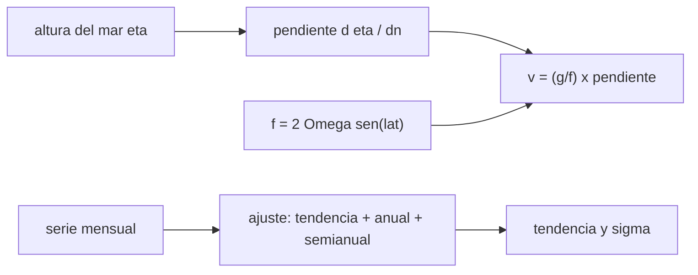

# B57-C12 — Oceanografía desde órbita

<!-- nav:top -->
[🏠 Programa](../../../../README.md) · [📚 Bloque B57](../../../tronco-comun/B57-observacion-terrestre-y-geociencias-orbitales.md) · [← Anterior: B57-C11 — LiDAR satelital](../B57-C11-lidar-satelital/CLASE.md) · [Siguiente: B57-C13 — Atmósfera y aerosoles →](../B57-C13-atmosfera-y-aerosoles/CLASE.md)
<!-- /nav -->

## 1. Ubicación, nivel y alcance

Clase 12 del bloque B57. Con alturas del mar medidas desde órbita se pueden calcular dos cosas: las corrientes (la pendiente de la superficie es una velocidad geostrófica) y el cambio del nivel del mar (una tendencia en una serie temporal). Calculas la velocidad de un remolino **sintético** y estimas con qué incertidumbre se mide una tendencia **ilustrativa** de milímetros por año. No se consultó una fuente: son relaciones de un modelo.

## 2. Por qué esta clase existe

El océano se mueve lento y se eleva más lento aún. La decisión central: **¿qué pendiente de la superficie equivale a una corriente y cuántos años de datos se necesitan para ver una tendencia de pocos milímetros por año entre un ruido de centímetros?**

## 3. Lo que podrás hacer al terminar

1. Calcular el parámetro de Coriolis y la velocidad geostrófica desde la pendiente de la altura del mar.
2. Comprobar una derivada numérica contra la analítica.
3. Ajustar una tendencia con términos anual y semianual.
4. Calcular la incertidumbre de la pendiente y verificarla con Monte Carlo.
5. Entender que una sola pasada mide solo la componente de velocidad perpendicular a la traza.

La evidencia es la **ficha de oceanografía desde órbita** del ejercicio 12 (sección 20).

## 4. Con qué llegas y cómo comprobarlo

1. ¿Qué es el parámetro de Coriolis?
2. ¿Qué es una derivada?
3. ¿Qué es un ajuste de mínimos cuadrados?
4. ¿Qué es una incertidumbre?
5. ¿Qué es un dato sintético?

<details>
<summary>Ver respuestas</summary>

1. `f = 2Ω sen φ`, la rotación local de la Tierra. 2. La tasa de cambio de una función. 3. El que minimiza el cuadrado de los residuos. 4. Un intervalo en que se espera el valor verdadero. 5. Uno generado por una fórmula.
</details>

Con cuatro o cinco aciertos, sigue; si no, repasa los prerrequisitos.

## 5. Un caso de contexto y casos de referencia

Un remolino de `0,20 m` de altura y `50 km` de radio característico a `33°` sur (**ilustrativo**) y una serie mensual de `30` años con una tendencia impuesta de `3 mm/año` (**ilustrativa**, no es una medición) con ciclo anual de `40 mm` y ruido de `20 mm`. Es el **ejemplo conductor**; todo es **sintético**.

## 6. Vocabulario

El **balance geostrófico** iguala la fuerza de presión (pendiente de la superficie) con la de Coriolis: `v = (g/f) ∂η/∂n`. La **anomalía de altura** `η` es la altura respecto de una referencia. El **número de Rossby** compara la aceleración con la fuerza de Coriolis. La **tendencia** es la pendiente de una recta ajustada a una serie. El **ciclo anual** es la oscilación estacional que se ajusta aparte.

## 7. Modelo mental: una loma de agua que no se desparrama

Una loma de agua debería deslizarse, pero la rotación terrestre desvía el flujo y lo hace circular alrededor de la loma: la pendiente da la velocidad.



*Descripción textual:* la pendiente de la altura, dividida por el parámetro de Coriolis, da la velocidad; la serie temporal da una tendencia con su incertidumbre.

Analogía: un molino de agua: la loma empuja y la rotación gira la corriente. Límite: vale solo para flujos lentos y grandes, con Rossby pequeño.

## 8. La explicación, paso a paso

### 8.1 Velocidad geostrófica

A `33°` sur, `f = -7,9431e-05 s⁻¹` (el signo indica el hemisferio). La velocidad máxima del remolino ocurre en `r = L = 50 km` y vale `0,2995 m/s` (analítica); la derivada numérica con malla de 5 km da `0,2985 m/s`, con error relativo `3,8e-03`. El número de Rossby es `0,075`, pequeño: el balance geostrófico es razonable.

### 8.2 Tendencia

Se ajusta la serie con una constante, una recta y dos armónicos (anual y semianual). El ajuste recupera `2,998 mm/año` (impuesto: 3). La incertidumbre analítica de la pendiente es `0,122 mm/año` y la simulada con 2000 realizaciones, `0,122 mm/año` (razón `1,002`).

### 8.3 Lectura

Con 30 años de datos y ruido blanco de 20 mm la pendiente se conoce a décimas de mm/año. En datos reales el ruido está correlacionado en el tiempo, hay errores de calibración entre misiones y correcciones geofísicas; esta incertidumbre es un límite inferior optimista.

### 8.4 Límites

Una traza que cruza el remolino solo da la componente de velocidad perpendicular a ella. El cálculo supone un fluido estacionario y sin fricción. La velocidad sintética de `0,30 m/s` no es una medición.

## 9. Magnitudes, símbolos y unidades

| Símbolo | Qué es | Unidad | Valor / nota |
|---|---|---|---|
| `η` | anomalía de altura del mar | m | 0,20 (sintética) |
| `f` | parámetro de Coriolis | s⁻¹ | -7,943e-05 |
| `v` | velocidad geostrófica | m/s | 0,300 máx. |
| `b` | tendencia del nivel del mar | mm/año | 3,0 (impuesta, ilustrativa) |
| `σ_b` | incertidumbre de la pendiente | mm/año | 0,122 |

## 10. Convenciones y referencias

`g = 9,80665 m s⁻²` y `Ω = 7,2921159 × 10⁻⁵ rad/s` como valores de referencia no consultados; latitud negativa en el hemisferio sur; tiempo en años desde el inicio de la serie. Velocidad positiva hacia el este.

## 11. De dónde sale lo que afirmamos

| ID | Fuente | Localizador | Respalda | Estado |
|---|---|---|---|---|
| — | Sin fuente externa | — | relaciones estándar que verifica el laboratorio | No se consultó una fuente para esta clase |

**Límites de las fuentes.** No se consultó ninguna fuente para esta clase. La tendencia de 3 mm/año es un valor ilustrativo para la simulación y no se presenta como medición ni como estimación de la subida real.

## 12. Cómo ver los resultados

| Magnitud | Valor |
|---|---|
| velocidad máxima (analítica / numérica) | 0,2995 / 0,2985 m/s |
| σ de la pendiente (analítica / simulada) | 0,122 / 0,122 mm/año |
| número de Rossby | 0,075 |

Descripción larga: la derivada numérica reproduce la analítica y la dispersión simulada de la pendiente coincide con la teoría.

## 13. Ejemplo trabajado: la velocidad máxima del remolino

**Paso 1 · Pendiente máxima.** `η0 e^{−1/2}/L = 0,20 × 0,6065/50 000 = 2,43 × 10⁻⁶`.

**Paso 2 · Factor.** `g/|f| = 9,80665/7,943 × 10⁻⁵ = 1,235 × 10⁵ m/s`.

**Paso 3 · Velocidad.** `0,2995 m/s`.

## 14. Distintas formas de abordar el problema

**Por pendiente:** balance geostrófico. **Por numérica:** diferencia centrada. **Por serie:** mínimos cuadrados. **Por Monte Carlo:** dispersión de la pendiente. Se verifican entre sí.

## 15. Práctica guiada

**Ejercicio 1 · con los pasos indicados.** Calcula `f` a `33°` sur. *Pasos:* `2Ω sen φ`.

<details><summary>Solución comentada</summary>

`2 × 7,2921e-5 × sen(−33°) = −7,94e-5 s⁻¹`.
</details>

**Ejercicio 2 · con una pista.** Si la pendiente es `2,4e-6`, ¿qué velocidad da? *Pista:* `g/|f| × pendiente`.

<details><summary>Solución comentada</summary>

`1,235e5 × 2,4e-6 = 0,30 m/s`.
</details>

**Ejercicio 3 · casi autónomo.** ¿En qué radio es máxima la velocidad de un remolino gaussiano? Usa 8.1.

<details><summary>Solución comentada</summary>

En `r = L = 50 km`.
</details>

## 16. Práctica autónoma, transferencia e integrador

**Ejercicio 4.** Si el remolino tuviera `0,10 m` de altura, ¿cómo cambia la velocidad?

<details><summary>Solución comentada</summary>

Se reduce a la mitad.
</details>

**Ejercicio 5.** ¿Cómo cambia `f` hacia el ecuador y qué pasa con `v`?

<details><summary>Solución comentada</summary>

`f` tiende a 0 y la velocidad geostrófica crece sin límite: el balance deja de valer cerca del ecuador.
</details>

**Ejercicio 6.** ¿Por qué se ajustan términos anual y semianual?

<details><summary>Solución comentada</summary>

Para que el ciclo estacional no sesgue la pendiente.
</details>

**Ejercicio 7.** Con σ de la pendiente `0,12 mm/año` y una tendencia de `3 mm/año`, ¿cuántas σ hay?

<details><summary>Solución comentada</summary>

Unas `3/0,12`σ: la tendencia es muy significativa en este modelo de ruido blanco.
</details>

**Ejercicio 8.** ¿Qué pasa con σ si la serie dura 15 años en vez de 30?

<details><summary>Solución comentada</summary>

Sube aproximadamente en `2^{1,5} ≈ 2,8` veces para ruido blanco.
</details>

**Ejercicio 9 · transferencia.** **Transferencia.** Una pasada del satélite cruza el remolino por el centro de oeste a este. ¿Qué componente mide?

<details><summary>Solución comentada</summary>

La componente norte–sur: perpendicular a la traza.
</details>

**Ejercicio 10 · transferencia.** **Transferencia.** Los datos reales de dos misiones difieren por 1 mm. ¿Cómo afecta?

<details><summary>Solución comentada</summary>

Un sesgo entre misiones aparece como un salto en la serie y cambia la pendiente; hay que calibrarlo.
</details>

**Ejercicio 11 · transferencia.** **Transferencia.** ¿Por qué la incertidumbre calculada es optimista?

<details><summary>Solución comentada</summary>

Porque el ruido real está correlacionado y hay errores sistemáticos que el modelo de ruido blanco no incluye.
</details>

**Ejercicio 12 · integrador.** **Integrador.** Elabora tu *ficha de oceanografía desde órbita*: la velocidad máxima analítica y numérica, el número de Rossby y la tabla de pendiente con su incertidumbre analítica y simulada.

<details><summary>Solución modelo</summary>

Secciones 8.1 y 8.2 con los valores de la ejecución y los límites de 8.3 y 8.4.
</details>

## 17. Laboratorio: velocidad geostrófica y tendencia del nivel del mar

El script [oceano.py](oceano.py) calcula la velocidad de un remolino sintético con derivada numérica y analítica y la tendencia de una serie con su incertidumbre por Monte Carlo (**comprueba** derivada numérica frente a analítica < 1 % y desviación de la pendiente < 15 %).

**Datos:** remolino y serie **sintéticos**; tendencia **ilustrativa**; g y Ω de referencia no consultados. **Predice antes de ejecutar:** ¿qué razón tendrá la σ simulada frente a la analítica? (cerca de 1.) **Ejecución del 2026-11-09 (Python 3.12.9):**

```text
Python 3.12.9 ; numpy 2.4.4
Parametro de Coriolis f = -7.9431e-05 s^-1 (lat -33 grados)
Velocidad geostrofica maxima: analitica = 0.2995 m/s (en r = 50 km) ; numerica = 0.2985 m/s ; error relativo = 3.77e-03
Numero de Rossby = v/(f L) = 0.075
Tendencia sintetica recuperada = 2.998 mm/anio (impuesta: 3.000) ; sigma analitica = 0.122 mm/anio ; sigma simulada = 0.122 mm/anio ; razon = 1.002
Pruebas superadas.
```

```bash
python programa/clases/B57/B57-C12-oceanografia-desde-orbita/oceano.py
```

**Límites:** ruido blanco, sin mareas ni correcciones y flujo estacionario.

## 18. Errores frecuentes y cómo corregirlos

**Aplicar el balance geostrófico en el ecuador.** `f → 0` (ejercicio 5).

**Presentar la tendencia ilustrativa como medición.** Está rotulada (sección 5).

**Ignorar el ciclo anual.** Sesga la pendiente (ejercicio 6).

**Creer que σ analítica es la incertidumbre real.** Es optimista (8.3).

## 19. Cómo sabrás que vas bien

Tras la sección 8: ¿qué resultado esperabas y cuál obtuviste? Si dudas, repasa el ejemplo 13. Tras el laboratorio: ¿qué comprueba? (ver la sección 17).

## 20. Qué entregas y cómo se evalúa

El producto es tu **ficha de oceanografía desde órbita** (ejercicio 12).

| Criterio | Inicial | En desarrollo | Logrado | Destacado |
|---|---|---|---|---|
| Conceptos | Los confunde | Parciales | Conceptos de la clase | Explica los límites |
| Cálculo | Sin unidades | Con errores | Tablas completas con unidades | Calcula casos nuevos |
| Numérico | Sin comprobar | Un caso | Contraste con el caso analítico | Interpreta las diferencias |
| Fuentes | Sin fuente | Sin fecha | Fuentes con fecha | Declara lo no consultado |
| Límites | No los nombra | Uno | Tres | Discute qué falta del modelo |

**Condiciones críticas (no se compensan con promedio):** rotular remolino y tendencia como sintéticos o ilustrativos; no presentar 3 mm/año como la subida real; citar solo lo consultado (aquí, nada).

## 21. Ética, seguridad y límites

Clase educativa: la tendencia de la simulación no estima el cambio real del nivel del mar. Accesibilidad: tablas equivalentes a las gráficas, fórmulas en texto, ejercicios sin conexión.

## 22. Para cerrar y seguir

Un remolino de `0,20 m` produce `0,30 m/s` y una serie de 30 años con ruido blanco fija la pendiente a `0,12 mm/año`. Queda una pregunta: ¿cómo se mide el aire que se respira desde la órbita?

**Glosario español–inglés.** balance geostrófico · *geostrophic balance*; parámetro de Coriolis · *Coriolis parameter*; anomalía de altura del mar · *sea level anomaly*; tendencia · *trend*; número de Rossby · *Rossby number*.

**Continuidad.** [B57-C13](../B57-C13-atmosfera-y-aerosoles/CLASE.md) estudia atmósfera y aerosoles.

**Referencias:** ver sección 11.

<!-- nav:bottom -->
---

[← Anterior: B57-C11 — LiDAR satelital](../B57-C11-lidar-satelital/CLASE.md) · [📚 Bloque B57](../../../tronco-comun/B57-observacion-terrestre-y-geociencias-orbitales.md) · [Siguiente: B57-C13 — Atmósfera y aerosoles →](../B57-C13-atmosfera-y-aerosoles/CLASE.md)
<!-- /nav -->
