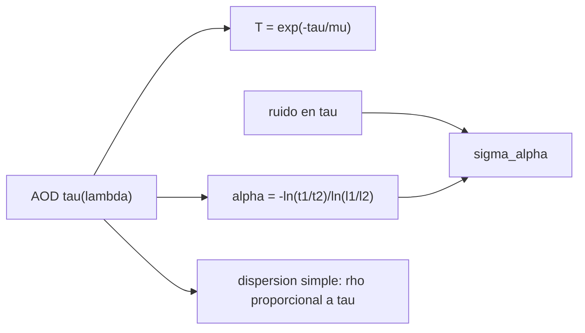

# B57-C13 — Atmósfera y aerosoles

<!-- nav:top -->
[🏠 Programa](../../../../README.md) · [📚 Bloque B57](../../../tronco-comun/B57-observacion-terrestre-y-geociencias-orbitales.md) · [← Anterior: B57-C12 — Oceanografía desde órbita](../B57-C12-oceanografia-desde-orbita/CLASE.md) · [Siguiente: B57-C14 — Glaciares y criósfera →](../B57-C14-glaciares-y-criosfera/CLASE.md)
<!-- /nav -->

## 1. Ubicación, nivel y alcance

Clase 13 del bloque B57. Los aerosoles (polvo, humo, sal marina, contaminación) atenúan y dispersan la luz. El **espesor óptico** `τ` cuantifica cuánto, y su variación con la longitud de onda (**exponente de Ångström**) informa del tamaño de las partículas. Recuperas el exponente desde dos longitudes de onda, propagas el ruido y calculas la transmitancia directa. Todo con datos **sintéticos**; las leyes usadas son conocidas pero **no se consultaron** en esta sesión.

## 2. Por qué esta clase existe

Un satélite que mira un incendio, un volcán o el mar tiene que descontar la atmósfera, y los aerosoles son lo más variable. La decisión central: **¿cuánto aerosol hay y qué tipo, con qué incertidumbre, a partir de pocas longitudes de onda?**

## 3. Lo que podrás hacer al terminar

1. Calcular la transmitancia directa con Beer–Lambert para distintos ángulos cenitales.
2. Recuperar el exponente de Ångström desde dos espesores ópticos.
3. Propagar el ruido de medición a la incertidumbre del exponente.
4. Verificar la propagación con Monte Carlo.
5. Reconocer el límite de la dispersión simple (`τ ≪ 1`).

La evidencia es la **ficha de aerosoles** del ejercicio 12 (sección 20).

## 4. Con qué llegas y cómo comprobarlo

1. ¿Qué es un logaritmo natural?
2. ¿Qué es una ley de potencias?
3. ¿Qué es el ángulo cenital?
4. ¿Qué es la propagación de errores?
5. ¿Qué es un valor ilustrativo?

<details>
<summary>Ver respuestas</summary>

1. El inverso de la exponencial. 2. Una relación `y = a x^b`. 3. El ángulo respecto de la vertical. 4. Cómo el ruido de las entradas se traduce en el de la salida. 5. Uno propuesto para el ejemplo.
</details>

Con cuatro o cinco aciertos, sigue; si no, repasa los prerrequisitos.

## 5. Un caso de contexto y casos de referencia

Una columna de aire con `AOD(550 nm) = 0,30` y exponente de Ångström `1,3` (ambos **ilustrativos**) se mide en `440` y `870 nm` con un ruido de `0,01`. Es el **ejemplo conductor**; los datos son **sintéticos**.

## 6. Vocabulario

El **espesor óptico de aerosoles** (AOD) `τ` es la integral vertical de la extinción. La **ley de Beer–Lambert** da la transmitancia directa `T = e^{−τ/μ}` con `μ = cos(cenital)`. El **exponente de Ångström** `α` ajusta `τ ∝ λ^{−α}`; valores altos indican partículas pequeñas. El **albedo de dispersión simple** `ω₀` es la fracción de extinción que es dispersión. La **función de fase** `P` da la dirección de la luz dispersada.

## 7. Modelo mental: un vidrio empañado

El vaho del vidrio quita luz directa y la reparte en todas direcciones; cuanto más vaho, menos pasa. Si el vaho es de gotas finas, quita más luz azul que roja.



*Descripción textual:* el espesor óptico determina la transmitancia, el exponente de Ångström y, cuando es pequeño, la reflectancia dispersada, mientras el ruido de medición se propaga al exponente.

Analogía: un vidrio empañado de gotas finas. Límite: los aerosoles reales absorben y tienen distribuciones de tamaño complejas.

## 8. La explicación, paso a paso

### 8.1 Espesor óptico y exponente

Con los parámetros ilustrativos, `τ(440 nm) = 0,4010` y `τ(870 nm) = 0,1653`. El exponente recuperado es `1,300000`, igual al impuesto (1,3) porque no hay ruido.

### 8.2 Ruido

Con un ruido de 0,01 en cada AOD, la propagación de errores da `σ_α = 0,0960`; la simulación de 20 000 ensayos da `0,0962` (razón `1,002`) y una media `1,302`. Un exponente se conoce a unas centésimas con esta incertidumbre.

### 8.3 Transmitancia directa

| cenital (°) | 0 | 30 | 60 | 75 |
|---|---|---|---|---|
| `T` con `τ = 0,30` | 0,741 | 0,707 | 0,549 | 0,314 |

Cuanto más oblicuo el Sol, más camino y menos luz directa.

### 8.4 Dispersión simple

Con `ω₀ = 0,95` y `P = 0,15`, la reflectancia por dispersión simple vale `0,00438` con `τ = 0,1` y `0,00876` con `τ = 0,2`: es lineal en `τ`. Solo vale para `τ ≪ 1`; con aerosoles espesos hay dispersión múltiple y la relación deja de ser lineal.

## 9. Magnitudes, símbolos y unidades

| Símbolo | Qué es | Unidad | Valor / nota |
|---|---|---|---|
| `τ` | espesor óptico de aerosoles | — | 0,30 a 550 nm (ilustrativo) |
| `α` | exponente de Ångström | — | 1,3 (ilustrativo) |
| `μ` | coseno del ángulo cenital | — | — |
| `T` | transmitancia directa | — | 0,707 (30°) |
| `σ_α` | incertidumbre de `α` | — | 0,0960 |

## 10. Convenciones y referencias

Longitudes de onda en µm; capa plano-paralela homogénea; transmitancia solo directa (no la difusa). La ley de Ångström se usa entre dos longitudes de onda.

## 11. De dónde sale lo que afirmamos

| ID | Fuente | Localizador | Respalda | Estado |
|---|---|---|---|---|
| — | Sin fuente externa | — | relaciones estándar que verifica el laboratorio | No se consultó una fuente para esta clase |

**Límites de las fuentes.** No se consultó ninguna fuente para esta clase: Beer–Lambert, la ley de Ångström y la dispersión simple se tratan como relaciones conocidas que verifica el laboratorio, no como datos de una red de mediciones.

## 12. Cómo ver los resultados

| Magnitud | Valor |
|---|---|
| `α` recuperado | 1,300000 |
| `σ_α` analítica / simulada | 0,0960 / 0,0962 |
| transmitancia a 60° | 0,549 |

Descripción larga: el exponente se recupera exactamente sin ruido y su dispersión simulada coincide con la propagación analítica.

## 13. Ejemplo trabajado: el exponente de Ångström

**Paso 1 · AOD.** `τ(440) = 0,4010`, `τ(870) = 0,1653`.

**Paso 2 · Cociente.** `ln(τ1/τ2) = ln(0,4010/0,1653)`.

**Paso 3 · Exponente.** `α = −ln(τ1/τ2)/ln(λ1/λ2) = 1,3000`.

## 14. Distintas formas de abordar el problema

**Por Beer–Lambert:** luz directa. **Por Ångström:** tamaño relativo. **Por propagación:** incertidumbre. **Por dispersión simple:** reflectancia en capas finas. Cada una usa una parte del modelo.

## 15. Práctica guiada

**Ejercicio 1 · con los pasos indicados.** Calcula `T` con `τ = 0,30` y Sol en el cenit. *Pasos:* `e^{−τ}`.

<details><summary>Solución comentada</summary>

`e^{−0,30} = 0,741`.
</details>

**Ejercicio 2 · con una pista.** Calcula `T` a 60° de cenital. *Pista:* `μ = 0,5`.

<details><summary>Solución comentada</summary>

`e^{−0,60} = 0,549`.
</details>

**Ejercicio 3 · casi autónomo.** Con `τ1 = 0,40` en 440 nm y `τ2 = 0,16` en 870 nm, ¿cuánto vale `α`?

<details><summary>Solución comentada</summary>

`ln(2,5)/ln(870/440) = 0,916/0,682 = 1,34`.
</details>

## 16. Práctica autónoma, transferencia e integrador

**Ejercicio 4.** ¿Qué indica un `α` cercano a 0?

<details><summary>Solución comentada</summary>

Partículas grandes (polvo, sal) con extinción casi independiente de la longitud de onda.
</details>

**Ejercicio 5.** Si el ruido pasa a 0,02, ¿cómo cambia `σ_α`?

<details><summary>Solución comentada</summary>

Se duplica: es lineal en el ruido.
</details>

**Ejercicio 6.** ¿Por qué `σ_α` depende de la razón `λ2/λ1`?

<details><summary>Solución comentada</summary>

Porque el denominador `ln(λ2/λ1)` crece con la separación espectral y reduce el error.
</details>

**Ejercicio 7.** ¿Es lineal la reflectancia con `τ`? Usa 8.4.

<details><summary>Solución comentada</summary>

Sí con `τ ≪ 1`; con `τ = 0,2` es el doble que con 0,1.
</details>

**Ejercicio 8.** Explica por qué la dispersión múltiple rompe esa linealidad.

<details><summary>Solución comentada</summary>

Porque la luz dispersada vuelve a dispersarse y la señal crece menos (o distinto) que `τ`.
</details>

**Ejercicio 9 · transferencia.** **Transferencia.** Una nube delgada no detectada ensucia un AOD. ¿Qué haces?

<details><summary>Solución comentada</summary>

Enmascarar nubes antes de recuperar AOD y declarar el criterio.
</details>

**Ejercicio 10 · transferencia.** **Transferencia.** Un incendio carga el aire de humo. ¿Qué esperas de `α`?

<details><summary>Solución comentada</summary>

Un `α` alto (partículas finas) y un AOD mucho mayor que el de fondo.
</details>

**Ejercicio 11 · transferencia.** **Transferencia.** ¿Qué falta para recuperar aerosoles reales desde un satélite?

<details><summary>Solución comentada</summary>

Modelos de tipo de aerosol, reflectancia de superficie, geometría y tablas de transferencia radiativa; aquí solo hay un modelo simplificado.
</details>

**Ejercicio 12 · integrador.** **Integrador.** Elabora tu *ficha de aerosoles*: la tabla de AOD y exponente recuperado, la incertidumbre analítica y simulada y la transmitancia para cuatro ángulos.

<details><summary>Solución modelo</summary>

Secciones 8.1 a 8.4 con las cifras de la ejecución, rotulando todo como sintético o ilustrativo.
</details>

## 17. Laboratorio: espesor óptico, exponente de Ångström y transmitancia

El script [aerosoles.py](aerosoles.py) recupera el exponente desde dos AOD, propaga el ruido con Monte Carlo y calcula la transmitancia y la dispersión simple (**comprueba** que `α` se recupera sin ruido, que `σ_α` simulada coincide con la analítica a 3 % y que la dispersión simple es lineal).

**Datos:** AOD, exponente y albedo **sintéticos / ilustrativos**; sin fuentes consultadas. **Predice antes de ejecutar:** ¿cuánto será `α` sin ruido? (1,3.) **Ejecución del 2026-11-09 (Python 3.12.9):**

```text
Python 3.12.9 ; numpy 2.4.4
AOD sintetico: 440 nm = 0.4010 ; 870 nm = 0.1653 ; alpha recuperado = 1.300000
sigma de alpha: analitica = 0.0960 ; simulada = 0.0962 ; razon = 1.002 ; media simulada = 1.302
Transmitancia directa con AOD(550) = 0.30: cenital 0: 0.741 ; cenital 30: 0.707 ; cenital 60: 0.549 ; cenital 75: 0.314
Reflectancia por dispersion simple: tau 0.1 -> 0.00438 ; tau 0.2 -> 0.00876 (razon 2.000)
Pruebas superadas.
```

```bash
python programa/clases/B57/B57-C13-atmosfera-y-aerosoles/aerosoles.py
```

**Límites:** capa homogénea, sin absorción de gases ni dispersión múltiple.

## 18. Errores frecuentes y cómo corregirlos

**Usar grados en lugar del coseno.** Beer–Lambert usa `μ` (8.3).

**Aplicar la dispersión simple a `τ` grande.** Se rompe (8.4).

**Olvidar enmascarar nubes.** Ejercicio 9.

**Presentar el AOD como medido.** Es sintético (sección 5).

## 19. Cómo sabrás que vas bien

Tras la sección 8: ¿qué resultado esperabas y cuál obtuviste? Si dudas, repasa el ejemplo 13. Tras el laboratorio: ¿qué comprueba? (ver la sección 17).

## 20. Qué entregas y cómo se evalúa

El producto es tu **ficha de aerosoles** (ejercicio 12).

| Criterio | Inicial | En desarrollo | Logrado | Destacado |
|---|---|---|---|---|
| Conceptos | Los confunde | Parciales | Conceptos de la clase | Explica los límites |
| Cálculo | Sin unidades | Con errores | Tablas completas con unidades | Calcula casos nuevos |
| Numérico | Sin comprobar | Un caso | Contraste con el caso analítico | Interpreta las diferencias |
| Fuentes | Sin fuente | Sin fecha | Fuentes con fecha | Declara lo no consultado |
| Límites | No los nombra | Uno | Tres | Discute qué falta del modelo |

**Condiciones críticas (no se compensan con promedio):** rotular el AOD como sintético; no atribuir valores a una red de mediciones no consultada; citar solo lo consultado (aquí, nada).

## 21. Ética, seguridad y límites

Clase educativa: no se estima la calidad del aire de ningún lugar. Accesibilidad: tablas equivalentes a las gráficas, fórmulas en texto, ejercicios sin conexión.

## 22. Para cerrar y seguir

Con `τ = 0,30` pasa una fracción `0,741` de la luz directa en el cenit y el exponente `α = 1,30` se conoce a `±0,10`. Queda una pregunta: ¿cómo se mide la masa del hielo?

**Glosario español–inglés.** espesor óptico · *optical depth/thickness*; exponente de Ångström · *Ångström exponent*; aerosol · *aerosol*; transmitancia · *transmittance*; dispersión simple · *single scattering*.

**Continuidad.** [B57-C14](../B57-C14-glaciares-y-criosfera/CLASE.md) estudia glaciares y criósfera.

**Referencias:** ver sección 11.

<!-- nav:bottom -->
---

[← Anterior: B57-C12 — Oceanografía desde órbita](../B57-C12-oceanografia-desde-orbita/CLASE.md) · [📚 Bloque B57](../../../tronco-comun/B57-observacion-terrestre-y-geociencias-orbitales.md) · [Siguiente: B57-C14 — Glaciares y criósfera →](../B57-C14-glaciares-y-criosfera/CLASE.md)
<!-- /nav -->
