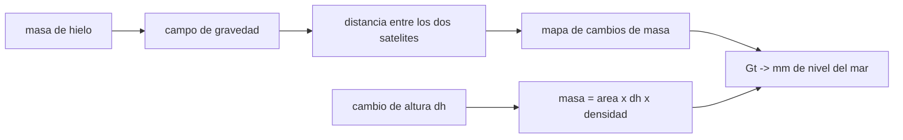

# B57-C14 — Glaciares y criósfera

<!-- nav:top -->
[🏠 Programa](../../../../README.md) · [📚 Bloque B57](../../../tronco-comun/B57-observacion-terrestre-y-geociencias-orbitales.md) · [← Anterior: B57-C13 — Atmósfera y aerosoles](../B57-C13-atmosfera-y-aerosoles/CLASE.md) · [Siguiente: B57-C15 — Sequías e inundaciones →](../B57-C15-sequias-e-inundaciones/CLASE.md)
<!-- /nav -->

## 1. Ubicación, nivel y alcance

Clase 14 del bloque B57. El hielo terrestre se estudia desde la órbita de dos maneras: midiendo cómo cambia la gravedad (GRACE-FO mide la masa) y cómo cambia la altura (un altímetro mide el espesor). Conviertes pérdidas de masa en milímetros de nivel del mar, ves cuánto cambia la masa según la densidad que supongas para el hielo o la nieve y calculas la incertidumbre de una tendencia de masa. Las cifras de GRACE-FO son las de la página consultada; todos los valores de masa son **sintéticos o ilustrativos**.

## 2. Por qué esta clase existe

Un glaciar que baja medio metro puede haber perdido mucha o poca masa según lo que se pierda sea hielo o nieve. La decisión central: **¿qué densidad uso para convertir cambios de altura en masa y cuánto cambia el resultado?**

## 3. Lo que podrás hacer al terminar

1. Convertir gigatoneladas de hielo en milímetros de nivel del mar.
2. Convertir un cambio de altura en masa con una densidad dada y medir el efecto de la densidad.
3. Relacionar el grado de los armónicos esféricos con la resolución espacial.
4. Calcular la incertidumbre de una tendencia de masa y verificarla.
5. Describir cómo GRACE-FO mide cambios de masa (separación de dos satélites).

La evidencia es la **ficha del balance de hielo** del ejercicio 12 (sección 20).

## 4. Con qué llegas y cómo comprobarlo

1. ¿Qué es una gigatonelada?
2. ¿Qué es la densidad?
3. ¿Qué es un área en m²?
4. ¿Qué es una regresión lineal?
5. ¿Qué es un valor ilustrativo?

<details>
<summary>Ver respuestas</summary>

1. `10⁹` toneladas = `10¹² kg`. 2. Masa por unidad de volumen. 3. Una superficie en metros cuadrados. 4. Un ajuste de recta por mínimos cuadrados. 5. Uno propuesto para el ejemplo.
</details>

Con cuatro o cinco aciertos, sigue; si no, repasa los prerrequisitos.

## 5. Un caso de contexto y casos de referencia

Los dos satélites de GRACE-FO vuelan a unos `490 km` y separados unos `220 km`; miden la distancia entre ambos con un sistema de microondas y un acelerómetro mide las fuerzas no gravitacionales. Aquí imaginas una pérdida de `270 Gt/año` (**ilustrativa**) y un glaciar de `10⁵ km²` que baja `0,5 m/año` (**ilustrativo**). Es el **ejemplo conductor**; los valores de masa son **sintéticos**.

## 6. Vocabulario

Un **equivalente en nivel del mar** es el cambio de altura del océano si toda esa masa de agua se repartiera uniformemente. La **gravimetría** mide el campo de gravedad; sus cambios en el tiempo reflejan cambios de masa. Los **armónicos esféricos** descomponen el campo; el **grado** `l` fija la resolución `πR/l`. El **firn** es nieve compactada de densidad menor que la del hielo. La **tendencia** es la pendiente de la masa en el tiempo.

## 7. Modelo mental: pesar una montaña desde lejos

Dos satélites en fila sienten distinto el tirón de una masa: el que se acerca primero se adelanta. Esa diferencia de distancia delata dónde hay más o menos masa.



*Descripción textual:* los cambios de masa alteran la gravedad y la distancia entre los satélites; de ahí sale un mapa de masa que se convierte en nivel del mar, mientras que los cambios de altura requieren una densidad para convertirse en masa.

Analogía: pesar un objeto por cuánto se hunde un colchón. Límite: la gravedad promedia sobre cientos de kilómetros y no ve un glaciar pequeño.

## 8. La explicación, paso a paso

### 8.1 De gigatoneladas a milímetros

Con un área oceánica de referencia de `3,618 × 10¹⁴ m²` (no consultada), `1 mm` de nivel del mar equivale a `361,8 Gt`. Una pérdida de `270 Gt/año` (ilustrativa) corresponde a `0,746 mm/año`.

### 8.2 Altura y densidad

Un glaciar de `10⁵ km²` que baja `0,5 m/año` pierde `45,9 Gt/año` si lo perdido es hielo (917 kg/m³, referencia no consultada) y `17,5 Gt/año` si es firn (350 kg/m³). La razón es `2,62`: no saber qué se pierde cambia la masa en más del doble.

### 8.3 Resolución espacial

Con armónicos hasta grado `l`, la resolución es `πR/l`: `334 km` con `l = 60` y `208 km` con `l = 96`. Los glaciares pequeños quedan por debajo de esa escala.

### 8.4 Tendencia de masa

Con una serie sintética de 20 años, ruido de 60 Gt y pérdida de 270 Gt/año, el ajuste recupera `-270,0 Gt/año`; la incertidumbre analítica es `0,67 Gt/año` y la simulada `0,66` (razón `0,985`). Esta incertidumbre supone ruido blanco y no incluye sesgos como el reajuste glacial.

## 9. Magnitudes, símbolos y unidades

| Símbolo | Qué es | Unidad | Valor / nota |
|---|---|---|---|
| `M` | masa de hielo | Gt | 270 Gt/año (ilustrativa) |
| `A_oc` | área oceánica | m² | 3,618 × 10¹⁴ (referencia) |
| `ρ` | densidad | kg/m³ | 917; 350 |
| `l` | grado máximo de armónicos | — | 60; 96 |
| `σ` | incertidumbre de la tendencia | Gt/año | 0,67 |

## 10. Convenciones y referencias

1 Gt = 10¹² kg; densidades constantes; área oceánica fija; tendencia positiva de nivel del mar si el hielo pierde masa. Series sintéticas con ruido blanco.

## 11. De dónde sale lo que afirmamos

| ID | Fuente | Localizador | Respalda | Estado |
|---|---|---|---|---|
| S1 | NASA JPL, *GRACE-FO* | https://grace.jpl.nasa.gov/mission/grace-fo/ | altitud de unos 490 km, separación de unos 220 km, medición con microondas y acelerómetro, y variables medidas (almacenamiento de agua, hielo, nivel del mar). | Consultada 2026-11-09 |

**Límites de las fuentes.** La página de GRACE-FO consultada no daba el grado de armónicos ni la resolución; esas cifras salen de `πR/l` y son un orden de magnitud. El área oceánica y las densidades son valores de referencia no consultados. Las pérdidas de masa son ilustrativas.

## 12. Cómo ver los resultados

| Magnitud | Valor |
|---|---|
| 1 mm de nivel del mar | 361,8 Gt |
| 270 Gt/año | 0,746 mm/año |
| razón hielo/firn | 2,62 |
| σ tendencia (analítica / simulada) | 0,67 / 0,66 Gt/año |

Descripción larga: elegir mal la densidad cambia la masa estimada más del doble y la tendencia simulada tiene la dispersión esperada.

## 13. Ejemplo trabajado: un milímetro en gigatoneladas

**Paso 1 · Volumen.** `3,618 × 10¹⁴ m² × 10⁻³ m = 3,618 × 10¹¹ m³`.

**Paso 2 · Masa.** `× 1000 kg/m³ = 3,618 × 10¹⁴ kg`.

**Paso 3 · Gt.** `/ 10¹² = 361,8 Gt`.

## 14. Distintas formas de abordar el problema

**Por gravedad:** mide masa directamente pero con resolución gruesa. **Por altura:** mide cambios finos pero exige una densidad. Cada vía tiene su límite y se complementan.

## 15. Práctica guiada

**Ejercicio 1 · con los pasos indicados.** ¿Cuántos mm de nivel del mar equivalen a `361,8 Gt`? *Pasos:* usa 8.1.

<details><summary>Solución comentada</summary>

`1 mm`.
</details>

**Ejercicio 2 · con una pista.** ¿Y a `3618 Gt`? *Pista:* proporcional.

<details><summary>Solución comentada</summary>

`10 mm`.
</details>

**Ejercicio 3 · casi autónomo.** Un glaciar de `2 × 10⁴ km²` baja `1 m` (hielo). ¿Cuántos Gt?

<details><summary>Solución comentada</summary>

`2e10 m² × 1 m × 917 = 1,83e13 kg = 18,3 Gt`.
</details>

## 16. Práctica autónoma, transferencia e integrador

**Ejercicio 4.** ¿Cuánto cambia si fuera firn de 350 kg/m³?

<details><summary>Solución comentada</summary>

`7,0 Gt`: 2,6 veces menos.
</details>

**Ejercicio 5.** ¿Qué resolución da el grado `l = 120`?

<details><summary>Solución comentada</summary>

`π × 6371/120 = 167 km`.
</details>

**Ejercicio 6.** ¿Qué pasa con σ de la tendencia si la serie dura 40 años en lugar de 20?

<details><summary>Solución comentada</summary>

Baja unas `2^{1,5} = 2,8` veces para ruido blanco.
</details>

**Ejercicio 7.** ¿Por qué un glaciar de 50 km² no se ve con GRACE-FO?

<details><summary>Solución comentada</summary>

Porque la resolución es de cientos de kilómetros.
</details>

**Ejercicio 8.** ¿Qué mide el acelerómetro de GRACE-FO?

<details><summary>Solución comentada</summary>

Las fuerzas no gravitacionales (por ejemplo el arrastre atmosférico), para restarlas.
</details>

**Ejercicio 9 · transferencia.** **Transferencia.** Un estudio reporta pérdida en Gt sin decir la densidad usada. ¿Qué preguntas haces?

<details><summary>Solución comentada</summary>

Qué densidad, qué área y si se perdió hielo o firn; sin eso la masa puede variar más del doble.
</details>

**Ejercicio 10 · transferencia.** **Transferencia.** ¿Es lo mismo masa perdida que nivel del mar ganado?

<details><summary>Solución comentada</summary>

No del todo: hay efectos de gravedad y de distribución espacial (huellas) que no se modelan aquí.
</details>

**Ejercicio 11 · transferencia.** **Transferencia.** ¿Qué falta para usar este modelo con datos reales?

<details><summary>Solución comentada</summary>

Productos de masa con procedencia, corrección del reajuste glacial, errores correlacionados y validación.
</details>

**Ejercicio 12 · integrador.** **Integrador.** Elabora tu *ficha del balance de hielo*: la conversión de Gt a mm, la tabla de masas con dos densidades, las resoluciones por grado y la tendencia con su incertidumbre.

<details><summary>Solución modelo</summary>

Secciones 8.1 a 8.4 con las cifras de la ejecución, rotulando las pérdidas como ilustrativas.
</details>

## 17. Laboratorio: masa de hielo y nivel del mar

El script [hielo.py](hielo.py) convierte masa en nivel del mar, estima el efecto de la densidad y verifica la incertidumbre de una tendencia por Monte Carlo (**comprueba** 1 mm = 361,8 Gt exacto y la σ de la tendencia simulada frente a la analítica con 10 %).

**Datos:** separación y altitud de GRACE-FO consultadas (S1); masas, áreas y densidades **ilustrativas**. **Predice antes de ejecutar:** ¿cuántos mm/año son 270 Gt/año? (unos 0,75.) **Ejecución del 2026-11-09 (Python 3.12.9):**

```text
Python 3.12.9 ; numpy 2.4.4
1 mm de nivel del mar = 361.8 Gt ; 270 Gt/anio = 0.746 mm/anio de nivel del mar
Glaciar de 1e5 km2 que baja 0.5 m/anio: masa con 917 kg/m3 = 45.85 Gt ; con 350 kg/m3 = 17.50 Gt ; razon = 2.62
Resolucion espacial pi R / l: l = 60 -> 334 km ; l = 96 -> 208 km
Tendencia de masa: recuperada = -270.0 Gt/anio ; sigma analitica = 0.67 ; simulada = 0.66 ; razon = 0.985
Pruebas superadas.
```

```bash
python programa/clases/B57/B57-C14-glaciares-y-criosfera/hielo.py
```

**Límites:** océano uniforme, ruido blanco y sin reajuste glacial ni efectos gravitacionales de la redistribución.

## 18. Errores frecuentes y cómo corregirlos

**Convertir altura en masa sin declarar la densidad.** Cambia más del doble (8.2).

**Esperar ver glaciares pequeños con gravimetría.** Resolución de cientos de km (8.3).

**Confundir Gt con mm.** Se relacionan con 361,8 Gt/mm (8.1).

**Presentar las pérdidas como medidas.** Son ilustrativas (sección 5).

## 19. Cómo sabrás que vas bien

Tras la sección 8: ¿qué resultado esperabas y cuál obtuviste? Si dudas, repasa el ejemplo 13. Tras el laboratorio: ¿qué comprueba? (ver la sección 17).

## 20. Qué entregas y cómo se evalúa

El producto es tu **ficha del balance de hielo** (ejercicio 12).

| Criterio | Inicial | En desarrollo | Logrado | Destacado |
|---|---|---|---|---|
| Conceptos | Los confunde | Parciales | Conceptos de la clase | Explica los límites |
| Cálculo | Sin unidades | Con errores | Tablas completas con unidades | Calcula casos nuevos |
| Numérico | Sin comprobar | Un caso | Contraste con el caso analítico | Interpreta las diferencias |
| Fuentes | Sin fuente | Sin fecha | Fuentes con fecha | Declara lo no consultado |
| Límites | No los nombra | Uno | Tres | Discute qué falta del modelo |

**Condiciones críticas (no se compensan con promedio):** rotular pérdidas, áreas y densidades como ilustrativas; declarar la densidad en toda conversión; citar solo lo consultado.

## 21. Ética, seguridad y límites

Clase educativa: no se estima la pérdida de hielo de ninguna región real. Accesibilidad: tablas equivalentes a las gráficas, fórmulas en texto, ejercicios sin conexión.

## 22. Para cerrar y seguir

Un milímetro de nivel del mar equivale a `361,8 Gt` y la densidad supuesta puede cambiar la masa por un factor `2,6`. Queda una pregunta: ¿cómo se mapean el agua y la falta de agua en tierra?

**Glosario español–inglés.** equivalente en nivel del mar · *sea level equivalent*; gravimetría · *gravimetry*; armónicos esféricos · *spherical harmonics*; firn · *firn*; criosfera · *cryosphere*.

**Continuidad.** [B57-C15](../B57-C15-sequias-e-inundaciones/CLASE.md) estudia sequías e inundaciones.

**Referencias:** ver sección 11.

<!-- nav:bottom -->
---

[← Anterior: B57-C13 — Atmósfera y aerosoles](../B57-C13-atmosfera-y-aerosoles/CLASE.md) · [📚 Bloque B57](../../../tronco-comun/B57-observacion-terrestre-y-geociencias-orbitales.md) · [Siguiente: B57-C15 — Sequías e inundaciones →](../B57-C15-sequias-e-inundaciones/CLASE.md)
<!-- /nav -->
