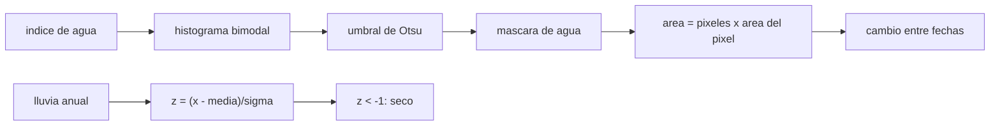

# B57-C15 — Sequías e inundaciones

<!-- nav:top -->
[🏠 Programa](../../../../README.md) · [📚 Bloque B57](../../../tronco-comun/B57-observacion-terrestre-y-geociencias-orbitales.md) · [← Anterior: B57-C14 — Glaciares y criósfera](../B57-C14-glaciares-y-criosfera/CLASE.md) · [Siguiente: B57-C16 — Incendios forestales →](../B57-C16-incendios-forestales/CLASE.md)
<!-- /nav -->

## 1. Ubicación, nivel y alcance

Clase 15 del bloque B57. Una inundación se ve como más agua y una sequía como menos agua o menos lluvia que lo normal. Aprendes a separar agua y tierra con un umbral que se elige solo (Otsu), a medir cuánta área se inundó y a volver una lluvia en una anomalía estandarizada. Todo con datos **sintéticos**; el índice de agua NDWI es una fórmula conocida **no consultada**.

## 2. Por qué esta clase existe

Las agencias necesitan mapas de inundación en horas y alertas de sequía en meses. La decisión central: **¿cómo se fija el umbral entre agua y tierra sin fijarlo a ojo, y cómo se declara que un año es seco?**

## 3. Lo que podrás hacer al terminar

1. Calcular un índice de agua y separar clases con el umbral de Otsu.
2. Comparar el umbral de Otsu con el punto medio analítico de dos gaussianas.
3. Medir el área inundada como cambio de área entre dos fechas.
4. Estandarizar una anomalía de lluvia y relacionarla con una probabilidad.
5. Reconocer las limitaciones (nubes, sombras, bosque inundado).

La evidencia es la **ficha de sequía e inundación** del ejercicio 12 (sección 20).

## 4. Con qué llegas y cómo comprobarlo

1. ¿Qué es un histograma?
2. ¿Qué es una varianza?
3. ¿Qué es una gaussiana?
4. ¿Qué es una anomalía?
5. ¿Qué es un dato sintético?

<details>
<summary>Ver respuestas</summary>

1. El conteo de valores por intervalo. 2. El promedio de las desviaciones al cuadrado. 3. Una distribución en campana. 4. La diferencia respecto del valor normal. 5. Uno generado por una fórmula.
</details>

Con cuatro o cinco aciertos, sigue; si no, repasa los prerrequisitos.

## 5. Un caso de contexto y casos de referencia

Un lago circular crece de `30` a `45` píxeles de radio en una imagen sintética de `200 × 200` píxeles de `30 m`. El índice vale `+0,5` en el agua y `−0,4` en la tierra, con ruido de `0,10`. Además, una serie sintética de lluvia anual con media `600 mm` y desviación `150 mm`. Es el **ejemplo conductor**; los datos son **sintéticos**.

## 6. Vocabulario

Un **índice de agua** (como el NDWI) realza el agua: `(verde − NIR)/(verde + NIR)`. El **umbral de Otsu** es el valor que maximiza la varianza entre las dos clases. La **máscara** es una imagen binaria de agua. La **anomalía estandarizada** `z = (x − μ)/σ` mide cuántas desviaciones se aleja un valor del promedio. Una **sequía** meteorológica es un período con lluvia por debajo de lo normal.

## 7. Modelo mental: separar dos montones con una regla

Si tienes dos montones de piedras de tamaño distinto, pones la regla donde separe mejor ambos. Otsu hace eso con el histograma.



*Descripción textual:* el histograma del índice de agua tiene dos modas; Otsu elige el umbral, la máscara da el área y la diferencia entre fechas es la inundación; la lluvia se estandariza para declarar años secos.

Analogía: separar piedras chicas y grandes con una regla bien puesta. Límite: si hay una tercera clase (sombra, nubes), la regla de dos montones falla.

## 8. La explicación, paso a paso

### 8.1 Umbral y área

Para dos gaussianas de igual varianza **y peso**, el umbral óptimo es el punto medio, `0,050`; en una imagen mitad agua y mitad tierra Otsu da `0,048`. En las escenas del lago los pesos son desiguales (el agua es una fracción pequeña) y el umbral se desplaza: `0,089` antes y `0,066` después, aún entre las dos medias.

| fecha | área estimada (km²) | área verdadera (km²) |
|---|---|---|
| antes (radio 30 píxeles) | 2,539 | 2,539 |
| después (radio 45 píxeles) | 5,725 | 5,725 |

El aumento de área inundada estimado es `3,186 km²` y el verdadero `3,186 km²`.

### 8.2 Sequía

Con 200 000 años sintéticos de lluvia normal, la fracción con `z < −1` es `16,03 %`, frente al `15,87 %` de una normal. En 40 años reales el `z` mínimo sería del orden de `-2,5` en esta serie.

### 8.3 Lectura

La inundación se mide como diferencia de áreas con el mismo método en ambas fechas. Las nubes, las sombras de relieve (similares al agua en el óptico), la vegetación sobre el agua y los edificios inundados son los casos que un umbral simple no resuelve; en radar el agua suele verse oscura, pero el viento la agita.

### 8.4 Límites

El histograma sintético tiene dos clases perfectamente separables; en datos reales hay mezcla en los bordes y más clases. La anomalía estandarizada supone distribución normal, que no vale para lluvias muy sesgadas.

## 9. Magnitudes, símbolos y unidades

| Símbolo | Qué es | Unidad | Valor / nota |
|---|---|---|---|
| `NDWI` | índice de agua | — | +0,5 agua; −0,4 tierra (sintéticos) |
| `T` | umbral de Otsu | — | 0,089 |
| `A` | área de agua | km² | 5,725 (después) |
| `z` | anomalía estandarizada | — | < −1 = seco |

## 10. Convenciones y referencias

Píxel de 30 m (ejemplo); área en km²; `z` con media y desviación de la serie; clases separables. Sin nubes ni sombras.

## 11. De dónde sale lo que afirmamos

| ID | Fuente | Localizador | Respalda | Estado |
|---|---|---|---|---|
| — | Sin fuente externa | — | relaciones estándar que verifica el laboratorio | No se consultó una fuente para esta clase |

**Límites de las fuentes.** No se consultó ninguna fuente para esta clase: el NDWI y el criterio de Otsu se tratan como métodos conocidos que verifica el laboratorio. Los datos son sintéticos y los umbrales de sequía (`z < −1`) son una convención de la clase.

## 12. Cómo ver los resultados

| Magnitud | Valor |
|---|---|
| umbral de Otsu (antes) | 0,089 |
| aumento de área estimado / verdadero | 3,186 / 3,186 km² |
| fracción `z < −1` | 16,03 % (normal 15,87 %) |

Descripción larga: el umbral automático cae casi en el punto medio y el área medida coincide con la verdadera.

## 13. Ejemplo trabajado: el área inundada

**Paso 1 · Píxeles.** Después, el lago tiene unos `π × 45² ≈ 6362` píxeles.

**Paso 2 · Área de un píxel.** `30 m × 30 m = 900 m²`.

**Paso 3 · Área.** `6362 × 900 m² ≈ 5,73 km²`; la ejecución da `5,725 km²`.

## 14. Distintas formas de abordar el problema

**Por umbral fijo:** simple, pero depende de la escena. **Por Otsu:** se adapta al histograma. **Por radar:** el agua es oscura y no depende de nubes. Cada método tiene escenas donde falla.

## 15. Práctica guiada

**Ejercicio 1 · con los pasos indicados.** Calcula el NDWI con verde `0,12` y NIR `0,04`. *Pasos:* diferencia entre suma.

<details><summary>Solución comentada</summary>

`0,08/0,16 = 0,5`: agua.
</details>

**Ejercicio 2 · con una pista.** Calcula el NDWI con verde `0,10` y NIR `0,28`. *Pista:* misma fórmula.

<details><summary>Solución comentada</summary>

`−0,18/0,38 = −0,47`: no agua.
</details>

**Ejercicio 3 · casi autónomo.** ¿Cuál es el área de un píxel de 30 m en km²? Usa la sección 5.

<details><summary>Solución comentada</summary>

`9 × 10⁻⁴ km²`.
</details>

## 16. Práctica autónoma, transferencia e integrador

**Ejercicio 4.** Un lago de `8000` píxeles de 30 m, ¿cuántos km²?

<details><summary>Solución comentada</summary>

`7,2 km²`.
</details>

**Ejercicio 5.** ¿Qué `z` tiene una lluvia de `375 mm` si la media es `600` y σ `150`?

<details><summary>Solución comentada</summary>

`−1,5`: seco.
</details>

**Ejercicio 6.** ¿Qué fracción de años esperas con `z < −2`?

<details><summary>Solución comentada</summary>

Unos `2,3 %` para una normal.
</details>

**Ejercicio 7.** ¿Por qué Otsu cae en el punto medio en la imagen equilibrada?

<details><summary>Solución comentada</summary>

Porque las dos clases tienen igual varianza e igual peso.
</details>

**Ejercicio 8.** ¿Por qué en las escenas del lago el umbral no es el punto medio (8.1)?

<details><summary>Solución comentada</summary>

Porque los pesos son desiguales y el criterio de Otsu depende de ellos: el umbral se mueve dentro de la meseta entre las dos modas (0,089 y 0,066), sin cambiar la clasificación de píxeles mientras las modas estén lejos.
</details>

**Ejercicio 9 · transferencia.** **Transferencia.** Una sombra de montaña tiene índice parecido al agua. ¿Qué haces?

<details><summary>Solución comentada</summary>

Enmascarar con un modelo de elevación (pendiente y sombra) o usar radar.
</details>

**Ejercicio 10 · transferencia.** **Transferencia.** Una inundación bajo un bosque no se ve en el óptico. ¿Qué sensor ayuda?

<details><summary>Solución comentada</summary>

Un radar de banda larga, que penetra el follaje; el óptico ve solo la copa.
</details>

**Ejercicio 11 · transferencia.** **Transferencia.** ¿Por qué conviene medir el cambio con el mismo método en ambas fechas?

<details><summary>Solución comentada</summary>

Para que los sesgos del método se cancelen en la diferencia.
</details>

**Ejercicio 12 · integrador.** **Integrador.** Elabora tu *ficha de sequía e inundación*: la tabla de umbral y área en las dos fechas, el aumento de área y la fracción de años secos frente a la normal.

<details><summary>Solución modelo</summary>

Sección 8.1 y 8.2 con las cifras de la ejecución y los límites de 8.3 y 8.4.
</details>

## 17. Laboratorio: máscara de agua, cambio de área y anomalía de lluvia

El script [agua.py](agua.py) calcula el umbral de Otsu en una imagen sintética de un lago, mide el área en dos fechas y estandariza una serie de lluvia (**comprueba** el umbral de la imagen equilibrada frente al punto medio (0,02), el umbral de las escenas entre las medias, el área frente a la verdadera con 2 % y la fracción de años secos frente a la normal).

**Datos:** imagen y lluvia **sintéticas**; NDWI sin fuente consultada. **Predice antes de ejecutar:** ¿dónde caerá el umbral en la imagen mitad agua, mitad tierra? (cerca de +0,05, el punto medio entre −0,4 y +0,5; en las escenas del lago se mueve algo dentro de la meseta.) **Ejecución del 2026-11-09 (Python 3.12.9):**

```text
Python 3.12.9 ; numpy 2.4.4
Umbral de Otsu: antes = 0.089 ; despues = 0.066 ; imagen mitad agua mitad tierra = 0.048 ; punto medio analitico = 0.050
Area de agua antes: estimada = 2.539 km2 ; verdadera = 2.539 km2
Area de agua despues: estimada = 5.725 km2 ; verdadera = 5.725 km2
Inundacion (aumento de area): estimado = 3.186 km2 ; verdadero = 3.186 km2
Anios con z < -1 en 200000 anios sinteticos = 16.03 % (normal: 15.87 %) ; z minimo en 40 anios = -2.47
Pruebas superadas.
```

```bash
python programa/clases/B57/B57-C15-sequias-e-inundaciones/agua.py
```

**Límites:** dos clases separables, sin nubes ni sombras y lluvia normal.

## 18. Errores frecuentes y cómo corregirlos

**Fijar el umbral a ojo sin declararlo.** Usa Otsu u otro criterio documentado (8.1).

**Confundir sombra con agua.** Ejercicio 9.

**Medir el cambio con métodos distintos.** Ejercicio 11.

**Presentar el lago como observado.** Es sintético (sección 5).

## 19. Cómo sabrás que vas bien

Tras la sección 8: ¿qué resultado esperabas y cuál obtuviste? Si dudas, repasa el ejemplo 13. Tras el laboratorio: ¿qué comprueba? (ver la sección 17).

## 20. Qué entregas y cómo se evalúa

El producto es tu **ficha de sequía e inundación** (ejercicio 12).

| Criterio | Inicial | En desarrollo | Logrado | Destacado |
|---|---|---|---|---|
| Conceptos | Los confunde | Parciales | Conceptos de la clase | Explica los límites |
| Cálculo | Sin unidades | Con errores | Tablas completas con unidades | Calcula casos nuevos |
| Numérico | Sin comprobar | Un caso | Contraste con el caso analítico | Interpreta las diferencias |
| Fuentes | Sin fuente | Sin fecha | Fuentes con fecha | Declara lo no consultado |
| Límites | No los nombra | Uno | Tres | Discute qué falta del modelo |

**Condiciones críticas (no se compensan con promedio):** rotular las imágenes y la lluvia como sintéticas; no usar el modelo para declarar una inundación real; citar solo lo consultado (aquí, nada).

## 21. Ética, seguridad y límites

Clase educativa: no se delimita ninguna inundación real. Accesibilidad: tablas equivalentes a las gráficas, fórmulas en texto, ejercicios sin conexión.

## 22. Para cerrar y seguir

Otsu fija el umbral entre las dos clases y mide el aumento de área en `3,19 km²` frente a `3,19 km²` verdaderos. Queda una pregunta: ¿cómo se detecta el fuego desde la órbita?

**Glosario español–inglés.** índice de agua · *water index (NDWI)*; umbral de Otsu · *Otsu threshold*; máscara · *mask*; anomalía estandarizada · *standardized anomaly*; sequía · *drought*.

**Continuidad.** [B57-C16](../B57-C16-incendios-forestales/CLASE.md) estudia incendios forestales.

**Referencias:** ver sección 11.

<!-- nav:bottom -->
---

[← Anterior: B57-C14 — Glaciares y criósfera](../B57-C14-glaciares-y-criosfera/CLASE.md) · [📚 Bloque B57](../../../tronco-comun/B57-observacion-terrestre-y-geociencias-orbitales.md) · [Siguiente: B57-C16 — Incendios forestales →](../B57-C16-incendios-forestales/CLASE.md)
<!-- /nav -->
