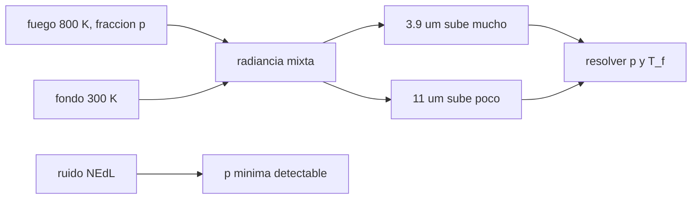

# B57-C16 — Incendios forestales

<!-- nav:top -->
[🏠 Programa](../../../../README.md) · [📚 Bloque B57](../../../tronco-comun/B57-observacion-terrestre-y-geociencias-orbitales.md) · [← Anterior: B57-C15 — Sequías e inundaciones](../B57-C15-sequias-e-inundaciones/CLASE.md) · [Siguiente: B57-C17 — Terremotos y deformación →](../B57-C17-terremotos-y-deformacion/CLASE.md)
<!-- /nav -->

## 1. Ubicación, nivel y alcance

Clase 16 del bloque B57. Un incendio ocupa una fracción mínima del píxel pero emite mucho en el infrarrojo medio (3,9 µm), donde la ley de Planck crece muy rápido con la temperatura. Con dos bandas térmicas se pueden estimar la fracción en llamas y su temperatura. Resuelves el problema de ida y vuelta con un píxel **sintético**, ves cuánto lo afecta un error del fondo y calculas el área mínima detectable. Los tamaños de píxel (375 m y 1 km) son los de FIRMS consultado; el resto es **ilustrativo**.

## 2. Por qué esta clase existe

Un incendio pequeño puede ser un desastre en horas, pero un píxel mide cientos de metros. La decisión central: **¿cuál es la fracción de píxel más pequeña que se puede detectar y cuánto sesga la estimación un error en el fondo?**

## 3. Lo que podrás hacer al terminar

1. Calcular la radiancia de un píxel mixto fuego–fondo en dos bandas.
2. Resolver fracción y temperatura del fuego con dos bandas.
3. Medir la sensibilidad a un error en la temperatura de fondo.
4. Calcular la fracción y el área mínimas detectables dado el ruido.
5. Explicar por qué se usa el infrarrojo medio para fuego y el térmico para el fondo.

La evidencia es la **ficha de detección de incendios** del ejercicio 12 (sección 20).

## 4. Con qué llegas y cómo comprobarlo

1. ¿Qué dice la ley de Planck sobre la radiancia y la temperatura?
2. ¿Qué es una mezcla lineal?
3. ¿Qué es una biselección (bisección)?
4. ¿Qué es el ruido térmico (NEdT)?
5. ¿Qué es un dato sintético?

<details>
<summary>Ver respuestas</summary>

1. Crece muy rápido con la temperatura, más en longitudes de onda cortas. 2. Un promedio ponderado por la fracción de cada parte. 3. Un método que parte un intervalo a la mitad para hallar una raíz. 4. La diferencia mínima de temperatura que supera el ruido. 5. Uno generado por una fórmula.
</details>

Con cuatro o cinco aciertos, sigue; si no, repasa los prerrequisitos.

## 5. Un caso de contexto y casos de referencia

Un píxel de `375 m` (como VIIRS en FIRMS) tiene un fondo a `300 K` y un fuego de `800 K` que cubre `0,1 %` del píxel (**ilustrativo**). Es el **ejemplo conductor**; el fuego es **sintético**. Los píxeles de `1 km` (MODIS) y `375 m` (VIIRS) son los de la página consultada.

## 6. Vocabulario

Una **detección activa de fuego** marca un píxel con uno o más focos. La **fracción de píxel** `p` es la parte del píxel en llamas. Una **banda de infrarrojo medio** (3,9 µm) es muy sensible a temperaturas altas; la de **infrarrojo térmico** (11 µm) lo es al fondo. La **radiancia mixta** es el promedio ponderado de las radiancias de fuego y fondo. El **NEdL** es el ruido en radiancia equivalente al NEdT.

## 7. Modelo mental: una vela en un salón

Una vela casi no calienta el salón, pero si miras con una cámara sensible al calor intenso la ves de lejos. El infrarrojo medio es esa cámara.



*Descripción textual:* la radiancia mixta sube mucho en 3,9 µm y poco en 11 µm, y de ambos canales salen la fracción y la temperatura; el ruido fija la fracción mínima detectable.

Analogía: ver una vela con una cámara térmica en una habitación a 20 °C. Límite: el sol reflejado en 3,9 µm, el humo y las nubes pueden dar falsas alarmas.

## 8. La explicación, paso a paso

### 8.1 El efecto del fuego en dos bandas

La radiancia del fondo a 300 K es `6,025e+05` en 3,9 µm y `9,573e+06 W m⁻² sr⁻¹ m⁻¹` en 11 µm. Con un fuego de 800 K que cubre `0,1 %` del píxel, la radiancia en 3,9 µm sube `3,20` veces y la de 11 µm sube `1,018` veces.

### 8.2 Resolver fracción y temperatura

Con las dos radiancias y el fondo conocido, la bisección sobre `T_f` recupera `p = 1,000000e-03` (error `3,7e-15`) y `T_f = 800,0000 K` (error `8,9e-16`).

### 8.3 Sensibilidad al fondo

Un error de 2 K en el fondo cambia la solución a `p = 6,525e-05` y `T_f = 1800,0 K`, es decir, la bisección se va al extremo del intervalo de búsqueda (1800 K): el problema está mal condicionado y un pequeño sesgo del fondo destruye la estimación conjunta. Por eso en la práctica se fija la temperatura del fuego o se estima el fondo con los píxeles vecinos.

### 8.4 Detectabilidad

Con un ruido de `0,5 K` a 300 K y un umbral de 3 veces el ruido, la fracción mínima detectable es `2,80e-05`, es decir, un área de `3,9 m²` en un píxel de 375 m y de `28 m²` en uno de 1 km. Estos números son ilustrativos: no son la sensibilidad de FIRMS ni de ningún sensor.

## 9. Magnitudes, símbolos y unidades

| Símbolo | Qué es | Unidad | Valor / nota |
|---|---|---|---|
| `p` | fracción de píxel en llamas | — | 1 × 10⁻³ (sintética) |
| `T_f` | temperatura del fuego | K | 800 (ilustrativa) |
| `T_b` | temperatura de fondo | K | 300 (ilustrativa) |
| `p_min` | fracción mínima detectable | — | 2,80e-05 |
| `A_min` | área mínima (375 m) | m² | 3,9 |

## 10. Convenciones y referencias

Planck en W m⁻² sr⁻¹ m⁻¹; longitudes de onda de 3,9 y 11 µm; fondo uniforme; sin atmósfera ni reflexión solar; temperaturas en kelvin.

## 11. De dónde sale lo que afirmamos

| ID | Fuente | Localizador | Respalda | Estado |
|---|---|---|---|---|
| S1 | NASA Earthdata, *FIRMS (Fire Information for Resource Management System)* | https://www.earthdata.nasa.gov/data/tools/firms | píxeles de 1 km para MODIS y de 375 m para VIIRS; datos globales en menos de 3 horas desde la observación. | Consultada 2026-11-09 |

**Límites de las fuentes.** No se consultó la sensibilidad de los instrumentos ni los algoritmos de detección de FIRMS. El ruido, las temperaturas y la fracción son ilustrativos.

## 12. Cómo ver los resultados

| Magnitud | Valor |
|---|---|
| subida de la radiancia en 3,9 µm / 11 µm | ×3,20 / ×1,018 |
| error de la ida y vuelta en `p` | 3,7e-15 |
| área mínima (375 m / 1 km) | 3,9 / 28 m² |

Descripción larga: una fracción de una milésima eleva la banda de 3,9 µm más de una vez y media y casi no mueve la de 11 µm.

## 13. Ejemplo trabajado: la radiancia mixta en 3,9 µm

**Paso 1 · Componentes.** `B(3,9 µm; 800 K)` y `B(3,9 µm; 300 K)`.

**Paso 2 · Mezcla.** `L = 0,001·B(800) + 0,999·B(300)`.

**Paso 3 · Resultado.** `1,927e+06`, que es `3,20` veces el fondo `6,025e+05`.

## 14. Distintas formas de abordar el problema

**Por una banda:** cualquier cambio en 3,9 µm podría ser fuego o sol reflejado. **Por dos bandas:** se resuelve `p` y `T_f` si el fondo es conocido. **Por contexto:** se filtran falsas alarmas con series temporales.

## 15. Práctica guiada

**Ejercicio 1 · con los pasos indicados.** Calcula la radiancia mixta si `p = 0`. *Pasos:* solo fondo.

<details><summary>Solución comentada</summary>

`L = B(T_b)`, es decir, 6,025e+05 en 3,9 µm.
</details>

**Ejercicio 2 · con una pista.** Si `p = 0,01` y el fuego es 800 K, ¿se espera que 3,9 µm suba más o menos que con `p = 0,001`?

<details><summary>Solución comentada</summary>

Más, unas 10 veces más contribución del fuego.
</details>

**Ejercicio 3 · casi autónomo.** Explica por qué 11 µm sube poco. Usa 8.1.

<details><summary>Solución comentada</summary>

Porque a 11 µm la emisión del fuego crece mucho menos con la temperatura que a 3,9 µm.
</details>

## 16. Práctica autónoma, transferencia e integrador

**Ejercicio 4.** ¿Qué pasa con la solución si el fondo real es 2 K mayor? Usa 8.3.

<details><summary>Solución comentada</summary>

La solución conjunta deja de ser fiable: `T_f` se va al límite de búsqueda y `p` cambia (8.3).
</details>

**Ejercicio 5.** ¿Qué área tiene un píxel de 375 m?

<details><summary>Solución comentada</summary>

`140 625 m²`.
</details>

**Ejercicio 6.** Si `p_min = 2,80e-05`, ¿qué área es en 375 m?

<details><summary>Solución comentada</summary>

`3,9 m²`.
</details>

**Ejercicio 7.** ¿Por qué el área mínima es mayor con píxeles de 1 km?

<details><summary>Solución comentada</summary>

Porque la misma fracción abarca más área: `p·A_pixel`.
</details>

**Ejercicio 8.** Explica por qué dos bandas permiten separar `p` y `T_f`.

<details><summary>Solución comentada</summary>

Porque cada banda aporta una ecuación y hay dos incógnitas.
</details>

**Ejercicio 9 · transferencia.** **Transferencia.** Una roca solar caliente refleja luz a 3,9 µm de día. ¿Qué haces?

<details><summary>Solución comentada</summary>

Usar la banda de 11 µm y el contexto temporal, y declarar el criterio para evitar falsas alarmas.
</details>

**Ejercicio 10 · transferencia.** **Transferencia.** Una nube cubre el incendio. ¿Qué pasa con la detección?

<details><summary>Solución comentada</summary>

Se pierde la señal: el infrarrojo no atraviesa nubes gruesas.
</details>

**Ejercicio 11 · transferencia.** **Transferencia.** ¿Qué datos reales harían falta para validar el método?

<details><summary>Solución comentada</summary>

Productos de fuego con procedencia y perímetros de incendio de referencia independientes.
</details>

**Ejercicio 12 · integrador.** **Integrador.** Elabora tu *ficha de detección de incendios*: la tabla de radiancias del píxel mixto, la ida y vuelta de `p` y `T_f`, la sensibilidad al fondo y el área mínima detectable.

<details><summary>Solución modelo</summary>

Secciones 8.1 a 8.4 con las cifras de la ejecución, rotulando las temperaturas y el ruido como ilustrativos.
</details>

## 17. Laboratorio: píxel mixto de fuego con dos bandas

El script [fuego.py](fuego.py) calcula la radiancia mixta con Planck, resuelve fracción y temperatura del fuego, mide la sensibilidad al fondo y el área mínima (**comprueba** que la ida y vuelta de `p` y `T_f` es exacta a 1e-6).

**Datos:** píxeles de FIRMS (S1); temperaturas, fracción y ruido **ilustrativos / sintéticos**. **Predice antes de ejecutar:** ¿qué banda sube más con el fuego? (la de 3,9 µm.) **Ejecución del 2026-11-09 (Python 3.12.9):**

```text
Python 3.12.9 (biblioteca estandar)
Radiancia de fondo: 3.9 um = 6.0254e+05 ; 11 um = 9.5732e+06 W m^-2 sr^-1 m^-1
Pixel mixto (p = 1e-3, 800 K): 3.9 um sube x3.20 ; 11 um sube x1.018
Ida y vuelta: p = 1.000000e-03 (error 3.7e-15) ; T_f = 800.0000 K (error 8.9e-16)
Con 2 K de error en el fondo: p = 6.525e-05 ; T_f = 1800.0 K
Fraccion minima detectable = 2.80e-05 ; area minima: pixel de 375 m = 3.9 m2 ; pixel de 1 km = 28 m2
Pruebas superadas.
```

```bash
python programa/clases/B57/B57-C16-incendios-forestales/fuego.py
```

**Límites:** sin atmósfera, sin reflexión solar y con fondo uniforme y conocido.

## 18. Errores frecuentes y cómo corregirlos

**Atribuir toda la subida de 3,9 µm al fuego.** Hay reflexión solar (ejercicio 9).

**Ignorar el error del fondo.** Destruye la estimación conjunta (8.3).

**Confundir el tamaño del píxel con el del incendio.** El incendio ocupa una fracción `p` (sección 6).

**Presentar la detección como real.** Es sintética (sección 5).

## 19. Cómo sabrás que vas bien

Tras la sección 8: ¿qué resultado esperabas y cuál obtuviste? Si dudas, repasa el ejemplo 13. Tras el laboratorio: ¿qué comprueba? (ver la sección 17).

## 20. Qué entregas y cómo se evalúa

El producto es tu **ficha de detección de incendios** (ejercicio 12).

| Criterio | Inicial | En desarrollo | Logrado | Destacado |
|---|---|---|---|---|
| Conceptos | Los confunde | Parciales | Conceptos de la clase | Explica los límites |
| Cálculo | Sin unidades | Con errores | Tablas completas con unidades | Calcula casos nuevos |
| Numérico | Sin comprobar | Un caso | Contraste con el caso analítico | Interpreta las diferencias |
| Fuentes | Sin fuente | Sin fecha | Fuentes con fecha | Declara lo no consultado |
| Límites | No los nombra | Uno | Tres | Discute qué falta del modelo |

**Condiciones críticas (no se compensan con promedio):** rotular el fuego y el ruido como sintéticos; no presentar el área mínima como la sensibilidad de FIRMS; citar solo lo consultado.

## 21. Ética, seguridad y límites

Clase educativa: no se detecta ningún incendio real ni se emite alerta alguna. Accesibilidad: tablas equivalentes a las gráficas, fórmulas en texto, ejercicios sin conexión.

## 22. Para cerrar y seguir

Una fracción de `0,1 %` a 800 K eleva 3,9 µm `3,20` veces y la ida y vuelta recupera `p` con error `4e-15`. Queda una pregunta: ¿cómo se miden los terremotos desde el espacio?

**Glosario español–inglés.** detección activa de fuego · *active fire detection*; fracción de píxel · *sub-pixel fraction*; infrarrojo medio · *mid-infrared (MIR)*; radiancia mixta · *mixed-pixel radiance*; sensibilidad térmica · *noise-equivalent temperature difference (NEdT)*.

**Continuidad.** [B57-C17](../B57-C17-terremotos-y-deformacion/CLASE.md) estudia terremotos y deformación.

**Referencias:** ver sección 11.

<!-- nav:bottom -->
---

[← Anterior: B57-C15 — Sequías e inundaciones](../B57-C15-sequias-e-inundaciones/CLASE.md) · [📚 Bloque B57](../../../tronco-comun/B57-observacion-terrestre-y-geociencias-orbitales.md) · [Siguiente: B57-C17 — Terremotos y deformación →](../B57-C17-terremotos-y-deformacion/CLASE.md)
<!-- /nav -->
