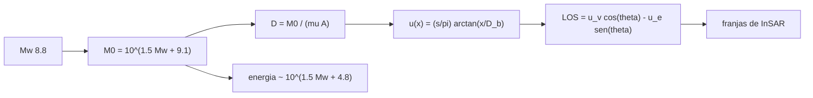

# B57-C17 — Terremotos y deformación

<!-- nav:top -->
[🏠 Programa](../../../../README.md) · [📚 Bloque B57](../../../tronco-comun/B57-observacion-terrestre-y-geociencias-orbitales.md) · [← Anterior: B57-C16 — Incendios forestales](../B57-C16-incendios-forestales/CLASE.md) · [Siguiente: B57-C18 — Volcanismo y monitoreo →](../B57-C18-volcanismo-y-monitoreo/CLASE.md)
<!-- /nav -->

## 1. Ubicación, nivel y alcance

Clase 17 del bloque B57. Un terremoto libera energía deslizando una falla; desde la órbita se mide el resultado como un cambio del suelo. Aquí conectas la magnitud con el momento sísmico y el deslizamiento medio, calculas el desplazamiento de una falla simple y lo proyectas a la línea de visión de un radar. La magnitud y la profundidad de origen de Maule 2010 son las del servicio del USGS consultado; el resto es **ilustrativo** y las fórmulas Mw–M0 y de energía son conocidas pero **no se consultaron**.

## 2. Por qué esta clase existe

Medir la deformación permite saber cuánto deslizó la falla y cuánta tensión queda. La decisión central: **¿cómo se pasa de un número de magnitud al deslizamiento y a la deformación que verá un satélite?**

## 3. Lo que podrás hacer al terminar

1. Calcular el momento sísmico desde la magnitud y recuperarla (ida y vuelta).
2. Estimar el deslizamiento medio de una ruptura con rigidez y área dadas.
3. Calcular cómo escalan el momento y la energía con la magnitud.
4. Evaluar el desplazamiento de una falla de tornillo y su derivada.
5. Proyectar un desplazamiento a la línea de visión de un radar.

La evidencia es la **ficha de deformación sísmica** del ejercicio 12 (sección 20).

## 4. Con qué llegas y cómo comprobarlo

1. ¿Qué es un logaritmo decimal?
2. ¿Qué es la rigidez (módulo de corte)?
3. ¿Qué es el desplazamiento de una falla?
4. ¿Qué es la línea de visión (LOS)?
5. ¿Qué es un valor ilustrativo?

<details>
<summary>Ver respuestas</summary>

1. El exponente al que se eleva 10. 2. La resistencia del material a cortarse; unas decenas de GPa en la corteza. 3. El deslizamiento relativo entre sus dos lados. 4. La dirección del sensor al suelo. 5. Uno propuesto para el ejemplo.
</details>

Con cuatro o cinco aciertos, sigue; si no, repasa los prerrequisitos.

## 5. Un caso de contexto y casos de referencia

El terremoto de Maule del `27 de febrero de 2010` tuvo `Mw 8,8` y una profundidad de origen de `22,9 km` según el USGS (consultado). Aquí lo modelas con una falla **ilustrativa** de `500 × 100 km` y rigidez `30 GPa`, y comparas con una falla de tornillo de deslizamiento `4 m` y profundidad de bloqueo `15 km`. Es el **ejemplo conductor**; los parámetros de la falla son **ilustrativos**.

## 6. Vocabulario

El **momento sísmico** `M0 = μ A D` mide el tamaño del terremoto (N·m). La **magnitud de momento** `Mw` es una función logarítmica de `M0`. La **profundidad de bloqueo** es la profundidad sobre la cual la falla está trabada. El **deslizamiento** `D` es el desplazamiento relativo de los dos lados. La **deformación cosísmica** es el cambio del suelo durante el terremoto; la **intersísmica**, la acumulada entre terremotos.

## 7. Modelo mental: una regla que se estira y se rompe

Una zona de subducción acumula deformación lentamente y la libera de golpe: el momento sísmico es cuánta regla se rompió, la magnitud es su logaritmo.



*Descripción textual:* la magnitud fija el momento, que con el área da el deslizamiento; el deslizamiento deforma la superficie, y esa deformación se proyecta a la línea de visión del radar.

Analogía: romper una regla de madera: cuanto mayor y más rígida, más energía suelta. Límite: la corteza no es homogénea y la ruptura no es uniforme.

## 8. La explicación, paso a paso

### 8.1 Magnitud, momento y deslizamiento

Para `Mw = 8,8`, `M0 = 1,995e+22 N·m`; la ida y vuelta recupera `Mw` con error `0,0e+00`. Con `μ = 30 GPa` y `A = 500 × 100 km`, el deslizamiento medio es `D = 13,30 m`. La energía radiada aproximada es `1,00e+18 J`.

### 8.2 Escalas

Cada unidad de magnitud multiplica `M0` por `31,6` y la energía por `31,6`; `+0,2` en `Mw` multiplica `M0` por `2,00`.

### 8.3 Falla de tornillo

El desplazamiento es `u(x) = (s/π) arctan(x/D_b)`. Lejos de la falla vale `2,0000 m`, igual a `s/2 = 2,0000 m`. A 15 km vale `1,000 m` y a 50 km `1,629 m`. La derivada numérica coincide con la analítica (error `1,5e-07`).

### 8.4 Hacia la línea de visión

Con incidencia de 39° (ilustrativa), el desplazamiento vertical se proyecta con factor `0,777` y el horizontal este con `-0,629`. Un levantamiento de 3 m equivale a `84,1` franjas en banda C. Las franjas tan densas no se desenrollan (clase C08); en la práctica se usa también el desplazamiento de los píxeles.

## 9. Magnitudes, símbolos y unidades

| Símbolo | Qué es | Unidad | Valor / nota |
|---|---|---|---|
| `Mw` | magnitud de momento | — | 8,8 (USGS) |
| `M0` | momento sísmico | N·m | 1,995e+22 |
| `μ` | rigidez | Pa | 3 × 10¹⁰ (ilustrativa) |
| `D` | deslizamiento medio | m | 13,30 |
| `s` | deslizamiento de la falla de tornillo | m | 4 (ilustrativo) |

## 10. Convenciones y referencias

`M0` en N·m con la relación `Mw = (log₁₀M0 − 9,1)/1,5`; desplazamiento positivo en el sentido del deslizamiento; LOS con el convenio de la clase (vertical positivo hacia el satélite). Medio elástico homogéneo.

## 11. De dónde sale lo que afirmamos

| ID | Fuente | Localizador | Respalda | Estado |
|---|---|---|---|---|
| S1 | USGS, *Servicio de eventos, evento del 2010-02-27 (Maule)* | https://earthquake.usgs.gov/fdsnws/event/1/query?eventid=official20100227063411530_30&format=geojson | fecha y hora (2010-02-27 06:34:11.530 UTC), magnitud 8,8 y profundidad de origen de 22,9 km. | Consultada 2026-11-09 (magnitud, hora y profundidad de origen) |

**Límites de las fuentes.** La página de eventos del USGS consultada no traía el mecanismo focal ni la extensión de la ruptura: el área de 500 × 100 km es ilustrativa. Las relaciones Mw–M0 y de energía no se consultaron.

## 12. Cómo ver los resultados

| Magnitud | Valor |
|---|---|
| momento sísmico de Mw 8,8 | 1,995e+22 N·m |
| deslizamiento medio | 13,30 m |
| `u(∞)` de la falla de tornillo | 2,0000 m |
| franjas de 3 m en LOS | 84,1 |

Descripción larga: un terremoto grande desliza metros y el desplazamiento decae con la distancia a la falla siguiendo una arcotangente.

## 13. Ejemplo trabajado: el momento de Mw 8,8

**Paso 1 · Exponente.** `1,5 × 8,8 + 9,1 = 22,3`.

**Paso 2 · Momento.** `M0 = 10^22,3 = 1,995e+22 N·m`.

**Paso 3 · Deslizamiento.** `D = M0/(μ A) = 13,30 m` con `μ A = 1,5 × 10²² N`.

## 14. Distintas formas de abordar el problema

**Por magnitud:** escala logarítmica. **Por momento:** lineal en `D` y `A`. **Por geometría:** deformación de la falla. **Por satélite:** LOS y franjas. Cada paso cambia de escala.

## 15. Práctica guiada

**Ejercicio 1 · con los pasos indicados.** Calcula `M0` para `Mw = 7`. *Pasos:* `10^(1,5·7+9,1)`.

<details><summary>Solución comentada</summary>

`10^19,6 = 3,98e19 N·m`.
</details>

**Ejercicio 2 · con una pista.** ¿Cuántas veces más energía libera un `Mw 8` que un `Mw 7`?

<details><summary>Solución comentada</summary>

`10^1,5 ≈ 31,6`.
</details>

**Ejercicio 3 · casi autónomo.** ¿Qué `Mw` tiene `M0 = 1e21`? *Pista:* `(log M0 − 9,1)/1,5`.

<details><summary>Solución comentada</summary>

`(21 − 9,1)/1,5 = 7,93`.
</details>

## 16. Práctica autónoma, transferencia e integrador

**Ejercicio 4.** Con `D = 6 m`, `μ = 30 GPa` y `A = 200 × 50 km`, ¿cuánto es `M0`?

<details><summary>Solución comentada</summary>

`3e10 × 1e10 × 6 = 1,8e21 N·m`.
</details>

**Ejercicio 5.** ¿Qué desplazamiento tiene la falla de tornillo a `x = D_b`?

<details><summary>Solución comentada</summary>

`(s/π) arctan(1) = s/4 = 1 m`.
</details>

**Ejercicio 6.** ¿Qué porcentaje del desplazamiento total se alcanza a `x = 5 D_b`?

<details><summary>Solución comentada</summary>

`arctan(5)/(π/2) = 87 %`.
</details>

**Ejercicio 7.** ¿Qué factor LOS tiene un desplazamiento vertical con incidencia 39°?

<details><summary>Solución comentada</summary>

`cos 39° = 0,777`.
</details>

**Ejercicio 8.** Explica por qué se usa escala logarítmica para la magnitud.

<details><summary>Solución comentada</summary>

Porque la energía y el momento varían en muchos órdenes de magnitud entre terremotos.
</details>

**Ejercicio 9 · transferencia.** **Transferencia.** Dos terremotos tienen igual `Mw` pero uno rompió un área doble. ¿Qué cambia?

<details><summary>Solución comentada</summary>

El deslizamiento medio se reduce a la mitad, porque `M0 = μ A D` es el mismo.
</details>

**Ejercicio 10 · transferencia.** **Transferencia.** ¿Qué mide un radar que un GNSS no?

<details><summary>Solución comentada</summary>

Un mapa denso de desplazamientos en la LOS, aunque con una sola componente por pasada.
</details>

**Ejercicio 11 · transferencia.** **Transferencia.** ¿Por qué este modelo no puede predecir un terremoto?

<details><summary>Solución comentada</summary>

Porque describe el efecto del deslizamiento ya ocurrido en un medio simple; no determina cuándo ni dónde se romperá.
</details>

**Ejercicio 12 · integrador.** **Integrador.** Elabora tu *ficha de deformación sísmica*: la tabla de magnitud, momento, deslizamiento y energía de Maule con parámetros ilustrativos, la falla de tornillo y la proyección a LOS.

<details><summary>Solución modelo</summary>

Secciones 8.1 a 8.4 con las cifras de la ejecución y los límites (medio homogéneo, sin predicción).
</details>

## 17. Laboratorio: momento sísmico, falla de tornillo y línea de visión

El script [sismo.py](sismo.py) calcula el momento y el deslizamiento de un Mw 8,8, evalúa una falla de tornillo y proyecta a la línea de visión (**comprueba** la ida y vuelta Mw–M0 a 1e-12, el límite `s/2` y la derivada numérica frente a la analítica).

**Datos:** magnitud y profundidad de origen del USGS (S1); falla y rigidez **ilustrativas**. **Predice antes de ejecutar:** ¿cuántos metros de deslizamiento medio saldrán? (más de 10.) **Ejecución del 2026-11-09 (Python 3.12.9):**

```text
Python 3.12.9 (biblioteca estandar)
Mw 8.8: M0 = 1.995e+22 N m ; ida y vuelta Mw = 8.800000000000 (error 0.0e+00)
Deslizamiento medio con 30 GPa y 500 x 100 km = 13.30 m ; energia radiada = 1.00e+18 J
Una unidad de Mw multiplica M0 por 31.6 y la energia por 31.6 ; +0.2 en Mw multiplica M0 por 2.00
Falla de tornillo: u(infinito) = 2.0000 m (s/2 = 2.0000) ; u(15 km) = 1.000 m ; u(50 km) = 1.629 m ; error de la derivada = 1.5e-07
Proyeccion a la LOS (39 grados): vertical x0.777 ; este x-0.629 ; 3 m verticales = 84.1 franjas
Pruebas superadas.
```

```bash
python programa/clases/B57/B57-C17-terremotos-y-deformacion/sismo.py
```

**Límites:** medio elástico homogéneo, falla vertical y ruptura uniforme; no predice terremotos.

## 18. Errores frecuentes y cómo corregirlos

**Sumar magnitudes como si fueran lineales.** Es logarítmica (8.2).

**Confundir deslizamiento medio con el máximo.** La ruptura no es uniforme (sección 6).

**Tomar la LOS como vertical.** Mezcla componentes (8.4).

**Usar el modelo para predecir.** No lo permite (ejercicio 11).

## 19. Cómo sabrás que vas bien

Tras la sección 8: ¿qué resultado esperabas y cuál obtuviste? Si dudas, repasa el ejemplo 13. Tras el laboratorio: ¿qué comprueba? (ver la sección 17).

## 20. Qué entregas y cómo se evalúa

El producto es tu **ficha de deformación sísmica** (ejercicio 12).

| Criterio | Inicial | En desarrollo | Logrado | Destacado |
|---|---|---|---|---|
| Conceptos | Los confunde | Parciales | Conceptos de la clase | Explica los límites |
| Cálculo | Sin unidades | Con errores | Tablas completas con unidades | Calcula casos nuevos |
| Numérico | Sin comprobar | Un caso | Contraste con el caso analítico | Interpreta las diferencias |
| Fuentes | Sin fuente | Sin fecha | Fuentes con fecha | Declara lo no consultado |
| Límites | No los nombra | Uno | Tres | Discute qué falta del modelo |

**Condiciones críticas (no se compensan con promedio):** rotular la falla como ilustrativa; no presentar el modelo como predicción; citar solo lo consultado.

## 21. Ética, seguridad y límites

Clase educativa: no se predice ningún terremoto ni se evalúa la amenaza de un lugar. Accesibilidad: tablas equivalentes a las gráficas, fórmulas en texto, ejercicios sin conexión.

## 22. Para cerrar y seguir

Un `Mw 8,8` equivale a `2,00e+22 N·m` y, con la falla ilustrativa, a `13,3 m` de deslizamiento medio. Queda una pregunta: ¿cómo se ve el hinchamiento de un volcán?

**Glosario español–inglés.** momento sísmico · *seismic moment*; deslizamiento · *slip*; profundidad de bloqueo · *locking depth*; deformación cosísmica · *coseismic deformation*; falla de tornillo · *screw dislocation*.

**Continuidad.** [B57-C18](../B57-C18-volcanismo-y-monitoreo/CLASE.md) estudia volcanismo y monitoreo.

**Referencias:** ver sección 11.

<!-- nav:bottom -->
---

[← Anterior: B57-C16 — Incendios forestales](../B57-C16-incendios-forestales/CLASE.md) · [📚 Bloque B57](../../../tronco-comun/B57-observacion-terrestre-y-geociencias-orbitales.md) · [Siguiente: B57-C18 — Volcanismo y monitoreo →](../B57-C18-volcanismo-y-monitoreo/CLASE.md)
<!-- /nav -->
