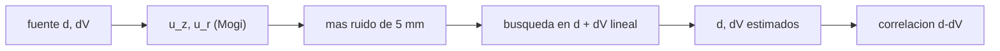

# B57-C18 — Volcanismo y monitoreo

<!-- nav:top -->
[🏠 Programa](../../../../README.md) · [📚 Bloque B57](../../../tronco-comun/B57-observacion-terrestre-y-geociencias-orbitales.md) · [← Anterior: B57-C17 — Terremotos y deformación](../B57-C17-terremotos-y-deformacion/CLASE.md) · [Siguiente: B57-C19 — SIG y análisis de riesgo →](../B57-C19-sig-y-analisis-de-riesgo/CLASE.md)
<!-- /nav -->

## 1. Ubicación, nivel y alcance

Clase 18 del bloque B57. Cuando entra magma a una cámara, el suelo de arriba se hincha de forma que un radar puede medir. El modelo más simple, una esfera presurizada en un semiespacio elástico (fuente de Mogi), da una fórmula cerrada. Calculas el perfil de deformación **sintético**, verificas dónde está el máximo horizontal e inviertes la profundidad y el volumen, y ves que ambos se compensan cuando hay ruido. La fórmula de Mogi es conocida pero **no se consultó** una fuente.

## 2. Por qué esta clase existe

Medir la deformación de un volcán permite inferir qué ocurre bajo tierra, pero la inversión no tiene respuesta única. La decisión central: **¿qué profundidad y qué volumen explican la deformación y con qué incertidumbre conjunta?**

## 3. Lo que podrás hacer al terminar

1. Evaluar la deformación vertical y radial de una fuente de Mogi.
2. Verificar que el máximo horizontal está a `d/√2`.
3. Invertir profundidad y cambio de volumen por mínimos cuadrados.
4. Medir la incertidumbre de la inversión y su correlación.
5. Reconocer los límites de una fuente puntual en un semiespacio homogéneo.

La evidencia es la **ficha de deformación volcánica** del ejercicio 12 (sección 20).

## 4. Con qué llegas y cómo comprobarlo

1. ¿Qué es un semiespacio elástico?
2. ¿Qué es la razón de Poisson?
3. ¿Qué es un mínimo cuadrado lineal?
4. ¿Qué es una correlación?
5. ¿Qué es un dato sintético?

<details>
<summary>Ver respuestas</summary>

1. Un medio que ocupa todo el espacio bajo una superficie plana y recupera su forma al descargarse. 2. El cociente entre la contracción lateral y la extensión axial; unos 0,25 en roca. 3. El ajuste de un solo factor que minimiza el residuo. 4. Una medida de cuánto varían juntos dos valores. 5. Uno generado por una fórmula.
</details>

Con cuatro o cinco aciertos, sigue; si no, repasa los prerrequisitos.

## 5. Un caso de contexto y casos de referencia

Una cámara a `5 km` de profundidad aumenta su volumen en `10⁷ m³` (**ilustrativo**) bajo un volcán sintético; el radar mide 21 puntos entre 0 y 20 km con un ruido de `5 mm`. Es el **ejemplo conductor**; todo es **sintético**.

## 6. Vocabulario

La **fuente de Mogi** es una cavidad esférica pequeña presurizada en un semiespacio elástico. Su deformación es `u_z = (1−ν)ΔV d/[π(r²+d²)^{3/2}]` y `u_r = (1−ν)ΔV r/[π(r²+d²)^{3/2}]`. La **inversión** busca los parámetros que explican las observaciones. El **trade-off** (compromiso) es que cambios en profundidad y en volumen producen deformaciones parecidas.

## 7. Modelo mental: presionar una esponja desde abajo

Si empujas desde dentro una esponja tapada con un paño, el paño se levanta en forma de campana: más profundo, más ancha y baja; más superficial, más angosta y alta.



*Descripción textual:* la profundidad y el volumen de la fuente generan los desplazamientos, a los que se suma ruido, y la inversión recupera ambos con una incertidumbre conjunta.

Analogía: presionar una esponja con un paño encima. Límite: el volcán real tiene topografía, heterogeneidad y fuentes múltiples.

## 8. La explicación, paso a paso

### 8.1 El perfil

Con `d = 5 km` y `ΔV = 10⁷ m³`, el ascenso en el centro es `95,5 mm`; a 10 km del centro, `0,0085 m`. El desplazamiento radial máximo es `0,0364 m` y ocurre a `3540 m`, igual a `d/√2 = 3536 m`.

### 8.2 Inversión sin ruido

Una búsqueda en `d` entre 1 y 15 km con `ΔV` lineal recupera `d = 5000 m` y `ΔV = 1,0000e+07 m³`: coincide con lo impuesto.

### 8.3 Inversión con ruido

Con 5 mm de ruido (300 ensayos): `d = 5002 ± 192 m` y `ΔV = 1,003e+07 ± 6,51e+05 m³`. La correlación entre ambos es `0,92`: una fuente más profunda y mayor explica casi igual los datos. Por eso se reporta la incertidumbre conjunta y no cada parámetro por separado.

### 8.4 Límites

El resultado depende del modelo: una esfera en un semiespacio homogéneo plano. Con topografía, un cuerpo alargado o varias fuentes, la profundidad estimada puede cambiar mucho. Un modelo que ajusta los datos no prueba que sea la fuente real.

## 9. Magnitudes, símbolos y unidades

| Símbolo | Qué es | Unidad | Valor / nota |
|---|---|---|---|
| `d` | profundidad de la fuente | m | 5000 (sintética) |
| `ΔV` | cambio de volumen | m³ | 10⁷ (ilustrativo) |
| `ν` | razón de Poisson | — | 0,25 |
| `u_z` | ascenso del suelo | m | 0,0955 en el centro |
| `r_máx` | radio del máximo horizontal | m | 3536 |

## 10. Convenciones y referencias

Origen en la vertical de la fuente; `r` radial en la superficie; `u_z` positivo hacia arriba; desplazamientos de un campo estático. Se descartan topografía y estratificación.

## 11. De dónde sale lo que afirmamos

| ID | Fuente | Localizador | Respalda | Estado |
|---|---|---|---|---|
| — | Sin fuente externa | — | relaciones estándar que verifica el laboratorio | No se consultó una fuente para esta clase |

**Límites de las fuentes.** No se consultó ninguna fuente para esta clase: la fórmula de Mogi se trata como un resultado conocido que verifica la clase (máximo en `d/√2`, inversión sin ruido). Todos los parámetros son ilustrativos o sintéticos.

## 12. Cómo ver los resultados

| Magnitud | Valor |
|---|---|
| ascenso central | 95,5 mm |
| máximo horizontal a | 3540 m (teoría 3536 m) |
| `d` con ruido | 5002 ± 192 m |
| correlación `d`–`ΔV` | 0,92 |

Descripción larga: el ascenso es una campana, el máximo horizontal queda a `d/√2` y el ruido mueve juntas profundidad y volumen.

## 13. Ejemplo trabajado: el ascenso central

**Paso 1 · Factor.** `(1 − 0,25)/π = 0,2387`.

**Paso 2 · Distancia.** En `r = 0`, `d/(d²)^{3/2} = 1/d² = 4 × 10⁻⁸ m⁻²`.

**Paso 3 · Ascenso.** `0,2387 × 10⁷ × 4 × 10⁻⁸ = 0,0955 m`; la ejecución da `95,5 mm`.

## 14. Distintas formas de abordar el problema

**Por fórmula:** perfil cerrado. **Por inversión:** búsqueda de `d` y ajuste de `ΔV`. **Por Monte Carlo:** incertidumbre conjunta. Un modelo más complejo exigiría más datos para no sobreajustar.

## 15. Práctica guiada

**Ejercicio 1 · con los pasos indicados.** Calcula `u_z(0)` para `d = 4 km`, `ΔV = 10⁷`, `ν = 0,25`. *Pasos:* `(1−ν)ΔV/(π d²)`.

<details><summary>Solución comentada</summary>

`0,75 × 1e7/(π × 1,6e7) = 0,149 m`.
</details>

**Ejercicio 2 · con una pista.** ¿Dónde está el máximo horizontal si `d = 8 km`? *Pista:* `d/√2`.

<details><summary>Solución comentada</summary>

A `5,66 km`.
</details>

**Ejercicio 3 · casi autónomo.** Si se duplica `ΔV` con `d` fijo, ¿cómo cambia el perfil?

<details><summary>Solución comentada</summary>

Todo se duplica.
</details>

## 16. Práctica autónoma, transferencia e integrador

**Ejercicio 4.** Si se duplica `d` con `ΔV` fijo, ¿cómo cambia `u_z(0)`?

<details><summary>Solución comentada</summary>

Baja 4 veces: va como `1/d²`.
</details>

**Ejercicio 5.** ¿Qué razón `u_r/u_z` hay en `r = d`?

<details><summary>Solución comentada</summary>

`r/d = 1`.
</details>

**Ejercicio 6.** ¿Qué significa una correlación positiva entre `d` y `ΔV`?

<details><summary>Solución comentada</summary>

Una fuente más profunda necesita más volumen para dar el mismo ascenso.
</details>

**Ejercicio 7.** ¿Por qué se invierte `ΔV` con mínimos cuadrados lineales y `d` por búsqueda?

<details><summary>Solución comentada</summary>

Porque `ΔV` multiplica linealmente el perfil, mientras `d` entra de forma no lineal.
</details>

**Ejercicio 8.** Con σ = 5 mm y un ascenso de 95 mm, ¿qué relación señal–ruido hay?

<details><summary>Solución comentada</summary>

Unas 19.
</details>

**Ejercicio 9 · transferencia.** **Transferencia.** Los datos muestran un solo lóbulo horizontal asimétrico. ¿Qué sospechas?

<details><summary>Solución comentada</summary>

Una fuente no esférica, topografía o dos fuentes.
</details>

**Ejercicio 10 · transferencia.** **Transferencia.** ¿Por qué no basta la deformación para afirmar que hay una erupción próxima?

<details><summary>Solución comentada</summary>

Porque la deformación no distingue por sí sola entre magma, gases o fluidos hidrotermales ni dice cuándo ocurriría una erupción.
</details>

**Ejercicio 11 · transferencia.** **Transferencia.** ¿Qué datos reales harían falta para validar el método?

<details><summary>Solución comentada</summary>

Interferogramas observados con procedencia, topografía y referencias de campo (GNSS).
</details>

**Ejercicio 12 · integrador.** **Integrador.** Elabora tu *ficha de deformación volcánica*: la tabla del perfil de Mogi, el máximo horizontal, la inversión con y sin ruido y la correlación.

<details><summary>Solución modelo</summary>

Secciones 8.1 a 8.3 con las cifras de la ejecución, rotulando todo como sintético y señalando los límites de 8.4.
</details>

## 17. Laboratorio: perfil de Mogi e inversión

El script [mogi.py](mogi.py) evalúa la deformación de una fuente de Mogi, verifica el máximo horizontal e invierte profundidad y volumen sin y con ruido (**comprueba** la profundidad recuperada sin ruido (25 m), el máximo en `d/√2` (1 %) y la correlación `d`–`ΔV`).

**Datos:** fuente, ruido y observaciones **sintéticos**; sin fuente consultada. **Predice antes de ejecutar:** ¿dónde estará el máximo horizontal? (a unos 3,5 km.) **Ejecución del 2026-11-09 (Python 3.12.9):**

```text
Python 3.12.9 ; numpy 2.4.4
Fuente d = 5 km, dV = 1e7 m3: u_z(0) = 95.5 mm ; u_z(10 km) = 8.54 mm ; max u_r = 36.4 mm
Maximo de u_r: numerico r = 3540 m ; teoria d/sqrt(2) = 3536 m
Inversion sin ruido: d = 5000 m ; dV = 1.0000e+07 m3
Inversion con 5 mm de ruido (300 ensayos): d = 5002 +- 192 m ; dV = 1.003e+07 +- 6.51e+05 m3 ; correlacion d-dV = 0.92
Pruebas superadas.
```

```bash
python programa/clases/B57/B57-C18-volcanismo-y-monitoreo/mogi.py
```

**Límites:** fuente puntual, semiespacio homogéneo y plano; no es un modelo de ningún volcán.

## 18. Errores frecuentes y cómo corregirlos

**Reportar `d` sin su incertidumbre conjunta con `ΔV`.** Están correlacionados (8.3).

**Creer que un buen ajuste prueba el modelo.** Se corrige con 8.4.

**Aplicar Mogi sin topografía a un volcán empinado.** Falla (8.4).

**Presentar la fuente como real.** Es sintética (sección 5).

## 19. Cómo sabrás que vas bien

Tras la sección 8: ¿qué resultado esperabas y cuál obtuviste? Si dudas, repasa el ejemplo 13. Tras el laboratorio: ¿qué comprueba? (ver la sección 17).

## 20. Qué entregas y cómo se evalúa

El producto es tu **ficha de deformación volcánica** (ejercicio 12).

| Criterio | Inicial | En desarrollo | Logrado | Destacado |
|---|---|---|---|---|
| Conceptos | Los confunde | Parciales | Conceptos de la clase | Explica los límites |
| Cálculo | Sin unidades | Con errores | Tablas completas con unidades | Calcula casos nuevos |
| Numérico | Sin comprobar | Un caso | Contraste con el caso analítico | Interpreta las diferencias |
| Fuentes | Sin fuente | Sin fecha | Fuentes con fecha | Declara lo no consultado |
| Límites | No los nombra | Uno | Tres | Discute qué falta del modelo |

**Condiciones críticas (no se compensan con promedio):** rotular la fuente como sintética; no inferir erupciones; citar solo lo consultado (aquí, nada).

## 21. Ética, seguridad y límites

Clase educativa: no se evalúa ni se predice la actividad de ningún volcán real. Accesibilidad: tablas equivalentes a las gráficas, fórmulas en texto, ejercicios sin conexión.

## 22. Para cerrar y seguir

Una fuente a `5 km` levanta el centro `95 mm` y su máximo horizontal queda a `3536 m`; con ruido, `d` y `ΔV` se correlacionan en `0,92`. Queda una pregunta: ¿cómo se combinan capas de datos para evaluar un riesgo?

**Glosario español–inglés.** fuente de Mogi · *Mogi source*; semiespacio elástico · *elastic half-space*; inversión · *inversion*; razón de Poisson · *Poisson's ratio*; volcán · *volcano*.

**Continuidad.** [B57-C19](../B57-C19-sig-y-analisis-de-riesgo/CLASE.md) estudia sIG y análisis de riesgo.

**Referencias:** ver sección 11.

<!-- nav:bottom -->
---

[← Anterior: B57-C17 — Terremotos y deformación](../B57-C17-terremotos-y-deformacion/CLASE.md) · [📚 Bloque B57](../../../tronco-comun/B57-observacion-terrestre-y-geociencias-orbitales.md) · [Siguiente: B57-C19 — SIG y análisis de riesgo →](../B57-C19-sig-y-analisis-de-riesgo/CLASE.md)
<!-- /nav -->
