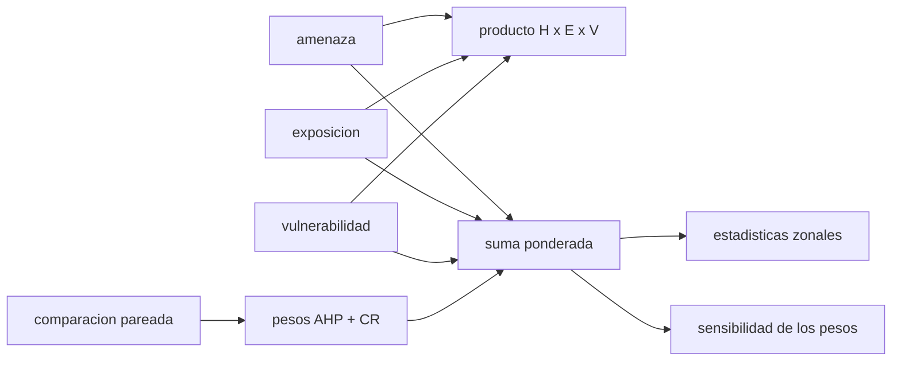

# B57-C19 — SIG y análisis de riesgo

<!-- nav:top -->
[🏠 Programa](../../../../README.md) · [📚 Bloque B57](../../../tronco-comun/B57-observacion-terrestre-y-geociencias-orbitales.md) · [← Anterior: B57-C18 — Volcanismo y monitoreo](../B57-C18-volcanismo-y-monitoreo/CLASE.md) · [Siguiente: B57-C20 — Caso de estudio climático o geológico de Chile →](../B57-C20-caso-de-estudio-climatico-o-geologico-de-chile/CLASE.md)
<!-- /nav -->

## 1. Ubicación, nivel y alcance

Clase 19 del bloque B57. Un análisis de riesgo combina mapas: dónde es probable el fenómeno (amenaza), qué hay expuesto y cuán frágil es. Un sistema de información geográfica (SIG) superpone esas capas. Combinas tres capas **sintéticas** de dos maneras (producto y suma ponderada), calculas pesos por el método AHP con una comprobación de consistencia y mides cuánto cambia el resultado al perturbar los pesos. El índice aleatorio de Saaty es conocimiento general **no consultado**; ningún lugar real se evalúa.

## 2. Por qué esta clase existe

Los mapas de riesgo orientan decisiones y presupuestos, pero dependen de supuestos de ponderación que suelen quedar ocultos. La decisión central: **¿cómo combino capas y cuánto cambian las zonas prioritarias si cambio los pesos?**

## 3. Lo que podrás hacer al terminar

1. Definir riesgo como amenaza × exposición × vulnerabilidad y como suma ponderada.
2. Calcular pesos AHP y la razón de consistencia.
3. Detectar una matriz de comparación inconsistente.
4. Medir el solape entre dos métodos de combinación.
5. Medir la sensibilidad de las celdas prioritarias a los pesos.

La evidencia es la **ficha de análisis de riesgo** del ejercicio 12 (sección 20).

## 4. Con qué llegas y cómo comprobarlo

1. ¿Qué es una capa ráster?
2. ¿Qué es un vector propio?
3. ¿Qué es una media ponderada?
4. ¿Qué es un percentil?
5. ¿Qué es un dato sintético?

<details>
<summary>Ver respuestas</summary>

1. Una malla de celdas con un valor cada una. 2. Un vector que una matriz solo escala. 3. Una media en que cada valor pesa distinto. 4. El valor bajo el cual cae un porcentaje de los datos. 5. Uno generado por una fórmula.
</details>

Con cuatro o cinco aciertos, sigue; si no, repasa los prerrequisitos.

## 5. Un caso de contexto y casos de referencia

Tres capas de `60 × 60` celdas **sintéticas**: la amenaza se concentra en el noroeste, la exposición en el centro y la vulnerabilidad crece hacia el este. Se combinan con pesos AHP elegidos por comparación pareada (**ilustrativa**). Es el **ejemplo conductor**; no representa ningún lugar.

## 6. Vocabulario

La **amenaza** es la probabilidad e intensidad del fenómeno; la **exposición** es lo que está en su camino; la **vulnerabilidad** es cuán dañable es. El **proceso analítico jerárquico (AHP)** deriva pesos de comparaciones pareadas. La **razón de consistencia** (CR) mide la coherencia de esas comparaciones. Las **estadísticas zonales** resumen una capa por zona. El **solape** es la fracción de celdas prioritarias comunes a dos mapas.

## 7. Modelo mental: una receta con ingredientes ponderados

Un mapa de riesgo es una receta: los pesos dicen cuánto vale cada ingrediente y el resultado cambia si cambias las proporciones.



*Descripción textual:* las tres capas se combinan por producto o por suma ponderada con pesos AHP, y el resultado se resume por zonas y se somete a una prueba de sensibilidad.

Analogía: una receta: cambiar la sal cambia el plato. Límite: los pesos no son una ley física, son un juicio de quien decide.

## 8. La explicación, paso a paso

### 8.1 Pesos AHP

Con comparaciones `H/E = 2`, `H/V = 4`, `E/V = 2` (consistentes) los pesos son `0,571 ; 0,286 ; 0,143`, `λ_max = 3,000000` y `CR = 0,0e+00`; coinciden con la media geométrica (diferencia `0,0e+00`). Con una matriz inconsistente (`H > E`, `E > V`, `V > H`) `λ_max = 4,231` y `CR = 1,06`, por encima del límite de 0,10 que se usa habitualmente.

### 8.2 Dos formas de combinar

Entre el producto y la suma ponderada, el 10 % de celdas de mayor riesgo se solapa en `81,9%`. El producto penaliza que una capa sea baja; la suma compensa una capa baja con otras altas.

### 8.3 Sensibilidad

Perturbando cada peso hasta ±20 %, el solape con el mapa base del 10 % prioritario tiene mínimo `94,4%` y media `97,8%`.

### 8.4 Zonas

El riesgo medio aditivo por cuadrante es: `0,293` (NO), `0,227` (NE), `0,449` (SO), `0,257` (SE). La zona mayor es `SO`. Un promedio por zona esconde las celdas críticas; conviene mirar también la distribución.

## 9. Magnitudes, símbolos y unidades

| Símbolo | Qué es | Unidad | Valor / nota |
|---|---|---|---|
| `H`, `E`, `V` | amenaza, exposición, vulnerabilidad | 0–1 | capas sintéticas |
| `w` | pesos AHP | — | 0,571 ; 0,286 ; 0,143 |
| `CR` | razón de consistencia | — | 0,0e+00; 1,06 |
| solape | celdas comunes del 10 % superior | % | 81,9% |

## 10. Convenciones y referencias

Capas normalizadas a [0, 1]; celdas del mismo tamaño; riesgo adimensional (índice relativo, no una probabilidad ni una pérdida). Índice aleatorio de Saaty 0,58 para n = 3 (no consultado).

## 11. De dónde sale lo que afirmamos

| ID | Fuente | Localizador | Respalda | Estado |
|---|---|---|---|---|
| — | Sin fuente externa | — | relaciones estándar que verifica el laboratorio | No se consultó una fuente para esta clase |

**Límites de las fuentes.** No se consultó ninguna fuente: el AHP y el índice aleatorio son conocimiento general; las capas son sintéticas. El riesgo calculado es un índice relativo y no una estimación de pérdidas.

## 12. Cómo ver los resultados

| Magnitud | Valor |
|---|---|
| pesos AHP | 0,571 ; 0,286 ; 0,143 |
| `CR` consistente / inconsistente | 0,0e+00 / 1,06 |
| solape producto–suma | 81,9% |
| solape mínimo con pesos ±20 % | 94,4% |

Descripción larga: los pesos consistentes tienen CR cero, y cambiar los pesos o el método modifica una parte de las celdas prioritarias.

## 13. Ejemplo trabajado: los pesos de una matriz consistente

**Paso 1 · Medias geométricas por fila.** `(1·2·4)^{1/3} = 2`, `(0,5·1·2)^{1/3} = 1`, `(0,25·0,5·1)^{1/3} = 0,5`.

**Paso 2 · Normalizar.** Suma `3,5`: `2/3,5 = 0,571`, `1/3,5 = 0,286`, `0,5/3,5 = 0,143`.

**Paso 3 · Cotejo.** La iteración de potencias da `0,571 ; 0,286 ; 0,143`.

## 14. Distintas formas de abordar el problema

**Por producto:** exige que las tres capas sean altas. **Por suma ponderada:** permite compensar. **Por AHP:** hace explícitos los pesos. **Por sensibilidad:** dice cuánto depende el resultado de esos pesos.

## 15. Práctica guiada

**Ejercicio 1 · con los pasos indicados.** Calcula `H·E·V` con `0,8`, `0,5` y `0,6`. *Pasos:* multiplica.

<details><summary>Solución comentada</summary>

`0,24`.
</details>

**Ejercicio 2 · con una pista.** Con pesos `0,57`, `0,29`, `0,14` calcula la suma ponderada de ese mismo trío.

<details><summary>Solución comentada</summary>

`0,456 + 0,145 + 0,084 = 0,685`.
</details>

**Ejercicio 3 · casi autónomo.** ¿Por qué el producto da `0` si una capa es `0`? Usa 8.2.

<details><summary>Solución comentada</summary>

Porque un factor nulo anula el producto: sin exposición no hay riesgo.
</details>

## 16. Práctica autónoma, transferencia e integrador

**Ejercicio 4.** Calcula el peso de la tercera fila de una matriz consistente `[1,2,4; 0,5,1,2; 0,25,0,5,1]`.

<details><summary>Solución comentada</summary>

`0,143`.
</details>

**Ejercicio 5.** ¿Qué indica `CR = 0,25`?

<details><summary>Solución comentada</summary>

Comparaciones incoherentes: hay que revisarlas.
</details>

**Ejercicio 6.** ¿Qué pasa con el solape si los pesos se perturban más (±40 %)?

<details><summary>Solución comentada</summary>

Baja más: la prioridad depende más de los pesos.
</details>

**Ejercicio 7.** Explica por qué los promedios zonales pueden ocultar celdas críticas.

<details><summary>Solución comentada</summary>

Un promedio mezcla celdas altas y bajas; una celda muy riesgosa en una zona tranquila queda diluida.
</details>

**Ejercicio 8.** ¿Qué ventaja tiene declarar los pesos?

<details><summary>Solución comentada</summary>

Permite revisarlos y repetir el análisis con otros.
</details>

**Ejercicio 9 · transferencia.** **Transferencia.** Un municipio pide «el mapa de riesgo» sin declarar pesos. ¿Qué respondes?

<details><summary>Solución comentada</summary>

Que el mapa depende de los pesos y del método; entrego el análisis con su sensibilidad y los supuestos.
</details>

**Ejercicio 10 · transferencia.** **Transferencia.** ¿Se puede interpretar el índice como probabilidad de daño?

<details><summary>Solución comentada</summary>

No: es un índice relativo sin calibrar con pérdidas observadas.
</details>

**Ejercicio 11 · transferencia.** **Transferencia.** ¿Qué datos reales harían falta?

<details><summary>Solución comentada</summary>

Capas de amenaza, exposición y vulnerabilidad con procedencia, resolución y fecha, y datos de daños para calibrar.
</details>

**Ejercicio 12 · integrador.** **Integrador.** Elabora tu *ficha de análisis de riesgo*: la tabla de pesos y consistencia, el solape entre métodos, la sensibilidad a pesos y las estadísticas zonales.

<details><summary>Solución modelo</summary>

Secciones 8.1 a 8.4 con las cifras de la ejecución, aclarando que el índice es relativo y sintético.
</details>

## 17. Laboratorio: riesgo, pesos AHP y sensibilidad

El script [riesgo.py](riesgo.py) combina tres capas sintéticas, calcula pesos AHP con razón de consistencia y mide la sensibilidad de las celdas prioritarias (**comprueba** que los pesos coinciden con la media geométrica a 1e-9 con CR = 0 y que una matriz incoherente tiene CR > 0,10).

**Datos:** capas, zonas y comparaciones **sintéticas / ilustrativas**; índice aleatorio de Saaty no consultado. **Predice antes de ejecutar:** ¿qué zona tendrá mayor riesgo medio? (la que combine amenaza y exposición altas; ver 8.4.) **Ejecución del 2026-11-09 (Python 3.12.9):**

```text
Python 3.12.9 ; numpy 2.4.4
Matriz consistente: pesos = [0.571429, 0.285714, 0.142857] ; lambda_max = 3.000000 ; CR = 0.00e+00 ; diferencia con media geometrica = 0.0e+00
Matriz inconsistente: lambda_max = 4.231 ; CR = 1.06 (se acepta CR < 0.10)
Solape del 10 % de mayor riesgo entre metodo multiplicativo y aditivo = 81.9 %
Perturbando los pesos +-20 %: solape minimo = 94.4 % ; medio = 97.8 %
Riesgo medio por zona (aditivo): NO = 0.293 ; NE = 0.227 ; SO = 0.449 ; SE = 0.257 ; mayor: SO
Pruebas superadas.
```

```bash
python programa/clases/B57/B57-C19-sig-y-analisis-de-riesgo/riesgo.py
```

**Límites:** capas independientes y sin calibración; no representa ningún lugar.

## 18. Errores frecuentes y cómo corregirlos

**Presentar el índice como probabilidad.** Es relativo (ejercicio 10).

**Ocultar los pesos.** Se corrige con ejercicio 9.

**Usar solo el promedio por zona.** Diluye celdas críticas (ejercicio 7).

**Comparar mapas con capas de distinta resolución sin avisar.** Declara resolución y fecha (sección 10).

## 19. Cómo sabrás que vas bien

Tras la sección 8: ¿qué resultado esperabas y cuál obtuviste? Si dudas, repasa el ejemplo 13. Tras el laboratorio: ¿qué comprueba? (ver la sección 17).

## 20. Qué entregas y cómo se evalúa

El producto es tu **ficha de análisis de riesgo** (ejercicio 12).

| Criterio | Inicial | En desarrollo | Logrado | Destacado |
|---|---|---|---|---|
| Conceptos | Los confunde | Parciales | Conceptos de la clase | Explica los límites |
| Cálculo | Sin unidades | Con errores | Tablas completas con unidades | Calcula casos nuevos |
| Numérico | Sin comprobar | Un caso | Contraste con el caso analítico | Interpreta las diferencias |
| Fuentes | Sin fuente | Sin fecha | Fuentes con fecha | Declara lo no consultado |
| Límites | No los nombra | Uno | Tres | Discute qué falta del modelo |

**Condiciones críticas (no se compensan con promedio):** rotular las capas como sintéticas; no presentar el índice como probabilidad ni evaluar un lugar real; citar solo lo consultado (aquí, nada).

## 21. Ética, seguridad y límites

Clase educativa: un índice mal calibrado puede distribuir mal recursos; el análisis real exige participación y revisión de la comunidad afectada. Accesibilidad: tablas equivalentes a las gráficas, fórmulas en texto, ejercicios sin conexión.

## 22. Para cerrar y seguir

Con pesos `0,571 ; 0,286 ; 0,143` el 10 % prioritario conserva entre `94%` y `100 %` de sus celdas al mover los pesos ±20 %. Queda una pregunta: ¿cómo se junta todo en un caso concreto de Chile?

**Glosario español–inglés.** amenaza · *hazard*; exposición · *exposure*; vulnerabilidad · *vulnerability*; proceso analítico jerárquico · *analytic hierarchy process (AHP)*; sistema de información geográfica · *geographic information system (GIS)*.

**Continuidad.** [B57-C20](../B57-C20-caso-de-estudio-climatico-o-geologico-de-chile/CLASE.md) estudia caso de estudio climático o geológico de Chile.

**Referencias:** ver sección 11.

<!-- nav:bottom -->
---

[← Anterior: B57-C18 — Volcanismo y monitoreo](../B57-C18-volcanismo-y-monitoreo/CLASE.md) · [📚 Bloque B57](../../../tronco-comun/B57-observacion-terrestre-y-geociencias-orbitales.md) · [Siguiente: B57-C20 — Caso de estudio climático o geológico de Chile →](../B57-C20-caso-de-estudio-climatico-o-geologico-de-chile/CLASE.md)
<!-- /nav -->
