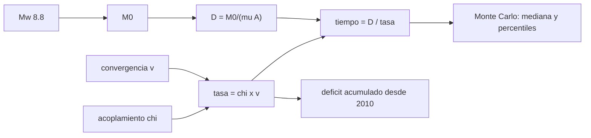

# B57-C20 — Caso de estudio climático o geológico de Chile

<!-- nav:top -->
[🏠 Programa](../../../../README.md) · [📚 Bloque B57](../../../tronco-comun/B57-observacion-terrestre-y-geociencias-orbitales.md) · [← Anterior: B57-C19 — SIG y análisis de riesgo](../B57-C19-sig-y-analisis-de-riesgo/CLASE.md) · [Siguiente: B57-C21 — Sensores infrarrojos térmicos para observación terrestre →](../B57-C21-sensores-infrarrojos-termicos-para-observacion-terrestre/CLASE.md)
<!-- /nav -->

## 1. Ubicación, nivel y alcance

Clase 20 del bloque B57. Esta clase cierra el tramo de aplicaciones con un caso geológico de Chile: el terremoto de Maule del 27 de febrero de 2010, de magnitud 8,8 según el USGS (consultado). Reúnes lo aprendido en las clases C08, C10 y C17 y haces un ejercicio de **escalas**: cuánto deslizó la falla, cuánto tarda en reponerse con una tasa de acumulación **ilustrativa** y qué fracción se ha acumulado hasta hoy. No es un pronóstico: es una cuenta de órdenes de magnitud.

## 2. Por qué esta clase existe

Chile vive sobre una zona de subducción activa y las instituciones deben comprender cuánta deformación se acumula y se libera. La decisión central: **¿qué puede decir una cuenta de balance de deslizamiento y qué no puede decir sobre cuándo ocurrirá el próximo terremoto?**

## 3. Lo que podrás hacer al terminar

1. Resumir un evento con los datos publicados que se consultaron (fecha, magnitud, profundidad de origen).
2. Estimar el deslizamiento medio de la ruptura a partir del momento sísmico.
3. Calcular el tiempo de reposición del deslizamiento con una tasa de acumulación dada.
4. Propagar la incertidumbre de la tasa y del acoplamiento con Monte Carlo.
5. Explicar por qué la cuenta no es un pronóstico.

La evidencia es la **ficha del caso de Chile** del ejercicio 12 (sección 20).

## 4. Con qué llegas y cómo comprobarlo

1. ¿Qué es una zona de subducción?
2. ¿Qué es el acoplamiento?
3. ¿Qué es un percentil?
4. ¿Qué es una distribución lognormal?
5. ¿Qué es un valor ilustrativo?

<details>
<summary>Ver respuestas</summary>

1. Donde una placa se hunde bajo otra. 2. La fracción del movimiento relativo que queda trabada y se acumula como deformación. 3. El valor bajo el cual cae un porcentaje de los datos. 4. La de una variable positiva cuyo logaritmo es normal. 5. Uno propuesto para el ejemplo.
</details>

Con cuatro o cinco aciertos, sigue; si no, repasa los prerrequisitos.

## 5. Un caso de contexto y casos de referencia

Terremoto de Maule, `2010-02-27 06:34:11 UTC`, `Mw 8,8`, profundidad de origen `22,9 km` (USGS, consultado). Con rigidez `30 GPa` y área `500 × 100 km` (**ilustrativas**), una convergencia de `66 mm/año` y un acoplamiento de `0,7` (**ilustrativos**, no consultados). Es el **ejemplo conductor**; los parámetros no son los de un estudio.

## 6. Vocabulario

El **ciclo sísmico** alterna acumulación lenta de deformación y liberación brusca. El **déficit de deslizamiento** es el deslizamiento que se ha acumulado sin liberarse. La **velocidad de convergencia** es el ritmo de acercamiento de las placas. El **acoplamiento** `χ` es la fracción de ese ritmo que se acumula. El **tiempo de reposición** es `D/(χ v)`. Un **pronóstico** daría una probabilidad con fecha; esta clase no lo hace.

## 7. Modelo mental: llenar una bañera que se vacía de golpe

La zona de subducción acumula deslizamiento como una bañera que se llena despacio y se vacía de golpe. Sabes cuánto cabe (D) y a qué ritmo se llena, pero no cuándo alguien tira el tapón.



*Descripción textual:* la magnitud da el deslizamiento, la convergencia y el acoplamiento dan la tasa, y su cociente es el tiempo de reposición, con incertidumbre por Monte Carlo y un déficit acumulado hasta hoy.

Analogía: una bañera que se llena y se vacía de golpe. Límite: no dice cuándo se vacía; la ruptura depende de la fricción y de procesos que esta cuenta no incluye.

## 8. La explicación, paso a paso

### 8.1 Del evento al deslizamiento

`M0 = 1,995e+22 N·m` y, con `μA = 1,5 × 10²² N`, `D = 13,30 m` (ida y vuelta de la magnitud: `8,800000`). Frente a un `Mw 7,5`, el momento es `89` veces mayor.

### 8.2 Tasa y tiempo

La tasa de acumulación es `χ v = 0,0462 m/año`. Reponer `D` toma `288` años con los valores centrales. Con incertidumbre (convergencia ±10 mm/año lognormal; acoplamiento ±0,1), el Monte Carlo da una mediana de `289` años y un rango (percentiles 16–84) de `238` a `356` años.

### 8.3 Déficit acumulado

Entre el `2010-02-27` y el `2026-11-09` pasaron `16,70` años; el déficit acumulado sería `0,77 m`, es decir, `5,8%` de `D`.

### 8.4 Qué no dice

Esta cuenta supone acumulación uniforme y una ruptura que repite el mismo tamaño. No incorpora deslizamiento asísmico, relajación posterior, segmentación ni los terremotos de otros tamaños. Por eso es un ejercicio de escala y no una probabilidad de ocurrencia. Para una evaluación real de peligro sísmico se usan estudios de las instituciones competentes.

## 9. Magnitudes, símbolos y unidades

| Símbolo | Qué es | Unidad | Valor / nota |
|---|---|---|---|
| `Mw` | magnitud de momento | — | 8,8 (USGS) |
| `D` | deslizamiento medio | m | 13,30 |
| `v` | convergencia | m/año | 0,066 (ilustrativa) |
| `χ` | acoplamiento | — | 0,7 (ilustrativo) |
| `T` | tiempo de reposición | años | 288 (central) |

## 10. Convenciones y referencias

Fechas en UTC y días julianos del calendario; 1 año = 365,25 días; tasa uniforme. Valores de convergencia y acoplamiento ilustrativos y no consultados.

## 11. De dónde sale lo que afirmamos

| ID | Fuente | Localizador | Respalda | Estado |
|---|---|---|---|---|
| S1 | USGS, *Servicio de eventos, evento del 2010-02-27 (Maule)* | https://earthquake.usgs.gov/fdsnws/event/1/query?eventid=official20100227063411530_30&format=geojson | fecha y hora, magnitud 8,8 y profundidad de origen de 22,9 km del evento de Maule. | Consultada 2026-11-09 (magnitud, hora y profundidad de origen) |

**Límites de las fuentes.** La página consultada no daba el mecanismo, el área de ruptura ni la tasa de convergencia: esos valores son ilustrativos. No se consultaron estudios geodésicos ni catálogos históricos de Chile, por lo que no se comparan resultados con ellos.

## 12. Cómo ver los resultados

| Magnitud | Valor |
|---|---|
| deslizamiento medio de Maule (ilustrativo) | 13,30 m |
| tiempo de reposición (central) | 288 años |
| rango 16–84 % | 238 – 356 años |
| déficit acumulado hasta hoy | 5,8% de `D` |

Descripción larga: reponer el deslizamiento de un Mw 8,8 toma siglos con estos parámetros y, a la fecha de la clase, solo se habría acumulado una fracción pequeña.

## 13. Ejemplo trabajado: el tiempo de reposición central

**Paso 1 · Tasa.** `0,7 × 0,066 = 0,0462 m/año`.

**Paso 2 · Deslizamiento.** `D = 13,30 m`.

**Paso 3 · Tiempo.** `13,30 / 0,0462 = 288 años`.

## 14. Distintas formas de abordar el problema

**Por balance:** tiempo de reposición. **Por incertidumbre:** Monte Carlo. **Por catálogo histórico:** (no consultado). **Por geodesia:** GNSS e InSAR miden el acoplamiento (clases C08 y C10). El balance da una escala, no una fecha.

## 15. Práctica guiada

**Ejercicio 1 · con los pasos indicados.** Calcula `M0` de `Mw 8,8`. *Pasos:* `10^(1,5 Mw + 9,1)`.

<details><summary>Solución comentada</summary>

`1,995e+22 N·m`.
</details>

**Ejercicio 2 · con una pista.** Calcula `D` con `μ A = 1,5e22 N`. *Pista:* `M0/(μ A)`.

<details><summary>Solución comentada</summary>

`13,30 m`.
</details>

**Ejercicio 3 · casi autónomo.** Calcula la tasa con `χ = 0,7` y `v = 0,066 m/año`.

<details><summary>Solución comentada</summary>

`0,0462 m/año`.
</details>

## 16. Práctica autónoma, transferencia e integrador

**Ejercicio 4.** ¿Cuánto tarda en reponerse `D`?

<details><summary>Solución comentada</summary>

`288 años` (valores centrales).
</details>

**Ejercicio 5.** Si el acoplamiento fuera 0,4, ¿cuánto tardaría?

<details><summary>Solución comentada</summary>

`13,30/(0,4 × 0,066) ≈ 504 años`.
</details>

**Ejercicio 6.** ¿Qué fracción del deslizamiento se ha acumulado a la fecha de esta clase?

<details><summary>Solución comentada</summary>

`5,8%` (8.3).
</details>

**Ejercicio 7.** Explica por qué la mediana y el valor central difieren poco.

<details><summary>Solución comentada</summary>

Porque las distribuciones de entrada son casi simétricas alrededor de los valores centrales.
</details>

**Ejercicio 8.** ¿Por qué el rango de tiempos es asimétrico?

<details><summary>Solución comentada</summary>

Porque el tiempo es un cociente: un acoplamiento bajo lo alarga mucho más de lo que uno alto lo acorta.
</details>

**Ejercicio 9 · transferencia.** **Transferencia.** Un titular dice «el próximo terremoto llegará en N años». ¿Qué respondes?

<details><summary>Solución comentada</summary>

Que esta cuenta da una escala de tiempo, no una fecha; el balance no predice la ruptura (8.4).
</details>

**Ejercicio 10 · transferencia.** **Transferencia.** ¿Qué mide GNSS que ayuda a estimar el acoplamiento?

<details><summary>Solución comentada</summary>

La velocidad de las estaciones respecto de la placa estable (clase C10).
</details>

**Ejercicio 11 · transferencia.** **Transferencia.** ¿Qué falta para usar este modelo en una evaluación real?

<details><summary>Solución comentada</summary>

Datos geodésicos observados, segmentación de la falla, catálogos históricos y revisión por la institución competente.
</details>

**Ejercicio 12 · integrador.** **Integrador.** Elabora tu *ficha del caso de Chile*: la ficha del caso: datos consultados, deslizamiento, tasa, tiempo de reposición con su rango, déficit acumulado y la lista de límites.

<details><summary>Solución modelo</summary>

Secciones 8.1 a 8.4 con las cifras de la ejecución, separando lo consultado (USGS) de lo ilustrativo y citando los límites.
</details>

## 17. Laboratorio: balance de deslizamiento del caso Maule

El script [chile.py](chile.py) calcula el momento y el deslizamiento de un Mw 8,8, el tiempo de reposición con Monte Carlo y el déficit acumulado hasta la fecha de la clase (**comprueba** la ida y vuelta de la magnitud y que la mediana simulada coincide con la central dentro de 5 %).

**Datos:** magnitud, fecha y profundidad de origen del USGS (S1); rigidez, área, convergencia y acoplamiento **ilustrativos**, no consultados. **Predice antes de ejecutar:** ¿cuánto tardaría en reponerse el deslizamiento? (siglos.) **Ejecución del 2026-11-09 (Python 3.12.9):**

```text
Python 3.12.9 ; numpy 2.4.4
Mw 8.8: M0 = 1.995e+22 N m ; deslizamiento medio D = 13.30 m ; ida y vuelta Mw = 8.800000
Tasa de acumulacion = 46.2 mm/anio ; tiempo para reponer D (central) = 288 anios
Monte Carlo (100000): mediana = 289 anios ; percentiles 16-84 = 238 - 356 anios ; mediana/central - 1 = 0.44%
Desde 2010-02-27 hasta 2026-11-09: 16.70 anios ; deficit acumulado = 0.77 m = 5.8 % de D
M0 de Mw 8.8 frente a Mw 7.5: x89
Pruebas superadas.
```

```bash
python programa/clases/B57/B57-C20-caso-de-estudio-climatico-o-geologico-de-chile/chile.py
```

**Límites:** acumulación uniforme y sin deslizamiento asísmico; no es un pronóstico.

## 18. Errores frecuentes y cómo corregirlos

**Leer el tiempo de reposición como pronóstico.** Es una escala (8.4).

**Mezclar datos consultados e ilustrativos.** Sepáralos como en la sección 11.

**Ignorar la incertidumbre.** Reporta el rango (8.2).

**Citar estudios no consultados.** Rotúlalos «no consultado» (sección 11).

## 19. Cómo sabrás que vas bien

Tras la sección 8: ¿qué resultado esperabas y cuál obtuviste? Si dudas, repasa el ejemplo 13. Tras el laboratorio: ¿qué comprueba? (ver la sección 17).

## 20. Qué entregas y cómo se evalúa

El producto es tu **ficha del caso de Chile** (ejercicio 12).

| Criterio | Inicial | En desarrollo | Logrado | Destacado |
|---|---|---|---|---|
| Conceptos | Los confunde | Parciales | Conceptos de la clase | Explica los límites |
| Cálculo | Sin unidades | Con errores | Tablas completas con unidades | Calcula casos nuevos |
| Numérico | Sin comprobar | Un caso | Contraste con el caso analítico | Interpreta las diferencias |
| Fuentes | Sin fuente | Sin fecha | Fuentes con fecha | Declara lo no consultado |
| Límites | No los nombra | Uno | Tres | Discute qué falta del modelo |

**Condiciones críticas (no se compensan con promedio):** separar lo consultado de lo ilustrativo; no presentar la cuenta como pronóstico; no citar estudios no consultados.

## 21. Ética, seguridad y límites

Clase educativa: un balance de deslizamiento no predice terremotos y no sustituye a la evaluación de peligro de las instituciones competentes. Comunicar una cifra de años sin su contexto puede generar alarma o complacencia. Accesibilidad: tablas equivalentes a las gráficas, fórmulas en texto, ejercicios sin conexión.

## 22. Para cerrar y seguir

El Mw 8,8 de Maule equivale a `13,3 m` de deslizamiento medio en la falla ilustrativa y a unos `288` años de acumulación con los parámetros elegidos. Esto cierra el tramo de aplicaciones; sigue la ampliación con sensores térmicos e hiperespectrales.

**Glosario español–inglés.** ciclo sísmico · *seismic cycle*; déficit de deslizamiento · *slip deficit*; acoplamiento · *coupling*; zona de subducción · *subduction zone*; tiempo de reposición · *recurrence (reloading) time*.

**Continuidad.** [B57-C21](../B57-C21-sensores-infrarrojos-termicos-para-observacion-terrestre/CLASE.md) estudia sensores infrarrojos térmicos para observación terrestre.

**Referencias:** ver sección 11.

<!-- nav:bottom -->
---

[← Anterior: B57-C19 — SIG y análisis de riesgo](../B57-C19-sig-y-analisis-de-riesgo/CLASE.md) · [📚 Bloque B57](../../../tronco-comun/B57-observacion-terrestre-y-geociencias-orbitales.md) · [Siguiente: B57-C21 — Sensores infrarrojos térmicos para observación terrestre →](../B57-C21-sensores-infrarrojos-termicos-para-observacion-terrestre/CLASE.md)
<!-- /nav -->
