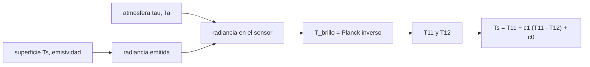

# B57-C21 — Sensores infrarrojos térmicos para observación terrestre

<!-- nav:top -->
[🏠 Programa](../../../../README.md) · [📚 Bloque B57](../../../tronco-comun/B57-observacion-terrestre-y-geociencias-orbitales.md) · [← Anterior: B57-C20 — Caso de estudio climático o geológico de Chile](../B57-C20-caso-de-estudio-climatico-o-geologico-de-chile/CLASE.md) · [Siguiente: B57-C22 — Espectrómetros de imagen e hiperespectrales →](../B57-C22-espectrometros-de-imagen-e-hiperespectrales/CLASE.md)
<!-- /nav -->

## 1. Ubicación, nivel y alcance

Clase 21 del bloque B57 (ampliación). La temperatura de la superficie se mide con sensores térmicos propios, en la región de 10–12 µm. Aquí inviertes la ley de Planck para obtener una temperatura de brillo, corriges la emisividad y aplicas el método de ventana dividida con dos bandas, que descuenta parte del efecto de la atmósfera. Las bandas térmicas de Landsat 8 (100 m) y la resolución de ECOSTRESS (70 m) son las de páginas consultadas; la atmósfera y las escenas son **sintéticas**.

## 2. Por qué esta clase existe

Una temperatura de superficie mal estimada engaña a quien estudia islas de calor, estrés hídrico, incendios o volcanes. La decisión central: **¿cuánto error introducen la atmósfera y la emisividad, y cómo se corrigen con dos bandas?**

## 3. Lo que podrás hacer al terminar

1. Convertir radiancia térmica en temperatura de brillo con Planck.
2. Corregir la emisividad y la radiancia reflejada del cielo.
3. Aplicar el método de ventana dividida y ajustar sus coeficientes.
4. Comparar el error de una banda y de dos bandas.
5. Reconocer que la emisividad mal conocida sesga la temperatura.

La evidencia es la **ficha de temperatura de superficie** del ejercicio 12 (sección 20).

## 4. Con qué llegas y cómo comprobarlo

1. ¿Qué dice la ley de Planck sobre la radiancia?
2. ¿Qué es la emisividad?
3. ¿Qué es la transmitancia atmosférica?
4. ¿Qué es una regresión lineal?
5. ¿Qué es un dato sintético?

<details>
<summary>Ver respuestas</summary>

1. Que crece con la temperatura y depende de la longitud de onda. 2. La fracción de la emisión de un cuerpo negro que emite un material. 3. La fracción de radiación que atraviesa la atmósfera. 4. Un ajuste de recta por mínimos cuadrados. 5. Uno generado por una fórmula.
</details>

Con cuatro o cinco aciertos, sigue; si no, repasa los prerrequisitos.

## 5. Un caso de contexto y casos de referencia

Las bandas térmicas 10 y 11 de Landsat 8 cubren `10,6–11,19` y `11,5–12,51 µm` con píxeles de `100 m`; ECOSTRESS entrega imágenes de temperatura y emisividad a `70 m`. Aquí usas `10,9` y `12,0 µm` como longitudes efectivas, emisividades `0,98` y `0,97` y una atmósfera **sintética**. Es el **ejemplo conductor**; los valores atmosféricos son **ilustrativos**.

## 6. Vocabulario

La **temperatura de brillo** `T_b` es la de un cuerpo negro que daría la misma radiancia. La **temperatura de superficie** `T_s` es la real, corregida por emisividad y atmósfera. La **ventana dividida** usa dos bandas contiguas para estimar el efecto atmosférico por su diferencia. La **radiancia reflejada del cielo** es la parte de la radiancia atmosférica que la superficie refleja `(1 − ε)`. La **temperatura de brillo** se invierte con Planck.

## 7. Modelo mental: medir la temperatura de una estufa a través de un vidrio empañado

La atmósfera es un vidrio levemente empañado que enfría la lectura; como empaña distinto en dos colores vecinos, la diferencia entre lecturas permite estimar y corregir el empañado.



*Descripción textual:* la superficie emite, la atmósfera absorbe y reemite, el sensor mide radiancia que se convierte en temperatura de brillo en dos bandas, y la diferencia entre ambas corrige el efecto atmosférico.

Analogía: leer un termómetro a través de un vidrio empañado: la diferencia entre dos lecturas con filtros distintos indica cuánto empaña. Límite: el modelo de una capa es una simplificación.

## 8. La explicación, paso a paso

### 8.1 Inversión de Planck

La inversión de la función de Planck recupera 300 K con error `0,0e+00 K`. La temperatura de brillo es la temperatura que daría un cuerpo negro con la radiancia medida.

### 8.2 Emisividad

Un suelo a 310 K con cielo a 250 K da `T_b = 309,073 K` si `ε = 0,98` y `306,252 K` si `ε = 0,92`; ignorar la emisividad subestima en `3,75 K`. Con la corrección `Ts = B⁻¹[(L − (1−ε) L_cielo)/ε]` se recupera 310 K en ambos casos (`310,0000` y `310,0000 K`). Si se usa `ε = 0,98` en un suelo de `0,92`, queda un error de `-2,86 K`.

### 8.3 Ventana dividida

Sobre 4000 escenas sintéticas, `T11` sola tiene sesgo `-6,00 K` y error rms `6,76 K`. Con `Ts = T11 + c1(T11 − T12) + c0` (`c1 = 1,742`, `c0 = -0,011`) el error rms baja a `0,46 K`.

### 8.4 Lectura

La ventana dividida corrige el efecto atmosférico solo si la emisividad es conocida y los coeficientes se ajustaron a atmósferas parecidas. Los coeficientes de esta clase pertenecen a la atmósfera sintética y no sirven para datos reales.

## 9. Magnitudes, símbolos y unidades

| Símbolo | Qué es | Unidad | Valor / nota |
|---|---|---|---|
| `B` | radiancia de Planck | W m⁻² sr⁻¹ m⁻¹ | — |
| `T_b` | temperatura de brillo | K | 309,07 (suelo 310 K, ε 0,98) |
| `ε` | emisividad | — | 0,98; 0,97 |
| `c₁` | coeficiente de ventana dividida | — | 1,742 (sintético) |
| rms | error de `T_s` | K | 6,76; 0,46 |

## 10. Convenciones y referencias

Longitudes de onda efectivas en µm; temperaturas en kelvin; emisividad conocida; atmósfera de una capa; sin radiancia solar reflejada (banda de 11 µm).

## 11. De dónde sale lo que afirmamos

| ID | Fuente | Localizador | Respalda | Estado |
|---|---|---|---|---|
| S1 | USGS, *Landsat 8 (bandas OLI y TIRS, barrido, órbita)* | https://www.usgs.gov/landsat-missions/landsat-8 | bandas 10 (10,6–11,19 µm) y 11 (11,5–12,51 µm) con píxeles de 100 m. | Consultada 2026-11-09 (primeros 100.000 de 143.802 caracteres) |
| S2 | NASA JPL, *ECOSTRESS* | https://ecostress.jpl.nasa.gov/ | imágenes de temperatura y emisividad de la superficie a 70 m, a bordo de la ISS. | Consultada 2026-11-09 |

**Límites de las fuentes.** La página de ECOSTRESS no daba número ni longitudes de onda de las bandas. Los coeficientes de la ventana dividida no se comparan con los de la literatura (no consultada); emisividades y atmósfera son ilustrativas.

## 12. Cómo ver los resultados

| Magnitud | Valor |
|---|---|
| subestimación por ignorar `ε = 0,92` | 3,75 K |
| rms de T11 sola / ventana dividida | 6,76 / 0,46 K |
| coeficientes (c₀, c₁) | -0,011, 1,742 |

Descripción larga: la emisividad sesga la temperatura en kelvin enteros y la ventana dividida reduce el error atmosférico a menos de un kelvin.

## 13. Ejemplo trabajado: la corrección de emisividad

**Paso 1 · Radiancia medida.** `L = ε B(310 K) + (1−ε) B(250 K)`.

**Paso 2 · Quitar el cielo reflejado.** `L − (1−ε) B(250 K)`.

**Paso 3 · Dividir por `ε` e invertir Planck.** Resultado: `310,000 K`.

## 14. Distintas formas de abordar el problema

**Por una banda:** simple pero sesgada. **Por ventana dividida:** corrige la atmósfera con dos bandas. **Por separación de temperatura y emisividad:** requiere más bandas. Cada una exige más información.

## 15. Práctica guiada

**Ejercicio 1 · con los pasos indicados.** ¿Qué temperatura de brillo da un cuerpo negro con la radiancia de uno a 300 K? *Pasos:* inversión.

<details><summary>Solución comentada</summary>

`300 K`.
</details>

**Ejercicio 2 · con una pista.** Un suelo con `ε = 0,92` se mide como si fuera cuerpo negro. ¿Cuánto se subestima? Usa 8.2.

<details><summary>Solución comentada</summary>

`3,75 K`.
</details>

**Ejercicio 3 · casi autónomo.** ¿Para qué sirve el término `(1−ε) L_cielo`?

<details><summary>Solución comentada</summary>

Para quitar la radiancia atmosférica reflejada por la superficie.
</details>

## 16. Práctica autónoma, transferencia e integrador

**Ejercicio 4.** ¿Por qué la ventana dividida usa dos bandas?

<details><summary>Solución comentada</summary>

Porque la atmósfera absorbe distinto en cada banda y la diferencia mide cuánto.
</details>

**Ejercicio 5.** Si `T11 − T12 = 2 K` y `c1 = 1,74`, ¿cuánto vale la corrección?

<details><summary>Solución comentada</summary>

`1,74 × 2 + c0`, de unos 3 K con los coeficientes de la clase.
</details>

**Ejercicio 6.** ¿Qué pasa si hay más vapor de agua (mayor `w`)?

<details><summary>Solución comentada</summary>

Baja la transmitancia, aumenta la diferencia `T11 − T12` y la corrección crece.
</details>

**Ejercicio 7.** ¿Qué error resulta de ignorar la emisividad con 0,92? Compara con el rms de la ventana dividida.

<details><summary>Solución comentada</summary>

`3,75 K`, mayor que el rms de la ventana dividida (`0,46 K`).
</details>

**Ejercicio 8.** Explica por qué los coeficientes no se pueden usar con datos reales.

<details><summary>Solución comentada</summary>

Se ajustaron a una atmósfera sintética; los reales exigen su propio ajuste con perfiles atmosféricos.
</details>

**Ejercicio 9 · transferencia.** **Transferencia.** Mides la temperatura de una ciudad con píxeles de 100 m. ¿Qué advertencias das?

<details><summary>Solución comentada</summary>

Declarar la emisividad usada, la fecha y hora, que es temperatura de superficie y no del aire, y el error del método.
</details>

**Ejercicio 10 · transferencia.** **Transferencia.** ¿Qué diferencia hay entre temperatura de brillo y del aire?

<details><summary>Solución comentada</summary>

La primera es radiométrica de la superficie; la segunda es la del aire a 2 m, que difiere según el balance de energía.
</details>

**Ejercicio 11 · transferencia.** **Transferencia.** ¿Qué datos reales harían falta para validar este método?

<details><summary>Solución comentada</summary>

Productos de temperatura con procedencia y mediciones in situ con radiómetros en superficies conocidas.
</details>

**Ejercicio 12 · integrador.** **Integrador.** Elabora tu *ficha de temperatura de superficie*: la tabla de temperatura de brillo con y sin corrección de emisividad y la comparación de errores de una y dos bandas.

<details><summary>Solución modelo</summary>

Secciones 8.1 a 8.3 con las cifras de la ejecución, rotulando la atmósfera como sintética.
</details>

## 17. Laboratorio: temperatura de brillo, emisividad y ventana dividida

El script [termico.py](termico.py) invierte Planck, corrige la emisividad y ajusta el método de ventana dividida sobre escenas sintéticas (**comprueba** la inversión de Planck a 1e-6 K, la corrección de emisividad y que la ventana dividida baja el error rms por debajo de 1,5 K).

**Datos:** bandas de Landsat 8 y resolución de ECOSTRESS publicadas (S1, S2); atmósfera y emisividades **sintéticas / ilustrativas**. **Predice antes de ejecutar:** ¿cuántos kelvin subestima ignorar `ε = 0,92`? (unos 3,7.) **Ejecución del 2026-11-09 (Python 3.12.9):**

```text
Python 3.12.9 ; numpy 2.4.4
Inversion de Planck: error = 0.0e+00 K
Suelo a 310 K con cielo a 250 K: T_brillo (eps 0.98) = 309.073 K ; T_brillo (eps 0.92) = 306.252 K ; subestimacion por eps 0.92 = 3.748 K
Con correccion de emisividad: eps 0.98 -> 310.0000 K ; eps 0.92 -> 310.0000 K ; error si se usa eps 0.98 con un suelo de 0.92 = -2.859 K
Ventana dividida (4000 escenas): sesgo de T11 = -6.00 K ; rms T11 sola = 6.76 K ; rms ventana dividida = 0.46 K ; c0 = -0.011 ; c1 = 1.742
Pruebas superadas.
```

```bash
python programa/clases/B57/B57-C21-sensores-infrarrojos-termicos-para-observacion-terrestre/termico.py
```

**Límites:** atmósfera de una capa, emisividad conocida y sin radiancia solar.

## 18. Errores frecuentes y cómo corregirlos

**Confundir temperatura de brillo con temperatura real.** Se corrige con 8.2.

**Usar coeficientes de otra atmósfera.** Se corrige con 8.4.

**Ignorar la radiancia del cielo reflejada.** Se corrige con 8.2.

**Presentar las escenas como observadas.** Son sintéticas (sección 5).

## 19. Cómo sabrás que vas bien

Tras la sección 8: ¿qué resultado esperabas y cuál obtuviste? Si dudas, repasa el ejemplo 13. Tras el laboratorio: ¿qué comprueba? (ver la sección 17).

## 20. Qué entregas y cómo se evalúa

El producto es tu **ficha de temperatura de superficie** (ejercicio 12).

| Criterio | Inicial | En desarrollo | Logrado | Destacado |
|---|---|---|---|---|
| Conceptos | Los confunde | Parciales | Conceptos de la clase | Explica los límites |
| Cálculo | Sin unidades | Con errores | Tablas completas con unidades | Calcula casos nuevos |
| Numérico | Sin comprobar | Un caso | Contraste con el caso analítico | Interpreta las diferencias |
| Fuentes | Sin fuente | Sin fecha | Fuentes con fecha | Declara lo no consultado |
| Límites | No los nombra | Uno | Tres | Discute qué falta del modelo |

**Condiciones críticas (no se compensan con promedio):** rotular la atmósfera como sintética; no usar los coeficientes con datos reales; citar solo lo consultado.

## 21. Ética, seguridad y límites

Clase educativa: no se estima la temperatura de ninguna ciudad real. Accesibilidad: tablas equivalentes a las gráficas, fórmulas en texto, ejercicios sin conexión.

## 22. Para cerrar y seguir

Ignorar la emisividad cuesta `3,7 K` y la ventana dividida deja un error de `0,5 K` frente a `6,8 K` con una sola banda. Queda una pregunta: ¿qué se gana con cientos de bandas?

**Glosario español–inglés.** temperatura de brillo · *brightness temperature*; emisividad · *emissivity*; ventana dividida · *split window*; temperatura de superficie · *land surface temperature (LST)*; infrarrojo térmico · *thermal infrared (TIR)*.

**Continuidad.** [B57-C22](../B57-C22-espectrometros-de-imagen-e-hiperespectrales/CLASE.md) estudia espectrómetros de imagen e hiperespectrales.

**Referencias:** ver sección 11.

<!-- nav:bottom -->
---

[← Anterior: B57-C20 — Caso de estudio climático o geológico de Chile](../B57-C20-caso-de-estudio-climatico-o-geologico-de-chile/CLASE.md) · [📚 Bloque B57](../../../tronco-comun/B57-observacion-terrestre-y-geociencias-orbitales.md) · [Siguiente: B57-C22 — Espectrómetros de imagen e hiperespectrales →](../B57-C22-espectrometros-de-imagen-e-hiperespectrales/CLASE.md)
<!-- /nav -->
