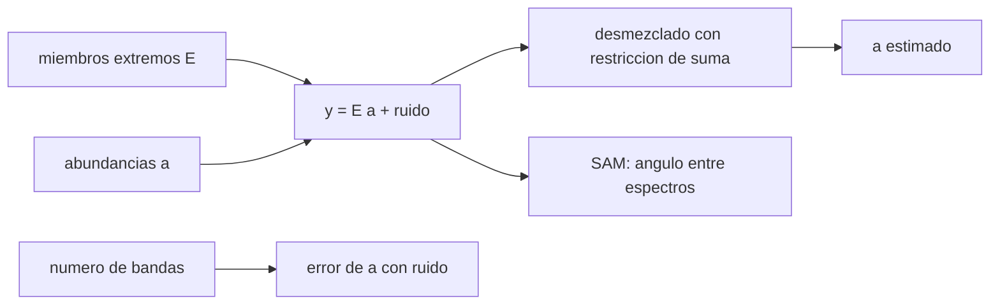

# B57-C22 — Espectrómetros de imagen e hiperespectrales

<!-- nav:top -->
[🏠 Programa](../../../../README.md) · [📚 Bloque B57](../../../tronco-comun/B57-observacion-terrestre-y-geociencias-orbitales.md) · [← Anterior: B57-C21 — Sensores infrarrojos térmicos para observación terrestre](../B57-C21-sensores-infrarrojos-termicos-para-observacion-terrestre/CLASE.md) · [Siguiente: B57-C23 — Diseño de órbita y revisita para observación terrestre →](../B57-C23-diseno-de-orbita-y-revisita-para-observacion-terrestre/CLASE.md)
<!-- /nav -->

## 1. Ubicación, nivel y alcance

Clase 22 del bloque B57 (ampliación). Un espectrómetro de imagen registra un espectro continuo en cada píxel, con cientos de bandas, en lugar de las pocas bandas de un sensor multiespectral. Eso permite identificar minerales o vegetación por sus rasgos de absorción. Aquí mides la similitud de espectros con el ángulo espectral, desmezclas un píxel en tres componentes y calculas el flujo de datos. De EMIT solo se consultó que es un espectrómetro de imagen en la ISS con un campo de 72 km y más de 100 000 espectros por segundo; los espectros son **sintéticos**.

## 2. Por qué esta clase existe

Dos materiales distintos pueden parecer iguales en cuatro bandas anchas y diferenciarse en cientos de bandas estrechas. La decisión central: **¿cuándo vale la pena el costo en datos de un sensor hiperespectral y cómo se separa una mezcla de materiales?**

## 3. Lo que podrás hacer al terminar

1. Describir un cubo hiperespectral y su flujo de datos.
2. Calcular el ángulo espectral entre dos espectros y su invariancia al brillo.
3. Desmezclar un píxel con mínimos cuadrados con restricción de suma.
4. Medir el error de la abundancia con ruido.
5. Comparar el error de abundancia con 200 y con 4 bandas.

La evidencia es la **ficha de espectrometría de imagen** del ejercicio 12 (sección 20).

## 4. Con qué llegas y cómo comprobarlo

1. ¿Qué es un espectro?
2. ¿Qué es un producto escalar?
3. ¿Qué es una mezcla lineal?
4. ¿Qué es un número de condición?
5. ¿Qué es un dato sintético?

<details>
<summary>Ver respuestas</summary>

1. Un conjunto de valores de reflectancia por longitud de onda. 2. La suma de productos de componentes de dos vectores. 3. Un promedio ponderado de componentes. 4. Una medida de cuánto amplifica un sistema el ruido. 5. Uno generado por una fórmula.
</details>

Con cuatro o cinco aciertos, sigue; si no, repasa los prerrequisitos.

## 5. Un caso de contexto y casos de referencia

Un píxel contiene `50 %` de arcilla, `30 %` de hematita y `20 %` de vegetación (**sintético**). Los tres espectros extremos son inventados, con rasgos de absorción gaussianos en 200 bandas entre `0,4` y `2,5 µm` (**ilustrativo**). Es el **ejemplo conductor**; no son espectros de una biblioteca.

## 6. Vocabulario

El **cubo hiperespectral** tiene dos dimensiones espaciales y una espectral. Un **miembro extremo** es el espectro de un material puro. El **desmezclado lineal** estima las **abundancias** de cada miembro. El **ángulo espectral** (SAM) es el ángulo entre dos espectros vistos como vectores; no cambia si un espectro se multiplica por un factor. El **número de condición** mide la sensibilidad al ruido del problema.

## 7. Modelo mental: reconocer una mezcla de pinturas por su color exacto

Un pintor reconoce una mezcla por su matiz; el espectrómetro reconoce cada material por cientos de matices y puede estimar cuánto hay de cada uno.



*Descripción textual:* el espectro del píxel es una combinación de miembros extremos con ruido; el desmezclado estima las abundancias y el número de bandas fija cuánto ruido se transmite.

Analogía: descomponer un color mezclado en sus pinturas base. Límite: las mezclas reales son no lineales cuando hay granos finos o múltiples reflexiones.

## 8. La explicación, paso a paso

### 8.1 Comparar espectros

El ángulo espectral entre arcilla y hematita es `9,78°`, entre arcilla y vegetación `19,92°` y entre hematita y vegetación `14,52°`. Multiplicar un espectro por 3,7 no cambia su ángulo (`1,5e-08 rad`): SAM es insensible al brillo.

### 8.2 Desmezclar

Sin ruido, el desmezclado con suma 1 recupera las abundancias con error `4,7e-15`. Con ruido de `0,005` el error rms de la abundancia es `0,0030` y el sesgo máximo `4,2e-05` (2000 ensayos).

### 8.3 Cuántas bandas

Con solo 4 bandas anchas (0,48; 0,56; 0,66; 0,86 µm) y el mismo ruido por banda, el error rms de la abundancia es `0,0166`, es decir, `5,5` veces el de 200 bandas (`0,0030`). Con pocas bandas, materiales de espectros parecidos se separan peor porque se promedia menos ruido y hay menos rasgos que los distingan.

### 8.4 Flujo de datos

Con 100 000 espectros por segundo, 285 bandas y 2 bytes (valores ilustrativos), el flujo bruto sería `57 MB/s`, o `4,9 TB/día` si se grabara sin pausa. Por eso un hiperespectral graba solo sobre objetivos y comprime a bordo. Esas cifras no son las de EMIT.

## 9. Magnitudes, símbolos y unidades

| Símbolo | Qué es | Unidad | Valor / nota |
|---|---|---|---|
| `y` | espectro del píxel | reflectancia | 200 bandas |
| `a` | abundancias | — | 0,5; 0,3; 0,2 (sintéticas) |
| `SAM` | ángulo espectral | ° | 9,78 (arcilla–hematita) |
| rms | error de abundancia con ruido | — | 0,0030 (200 bandas); 0,0166 (4) |
| flujo | tasa de datos | MB/s | 57 (ilustrativo) |

## 10. Convenciones y referencias

Reflectancia de superficie en [0, 1]; longitudes de onda en µm; mezcla lineal con suma de abundancias igual a 1 y sin restricción de no negatividad; ruido gaussiano independiente por banda.

## 11. De dónde sale lo que afirmamos

| ID | Fuente | Localizador | Respalda | Estado |
|---|---|---|---|---|
| S1 | NASA JPL, *EMIT* | https://earth.jpl.nasa.gov/emit/ | espectrómetro de imagen en la Estación Espacial Internacional, más de 100 000 espectros por segundo y campo de 72 km. | Consultada 2026-11-09 (sin rango espectral ni resolución en la página) |

**Límites de las fuentes.** La página de EMIT no daba el rango espectral, el muestreo ni la resolución espacial, por lo que no se usan como publicadas. Las 285 bandas y los espectros son ilustrativos o inventados.

## 12. Cómo ver los resultados

| Magnitud | Valor |
|---|---|
| SAM arcilla–hematita | 9,78° |
| rms de abundancia con ruido | 0,0030 |
| error de abundancia 200 / 4 bandas | 0,0030 / 0,0166 |
| flujo bruto ilustrativo | 57 MB/s |

Descripción larga: el SAM no cambia con el brillo y con pocas bandas el error de abundancia crece varias veces.

## 13. Ejemplo trabajado: el ángulo espectral

**Paso 1 · Vectores.** `x` e `y` son los espectros de 200 bandas.

**Paso 2 · Coseno.** `cos θ = x·y/(|x||y|)`.

**Paso 3 · Ángulo.** Arcilla–hematita: `9,78°`.

## 14. Distintas formas de abordar el problema

**Por bandas anchas:** pocas, baratas. **Por bandas estrechas:** más información y más datos. **Por SAM:** compara forma. **Por desmezclado:** estima proporciones. Cada una responde una pregunta distinta.

## 15. Práctica guiada

**Ejercicio 1 · con los pasos indicados.** ¿Cuántas bandas tiene el cubo sintético? *Pasos:* ve la sección 5.

<details><summary>Solución comentada</summary>

200.
</details>

**Ejercicio 2 · con una pista.** ¿Cuál es el SAM de un espectro consigo mismo multiplicado por 2?

<details><summary>Solución comentada</summary>

0°.
</details>

**Ejercicio 3 · casi autónomo.** Calcula el flujo de `10⁵` espectros/s con 200 bandas de 2 bytes. *Pista:* producto.

<details><summary>Solución comentada</summary>

`40 MB/s`.
</details>

## 16. Práctica autónoma, transferencia e integrador

**Ejercicio 4.** Si las abundancias deben sumar 1 y dos valen 0,5 y 0,3, ¿cuánto vale la tercera?

<details><summary>Solución comentada</summary>

0,2.
</details>

**Ejercicio 5.** ¿Por qué el desmezclado sin ruido es exacto?

<details><summary>Solución comentada</summary>

Porque `y = E a` y `E` tiene columnas independientes: la solución de mínimos cuadrados es única.
</details>

**Ejercicio 6.** ¿Qué ocurre con el error de abundancia si se pasa de 200 a 4 bandas con el mismo ruido?

<details><summary>Solución comentada</summary>

Crece `5,5` veces (8.3).
</details>

**Ejercicio 7.** Explica por qué SAM no distingue dos materiales con la misma forma pero distinto brillo.

<details><summary>Solución comentada</summary>

Porque normaliza por la longitud del vector: ignora la amplitud.
</details>

**Ejercicio 8.** ¿Qué falta para reconocer minerales reales con este método?

<details><summary>Solución comentada</summary>

Una biblioteca espectral con procedencia, corrección atmosférica y validación.
</details>

**Ejercicio 9 · transferencia.** **Transferencia.** Un lago con sedimentos cambia de color. ¿Sirve la mezcla lineal?

<details><summary>Solución comentada</summary>

Con cuidado: el agua y los sedimentos mezclan de modo no lineal; hay que validar el modelo.
</details>

**Ejercicio 10 · transferencia.** **Transferencia.** Una misión pide mapear arcillas con 5 % de error de abundancia. ¿Qué consideras?

<details><summary>Solución comentada</summary>

Número de bandas, relación señal–ruido, condicionamiento de los miembros y calibración; no basta la cantidad de bandas.
</details>

**Ejercicio 11 · transferencia.** **Transferencia.** ¿Qué consecuencia tiene el flujo de datos para una misión?

<details><summary>Solución comentada</summary>

Obliga a grabar solo objetivos y a comprimir a bordo.
</details>

**Ejercicio 12 · integrador.** **Integrador.** Elabora tu *ficha de espectrometría de imagen*: la tabla de SAM entre los tres miembros, el error de desmezclado sin y con ruido y la comparación entre 200 y 4 bandas.

<details><summary>Solución modelo</summary>

Secciones 8.1 a 8.3 con las cifras de la ejecución, rotulando los espectros como sintéticos y el flujo como ilustrativo.
</details>

## 17. Laboratorio: ángulo espectral, desmezclado y flujo de datos

El script [hiperespectral.py](hiperespectral.py) calcula ángulos espectrales, desmezcla un píxel con restricción de suma, mide el error con ruido con 200 y 4 bandas (**comprueba** las abundancias exactas sin ruido a 1e-9 la invariancia de SAM al factor de escala y que 4 bandas dan más de 3 veces el error).

**Datos:** hechos de EMIT consultados (S1); espectros, bandas y flujo **sintéticos / ilustrativos**. **Predice antes de ejecutar:** ¿qué error de abundancia será mayor, con 200 bandas o con 4? (con 4.) **Ejecución del 2026-11-09 (Python 3.12.9):**

```text
Python 3.12.9 ; numpy 2.4.4
Desmezclado sin ruido: error maximo de abundancia = 4.7e-15
SAM: invariancia al factor de escala = 1.5e-08 rad ; arcilla-hematita = 9.78 deg ; arcilla-vegetacion = 19.92 deg ; hematita-vegetacion = 14.52 deg
Con ruido 0.005 (2000 ensayos): rms de abundancia = 0.0030 ; sesgo maximo = 4.2e-05
Con 4 bandas anchas y el mismo ruido: rms de abundancia = 0.0166 (5.5 veces el de 200 bandas)
Flujo ilustrativo: 100000 espectros/s x 285 bandas x 2 bytes = 57 MB/s = 4.9 TB/dia (si se grabara de forma continua)
Pruebas superadas.
```

```bash
python programa/clases/B57/B57-C22-espectrometros-de-imagen-e-hiperespectrales/hiperespectral.py
```

**Límites:** mezcla lineal, sin atmósfera y con miembros conocidos.

## 18. Errores frecuentes y cómo corregirlos

**Tomar SAM como medida de abundancia.** Mide forma, no proporción.

**Olvidar la restricción de suma.** Se incluye con un multiplicador (8.2).

**Pensar que más bandas siempre mejoran.** Depende del ruido y de los miembros (8.3).

**Presentar los espectros como reales.** Son inventados (sección 5).

## 19. Cómo sabrás que vas bien

Tras la sección 8: ¿qué resultado esperabas y cuál obtuviste? Si dudas, repasa el ejemplo 13. Tras el laboratorio: ¿qué comprueba? (ver la sección 17).

## 20. Qué entregas y cómo se evalúa

El producto es tu **ficha de espectrometría de imagen** (ejercicio 12).

| Criterio | Inicial | En desarrollo | Logrado | Destacado |
|---|---|---|---|---|
| Conceptos | Los confunde | Parciales | Conceptos de la clase | Explica los límites |
| Cálculo | Sin unidades | Con errores | Tablas completas con unidades | Calcula casos nuevos |
| Numérico | Sin comprobar | Un caso | Contraste con el caso analítico | Interpreta las diferencias |
| Fuentes | Sin fuente | Sin fecha | Fuentes con fecha | Declara lo no consultado |
| Límites | No los nombra | Uno | Tres | Discute qué falta del modelo |

**Condiciones críticas (no se compensan con promedio):** rotular los espectros como sintéticos; no usar cifras de EMIT que la página no traía; citar solo lo consultado.

## 21. Ética, seguridad y límites

Clase educativa: no se mapea ningún mineral real. Accesibilidad: tablas equivalentes a las gráficas, fórmulas en texto, ejercicios sin conexión.

## 22. Para cerrar y seguir

El ruido de `0,005` produce un error de abundancia de `0,003` y con solo 4 bandas anchas el error es `5,5` veces mayor. Queda una pregunta: ¿cómo se elige la órbita que permite ver cada lugar cuando se necesita?

**Glosario español–inglés.** espectrómetro de imagen · *imaging spectrometer*; hiperespectral · *hyperspectral*; miembro extremo · *endmember*; desmezclado espectral · *spectral unmixing*; ángulo espectral · *spectral angle mapper (SAM)*.

**Continuidad.** [B57-C23](../B57-C23-diseno-de-orbita-y-revisita-para-observacion-terrestre/CLASE.md) estudia diseño de órbita y revisita para observación terrestre.

**Referencias:** ver sección 11.

<!-- nav:bottom -->
---

[← Anterior: B57-C21 — Sensores infrarrojos térmicos para observación terrestre](../B57-C21-sensores-infrarrojos-termicos-para-observacion-terrestre/CLASE.md) · [📚 Bloque B57](../../../tronco-comun/B57-observacion-terrestre-y-geociencias-orbitales.md) · [Siguiente: B57-C23 — Diseño de órbita y revisita para observación terrestre →](../B57-C23-diseno-de-orbita-y-revisita-para-observacion-terrestre/CLASE.md)
<!-- /nav -->
