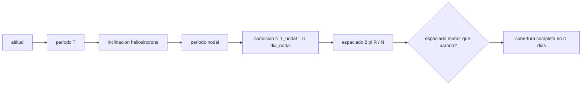

# B57-C23 — Diseño de órbita y revisita para observación terrestre

<!-- nav:top -->
[🏠 Programa](../../../../README.md) · [📚 Bloque B57](../../../tronco-comun/B57-observacion-terrestre-y-geociencias-orbitales.md) · [← Anterior: B57-C22 — Espectrómetros de imagen e hiperespectrales](../B57-C22-espectrometros-de-imagen-e-hiperespectrales/CLASE.md) · [Siguiente: B57-C24 — Diseño de una carga útil de observación terrestre →](../B57-C24-diseno-de-una-carga-util-de-observacion-terrestre/CLASE.md)
<!-- /nav -->

## 1. Ubicación, nivel y alcance

Clase 23 del bloque B57 (ampliación). Con qué frecuencia un satélite vuelve a pasar por un lugar depende de su órbita y de su ancho de barrido. Aquí calculas la inclinación de una órbita heliosíncrona (que mantiene la hora local de paso), el periodo orbital, las condiciones de traza repetida y el espaciado entre trazas, y las contrastas con las cifras publicadas de Sentinel-1 (altitud, inclinación, periodo, ciclo de 175 órbitas en 12 días) y de Landsat 8, consultadas.

## 2. Por qué esta clase existe

Si la órbita no repite sus trazas o el barrido no cubre el espacio entre ellas, quedan huecos. La decisión central: **¿qué altitud e inclinación dan un ciclo de repetición que cubre todo con el barrido disponible?**

## 3. Lo que podrás hacer al terminar

1. Calcular la inclinación heliosíncrona para una altitud.
2. Calcular el periodo orbital y el periodo nodal.
3. Hallar la altitud de una traza repetida `N/D` por bisección.
4. Calcular el espaciado entre trazas en el ecuador y compararlo con el barrido.
5. Contrastar los resultados con las cifras publicadas de Sentinel-1.

La evidencia es la **ficha del diseño de órbita** del ejercicio 12 (sección 20).

## 4. Con qué llegas y cómo comprobarlo

1. ¿Qué es el periodo orbital?
2. ¿Qué es la precesión nodal?
3. ¿Qué es una órbita heliosíncrona?
4. ¿Qué es una traza en el suelo?
5. ¿Qué es una bisección?

<details>
<summary>Ver respuestas</summary>

1. El tiempo de una vuelta; crece con la altitud. 2. El giro lento del plano orbital por el achatamiento terrestre. 3. Una órbita cuyo plano gira un grado al día, igual que el Sol aparente, y mantiene la hora local de paso. 4. El camino del punto subsatélite sobre la Tierra. 5. Un método que parte un intervalo a la mitad para hallar una raíz.
</details>

Con cuatro o cinco aciertos, sigue; si no, repasa los prerrequisitos.

## 5. Un caso de contexto y casos de referencia

Sentinel-1 vuela a `693 km` con inclinación `98,18°`, periodo `98,6 min` y repite su traza tras `175` órbitas en `12` días; su modo IW tiene `250 km` de barrido (todo consultado). Landsat 8 vuela a `705 km` con barrido de `185 km` y ciclo de `16` días (consultado). Es el **ejemplo conductor**; las constantes de la Tierra son **valores de referencia no consultados**.

## 6. Vocabulario

La **órbita heliosíncrona** tiene inclinación cercana a 98° para que la precesión nodal compense el movimiento anual del Sol. El **periodo nodal** es el tiempo entre dos pasos por el nodo ascendente. La **traza repetida** `N/D` significa `N` órbitas en `D` días. El **espaciado entre trazas** en el ecuador es `2πR/N`. La **revisita** es el intervalo entre observaciones de un punto, que puede ser menor que el ciclo si los barridos se solapan o hay varios satélites.

## 7. Modelo mental: surcos de un arado en un campo que gira

El satélite traza surcos sobre una Tierra que gira; tras `D` días el arado vuelve a empezar sobre los mismos surcos. Si los surcos están más cerca que el ancho de la franja, no queda nada sin arar.



*Descripción textual:* la altitud fija el periodo y la inclinación heliosíncrona; la condición de repetición fija el número de órbitas por ciclo; el espaciado entre trazas se compara con el barrido.

Analogía: arar un campo en franjas que giran: si las franjas se superponen, cubres todo. Límite: el modelo es de órbita circular con solo la perturbación J2.

## 8. La explicación, paso a paso

### 8.1 Heliosíncrona

A 693 km, la inclinación que hace que el plano gire 360° al año es `98,159°` (publicada: 98,18°). El periodo kepleriano es `98,63 min` (publicado: 98,6 min). A 705 km, la inclinación es `98,208°`.

### 8.2 Traza repetida

Para `175` órbitas en `12` días, el periodo nodal es `98,746 min` (con día nodal relativo de `24,0000 h`) y la altitud calculada es `692,8 km` (publicada: 693 km). El espaciado entre trazas en el ecuador es `229,0 km`, menor que los 250 km del modo IW: el barrido cubre todo el ecuador en 12 días.

### 8.3 Una hipótesis para Landsat

Si Landsat 8 repitiera 233 órbitas en 16 días (esta cifra **no se consultó**; es una hipótesis de la clase), la altitud de traza repetida sería `699,6 km` y el espaciado `172,0 km`, menor que el barrido de 185 km. Sirve para ver el método, no para afirmar los parámetros de la misión.

### 8.4 Lectura

La revisita real es menor que el ciclo si los barridos de trazas vecinas se solapan en latitudes altas o si hay varios satélites. Mantener la altitud exige maniobras para compensar el arrastre y conservar las trazas.

## 9. Magnitudes, símbolos y unidades

| Símbolo | Qué es | Unidad | Valor / nota |
|---|---|---|---|
| `i` | inclinación heliosíncrona | ° | 98,159 (693 km) |
| `T` | periodo orbital | min | 98,63 |
| `N/D` | órbitas por días del ciclo | — | 175/12 |
| `Δx` | espaciado de trazas | km | 229,0 |
| `W` | barrido | km | 250 (IW, publicado) |

## 10. Convenciones y referencias

Órbita circular; precesión secular de `J2`; días en SI; constantes de referencia no consultadas (GM, R, J2, año tropico). Espaciado calculado en el ecuador con Tierra esférica.

## 11. De dónde sale lo que afirmamos

| ID | Fuente | Localizador | Respalda | Estado |
|---|---|---|---|---|
| S1 | Copernicus, SentiWiki, *Sentinel-1 mission* | https://sentiwiki.copernicus.eu/web/s1-mission | altitud de 693 km, inclinación de 98,18°, periodo de 98,6 min, ciclo de 175 órbitas en 12 días y barrido de 250 km del modo IW. | Consultada 2026-11-09 |
| S2 | USGS, *Landsat 8 (bandas OLI y TIRS, barrido, órbita)* | https://www.usgs.gov/landsat-missions/landsat-8 | altitud de 705 km, barrido de 185 km y ciclo de 16 días. | Consultada 2026-11-09 (primeros 100.000 de 143.802 caracteres) |

**Límites de las fuentes.** Las constantes de la Tierra (GM, R, J2) no se consultaron en la sesión. El número de órbitas por ciclo de Landsat 8 no se consultó y se trata como hipótesis. El modelo no incluye excentricidad ni arrastre.

## 12. Cómo ver los resultados

| Magnitud | Valor |
|---|---|
| inclinación heliosíncrona a 693 km | 98,159° (publicada 98,18°) |
| altitud de traza repetida 175/12 | 692,8 km (publicada 693) |
| espaciado de trazas | 229,0 km |
| barrido IW | 250 km |

Descripción larga: el cálculo reproduce la inclinación y la altitud publicadas, y el espaciado entre trazas queda por debajo del barrido.

## 13. Ejemplo trabajado: el espaciado entre trazas

**Paso 1 · Circunferencia.** `2πR = 40 075 km`.

**Paso 2 · Órbitas.** `N = 175`.

**Paso 3 · Espaciado.** `40 075/175 = 229,0 km`.

## 14. Distintas formas de abordar el problema

**Por inclinación:** heliosíncrona. **Por ciclo:** `N/D`. **Por barrido:** cobertura. **Por constelación:** menor revisita con más satélites. Cada una acorta o ajusta el intervalo.

## 15. Práctica guiada

**Ejercicio 1 · con los pasos indicados.** ¿Cuál es el espaciado entre trazas con `N = 233`? *Pasos:* `40 075/N`.

<details><summary>Solución comentada</summary>

`172,0 km`.
</details>

**Ejercicio 2 · con una pista.** ¿Cumple 185 km de barrido? Usa el ejercicio 1.

<details><summary>Solución comentada</summary>

Sí: 172 < 185.
</details>

**Ejercicio 3 · casi autónomo.** ¿Cuántos días tardan en repetirse las trazas de 175 órbitas en 12 días en órbitas por día?

<details><summary>Solución comentada</summary>

`175/12 = 14,58` órbitas por día.
</details>

## 16. Práctica autónoma, transferencia e integrador

**Ejercicio 4.** Si se agrega un satélite idéntico desfasado medio ciclo, ¿qué pasa con la revisita?

<details><summary>Solución comentada</summary>

Se reduce a la mitad: 6 días en el caso de Sentinel-1 (S1).
</details>

**Ejercicio 5.** ¿Por qué la inclinación heliosíncrona es mayor que 90°?

<details><summary>Solución comentada</summary>

Porque debe ser retrógrada para que el plano precese en el sentido del movimiento del Sol.
</details>

**Ejercicio 6.** ¿Qué pasa con la inclinación si sube la altitud?

<details><summary>Solución comentada</summary>

Aumenta ligeramente: de 98,16° (693 km) a 98,21° (705 km).
</details>

**Ejercicio 7.** ¿Por qué el periodo nodal difiere del kepleriano?

<details><summary>Solución comentada</summary>

Por las correcciones de `J2` sobre el movimiento medio y la precesión del argumento del perigeo.
</details>

**Ejercicio 8.** Explica por qué mantener las trazas exige maniobras.

<details><summary>Solución comentada</summary>

El arrastre atmosférico baja la altitud y cambia el periodo; hay que corregirlo para conservar el ciclo.
</details>

**Ejercicio 9 · transferencia.** **Transferencia.** Se quiere revisita diaria con barrido de 250 km. ¿Qué estrategias hay?

<details><summary>Solución comentada</summary>

Una constelación, órbitas distintas o un barrido mayor; con un satélite y 250 km no basta.
</details>

**Ejercicio 10 · transferencia.** **Transferencia.** Un incendio evoluciona en horas. ¿Basta un satélite de órbita baja heliosíncrona?

<details><summary>Solución comentada</summary>

No: pasa pocas veces al día; se necesita una constelación o un sensor geoestacionario.
</details>

**Ejercicio 11 · transferencia.** **Transferencia.** ¿Qué datos faltan para diseñar una órbita real?

<details><summary>Solución comentada</summary>

Un modelo de fuerzas completo, restricciones de lanzamiento, hora de paso y requisitos de cobertura con su fuente.
</details>

**Ejercicio 12 · integrador.** **Integrador.** Elabora tu *ficha del diseño de órbita*: la tabla de inclinación, periodo, altitud de traza repetida y espaciado frente al barrido, con las cifras publicadas.

<details><summary>Solución modelo</summary>

Secciones 8.1 a 8.3 con las cifras de la ejecución, rotulando la hipótesis de Landsat como no consultada.
</details>

## 17. Laboratorio: órbita heliosíncrona, trazas repetidas y espaciado

El script [orbita.py](orbita.py) calcula la inclinación heliosíncrona, el periodo, la altitud de traza repetida y el espaciado de trazas y los contrasta con las cifras publicadas (**comprueba** la inclinación frente a 98,18° (0,05°), el periodo frente a 98,6 min (0,1 min) y la altitud de 175/12 frente a 693 km (5 km)).

**Datos:** cifras de Sentinel-1 y Landsat 8 consultadas (S1, S2); constantes de la Tierra de referencia no consultadas. **Predice antes de ejecutar:** ¿cuánto da la altitud de la traza repetida 175/12? (cerca de 693 km.) **Ejecución del 2026-11-09 (Python 3.12.9):**

```text
Python 3.12.9 (biblioteca estandar)
Heliosincrona a 693 km: inclinacion = 98.159 grados (publicada: 98.18) ; periodo kepleriano = 98.63 min (publicado: 98.6)
Heliosincrona a 705 km: inclinacion = 98.208 grados
Periodo nodal a 693 km = 98.746 min ; dia nodal relativo = 24.0000 h
Traza repetida 175 orbitas / 12 dias: altitud = 692.8 km (publicada: 693) ; espaciado en el ecuador = 229.0 km (barrido IW 250 km: cubre = True)
Traza repetida 233 orbitas / 16 dias (hipotesis, no consultada): altitud = 699.6 km ; espaciado = 172.0 km (barrido 185 km: cubre = True)
Pruebas superadas.
```

```bash
python programa/clases/B57/B57-C23-diseno-de-orbita-y-revisita-para-observacion-terrestre/orbita.py
```

**Límites:** órbita circular con solo `J2` secular; Tierra esférica.

## 18. Errores frecuentes y cómo corregirlos

**Confundir ciclo con revisita.** Pueden diferir (8.4).

**Olvidar la órbita retrógrada.** Ejercicio 5.

**Usar el periodo kepleriano para la repetición.** Debe ser el nodal (8.2).

**Dar por consultada una cifra no consultada.** La de Landsat 233/16 es una hipótesis (8.3).

## 19. Cómo sabrás que vas bien

Tras la sección 8: ¿qué resultado esperabas y cuál obtuviste? Si dudas, repasa el ejemplo 13. Tras el laboratorio: ¿qué comprueba? (ver la sección 17).

## 20. Qué entregas y cómo se evalúa

El producto es tu **ficha del diseño de órbita** (ejercicio 12).

| Criterio | Inicial | En desarrollo | Logrado | Destacado |
|---|---|---|---|---|
| Conceptos | Los confunde | Parciales | Conceptos de la clase | Explica los límites |
| Cálculo | Sin unidades | Con errores | Tablas completas con unidades | Calcula casos nuevos |
| Numérico | Sin comprobar | Un caso | Contraste con el caso analítico | Interpreta las diferencias |
| Fuentes | Sin fuente | Sin fecha | Fuentes con fecha | Declara lo no consultado |
| Límites | No los nombra | Uno | Tres | Discute qué falta del modelo |

**Condiciones críticas (no se compensan con promedio):** rotular las constantes como no consultadas; no presentar la hipótesis de Landsat como dato; citar solo lo consultado.

## 21. Ética, seguridad y límites

Clase educativa: no se diseña la órbita de ninguna misión real. Accesibilidad: tablas equivalentes a las gráficas, fórmulas en texto, ejercicios sin conexión.

## 22. Para cerrar y seguir

El cálculo reproduce `98,16°` y `693 km` para Sentinel-1 y un espaciado de `229 km` bajo un barrido de 250 km. Queda una pregunta: ¿cómo se junta todo en el diseño de una carga útil?

**Glosario español–inglés.** órbita heliosíncrona · *sun-synchronous orbit*; traza repetida · *repeating ground track*; periodo nodal · *nodal period*; precesión nodal · *nodal precession*; revisita · *revisit*.

**Continuidad.** [B57-C24](../B57-C24-diseno-de-una-carga-util-de-observacion-terrestre/CLASE.md) estudia diseño de una carga útil de observación terrestre.

**Referencias:** ver sección 11.

<!-- nav:bottom -->
---

[← Anterior: B57-C22 — Espectrómetros de imagen e hiperespectrales](../B57-C22-espectrometros-de-imagen-e-hiperespectrales/CLASE.md) · [📚 Bloque B57](../../../tronco-comun/B57-observacion-terrestre-y-geociencias-orbitales.md) · [Siguiente: B57-C24 — Diseño de una carga útil de observación terrestre →](../B57-C24-diseno-de-una-carga-util-de-observacion-terrestre/CLASE.md)
<!-- /nav -->
