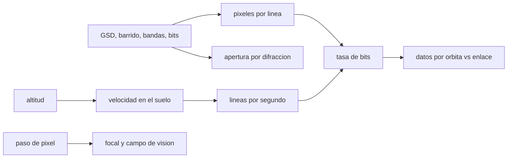

# B57-C24 — Diseño de una carga útil de observación terrestre

<!-- nav:top -->
[🏠 Programa](../../../../README.md) · [📚 Bloque B57](../../../tronco-comun/B57-observacion-terrestre-y-geociencias-orbitales.md) · [← Anterior: B57-C23 — Diseño de órbita y revisita para observación terrestre](../B57-C23-diseno-de-orbita-y-revisita-para-observacion-terrestre/CLASE.md) · [Siguiente: B57-C25 — Selección de bandas espectrales según el fenómeno →](../B57-C25-seleccion-de-bandas-espectrales-segun-el-fenomeno/CLASE.md)
<!-- /nav -->

## 1. Ubicación, nivel y alcance

Clase 24 del bloque B57 (ampliación). Diseñar una carga útil de observación es recorrer una cadena de requisitos: el GSD y el barrido fijan los píxeles por línea, la órbita fija la velocidad sobre el suelo y la tasa de líneas, de ahí sale la tasa de datos, y la focal, el campo y la apertura salen de la geometría y la difracción. Recorres esa cadena con requisitos tomados como punto de partida de los que mostró la página de Sentinel-2 (consultada), y cierras con el presupuesto de bajada de datos, con parámetros **ilustrativos**. No es el diseño de ningún instrumento.

## 2. Por qué esta clase existe

Cada requisito empuja a los demás: más resolución exige más datos, más barrido exige un campo de visión mayor, y el enlace de bajada limita cuánto se puede adquirir. La decisión central: **¿qué requisito se relaja cuando el presupuesto de datos no cierra?**

## 3. Lo que podrás hacer al terminar

1. Calcular los píxeles por línea, la tasa de líneas y la tasa de datos desde GSD, barrido y órbita.
2. Calcular la focal y el campo de visión desde el paso de pixel y la geometría.
3. Calcular la apertura mínima por difracción.
4. Comparar los datos por órbita con la capacidad del enlace.
5. Declarar el déficit del presupuesto y proponer qué relajar.

La evidencia es la **ficha de una carga útil** del ejercicio 12 (sección 20).

## 4. Con qué llegas y cómo comprobarlo

1. ¿Qué es el GSD?
2. ¿Qué es la velocidad sobre el suelo?
3. ¿Qué es un enlace de bajada?
4. ¿Qué es un campo de visión?
5. ¿Qué es un valor ilustrativo?

<details>
<summary>Ver respuestas</summary>

1. La distancia entre centros de píxel en el suelo. 2. La velocidad del punto subsatélite sobre la superficie. 3. La transmisión de datos del satélite a tierra. 4. El ángulo total que el sensor abarca. 5. Uno propuesto para el ejemplo.
</details>

Con cuatro o cinco aciertos, sigue; si no, repasa los prerrequisitos.

## 5. Un caso de contexto y casos de referencia

Se pide `GSD = 10 m`, `barrido = 290 km`, `4` bandas de `12 bits` desde `786 km` (los valores de Sentinel-2 como punto de partida; página consultada). Se supone un detector con paso de `7,5 µm`, apertura de `0,15 m`, adquisición en el `50 %` de la órbita, compresión `2:1` y un enlace de `520 Mbit/s` con `10 min` de contacto por órbita (**ilustrativos**). Es el **ejemplo conductor**; no es la carga útil de ninguna misión.

## 6. Vocabulario

La **carga útil** es el conjunto de instrumentos que cumple la misión. El **presupuesto de datos** compara lo que se genera con lo que se puede bajar. El **ciclo de trabajo** es la fracción de la órbita en que se adquiere. La **focal** `f = pH/GSD` fija el tamaño de la imagen en el plano focal. El **campo de visión** es el ángulo total de la línea. Un **requisito** es una condición que la carga debe cumplir.

## 7. Modelo mental: una cadena de dominó

Los requisitos son fichas de dominó: al mover una (GSD, barrido, bandas) caen las demás (tasa de líneas, datos, enlace). Si no hay hueco al final, hay que quitar una ficha.



*Descripción textual:* los requisitos de resolución y barrido, junto con la órbita, dan píxeles, líneas y tasa de bits; la geometría fija focal y campo; y la comparación con el enlace dice si el presupuesto cierra.

Analogía: llenar una maleta con límite de peso: cada objeto cabe, pero juntos pueden pasarse. Límite: aquí los pesos son estimaciones de primer orden.

## 8. La explicación, paso a paso

### 8.1 Del requisito a los datos

Con `290 km / 10 m` hay `29000` píxeles por línea. A `786 km`, la velocidad sobre el suelo es `6,641 km/s`, de modo que se necesitan `664,1` líneas por segundo; la tasa de píxeles es `19258165 px/s` y la de bits sin comprimir, `0,92 Gbit/s`.

### 8.2 Geometría óptica

Con paso de `7,5 µm`, `f = pH/GSD = 0,590 m`. El campo de visión de la línea es `20,90°` (Tierra plana). La línea focal mediría `218 mm` si fuera un solo detector (en la práctica se compone de varios). La apertura mínima por Rayleigh a `0,665 µm` es `63,8 mm`; con `0,15 m` el sistema es F/`3,93`.

### 8.3 Presupuesto de bajada

El periodo es `100,58 min`. Con 50 % de adquisición y compresión 2:1, se generan `1395 Gbit` por órbita; el enlace aporta `312 Gbit` en 10 min. La razón datos/capacidad es `4,47` y harían falta `44,7 min` de contacto. Si la razón supera 1, el presupuesto no cierra.

### 8.4 Qué se relaja

Para cerrar el presupuesto se puede bajar el ciclo de trabajo, comprimir más, reducir bandas o bits, ampliar el contacto (más estaciones) o aceptar un GSD mayor. Cada opción cambia una propiedad del producto y debe quedar escrita.

## 9. Magnitudes, símbolos y unidades

| Símbolo | Qué es | Unidad | Valor / nota |
|---|---|---|---|
| `GSD` | distancia de muestreo | m | 10 |
| `W` | barrido | km | 290 |
| `R_bits` | tasa de bits sin comprimir | Gbit/s | 0,92 |
| `f` | focal | m | 0,590 |
| `razón` | datos/capacidad por órbita | — | 4,47 |

## 10. Convenciones y referencias

Tierra plana para el campo de visión; velocidad circular; ciclo de trabajo y compresión ilustrativos; capacidad de enlace en bits por órbita. Las cifras de Sentinel-2 son requisitos de partida, no el diseño de esa misión.

## 11. De dónde sale lo que afirmamos

| ID | Fuente | Localizador | Respalda | Estado |
|---|---|---|---|---|
| S1 | Copernicus, SentiWiki, *Sentinel-2 mission* | https://sentiwiki.copernicus.eu/web/s2-mission | altitud media de 786 km, barrido de 290 km, píxeles de 10 m en cuatro bandas y 12 bits en la adquisición. | Consultada 2026-11-09 |

**Límites de las fuentes.** No se consultó el diseño del instrumento de Sentinel-2 ni sus tasas de datos. Paso de pixel, apertura, ciclo de trabajo, compresión y enlace son ilustrativos. GM y R son valores de referencia no consultados.

## 12. Cómo ver los resultados

| Magnitud | Valor |
|---|---|
| píxeles por línea | 29000 |
| tasa de bits sin comprimir | 0,92 Gbit/s |
| focal / campo de visión | 0,590 m / 20,90° |
| razón datos/capacidad | 4,47 |

Descripción larga: los requisitos de resolución y barrido generan muchos gigabits por segundo, y el enlace de bajada determina si el presupuesto cierra.

## 13. Ejemplo trabajado: la tasa de bits

**Paso 1 · Píxeles por línea.** `290 000/10 = 29000`.

**Paso 2 · Líneas.** `6,641 km/s / 10 m = 664,1 líneas/s`.

**Paso 3 · Bits.** `29000 × 664,1 × 4 × 12 = 0,92 Gbit/s`.

## 14. Distintas formas de abordar el problema

**Por requisito:** se parte de la necesidad. **Por presupuesto:** se verifica que cierre. **Por compromiso:** se relaja lo menos importante. Un diseño real itera entre los tres.

## 15. Práctica guiada

**Ejercicio 1 · con los pasos indicados.** ¿Cuántos píxeles por línea con barrido de `185 km` y GSD de `30 m`? *Pasos:* divide.

<details><summary>Solución comentada</summary>

`6167`.
</details>

**Ejercicio 2 · con una pista.** Calcula la focal con paso `7,5 µm`, `H = 786 km` y `GSD = 10 m`.

<details><summary>Solución comentada</summary>

`0,590 m`.
</details>

**Ejercicio 3 · casi autónomo.** ¿Qué apertura mínima da la difracción a `0,665 µm` para 10 m?

<details><summary>Solución comentada</summary>

`63,8 mm`.
</details>

## 16. Práctica autónoma, transferencia e integrador

**Ejercicio 4.** Si se pasa de 4 a 13 bandas con el mismo GSD, ¿cómo cambia la tasa de bits?

<details><summary>Solución comentada</summary>

Se multiplica por `13/4 = 3,25`.
</details>

**Ejercicio 5.** Si el ciclo de trabajo baja de 50 % a 25 %, ¿qué pasa con la razón datos/capacidad?

<details><summary>Solución comentada</summary>

Se reduce a la mitad.
</details>

**Ejercicio 6.** Si el GSD pasa de 10 m a 20 m, ¿cómo cambia la tasa de bits?

<details><summary>Solución comentada</summary>

Baja 4 veces: menos píxeles por línea y menos líneas.
</details>

**Ejercicio 7.** ¿Qué contacto necesitas para bajar los datos por órbita?

<details><summary>Solución comentada</summary>

`44,7 min`.
</details>

**Ejercicio 8.** Explica por qué una carga útil de barrido ancho necesita un campo de visión grande.

<details><summary>Solución comentada</summary>

Porque el ángulo que subtiende el barrido crece con él (`20,9°` para 290 km).
</details>

**Ejercicio 9 · transferencia.** **Transferencia.** El presupuesto no cierra. Propón dos relajaciones y su costo.

<details><summary>Solución comentada</summary>

Menos bandas (menos información espectral) y compresión mayor (más pérdida o más cómputo a bordo); también más estaciones de bajada.
</details>

**Ejercicio 10 · transferencia.** **Transferencia.** ¿Por qué esta clase no basta para especificar un instrumento?

<details><summary>Solución comentada</summary>

Faltan SNR, calibración, masa y potencia, térmica y verificación.
</details>

**Ejercicio 11 · transferencia.** **Transferencia.** ¿Qué requisito de usuario podrías haber dejado fuera?

<details><summary>Solución comentada</summary>

Revisita, hora local de paso, geolocalización y latencia de entrega.
</details>

**Ejercicio 12 · integrador.** **Integrador.** Elabora tu *ficha de una carga útil*: la cadena de requisitos a datos, la geometría óptica y el presupuesto de bajada, con una propuesta explícita de qué relajar si no cierra.

<details><summary>Solución modelo</summary>

Secciones 8.1 a 8.4 con las cifras de la ejecución y una lista de lo relajado y su costo.
</details>

## 17. Laboratorio: de los requisitos a los datos y a la apertura

El script [carga_util.py](carga_util.py) recorre la cadena de requisitos de una carga útil, calcula tasa de datos, focal, campo, apertura mínima y compara con el enlace de bajada (**comprueba** que la tasa de líneas por el GSD coincide con la velocidad sobre el suelo y que la apertura mínima es menor que la elegida).

**Datos:** requisitos de partida de Sentinel-2 (S1); el resto **ilustrativo**; GM y R de referencia no consultados. **Predice antes de ejecutar:** ¿cerrará el presupuesto de bajada con un solo enlace de 10 minutos? (no: los datos superan varias veces la capacidad.) **Ejecución del 2026-11-09 (Python 3.12.9):**

```text
Python 3.12.9 (biblioteca estandar)
Pixeles por linea = 29000 ; velocidad sobre el suelo = 6.641 km/s ; tasa de lineas = 664.1 /s
Tasa de pixeles = 19.3 Mpx/s ; tasa de bits sin comprimir = 0.92 Gbit/s
Focal con paso 7.5 um = 0.590 m ; campo de vision = 20.90 grados ; ancho de la linea focal = 218 mm
Apertura minima por difraccion = 63.8 mm ; con D = 0.15 m, F/# = 3.93
Periodo orbital = 100.58 min ; datos por orbita (50 % de adquisicion, compresion 2:1) = 1395 Gbit
Capacidad del enlace por orbita (520 Mbit/s x 600 s) = 312 Gbit ; razon datos/capacidad = 4.47 ; contacto necesario = 44.7 min
Pruebas superadas (el presupuesto NO cierra: se declara el deficit).
```

```bash
python programa/clases/B57/B57-C24-diseno-de-una-carga-util-de-observacion-terrestre/carga_util.py
```

**Límites:** primer orden, sin SNR, masa, potencia ni térmica.

## 18. Errores frecuentes y cómo corregirlos

**Confundir requisitos de partida con el diseño de una misión.** Se aclara en la sección 11.

**Olvidar el enlace de bajada.** Es el límite de 8.3.

**Ignorar el ciclo de trabajo.** Cambia la razón (ejercicio 5).

**Presentar el resultado como diseño de instrumento.** No lo es (sección 5).

## 19. Cómo sabrás que vas bien

Tras la sección 8: ¿qué resultado esperabas y cuál obtuviste? Si dudas, repasa el ejemplo 13. Tras el laboratorio: ¿qué comprueba? (ver la sección 17).

## 20. Qué entregas y cómo se evalúa

El producto es tu **ficha de una carga útil** (ejercicio 12).

| Criterio | Inicial | En desarrollo | Logrado | Destacado |
|---|---|---|---|---|
| Conceptos | Los confunde | Parciales | Conceptos de la clase | Explica los límites |
| Cálculo | Sin unidades | Con errores | Tablas completas con unidades | Calcula casos nuevos |
| Numérico | Sin comprobar | Un caso | Contraste con el caso analítico | Interpreta las diferencias |
| Fuentes | Sin fuente | Sin fecha | Fuentes con fecha | Declara lo no consultado |
| Límites | No los nombra | Uno | Tres | Discute qué falta del modelo |

**Condiciones críticas (no se compensan con promedio):** rotular los parámetros como ilustrativos; no presentar la carga como la de Sentinel-2; declarar qué se relajó si el presupuesto no cierra.

## 21. Ética, seguridad y límites

Clase educativa: no se diseña ninguna misión real. Accesibilidad: tablas equivalentes a las gráficas, fórmulas en texto, ejercicios sin conexión.

## 22. Para cerrar y seguir

Los requisitos generan `0,9 Gbit/s` y la razón datos/capacidad por órbita es `4,47`. Queda una pregunta: ¿qué bandas conviene medir según el fenómeno?

**Glosario español–inglés.** carga útil · *payload*; presupuesto de datos · *data budget*; ciclo de trabajo · *duty cycle*; campo de visión · *field of view (FOV)*; enlace de bajada · *downlink*.

**Continuidad.** [B57-C25](../B57-C25-seleccion-de-bandas-espectrales-segun-el-fenomeno/CLASE.md) estudia selección de bandas espectrales según el fenómeno.

**Referencias:** ver sección 11.

<!-- nav:bottom -->
---

[← Anterior: B57-C23 — Diseño de órbita y revisita para observación terrestre](../B57-C23-diseno-de-orbita-y-revisita-para-observacion-terrestre/CLASE.md) · [📚 Bloque B57](../../../tronco-comun/B57-observacion-terrestre-y-geociencias-orbitales.md) · [Siguiente: B57-C25 — Selección de bandas espectrales según el fenómeno →](../B57-C25-seleccion-de-bandas-espectrales-segun-el-fenomeno/CLASE.md)
<!-- /nav -->
