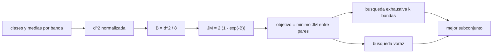

# B57-C25 — Selección de bandas espectrales según el fenómeno

<!-- nav:top -->
[🏠 Programa](../../../../README.md) · [📚 Bloque B57](../../../tronco-comun/B57-observacion-terrestre-y-geociencias-orbitales.md) · [← Anterior: B57-C24 — Diseño de una carga útil de observación terrestre](../B57-C24-diseno-de-una-carga-util-de-observacion-terrestre/CLASE.md) · [Siguiente: B57-C26 — Corrección atmosférica de imágenes →](../B57-C26-correccion-atmosferica-de-imagenes/CLASE.md)
<!-- /nav -->

## 1. Ubicación, nivel y alcance

Clase 25 del bloque B57 (ampliación). Qué bandas medir depende del fenómeno: vegetación, agua, fuego o ceniza se separan mejor en unas bandas que en otras. Cuantificas la **separabilidad** entre clases con la distancia de Jeffries–Matusita, buscas el mejor subconjunto de bandas por fuerza bruta y lo comparas con una selección voraz. Las clases y sus reflectancias son **sintéticas**; las ocho bandas candidatas son genéricas y no pertenecen a ningún sensor.

## 2. Por qué esta clase existe

Cada banda cuesta datos, masa y complejidad. La decisión central: **¿con qué menor número de bandas se separan las clases que me interesan y cuál es el par más difícil de distinguir?**

## 3. Lo que podrás hacer al terminar

1. Calcular la distancia de Bhattacharyya y la de Jeffries–Matusita entre clases gaussianas.
2. Medir la separabilidad mínima de un conjunto de bandas.
3. Buscar el mejor subconjunto de `k` bandas por enumeración.
4. Comparar la búsqueda voraz con la exhaustiva.
5. Identificar el par de clases más difícil y qué banda lo resuelve.

La evidencia es la **ficha de selección de bandas** del ejercicio 12 (sección 20).

## 4. Con qué llegas y cómo comprobarlo

1. ¿Qué es una clase espectral?
2. ¿Qué es una distancia entre medias normalizada?
3. ¿Qué es una combinación?
4. ¿Qué es una búsqueda voraz?
5. ¿Qué es un dato sintético?

<details>
<summary>Ver respuestas</summary>

1. Un grupo de píxeles con firma parecida. 2. La diferencia de medias dividida por la desviación. 3. Una selección de elementos sin orden. 4. Una que elige en cada paso lo mejor sin mirar atrás. 5. Uno generado por una fórmula.
</details>

Con cuatro o cinco aciertos, sigue; si no, repasa los prerrequisitos.

## 5. Un caso de contexto y casos de referencia

Cuatro clases **sintéticas**: agua, vegetación, suelo y quemado (ceniza), con reflectancias **ilustrativas** en 8 bandas candidatas entre `0,45` y `2,20 µm` y una desviación de `0,02`. Es el **ejemplo conductor**; el sensor y las bandas son genéricos.

## 6. Vocabulario

La **separabilidad** mide cuán distinguibles son dos clases. La distancia de **Bhattacharyya** para gaussianas de igual covarianza diagonal es `B = d²/8`. La distancia de **Jeffries–Matusita** es `JM = 2(1 − e^{−B})`, entre 0 (idénticas) y 2 (perfectamente separables). El **objetivo mínimo** es el menor `JM` entre pares de clases. Una **búsqueda voraz** agrega en cada paso la banda que más mejora el objetivo.

## 7. Modelo mental: elegir lentes de colores para distinguir frutas

Si quieres distinguir manzanas verdes de limones, no necesitas todos los colores: eliges los filtros donde más difieren y descartas los que no agregan nada.



*Descripción textual:* las medias por banda dan una distancia normalizada, de ella la separabilidad JM, y el objetivo mínimo guía la búsqueda exhaustiva o voraz del mejor subconjunto.

Analogía: elegir filtros fotográficos para distinguir frutas. Límite: aquí las clases son gaussianas con igual dispersión; las reales no.

## 8. La explicación, paso a paso

### 8.1 Separabilidad con todas las bandas

Con las 8 bandas, el menor `JM` entre pares es `2,0000` (máximo 2). Con tres bandas del visible/NIR (verde, rojo, NIR) es `1,6631`. El par más difícil con 8 bandas es **agua – quemado**, con `JM = 2,0000`; con solo el NIR de 0,86 µm, `JM = 1,5675`.

### 8.2 Mejores subconjuntos

| k | exhaustivo: bandas (µm) | JM mínimo | voraz: bandas (µm) | JM mínimo |
|---|---|---|---|---|
| 1 | 1,61 | 1,9544 | 1,61 | 1,9544 |
| 2 | 1,24, 1,61 | 1,9938 | 1,61, 1,24 | 1,9938 |
| 3 | 1,24, 1,61, 2,2 | 1,9995 | 1,61, 1,24, 2,2 | 1,9995 |
| 4 | 0,86, 1,24, 1,61, 2,2 | 1,9999 | 1,61, 1,24, 2,2, 0,86 | 1,9999 |

La búsqueda exhaustiva nunca es peor que la voraz; en este caso la diferencia es `0,0000` con 3 bandas.

### 8.3 Lectura

La separabilidad mínima se satura al agregar bandas: las primeras ganan mucho y las últimas poco. El par de clases difícil (aquí agua–quemado, ambas oscuras en el visible) manda la elección. Elegir bandas con un solo par en mente puede perjudicar a otros.

### 8.4 Límites

Las clases reales tienen variabilidad interna, covarianza entre bandas y mezcla en el píxel. La selección debe validarse con muestras de entrenamiento observadas. Aquí todo es sintético.

## 9. Magnitudes, símbolos y unidades

| Símbolo | Qué es | Unidad | Valor / nota |
|---|---|---|---|
| `d²` | distancia normalizada | — | — |
| `B` | distancia de Bhattacharyya | — | `d²/8` |
| `JM` | separabilidad de Jeffries–Matusita | — | 0 a 2; 2,000 (8 bandas) |
| `k` | número de bandas elegidas | — | 1 a 4 |

## 10. Convenciones y referencias

Gaussianas con igual covarianza diagonal (`σ = 0,02`); bandas indexadas por su centro en µm; el objetivo es el mínimo `JM` entre todos los pares de clases.

## 11. De dónde sale lo que afirmamos

| ID | Fuente | Localizador | Respalda | Estado |
|---|---|---|---|---|
| — | Sin fuente externa | — | relaciones estándar que verifica el laboratorio | No se consultó una fuente para esta clase |

**Límites de las fuentes.** No se consultó ninguna fuente para esta clase: la distancia de Jeffries–Matusita es un método conocido que verifica el laboratorio contra la fórmula analítica. Las bandas candidatas son genéricas y las reflectancias, inventadas.

## 12. Cómo ver los resultados

| Magnitud | Valor |
|---|---|
| JM mínimo con 8 bandas | 2,0000 |
| par más difícil | agua – quemado |
| JM mínimo con 3 bandas (exhaustivo / voraz) | 1,9995 / 1,9995 |

Descripción larga: la separabilidad mínima sube rápido con las primeras bandas y se satura, y la búsqueda voraz iguala o se acerca a la exhaustiva.

## 13. Ejemplo trabajado: el JM de agua y vegetación en una banda

**Paso 1 · Distancia normalizada.** En la banda de 0,86 µm: `(0,01 − 0,45)²/0,02² = 484`.

**Paso 2 · Bhattacharyya.** `B = 484/8 = 60,5`.

**Paso 3 · JM.** `2(1 − e^{−60,5}) ≈ 2`: separables en esa banda.

## 14. Distintas formas de abordar el problema

**Exhaustiva:** garantiza el óptimo pero crece combinatoriamente. **Voraz:** rápida, no siempre óptima. **Con conocimiento físico:** se parte de bandas con significado (rojo, NIR) y se prueban las demás.

## 15. Práctica guiada

**Ejercicio 1 · con los pasos indicados.** Calcula `B` para `d² = 16`. *Pasos:* `d²/8`.

<details><summary>Solución comentada</summary>

`2`.
</details>

**Ejercicio 2 · con una pista.** Calcula `JM` para `B = 2`. *Pista:* `2(1 − e^{−B})`.

<details><summary>Solución comentada</summary>

`2(1 − 0,1353) = 1,73`.
</details>

**Ejercicio 3 · casi autónomo.** ¿Qué `JM` tienen dos clases idénticas?

<details><summary>Solución comentada</summary>

`0`.
</details>

## 16. Práctica autónoma, transferencia e integrador

**Ejercicio 4.** ¿Cuántos subconjuntos de 3 bandas hay entre 8?

<details><summary>Solución comentada</summary>

`C(8,3) = 56`.
</details>

**Ejercicio 5.** ¿Y de 4?

<details><summary>Solución comentada</summary>

`C(8,4) = 70`.
</details>

**Ejercicio 6.** ¿Por qué el objetivo es el mínimo y no el promedio?

<details><summary>Solución comentada</summary>

Porque un par mal separado arruina el mapa aunque los demás estén bien.
</details>

**Ejercicio 7.** ¿Qué banda resuelve mejor el par difícil de 8.1?

<details><summary>Solución comentada</summary>

La que más separa sus medias; compara los valores de la sección 8.2 y la tabla de clases.
</details>

**Ejercicio 8.** Explica por qué la mejora se satura al agregar bandas.

<details><summary>Solución comentada</summary>

Porque tras separar el par más difícil, las bandas nuevas aportan poca diferencia adicional y el mínimo ya está cerca de 2.
</details>

**Ejercicio 9 · transferencia.** **Transferencia.** Si la dispersión sube de 0,02 a 0,04, ¿cómo cambia `d²`?

<details><summary>Solución comentada</summary>

Baja a un cuarto, y `JM` cae.
</details>

**Ejercicio 10 · transferencia.** **Transferencia.** ¿Qué pasa si dos bandas están muy correlacionadas?

<details><summary>Solución comentada</summary>

La covarianza diagonal sobrestima la separabilidad; hay que usar la covarianza completa.
</details>

**Ejercicio 11 · transferencia.** **Transferencia.** ¿Qué datos reales harían falta?

<details><summary>Solución comentada</summary>

Muestras de entrenamiento etiquetadas con procedencia, con sus covarianzas, de la zona y época de interés.
</details>

**Ejercicio 12 · integrador.** **Integrador.** Elabora tu *ficha de selección de bandas*: la tabla de los mejores subconjuntos de 1 a 4 bandas por los dos métodos, el par más difícil y una recomendación justificada.

<details><summary>Solución modelo</summary>

Sección 8.2 y 8.3 con las cifras de la ejecución, aclarando que las clases son sintéticas.
</details>

## 17. Laboratorio: separabilidad y selección de bandas

El script [bandas.py](bandas.py) calcula la separabilidad Jeffries–Matusita entre cuatro clases sintéticas y busca el mejor subconjunto de bandas por fuerza bruta y por búsqueda voraz (**comprueba** la JM calculada frente a la fórmula analítica a 1e-12 y que el óptimo exhaustivo no es peor que el voraz).

**Datos:** clases, bandas y desviación **sintéticas / ilustrativas**; sin fuentes consultadas. **Predice antes de ejecutar:** ¿qué par de clases será el más difícil? (el de dos clases oscuras en el visible.) **Ejecución del 2026-11-09 (Python 3.12.9):**

```text
Python 3.12.9 (biblioteca estandar)
JM minimo entre pares con las 8 bandas = 2.0000 ; con verde-rojo-NIR (0.55, 0.66, 0.86) = 1.6631
Par mas dificil: agua - quemado ; JM con 8 bandas = 2.0000 ; solo NIR 0.86 = 1.5675
k = 1: exhaustivo [1.61] JM = 1.9544 ; voraz [1.61] JM = 1.9544
k = 2: exhaustivo [1.24, 1.61] JM = 1.9938 ; voraz [1.61, 1.24] JM = 1.9938
k = 3: exhaustivo [1.24, 1.61, 2.2] JM = 1.9995 ; voraz [1.61, 1.24, 2.2] JM = 1.9995
k = 4: exhaustivo [0.86, 1.24, 1.61, 2.2] JM = 1.9999 ; voraz [1.61, 1.24, 2.2, 0.86] JM = 1.9999
Pruebas superadas.
```

```bash
python programa/clases/B57/B57-C25-seleccion-de-bandas-espectrales-segun-el-fenomeno/bandas.py
```

**Límites:** gaussianas de igual covarianza diagonal; sin mezcla en el píxel.

## 18. Errores frecuentes y cómo corregirlos

**Elegir bandas para un solo par.** Perjudica a otros (8.3).

**Creer que más bandas siempre ayudan.** La mejora se satura (8.3).

**Usar covarianza diagonal con bandas correlacionadas.** Ejercicio 10.

**Presentar las clases como reales.** Son sintéticas (sección 5).

## 19. Cómo sabrás que vas bien

Tras la sección 8: ¿qué resultado esperabas y cuál obtuviste? Si dudas, repasa el ejemplo 13. Tras el laboratorio: ¿qué comprueba? (ver la sección 17).

## 20. Qué entregas y cómo se evalúa

El producto es tu **ficha de selección de bandas** (ejercicio 12).

| Criterio | Inicial | En desarrollo | Logrado | Destacado |
|---|---|---|---|---|
| Conceptos | Los confunde | Parciales | Conceptos de la clase | Explica los límites |
| Cálculo | Sin unidades | Con errores | Tablas completas con unidades | Calcula casos nuevos |
| Numérico | Sin comprobar | Un caso | Contraste con el caso analítico | Interpreta las diferencias |
| Fuentes | Sin fuente | Sin fecha | Fuentes con fecha | Declara lo no consultado |
| Límites | No los nombra | Uno | Tres | Discute qué falta del modelo |

**Condiciones críticas (no se compensan con promedio):** rotular clases y bandas como sintéticas o genéricas; no presentar la selección como la de un sensor real; citar solo lo consultado (aquí, nada).

## 21. Ética, seguridad y límites

Clase educativa: no se mapea ningún fenómeno real. Accesibilidad: tablas equivalentes a las gráficas, fórmulas en texto, ejercicios sin conexión.

## 22. Para cerrar y seguir

Con `2,00` de `JM` mínimo con 8 bandas, tres bien elegidas alcanzan `2,00`, y el par más difícil es agua–quemado. Queda una pregunta: ¿cómo se corrige la atmósfera para comparar imágenes?

**Glosario español–inglés.** separabilidad · *separability*; distancia de Jeffries–Matusita · *Jeffries–Matusita distance*; búsqueda voraz · *greedy search*; selección de bandas · *band selection*; clase espectral · *spectral class*.

**Continuidad.** [B57-C26](../B57-C26-correccion-atmosferica-de-imagenes/CLASE.md) estudia corrección atmosférica de imágenes.

**Referencias:** ver sección 11.

<!-- nav:bottom -->
---

[← Anterior: B57-C24 — Diseño de una carga útil de observación terrestre](../B57-C24-diseno-de-una-carga-util-de-observacion-terrestre/CLASE.md) · [📚 Bloque B57](../../../tronco-comun/B57-observacion-terrestre-y-geociencias-orbitales.md) · [Siguiente: B57-C26 — Corrección atmosférica de imágenes →](../B57-C26-correccion-atmosferica-de-imagenes/CLASE.md)
<!-- /nav -->
