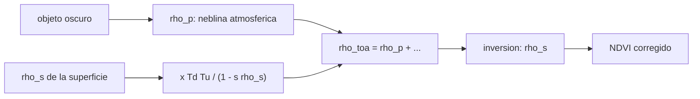

# B57-C26 — Corrección atmosférica de imágenes

<!-- nav:top -->
[🏠 Programa](../../../../README.md) · [📚 Bloque B57](../../../tronco-comun/B57-observacion-terrestre-y-geociencias-orbitales.md) · [← Anterior: B57-C25 — Selección de bandas espectrales según el fenómeno](../B57-C25-seleccion-de-bandas-espectrales-segun-el-fenomeno/CLASE.md) · [Siguiente: B57-C27 — Detección de cambios en series de imágenes →](../B57-C27-deteccion-de-cambios-en-series-de-imagenes/CLASE.md)
<!-- /nav -->

## 1. Ubicación, nivel y alcance

Clase 26 del bloque B57 (ampliación). La atmósfera cambia lo que registra el satélite: añade luz dispersada y atenúa la de la superficie. La corrección atmosférica estima la reflectancia de superficie desde la del tope de la atmósfera. Construyes un modelo directo simple, lo inviertes, ves el sesgo que produce en el NDVI y aplicas el método del objeto oscuro. La definición de reflectancia de superficie es la de USGS (consultada); atmósfera y escena son **sintéticas**.

## 2. Por qué esta clase existe

Comparar imágenes de fechas distintas con atmósferas distintas confunde atmósfera con cambio. La decisión central: **¿cuánto sesga la atmósfera y cómo se estima y descuenta con la información disponible?**

## 3. Lo que podrás hacer al terminar

1. Calcular la reflectancia en el tope de la atmósfera con un modelo de una capa.
2. Invertir el modelo para recuperar la reflectancia de superficie.
3. Medir el sesgo de la atmósfera sobre el NDVI.
4. Aplicar el método del objeto oscuro y medir su error.
5. Medir la sensibilidad de la corrección al espesor óptico.

La evidencia es la **ficha de corrección atmosférica** del ejercicio 12 (sección 20).

## 4. Con qué llegas y cómo comprobarlo

1. ¿Qué es la reflectancia en el tope de la atmósfera?
2. ¿Qué es la transmitancia?
3. ¿Qué es el albedo esférico?
4. ¿Qué es el espesor óptico?
5. ¿Qué es una inversión?

<details>
<summary>Ver respuestas</summary>

1. La que ve el sensor, antes de corregir la atmósfera. 2. La fracción de luz que atraviesa la atmósfera. 3. La fracción de luz reflejada por la superficie que la atmósfera devuelve a la superficie. 4. La atenuación logarítmica de la luz que atraviesa la atmósfera. 5. Despejar la causa a partir del efecto.
</details>

Con cuatro o cinco aciertos, sigue; si no, repasa los prerrequisitos.

## 5. Un caso de contexto y casos de referencia

Una superficie con vegetación sintética (rojo `0,05`, infrarrojo cercano `0,45`) bajo una atmósfera de espesores `0,35` y `0,15`, Sol a `30°` de cenit y vista al nadir. Es el **ejemplo conductor**; la superficie y la atmósfera son **sintéticas**. El producto de reflectancia de superficie de Landsat se define como la fracción de radiación solar que refleja la superficie (USGS, consultado).

## 6. Vocabulario

La **reflectancia de trayectoria** `ρ_p` es la luz dispersada por la atmósfera hacia el sensor sin tocar la superficie. La **transmitancia total** `T_d T_u` es la fracción que baja y sube. El **albedo esférico** `s` mide el rebote entre superficie y atmósfera. La **corrección atmosférica** convierte `ρ_TOA` en `ρ_s`. El **objeto oscuro** es un píxel que se supone casi negro para estimar `ρ_p`.

## 7. Modelo mental: ver el fondo de una piscina con agua turbia

Con el agua turbia ves menos contraste y una neblina uniforme sobre el fondo; si conoces la neblina y cuánta luz se pierde, puedes recuperar el fondo.



*Descripción textual:* la reflectancia en el tope es la suma de la neblina atmosférica y la señal atenuada de la superficie; la inversión recupera la superficie y el objeto oscuro estima la neblina cuando no se conoce.

Analogía: ver el fondo de una piscina turbia: restas la neblina y reescalas el contraste. Límite: la neblina real depende de longitud de onda, geometría y aerosoles.

## 8. La explicación, paso a paso

### 8.1 Del suelo al sensor

Con la superficie sintética, el sensor ve `ρ_TOA(rojo) = 0,04281` (frente a `0,05` en el suelo) y `ρ_TOA(NIR) = 0,34611` (frente a `0,45`). La transmitancia total del rojo es `T_d T_u = 0,4704` y la reflectancia de trayectoria `0,01920`: la neblina atmosférica aporta casi la mitad de la señal de una superficie oscura.

### 8.2 Inversión y NDVI

La inversión recupera las reflectancias con error `6,9e-18`. El NDVI de superficie es `0,8000`, en el TOA `0,7798` (sesgo `-0,0202`) y tras la corrección `0,8000`. La atmósfera reduce el NDVI porque suma neblina al rojo y atenúa el infrarrojo.

### 8.3 Objeto oscuro

Si se supone que el píxel más oscuro tiene `ρ_s = 0,01` pero en realidad vale `0,02`, el rojo recuperado es `0,04017` (error `-0,00983`), un error mayor que el de `-0,00719` que se tendría sin corregir: un supuesto equivocado del objeto oscuro puede empeorar el resultado, porque sobreestima la neblina. Con el supuesto correcto (`ρ_s = 0,01`) el error es solo `+0,00019`. Un error de `+0,10` en el espesor óptico produce un error de `-0,00237` en la reflectancia del rojo.

### 8.4 Lectura

La corrección reduce el error, pero lo traslada a la estimación de la atmósfera. Los productos oficiales usan datos auxiliares (aerosoles, vapor, ozono, elevación) y declaran su incertidumbre; este modelo de una capa sirve para ver el mecanismo.

## 9. Magnitudes, símbolos y unidades

| Símbolo | Qué es | Unidad | Valor / nota |
|---|---|---|---|
| `ρ_s` | reflectancia de superficie | adimensional | 0,05 (rojo); 0,45 (NIR) |
| `ρ_TOA` | reflectancia en el tope | adimensional | 0,0428; 0,3461 |
| `τ` | espesor óptico | — | 0,35; 0,15 (ilustrativos) |
| `s` | albedo esférico | — | 0,08 |
| `ρ_p` | reflectancia de trayectoria | adimensional | 0,0192 (rojo) |

## 10. Convenciones y referencias

Superficie lambertiana; geometría fija (cenital 30°, nadir); atmósfera de una capa y bandas monocromáticas; todas las reflectancias son adimensionales.

## 11. De dónde sale lo que afirmamos

| ID | Fuente | Localizador | Respalda | Estado |
|---|---|---|---|---|
| S1 | USGS, *Landsat Surface Reflectance* | https://www.usgs.gov/landsat-missions/landsat-surface-reflectance | definición de la reflectancia de superficie como fracción de radiación solar reflejada y su objetivo (comparar imágenes de distintas fechas); la página no traía algoritmo ni factores de escala. | Consultada 2026-11-09 (la página no da los factores de escala) |

**Límites de las fuentes.** No se consultó el algoritmo de corrección de ningún producto ni la documentación de transferencia radiativa. Espesores, albedos y funciones de fase son ilustrativos. Los factores de escala de Collection 2 no se consultaron.

## 12. Cómo ver los resultados

| Magnitud | Valor |
|---|---|
| NDVI de superficie / TOA / corregido | 0,8000 / 0,7798 / 0,8000 |
| reflectancia de trayectoria (rojo) | 0,01920 |
| error del objeto oscuro | -0,00983 |

Descripción larga: la atmósfera baja el NDVI y la corrección lo devuelve a su valor de superficie en el modelo.

## 13. Ejemplo trabajado: la reflectancia en el TOA del rojo

**Paso 1 · Trayectoria.** `ρ_p = 0,95 × 0,35 × 0,2/(4 × 0,866 × 1) = 0,01920`.

**Paso 2 · Transmitancia.** `T_d T_u = e^{−0,35/0,866} e^{−0,35} = 0,4704`.

**Paso 3 · Suma.** `ρ_TOA = ρ_p + T_d T_u · 0,05/(1 − 0,08 · 0,05) = 0,04281`.

## 14. Distintas formas de abordar el problema

**Por modelo directo e inversión:** exacto en el modelo. **Por objeto oscuro:** sencillo, sin datos auxiliares, con el supuesto de píxel negro. **Por productos oficiales:** usan datos auxiliares y declaran incertidumbre. Cada uno cambia el supuesto.

## 15. Práctica guiada

**Ejercicio 1 · con los pasos indicados.** Calcula `T_d T_u` con `τ = 0,35`, `μs = 0,866`, `μv = 1`. *Pasos:* `e^{−τ/μs} e^{−τ/μv}`.

<details><summary>Solución comentada</summary>

`0,4704`.
</details>

**Ejercicio 2 · con una pista.** Si `ρ_p = 0,01` y `ρ_TOA = 0,05`, ¿qué reflectancia queda tras restar la trayectoria?

<details><summary>Solución comentada</summary>

`0,04` antes de dividir por la transmitancia.
</details>

**Ejercicio 3 · casi autónomo.** ¿Por qué la atmósfera sube la reflectancia de superficies oscuras?

<details><summary>Solución comentada</summary>

Por la reflectancia de trayectoria, que se suma a la señal.
</details>

## 16. Práctica autónoma, transferencia e integrador

**Ejercicio 4.** ¿Qué pasa con el NDVI sin corregir?

<details><summary>Solución comentada</summary>

Baja respecto del de superficie (de 0,800 a 0,780).
</details>

**Ejercicio 5.** ¿Qué error resulta de subestimar `τ` en 0,10? Usa 8.3.

<details><summary>Solución comentada</summary>

`-0,00237` en la reflectancia del rojo.
</details>

**Ejercicio 6.** ¿Qué supone el método del objeto oscuro?

<details><summary>Solución comentada</summary>

Que existe un píxel casi negro (agua profunda, sombra) con reflectancia conocida.
</details>

**Ejercicio 7.** Si el píxel más oscuro es en realidad más brillante que lo supuesto, ¿qué ocurre?

<details><summary>Solución comentada</summary>

Se sobreestima la trayectoria y se recupera una reflectancia menor que la verdadera (8.3).
</details>

**Ejercicio 8.** ¿Por qué comparar imágenes de fechas distintas exige reflectancia de superficie?

<details><summary>Solución comentada</summary>

Para que las diferencias reflejen la superficie y no cambios de atmósfera (S1).
</details>

**Ejercicio 9 · transferencia.** **Transferencia.** Una imagen tiene niebla densa. ¿Qué haces con la corrección?

<details><summary>Solución comentada</summary>

Verificar que el modelo aplica (`τ` grande rompe el modelo simple) y enmascarar si no.
</details>

**Ejercicio 10 · transferencia.** **Transferencia.** ¿Qué datos auxiliares usan los productos reales?

<details><summary>Solución comentada</summary>

Aerosoles, vapor de agua, ozono, presión y elevación, entre otros; no se consultó la lista del producto.
</details>

**Ejercicio 11 · transferencia.** **Transferencia.** ¿Se puede aplicar este modelo a un píxel con nube delgada?

<details><summary>Solución comentada</summary>

No: la nube cambia la dispersión de forma que el modelo de aerosol no describe.
</details>

**Ejercicio 12 · integrador.** **Integrador.** Elabora tu *ficha de corrección atmosférica*: la tabla de reflectancias del suelo, el TOA y la corregida, el sesgo del NDVI y el error del objeto oscuro y de un `τ` mal estimado.

<details><summary>Solución modelo</summary>

Secciones 8.1 a 8.3 con las cifras de la ejecución, aclarando que la atmósfera es sintética.
</details>

## 17. Laboratorio: modelo atmosférico de una capa e inversión

El script [atmosfera.py](atmosfera.py) calcula la reflectancia en el tope de la atmósfera con un modelo de una capa, la invierte, mide el sesgo del NDVI y aplica el objeto oscuro (**comprueba** la ida y vuelta exacta a 1e-12 y que el sesgo del NDVI es mayor que 0,01).

**Datos:** atmósfera y superficie **sintéticas / ilustrativas**; definición de reflectancia de superficie de USGS (S1). **Predice antes de ejecutar:** ¿el NDVI en el TOA será mayor o menor que el de superficie? (menor.) **Ejecución del 2026-11-09 (Python 3.12.9):**

```text
Python 3.12.9 (biblioteca estandar)
Superficie rojo 0.05 / NIR 0.45 -> TOA: rojo = 0.04281 ; NIR = 0.34611
Trayectoria Td*Tu (rojo) = 0.4704 ; reflectancia de trayectoria (rojo) = 0.01920
Ida y vuelta (inversion): error maximo = 6.9e-18
NDVI de superficie = 0.8000 ; NDVI en el TOA = 0.7798 (sesgo -0.0202) ; NDVI corregido = 0.8000
Objeto oscuro: rojo recuperado = 0.04017 (error -0.00983) ; sin corregir el error del rojo en el TOA = -0.00719
Objeto oscuro con el supuesto correcto (0.01): error = +0.00019
Error de tau de +0.10 en el rojo: error de reflectancia = -0.00237
Pruebas superadas.
```

```bash
python programa/clases/B57/B57-C26-correccion-atmosferica-de-imagenes/atmosfera.py
```

**Límites:** una capa, superficie lambertiana, sin gases ni terreno.

## 18. Errores frecuentes y cómo corregirlos

**Comparar imágenes en TOA de fechas distintas.** Mezcla atmósfera y cambio (ejercicio 8).

**Suponer que el objeto oscuro es negro absoluto.** Introduce error (8.3).

**Aplicar el modelo con niebla densa.** Ejercicio 9.

**Presentar la atmósfera como real.** Es sintética (sección 5).

## 19. Cómo sabrás que vas bien

Tras la sección 8: ¿qué resultado esperabas y cuál obtuviste? Si dudas, repasa el ejemplo 13. Tras el laboratorio: ¿qué comprueba? (ver la sección 17).

## 20. Qué entregas y cómo se evalúa

El producto es tu **ficha de corrección atmosférica** (ejercicio 12).

| Criterio | Inicial | En desarrollo | Logrado | Destacado |
|---|---|---|---|---|
| Conceptos | Los confunde | Parciales | Conceptos de la clase | Explica los límites |
| Cálculo | Sin unidades | Con errores | Tablas completas con unidades | Calcula casos nuevos |
| Numérico | Sin comprobar | Un caso | Contraste con el caso analítico | Interpreta las diferencias |
| Fuentes | Sin fuente | Sin fecha | Fuentes con fecha | Declara lo no consultado |
| Límites | No los nombra | Uno | Tres | Discute qué falta del modelo |

**Condiciones críticas (no se compensan con promedio):** rotular atmósfera y superficie como sintéticas; no presentar el modelo como el algoritmo de un producto; citar solo lo consultado.

## 21. Ética, seguridad y límites

Clase educativa: no se corrige ninguna imagen real. Accesibilidad: tablas equivalentes a las gráficas, fórmulas en texto, ejercicios sin conexión.

## 22. Para cerrar y seguir

La atmósfera sintética baja el NDVI de `0,800` a `0,780` y la inversión lo recupera exactamente en el modelo. Queda una pregunta: ¿cómo se detectan cambios entre fechas?

**Glosario español–inglés.** corrección atmosférica · *atmospheric correction*; reflectancia de superficie · *surface reflectance*; reflectancia de trayectoria · *path reflectance*; objeto oscuro · *dark object subtraction*; albedo esférico · *spherical albedo*.

**Continuidad.** [B57-C27](../B57-C27-deteccion-de-cambios-en-series-de-imagenes/CLASE.md) estudia detección de cambios en series de imágenes.

**Referencias:** ver sección 11.

<!-- nav:bottom -->
---

[← Anterior: B57-C25 — Selección de bandas espectrales según el fenómeno](../B57-C25-seleccion-de-bandas-espectrales-segun-el-fenomeno/CLASE.md) · [📚 Bloque B57](../../../tronco-comun/B57-observacion-terrestre-y-geociencias-orbitales.md) · [Siguiente: B57-C27 — Detección de cambios en series de imágenes →](../B57-C27-deteccion-de-cambios-en-series-de-imagenes/CLASE.md)
<!-- /nav -->
