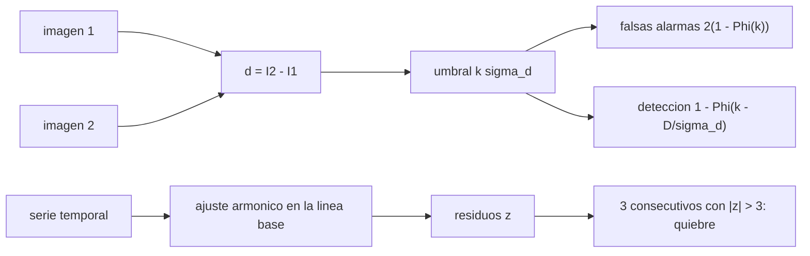

# B57-C27 — Detección de cambios en series de imágenes

<!-- nav:top -->
[🏠 Programa](../../../../README.md) · [📚 Bloque B57](../../../tronco-comun/B57-observacion-terrestre-y-geociencias-orbitales.md) · [← Anterior: B57-C26 — Corrección atmosférica de imágenes](../B57-C26-correccion-atmosferica-de-imagenes/CLASE.md) · [Siguiente: B57-C28 — Modelos digitales de elevación →](../B57-C28-modelos-digitales-de-elevacion/CLASE.md)
<!-- /nav -->

## 1. Ubicación, nivel y alcance

Clase 27 del bloque B57 (ampliación). Monitorear un territorio es comparar fechas. Aprendes la forma más simple, restar dos imágenes y poner un umbral, y calculas con la estadística cuántas falsas alarmas y cuántas detecciones esperas; luego pasas a una serie temporal con ciclo estacional, donde un ajuste armónico separa el cambio de lo normal. Todo con datos **sintéticos**.

## 2. Por qué esta clase existe

Un umbral bajo llena el mapa de falsas alarmas; uno alto deja pasar cambios reales. La decisión central: **¿qué umbral equilibra falsas alarmas y detecciones para el cambio que me interesa?**

## 3. Lo que podrás hacer al terminar

1. Calcular la probabilidad de falsa alarma de un umbral `kσ` sobre una diferencia.
2. Calcular la probabilidad de detección de un cambio de tamaño dado.
3. Verificar ambas con una simulación.
4. Ajustar un ciclo estacional y detectar un quiebre en una serie.
5. Medir el retraso de detección y las falsas alarmas de una regla de varias observaciones.

La evidencia es la **ficha de detección de cambios** del ejercicio 12 (sección 20).

## 4. Con qué llegas y cómo comprobarlo

1. ¿Qué es una distribución normal?
2. ¿Qué es una falsa alarma?
3. ¿Qué es la suma de ruidos independientes?
4. ¿Qué es un ajuste armónico?
5. ¿Qué es un dato sintético?

<details>
<summary>Ver respuestas</summary>

1. Una campana de media y desviación dadas. 2. Una detección donde no hay cambio. 3. Sus varianzas se suman. 4. Un ajuste por senos y cosenos de un periodo conocido. 5. Uno generado por una fórmula.
</details>

Con cuatro o cinco aciertos, sigue; si no, repasa los prerrequisitos.

## 5. Un caso de contexto y casos de referencia

Dos imágenes sintéticas de `200 × 200` píxeles con ruido `0,02` y un parche de `20 × 20` píxeles con un aumento de `0,15`; y una serie de 8 años con ciclo anual, ruido `0,03` y un quiebre de `−0,25` en el año 6. Es el **ejemplo conductor**; todo es **sintético**.

## 6. Vocabulario

La **diferencia de imágenes** `d = I₂ − I₁` tiene ruido `σ_d = √2 σ`. Un **umbral** `kσ_d` marca como cambio lo que lo supera. La **tasa de falsa alarma** es la probabilidad de marcar un píxel sin cambio; la de **detección**, la de marcar uno con cambio. Un **quiebre** (*break*) es un cambio brusco en una serie. Una **línea base** es el comportamiento normal ajustado en un periodo estable.

## 7. Modelo mental: un guardia con una linterna

El guardia ignora los ruidos normales de la noche y se alarma por los que superan un umbral. Un umbral bajo lo despierta con el viento; uno alto, cuando ya entró el ladrón.



*Descripción textual:* la diferencia y el umbral determinan falsas alarmas y detecciones; en una serie, un ajuste de línea base y una regla de varias observaciones detectan quiebres.

Analogía: un guardia con un umbral de ruido. Límite: el ruido real no es gaussiano ni independiente (nubes, registro, atmósfera).

## 8. La explicación, paso a paso

### 8.1 Diferencia de imágenes

Con `σ_d = √2 × 0,02 = 0,0283`:

| umbral | falsa alarma simulada | analítica | detección del cambio de +0,15 simulada | analítica |
|---|---|---|---|---|
| 2 σ_d | 4,500% | 4,550% | 100,0% | 100,0% |
| 3 σ_d | 0,275% | 0,270% | 99,0% | 98,9% |

Subir el umbral de 2 a 3 `σ_d` baja las falsas alarmas unas 17 veces y, para un cambio de 5 `σ_d`, apenas reduce la detección.

### 8.2 Serie temporal

Un ajuste armónico a los 3 primeros años deja residuos con `σ = 0,0370`. La regla «3 observaciones consecutivas con |z| > 3» da una alarma en `t = 6,089` años (quiebre en 6,000), con un retraso de `1,1 meses`, y `0` falsas alarmas entre los años 3 y 6.

### 8.3 Lectura

Exigir varias observaciones consecutivas reduce las falsas alarmas a costa de un retraso de la detección. Con la cadencia de 16 días de este ejemplo, la regla necesita tres observaciones tras el quiebre, un retraso del orden de uno a dos meses.

### 8.4 Límites

Los datos reales tienen nubes, errores de registro, cambios de iluminación y ruido no gaussiano. Los cambios naturales (fenología, estaciones) pueden parecer quiebres. Una detección automática es una alerta para revisar, no una prueba.

## 9. Magnitudes, símbolos y unidades

| Símbolo | Qué es | Unidad | Valor / nota |
|---|---|---|---|
| `σ` | ruido por imagen | reflectancia | 0,02 (sintético) |
| `σ_d` | ruido de la diferencia | reflectancia | 0,0283 |
| `k` | umbral en unidades de σ_d | — | 2; 3 |
| `P_fa` | tasa de falsa alarma | — | 0,27% (k = 3) |
| `P_d` | probabilidad de detección | — | 98,9% (Δ = 0,15, k = 3) |

## 10. Convenciones y referencias

Ruido gaussiano independiente; falsa alarma bilateral (|d| > kσ_d); series muestreadas cada 16 días; fecha en años desde el inicio.

## 11. De dónde sale lo que afirmamos

| ID | Fuente | Localizador | Respalda | Estado |
|---|---|---|---|---|
| — | Sin fuente externa | — | relaciones estándar que verifica el laboratorio | No se consultó una fuente para esta clase |

**Límites de las fuentes.** No se consultó ninguna fuente para esta clase: las probabilidades de falsa alarma y detección se calculan con la distribución normal y se contrastan con la simulación. Los datos son sintéticos.

## 12. Cómo ver los resultados

| Magnitud | Valor |
|---|---|
| falsa alarma con k = 3 (simulada / analítica) | 0,275% / 0,270% |
| detección con k = 3 | 99,0% |
| retraso de la alarma en la serie | 1,1 meses |

Descripción larga: la falsa alarma y la detección simuladas siguen las curvas teóricas, y la regla de tres observaciones detecta el quiebre con un retraso de pocas semanas.

## 13. Ejemplo trabajado: la falsa alarma de k = 3

**Paso 1 · Normal bilateral.** `2(1 − Φ(3))`.

**Paso 2 · Valor.** `Φ(3) = 0,99865`, luego `2 × 0,00135 = 0,0027`.

**Paso 3 · Simulación.** `0,275%`, acorde con `0,270%`.

## 14. Distintas formas de abordar el problema

**Por diferencia:** simple, para dos fechas. **Por serie y línea base:** separa lo estacional. **Por reglas de varias observaciones:** menos falsas alarmas, más retraso. Cada una trae un compromiso.

## 15. Práctica guiada

**Ejercicio 1 · con los pasos indicados.** Calcula `σ_d` si cada imagen tiene `σ = 0,03`. *Pasos:* `√2 σ`.

<details><summary>Solución comentada</summary>

`0,0424`.
</details>

**Ejercicio 2 · con una pista.** ¿Qué tasa de falsa alarma tiene `k = 3`? *Pista:* normal bilateral.

<details><summary>Solución comentada</summary>

`0,27 %`.
</details>

**Ejercicio 3 · casi autónomo.** ¿Cuántos píxeles se marcan en falso en 40 000 sin cambio con `k = 3`?

<details><summary>Solución comentada</summary>

Unos `108`.
</details>

## 16. Práctica autónoma, transferencia e integrador

**Ejercicio 4.** Con el mismo umbral, ¿cómo cambia la detección si el cambio fuera de `+0,05`?

<details><summary>Solución comentada</summary>

Baja mucho: `D/σ_d = 1,77`, que queda bajo `k = 3`.
</details>

**Ejercicio 5.** ¿Por qué se usa un ajuste armónico antes de buscar quiebres?

<details><summary>Solución comentada</summary>

Para quitar el ciclo estacional, que de otro modo parecería cambio.
</details>

**Ejercicio 6.** Si se exigen 5 observaciones consecutivas en lugar de 3, ¿qué pasa?

<details><summary>Solución comentada</summary>

Menos falsas alarmas y más retraso (unas 5 observaciones, 2,6 meses).
</details>

**Ejercicio 7.** ¿Por qué un cambio de 5 σ_d es casi siempre detectado con k = 3?

<details><summary>Solución comentada</summary>

Porque `P_d = 1 − Φ(−2) = 97,7 %`.
</details>

**Ejercicio 8.** Explica por qué un mapa de cambios con muchos píxeles aislados es sospechoso.

<details><summary>Solución comentada</summary>

Probablemente son falsas alarmas de ruido, que aparecen como píxeles sueltos; los cambios reales suelen formar parches.
</details>

**Ejercicio 9 · transferencia.** **Transferencia.** Una nube sin enmascarar cruza la escena. ¿Qué verías?

<details><summary>Solución comentada</summary>

Un cambio positivo grande donde no hay cambio del terreno.
</details>

**Ejercicio 10 · transferencia.** **Transferencia.** Se quiere alertar deforestación. ¿Qué compromiso eliges entre falsas alarmas y retraso?

<details><summary>Solución comentada</summary>

Depende del costo de revisar en terreno y del costo de actuar tarde; hay que declararlo.
</details>

**Ejercicio 11 · transferencia.** **Transferencia.** ¿Qué datos reales harían falta para validar el umbral?

<details><summary>Solución comentada</summary>

Cambios etiquetados con procedencia y fecha, y series con nubes enmascaradas.
</details>

**Ejercicio 12 · integrador.** **Integrador.** Elabora tu *ficha de detección de cambios*: la tabla de falsas alarmas y detección para k = 2 y 3, y el resultado de la regla de tres observaciones en la serie.

<details><summary>Solución modelo</summary>

Secciones 8.1 y 8.2 con las cifras de la ejecución y las limitaciones de 8.4.
</details>

## 17. Laboratorio: umbral de cambio y detección de quiebres

El script [cambios.py](cambios.py) restar dos imágenes sintéticas con umbral, contrastar falsas alarmas y detección con la teoría, y detectar un quiebre en una serie con línea base armónica (**comprueba** la falsa alarma con k = 2 dentro de 10 % de la teoría y la alarma de la serie después del quiebre y antes de 3 meses).

**Datos:** imágenes y series **sintéticas**; sin fuentes consultadas. **Predice antes de ejecutar:** ¿qué falsa alarma tiene k = 3? (0,27 %.) **Ejecución del 2026-11-09 (Python 3.12.9):**

```text
Python 3.12.9 ; numpy 2.4.4
k = 2: falsa alarma simulada = 4.500 % ; analitica = 4.550 % ; deteccion del cambio de +0.15: simulada = 100.0 % ; analitica = 100.0 %
k = 3: falsa alarma simulada = 0.275 % ; analitica = 0.270 % ; deteccion del cambio de +0.15: simulada = 99.0 % ; analitica = 98.9 %
Serie: sigma de los residuos del ajuste de 3 anios = 0.0370 ; alarma en t = 6.089 anios (quiebre en 6.000) ; retraso = 1.1 meses ; falsas alarmas antes del quiebre = 0
Pruebas superadas.
```

```bash
python programa/clases/B57/B57-C27-deteccion-de-cambios-en-series-de-imagenes/cambios.py
```

**Límites:** ruido gaussiano independiente, sin nubes ni errores de registro.

## 18. Errores frecuentes y cómo corregirlos

**Confundir ciclo estacional con cambio.** Ajusta la línea base (8.2).

**Elegir un umbral sin calcular las falsas alarmas.** Calcúlalas (8.1).

**Ignorar nubes y sombras.** Ejercicio 9.

**Tomar la alerta como prueba.** Es una alerta (8.4).

## 19. Cómo sabrás que vas bien

Tras la sección 8: ¿qué resultado esperabas y cuál obtuviste? Si dudas, repasa el ejemplo 13. Tras el laboratorio: ¿qué comprueba? (ver la sección 17).

## 20. Qué entregas y cómo se evalúa

El producto es tu **ficha de detección de cambios** (ejercicio 12).

| Criterio | Inicial | En desarrollo | Logrado | Destacado |
|---|---|---|---|---|
| Conceptos | Los confunde | Parciales | Conceptos de la clase | Explica los límites |
| Cálculo | Sin unidades | Con errores | Tablas completas con unidades | Calcula casos nuevos |
| Numérico | Sin comprobar | Un caso | Contraste con el caso analítico | Interpreta las diferencias |
| Fuentes | Sin fuente | Sin fecha | Fuentes con fecha | Declara lo no consultado |
| Límites | No los nombra | Uno | Tres | Discute qué falta del modelo |

**Condiciones críticas (no se compensan con promedio):** rotular las imágenes como sintéticas; declarar el umbral y las falsas alarmas esperadas; citar solo lo consultado (aquí, nada).

## 21. Ética, seguridad y límites

Clase educativa: las alertas automáticas pueden acusar a personas o comunidades si se interpretan sin verificación; se revisan antes de actuar. Accesibilidad: tablas equivalentes a las gráficas, fórmulas en texto, ejercicios sin conexión.

## 22. Para cerrar y seguir

Con `k = 3` la falsa alarma simulada es `0,28%` y se detecta el `99%` de un cambio de 0,15; el quiebre de la serie se detecta con `1,1` meses de retraso. Queda una pregunta: ¿cómo se obtiene la forma del terreno?

**Glosario español–inglés.** detección de cambios · *change detection*; falsa alarma · *false alarm*; línea base · *baseline*; quiebre · *break*; umbral · *threshold*.

**Continuidad.** [B57-C28](../B57-C28-modelos-digitales-de-elevacion/CLASE.md) estudia modelos digitales de elevación.

**Referencias:** ver sección 11.

<!-- nav:bottom -->
---

[← Anterior: B57-C26 — Corrección atmosférica de imágenes](../B57-C26-correccion-atmosferica-de-imagenes/CLASE.md) · [📚 Bloque B57](../../../tronco-comun/B57-observacion-terrestre-y-geociencias-orbitales.md) · [Siguiente: B57-C28 — Modelos digitales de elevación →](../B57-C28-modelos-digitales-de-elevacion/CLASE.md)
<!-- /nav -->
