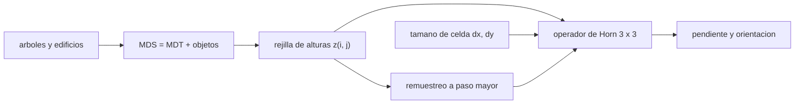

# B57-C28 — Modelos digitales de elevación

<!-- nav:top -->
[🏠 Programa](../../../../README.md) · [📚 Bloque B57](../../../tronco-comun/B57-observacion-terrestre-y-geociencias-orbitales.md) · [← Anterior: B57-C27 — Detección de cambios en series de imágenes](../B57-C27-deteccion-de-cambios-en-series-de-imagenes/CLASE.md) · [Siguiente: B57-C29 — Correcciones atmosféricas en altimetría →](../B57-C29-correcciones-atmosfericas-en-altimetria/CLASE.md)
<!-- /nav -->

## 1. Ubicación, nivel y alcance

Clase 28 del bloque B57 (ampliación). Un modelo digital de elevación (MDE) es el producto de la altimetría y la interferometría: una rejilla de alturas. Aquí calculas el tamaño de la celda en metros según la latitud, derivas pendiente y orientación con el operador de Horn, ves cuánto subestima la pendiente una rejilla más gruesa y la diferencia entre un modelo de **superficie** (copas de árboles y edificios) y uno de **terreno**. El Copernicus DEM (resolución, fuente y exactitud) es el de la página consultada; los terrenos son **sintéticos**.

## 2. Por qué esta clase existe

La pendiente decide dónde se produce un deslizamiento, cómo corre el agua o si una antena ve el horizonte. La decisión central: **¿qué resolución y qué tipo de modelo necesito para la pendiente que me importa?**

## 3. Lo que podrás hacer al terminar

1. Calcular el tamaño de celda en metros de una rejilla en grados.
2. Calcular pendiente y orientación con diferencias finitas de Horn.
3. Verificar el operador sobre un plano y un paraboloide.
4. Medir cuánto subestima la pendiente un paso mayor.
5. Distinguir modelo de superficie y de terreno.

La evidencia es la **ficha de un modelo digital de elevación** del ejercicio 12 (sección 20).

## 4. Con qué llegas y cómo comprobarlo

1. ¿Qué es una pendiente?
2. ¿Qué es un segundo de arco?
3. ¿Qué es una diferencia finita?
4. ¿Qué es un MDE?
5. ¿Qué es un valor sintético?

<details>
<summary>Ver respuestas</summary>

1. El cociente entre desnivel y distancia horizontal. 2. `1/3600` de grado. 3. Una aproximación de la derivada con valores vecinos. 4. Una rejilla de alturas del terreno. 5. Uno generado por una fórmula.
</details>

Con cuatro o cinco aciertos, sigue; si no, repasa los prerrequisitos.

## 5. Un caso de contexto y casos de referencia

El Copernicus DEM tiene una versión GLO-30 (rejilla de `1″`, unos `30 m`) y una GLO-90 (`3″`), generada con datos de TanDEM-X entre 2011 y 2015, con exactitud vertical absoluta inferior a `4 m` (LE90); es un modelo de **superficie** (consultado). Tú trabajas con terrenos **sintéticos**: un plano, un paraboloide y una ondulación sinusoidal con y sin árboles. Es el **ejemplo conductor**.

## 6. Vocabulario

Un **MDS** (modelo digital de superficie) incluye árboles y edificios; un **MDT** (de terreno) los quita. La **pendiente** es `√((∂z/∂x)² + (∂z/∂y)²)`; la **orientación** es la dirección hacia donde mira la ladera. El **operador de Horn** estima las derivadas con una ventana 3 × 3. El **tamaño de celda** depende de la latitud: un segundo de arco mide unos 31 m en latitud y menos en longitud lejos del ecuador.

## 7. Modelo mental: medir una ladera con una regla de longitud fija

Si mides una montaña con una regla de 30 m, se te pierden los peñascos de 5 m; con una de 90 m, aún más. La pendiente que ves depende de la regla.



*Descripción textual:* la rejilla y el tamaño de celda alimentan el operador de Horn, que da pendiente y orientación; un paso mayor las subestima, y los objetos sobre el terreno distinguen el MDS del MDT.

Analogía: medir una costa con reglas de distinta longitud. Límite: aquí el terreno es suave; uno fractal sería peor.

## 8. La explicación, paso a paso

### 8.1 El tamaño de celda

Un segundo de arco mide `30,89 m` en latitud. En longitud mide `30,89 m` en el ecuador, `25,90 m` a 33° S y `15,44 m` a 60° S. Una rejilla en grados no tiene celdas cuadradas en metros.

### 8.2 Comprobar el operador

Sobre un plano `z = 0,2x + 0,1y` (pendiente `12,604°`) el operador de Horn es exacto (error `0,0e+00`). Sobre un paraboloide el error relativo máximo de la pendiente es `4,74e-15`.

### 8.3 Resolución y pendiente

Una ondulación sinusoidal de 200 m de amplitud y 2000 m de longitud de onda tiene pendiente máxima `0,6283` (analítica). El operador da `0,6282` con paso de 10 m, `0,6271` con 30 m y `0,6197` con 90 m: cada degradación subestima más la pendiente máxima.

### 8.4 Superficie frente a terreno

Con árboles de 15 m sobre la mitad del dominio, la diferencia entre superficie y terreno llega a `15,0 m` y el borde del bosque crea una pendiente falsa (`0,750` frente a `0,628` del terreno). Un modelo de superficie como el Copernicus DEM no es un modelo del suelo bajo el bosque.

## 9. Magnitudes, símbolos y unidades

| Símbolo | Qué es | Unidad | Valor / nota |
|---|---|---|---|
| `dx` | tamaño de celda | m | 30,89 (latitud) |
| `s` | pendiente | — | 0,6283 (máx. sintética) |
| `h_árbol` | altura de la vegetación | m | 15 (sintética) |
| `LE90` | error vertical absoluto (publicado) | m | < 4 (Copernicus DEM) |

## 10. Convenciones y referencias

Pendiente como tangente (adimensional) o en grados según se indique; orientación desde el norte; celdas en metros planos; radio terrestre de 6371 km para el tamaño de celda en grados.

## 11. De dónde sale lo que afirmamos

| ID | Fuente | Localizador | Respalda | Estado |
|---|---|---|---|---|
| S1 | Copernicus Data Space, *Copernicus DEM (GLO-30 y GLO-90)* | https://dataspace.copernicus.eu/explore-data/data-collections/copernicus-contributing-missions/collections-description/COP-DEM | rejillas GLO-30 (1″) y GLO-90 (3″), origen TanDEM-X 2011–2015, exactitud vertical absoluta inferior a 4 m (LE90), modelo de superficie. | Consultada 2026-11-09 |

**Límites de las fuentes.** La página consultada no daba la exactitud horizontal ni el tratamiento de edición de los árboles. El radio terrestre y el operador de Horn no se consultaron en una fuente; el operador se verifica contra un plano y un paraboloide.

## 12. Cómo ver los resultados

| Magnitud | Valor |
|---|---|
| celda de 1″ en latitud / en longitud a 33° S | 30,89 / 25,90 m |
| pendiente máxima paso 10 / 30 / 90 m | 0,6282 / 0,6271 / 0,6197 |
| diferencia superficie–terreno | 15,0 m |

Descripción larga: la pendiente máxima baja a medida que se engruesa la rejilla y un bosque crea escalones falsos en el modelo de superficie.

## 13. Ejemplo trabajado: el tamaño de celda a 33° S

**Paso 1 · Latitud.** `1″ = 4,848 × 10⁻⁶ rad × 6 371 000 m = 30,89 m`.

**Paso 2 · Longitud.** `× cos 33° = 25,90 m`.

## 14. Distintas formas de abordar el problema

**Por resolución fina:** más detalle y más datos. **Por superficie:** incluye copas, útil para viento o radio. **Por terreno:** necesario para escurrimiento y deslizamientos. Elegir mal confunde el fenómeno.

## 15. Práctica guiada

**Ejercicio 1 · con los pasos indicados.** ¿Cuánto mide `1″` de latitud en metros? *Pasos:* arco por radio.

<details><summary>Solución comentada</summary>

`30,89 m`.
</details>

**Ejercicio 2 · con una pista.** ¿Cuánto mide `3″` en latitud?

<details><summary>Solución comentada</summary>

`92,6 m`.
</details>

**Ejercicio 3 · casi autónomo.** ¿Cuánto mide `1″` en longitud a 60° de latitud? *Pista:* `cos 60° = 0,5`.

<details><summary>Solución comentada</summary>

`15,44 m`.
</details>

## 16. Práctica autónoma, transferencia e integrador

**Ejercicio 4.** Calcula la pendiente de un plano `z = 0,2x + 0,1y` en grados.

<details><summary>Solución comentada</summary>

`12,604°`.
</details>

**Ejercicio 5.** ¿Por qué el operador de Horn es exacto sobre un plano?

<details><summary>Solución comentada</summary>

Porque las diferencias finitas centradas reproducen exactamente una función lineal.
</details>

**Ejercicio 6.** ¿Qué pasa con la pendiente máxima al pasar de 30 m a 90 m? Usa 8.3.

<details><summary>Solución comentada</summary>

Baja de 0,627 a 0,620.
</details>

**Ejercicio 7.** ¿Por qué un MDS no sirve para modelar el escurrimiento bajo un bosque?

<details><summary>Solución comentada</summary>

Porque el agua corre sobre el suelo y el MDS ve las copas.
</details>

**Ejercicio 8.** Un deslizamiento de 20 m de ancho, ¿se ve en GLO-30?

<details><summary>Solución comentada</summary>

Difícilmente: es menor que la celda (30 m).
</details>

**Ejercicio 9 · transferencia.** **Transferencia.** Se pide pendiente en laderas de 10 m de ancho. ¿Qué MDE eliges?

<details><summary>Solución comentada</summary>

Uno con celda de 10 m o menos, en lo posible un MDT obtenido con LiDAR; GLO-30 no tiene resolución suficiente.
</details>

**Ejercicio 10 · transferencia.** **Transferencia.** ¿Qué diferencia hay entre exactitud vertical y resolución horizontal?

<details><summary>Solución comentada</summary>

La primera es el error de altura (LE90 < 4 m); la segunda, el tamaño de celda (30 o 90 m): un MDE puede ser exacto y grueso.
</details>

**Ejercicio 11 · transferencia.** **Transferencia.** ¿Qué datos reales harían falta para validar este cálculo?

<details><summary>Solución comentada</summary>

Puntos de control con procedencia y alturas de terreno de mayor exactitud (clase C31).
</details>

**Ejercicio 12 · integrador.** **Integrador.** Elabora tu *ficha de un modelo digital de elevación*: la tabla de tamaño de celda, la verificación del operador de Horn, el efecto de la resolución sobre la pendiente máxima y la diferencia superficie–terreno.

<details><summary>Solución modelo</summary>

Secciones 8.1 a 8.4 con las cifras de la ejecución, rotulando los terrenos como sintéticos.
</details>

## 17. Laboratorio: pendiente, resolución y superficie frente a terreno

El script [mde.py](mde.py) calcula el tamaño de celda, verifica el operador de Horn sobre un plano y un paraboloide y mide el efecto de la resolución y de los árboles (**comprueba** el plano exacto a 1e-9, el paraboloide con 1 % y que la pendiente máxima baja con la resolución).

**Datos:** Copernicus DEM publicado (S1); terrenos **sintéticos**; radio terrestre de referencia no consultado. **Predice antes de ejecutar:** ¿qué paso subestima más la pendiente? (el de 90 m.) **Ejecución del 2026-11-09 (Python 3.12.9):**

```text
Python 3.12.9 ; numpy 2.4.4
Celda de 1 segundo de arco: 30.89 m en latitud ; en longitud a 0 = 30.89 m ; a 33 S = 25.90 m ; a 60 S = 15.44 m
Plano z = 0.2 x + 0.1 y: pendiente 12.604 grados ; error de Horn = 0.0e+00
Paraboloide: error relativo maximo de la pendiente (donde > 0.05) = 4.74e-15
Terreno sinusoidal (pendiente maxima analitica = 0.6283): paso 10 m = 0.6282 ; paso 30 m = 0.6271 ; paso 90 m = 0.6197
Arboles de 15 m en la mitad: diferencia superficie-terreno maxima = 15.0 m ; pendiente maxima en el borde del bosque (paso 10 m) = 0.750
Pruebas superadas.
```

```bash
python programa/clases/B57/B57-C28-modelos-digitales-de-elevacion/mde.py
```

**Límites:** terrenos suaves y sintéticos; árboles como un escalón.

## 18. Errores frecuentes y cómo corregirlos

**Suponer celdas cuadradas en grados.** Cambian con la latitud (8.1).

**Usar un MDS como MDT.** Se corrige con 8.4.

**Confundir exactitud y resolución.** Ejercicio 10.

**Presentar el terreno como real.** Es sintético (sección 5).

## 19. Cómo sabrás que vas bien

Tras la sección 8: ¿qué resultado esperabas y cuál obtuviste? Si dudas, repasa el ejemplo 13. Tras el laboratorio: ¿qué comprueba? (ver la sección 17).

## 20. Qué entregas y cómo se evalúa

El producto es tu **ficha de un modelo digital de elevación** (ejercicio 12).

| Criterio | Inicial | En desarrollo | Logrado | Destacado |
|---|---|---|---|---|
| Conceptos | Los confunde | Parciales | Conceptos de la clase | Explica los límites |
| Cálculo | Sin unidades | Con errores | Tablas completas con unidades | Calcula casos nuevos |
| Numérico | Sin comprobar | Un caso | Contraste con el caso analítico | Interpreta las diferencias |
| Fuentes | Sin fuente | Sin fecha | Fuentes con fecha | Declara lo no consultado |
| Límites | No los nombra | Uno | Tres | Discute qué falta del modelo |

**Condiciones críticas (no se compensan con promedio):** rotular los terrenos como sintéticos; declarar si el modelo es de superficie o de terreno; citar solo lo consultado.

## 21. Ética, seguridad y límites

Clase educativa: la pendiente calculada no sirve para evaluar la estabilidad de ninguna ladera real. Accesibilidad: tablas equivalentes a las gráficas, fórmulas en texto, ejercicios sin conexión.

## 22. Para cerrar y seguir

La celda de GLO-30 mide `31 m` en latitud y `26 m` en longitud a 33° S, y un paso de 90 m subestima la pendiente máxima `0,628` hasta `0,620`. Queda una pregunta: ¿cómo se corrige el retraso de la atmósfera en la altimetría?

**Glosario español–inglés.** modelo digital de elevación · *digital elevation model (DEM)*; modelo de superficie · *digital surface model (DSM)*; modelo de terreno · *digital terrain model (DTM)*; pendiente · *slope*; orientación · *aspect*.

**Continuidad.** [B57-C29](../B57-C29-correcciones-atmosfericas-en-altimetria/CLASE.md) estudia correcciones atmosféricas en altimetría.

**Referencias:** ver sección 11.

<!-- nav:bottom -->
---

[← Anterior: B57-C27 — Detección de cambios en series de imágenes](../B57-C27-deteccion-de-cambios-en-series-de-imagenes/CLASE.md) · [📚 Bloque B57](../../../tronco-comun/B57-observacion-terrestre-y-geociencias-orbitales.md) · [Siguiente: B57-C29 — Correcciones atmosféricas en altimetría →](../B57-C29-correcciones-atmosfericas-en-altimetria/CLASE.md)
<!-- /nav -->
