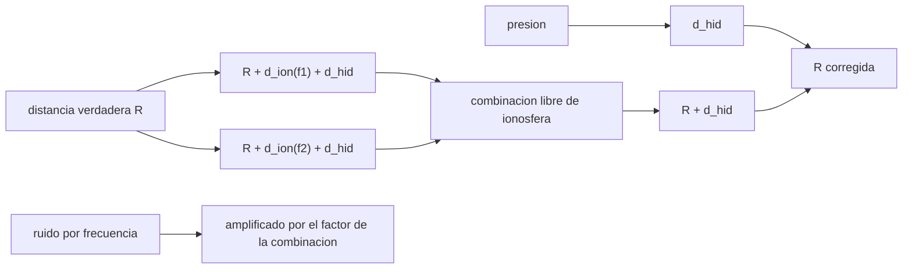

# B57-C29 — Correcciones atmosféricas en altimetría

<!-- nav:top -->
[🏠 Programa](../../../../README.md) · [📚 Bloque B57](../../../tronco-comun/B57-observacion-terrestre-y-geociencias-orbitales.md) · [← Anterior: B57-C28 — Modelos digitales de elevación](../B57-C28-modelos-digitales-de-elevacion/CLASE.md) · [Siguiente: B57-C30 — Nubes de puntos tridimensionales →](../../../tronco-comun/B57-observacion-terrestre-y-geociencias-orbitales.md#b57-c30)
<!-- /nav -->

## 1. Ubicación, nivel y alcance

Clase 29 del bloque B57 (ampliación). El pulso de un altímetro viaja más lento en la atmósfera, de modo que la distancia medida es mayor que la real. La troposfera seca retrasa unos 2,3 m según la presión; la ionosfera retrasa decenas de centímetros según la frecuencia. Calculas los dos retardos con fórmulas conocidas (**no consultadas** en esta sesión), usas dos frecuencias para eliminar el efecto ionosférico y mides cuánto amplifica el ruido esa combinación. Todo con datos **sintéticos**.

## 2. Por qué esta clase existe

Un error de decímetros en la distancia equivale a decímetros de error en la altura del mar, mayor que las señales que se buscan. La decisión central: **¿qué corrección aplicar a cada retardo y cuánto ruido agrega?**

## 3. Lo que podrás hacer al terminar

1. Calcular el retardo ionosférico a una frecuencia dada y su dependencia con `1/f²`.
2. Calcular el retardo hidrostático seco en función de la presión, la latitud y la altura.
3. Eliminar la ionosfera con dos frecuencias.
4. Medir la amplificación del ruido de esa combinación.
5. Relacionar presión y nivel del mar con la barometría inversa.

La evidencia es la **ficha de correcciones atmosféricas** del ejercicio 12 (sección 20).

## 4. Con qué llegas y cómo comprobarlo

1. ¿Qué es el TEC?
2. ¿Qué es una dependencia `1/f²`?
3. ¿Qué es la presión de superficie?
4. ¿Qué es una combinación lineal?
5. ¿Qué es un dato sintético?

<details>
<summary>Ver respuestas</summary>

1. El contenido total de electrones por área en la columna de la ionosfera. 2. Un efecto que cae con el cuadrado de la frecuencia. 3. El peso de la columna de aire por unidad de área. 4. Una suma ponderada de medidas. 5. Uno generado por una fórmula.
</details>

Con cuatro o cinco aciertos, sigue; si no, repasa los prerrequisitos.

## 5. Un caso de contexto y casos de referencia

Un altímetro **ilustrativo** mide a `13,575 GHz` (Ku) y `5,41 GHz` (C) con un ruido de `2 cm` por frecuencia, con un contenido electrónico de `50 TECU` y presiones de `1013,25`, `1000` y `700 hPa`. Es el **ejemplo conductor**; los valores son **ilustrativos** y las fórmulas, conocimiento general **no consultado**.

## 6. Vocabulario

El **retardo ionosférico** es proporcional al TEC y a `1/f²`. El **retardo troposférico seco (hidrostático)** es casi proporcional a la presión de superficie. La **combinación libre de ionosfera** usa dos frecuencias para anular el término `1/f²`. La **barometría inversa** es la respuesta del nivel del mar a la presión: alta presión baja el nivel. Un **TECU** es `10¹⁶` electrones por metro cuadrado.

## 7. Modelo mental: medir con una cinta que se estira

La atmósfera estira la cinta métrica del radar. La ionosfera la estira distinto en cada frecuencia, y esa diferencia permite saber cuánto se estiró.



*Descripción textual:* las dos medidas tienen la misma distancia más un retardo ionosférico distinto; la combinación elimina la ionosfera y amplifica el ruido, y el retardo seco se resta aparte con la presión.

Analogía: medir con una cinta que se estira distinto según su color. Límite: la ionosfera real tiene efectos de orden superior que esta fórmula no incluye.

## 8. La explicación, paso a paso

### 8.1 Ionosfera

Con 50 TECU el retardo es `0,1093 m` en Ku y `0,6885 m` en C; con 20 TECU, `0,0437` y `0,2754 m`. El efecto cae como `1/f²`: a frecuencia menor, retardo mayor.

### 8.2 Troposfera seca

El retardo hidrostático a 33° S y nivel del mar es `2,3095 m` con 1013,25 hPa, `2,2793 m` con 1000 hPa y `1,5955 m` con 700 hPa; a 3 km de altura y 700 hPa, `1,5968 m`. Una diferencia de 30 hPa cambia el retardo unos `6,8 cm`.

### 8.3 Combinación libre de ionosfera

La combinación recupera la distancia con error `0,0e+00 m` sin ruido. Con 2 cm de ruido por frecuencia, el factor de amplificación analítico es `1,2037` y el simulado `1,2050` (razón `1,0011`): el ruido final es `2,41 cm`.

### 8.4 Presión y nivel del mar

La barometría inversa da `9,95 mm` de nivel por hPa; 30 hPa de presión equivalen a unos `29,8 cm`. Es una corrección distinta del retardo: el retardo corrige la medición; la barometría corrige una respuesta física del océano que muchos estudios restan.

## 9. Magnitudes, símbolos y unidades

| Símbolo | Qué es | Unidad | Valor / nota |
|---|---|---|---|
| `TEC` | contenido electrónico total | TECU | 20; 50 (ilustrativo) |
| `d_ion` | retardo ionosférico | m | 0,1093 (Ku, 50 TECU) |
| `d_hid` | retardo hidrostático | m | 2,3095 (1013,25 hPa) |
| `A` | amplificación del ruido | — | 1,204 |
| `k_b` | barometría inversa | mm/hPa | 9,95 |

## 10. Convenciones y referencias

Retardos positivos (la distancia medida es mayor); presión en hPa; TEC en TECU; frecuencias en Hz; latitud negativa al sur. Fórmulas de primer orden y conocimiento general no consultado.

## 11. De dónde sale lo que afirmamos

| ID | Fuente | Localizador | Respalda | Estado |
|---|---|---|---|---|
| — | Sin fuente externa | — | relaciones estándar que verifica el laboratorio | No se consultó una fuente para esta clase |

**Límites de las fuentes.** No se consultó ninguna fuente de altimetría (la página de Sentinel-6 no abrió). Las fórmulas del retardo se usan como conocimiento general y se contrastan con el laboratorio solo en lo algebraico. No se corrige el retardo húmedo ni los efectos de orden superior.

## 12. Cómo ver los resultados

| Magnitud | Valor |
|---|---|
| ionosfera 50 TECU: Ku / C | 0,1093 / 0,6885 m |
| hidrostático 1013,25 hPa | 2,3095 m |
| amplificación del ruido | 1,204 (analítica) / 1,205 (simulada) |
| 1 hPa en nivel del mar | 9,95 mm |

Descripción larga: el retardo hidrostático es de metros, el ionosférico de centímetros y la combinación de frecuencias lo elimina a cambio de algo de ruido.

## 13. Ejemplo trabajado: el retardo ionosférico en Ku

**Paso 1 · Fórmula.** `d = 40,3 · TEC/f²`.

**Paso 2 · Datos.** `TEC = 50 × 10¹⁶ m⁻²`, `f = 13,575 × 10⁹ Hz`.

**Paso 3 · Resultado.** `40,3 × 5 × 10¹⁷/(1,843 × 10²⁰) = 0,1093 m`.

## 14. Distintas formas de abordar el problema

**Por modelo:** barato, se apoya en mapas de TEC y de presión. **Por doble frecuencia:** mide la ionosfera, a cambio de ruido. **Por radiómetro:** mide el vapor de agua (retardo húmedo, no tratado aquí).

## 15. Práctica guiada

**Ejercicio 1 · con los pasos indicados.** Calcula el retardo para `TEC = 20 TECU` a `13,575 GHz`. *Pasos:* fórmula 8.1.

<details><summary>Solución comentada</summary>

`0,0437 m`.
</details>

**Ejercicio 2 · con una pista.** Si se duplica la frecuencia, ¿cómo cambia el retardo ionosférico?

<details><summary>Solución comentada</summary>

Baja 4 veces.
</details>

**Ejercicio 3 · casi autónomo.** ¿Qué retardo hidrostático corresponde a 1013,25 hPa?

<details><summary>Solución comentada</summary>

`2,3095 m`.
</details>

## 16. Práctica autónoma, transferencia e integrador

**Ejercicio 4.** ¿Y a 1000 hPa?

<details><summary>Solución comentada</summary>

`2,2793 m`.
</details>

**Ejercicio 5.** ¿Cuánto cambia el nivel del mar con una presión 10 hPa mayor? Usa la barometría inversa.

<details><summary>Solución comentada</summary>

Baja unos `9,95 mm × 10 ≈ 10 cm`.
</details>

**Ejercicio 6.** ¿Por qué no basta una corrección hidrostática de presión estándar?

<details><summary>Solución comentada</summary>

Porque la presión real varía unas decenas de hPa, lo que cambia el retardo en centímetros.
</details>

**Ejercicio 7.** ¿Qué amplificación tiene la combinación? Usa 8.3.

<details><summary>Solución comentada</summary>

`1,204`: el ruido sube a `2,41 cm`.
</details>

**Ejercicio 8.** Explica por qué la combinación elimina la ionosfera.

<details><summary>Solución comentada</summary>

Porque pondera las dos medidas para que el término `1/f²` se cancele.
</details>

**Ejercicio 9 · transferencia.** **Transferencia.** Un altímetro de una sola frecuencia usa un mapa de TEC. ¿Qué error agrega?

<details><summary>Solución comentada</summary>

El error del mapa de TEC; a 13,575 GHz, 5 TECU de error valen `1,1 cm`.
</details>

**Ejercicio 10 · transferencia.** **Transferencia.** ¿Qué retardo no se trató y por qué importa?

<details><summary>Solución comentada</summary>

El húmedo (vapor de agua), de varios centímetros y muy variable, que se mide con un radiómetro.
</details>

**Ejercicio 11 · transferencia.** **Transferencia.** ¿Qué datos reales harían falta para validar este cálculo?

<details><summary>Solución comentada</summary>

Mapas de TEC y de presión con procedencia y mediciones de referencia independientes.
</details>

**Ejercicio 12 · integrador.** **Integrador.** Elabora tu *ficha de correcciones atmosféricas*: la tabla de retardos ionosféricos e hidrostáticos, la combinación libre de ionosfera con su amplificación y la barometría inversa.

<details><summary>Solución modelo</summary>

Secciones 8.1 a 8.4 con las cifras de la ejecución, aclarando que las fórmulas no se consultaron y que los valores son ilustrativos.
</details>

## 17. Laboratorio: retardos ionosférico e hidrostático y combinación de dos frecuencias

El script [correcciones_alt.py](correcciones_alt.py) calcula retardos ionosféricos e hidrostáticos, elimina la ionosfera con dos frecuencias y mide la amplificación del ruido por Monte Carlo (**comprueba** la combinación exacta a 1e-9 m y la amplificación simulada frente a la analítica con 3 %).

**Datos:** frecuencias, TEC, presión y ruido **sintéticos / ilustrativos**; fórmulas de conocimiento general no consultado. **Predice antes de ejecutar:** ¿cuántos metros retrasa la troposfera seca a presión estándar? (unos 2,3.) **Ejecución del 2026-11-09 (Python 3.12.9):**

```text
Python 3.12.9 ; numpy 2.4.4
Retardo ionosferico 50 TECU: Ku (13.575 GHz) = 10.93 cm ; C (5.41 GHz) = 68.85 cm ; 20 TECU: Ku = 4.37 cm ; C = 27.54 cm
Retardo hidrostatico (lat -33, nivel del mar): 1013.25 hPa = 2.3095 m ; 1000 hPa = 2.2793 m ; 700 hPa = 1.5955 m ; 700 hPa a 3 km = 1.5968 m
Combinacion libre de ionosfera: error sin ruido = 0.0e+00 m
Amplificacion del ruido: analitica = 1.2037 ; simulada = 1.2050 ; razon = 1.0011 ; ruido de 2 cm -> 2.41 cm
Barometria inversa: 1 hPa = 9.95 mm de nivel del mar ; 30 hPa = 29.8 cm
Pruebas superadas.
```

```bash
python programa/clases/B57/B57-C29-correcciones-atmosfericas-en-altimetria/correcciones_alt.py
```

**Límites:** ionosfera de primer orden y sin retardo húmedo.

## 18. Errores frecuentes y cómo corregirlos

**Confundir el retardo con la barometría inversa.** Se aclara en 8.4.

**Ignorar la amplificación del ruido.** Se mide en 8.3.

**Usar presión estándar para un lugar de altura.** Cambia el retardo (8.2).

**Presentar los valores como medidos.** Son ilustrativos (sección 5).

## 19. Cómo sabrás que vas bien

Tras la sección 8: ¿qué resultado esperabas y cuál obtuviste? Si dudas, repasa el ejemplo 13. Tras el laboratorio: ¿qué comprueba? (ver la sección 17).

## 20. Qué entregas y cómo se evalúa

El producto es tu **ficha de correcciones atmosféricas** (ejercicio 12).

| Criterio | Inicial | En desarrollo | Logrado | Destacado |
|---|---|---|---|---|
| Conceptos | Los confunde | Parciales | Conceptos de la clase | Explica los límites |
| Cálculo | Sin unidades | Con errores | Tablas completas con unidades | Calcula casos nuevos |
| Numérico | Sin comprobar | Un caso | Contraste con el caso analítico | Interpreta las diferencias |
| Fuentes | Sin fuente | Sin fecha | Fuentes con fecha | Declara lo no consultado |
| Límites | No los nombra | Uno | Tres | Discute qué falta del modelo |

**Condiciones críticas (no se compensan con promedio):** rotular los valores como ilustrativos; declarar que las fórmulas no se consultaron; no presentar el modelo como un procesador de misión.

## 21. Ética, seguridad y límites

Clase educativa: no se corrige ningún dato real. Accesibilidad: tablas equivalentes a las gráficas, fórmulas en texto, ejercicios sin conexión.

## 22. Para cerrar y seguir

La ionosfera retrasa `0,11 m` en Ku con 50 TECU, la troposfera seca `2,31 m`, y la combinación de dos frecuencias multiplica el ruido por `1,20`. Queda una pregunta: ¿cómo se procesan los datos LiDAR en tres dimensiones?

**Glosario español–inglés.** retardo ionosférico · *ionospheric delay*; retardo troposférico seco · *dry tropospheric delay*; contenido electrónico total · *total electron content (TEC)*; barometría inversa · *inverse barometer*; doble frecuencia · *dual frequency*.

**Continuidad.** [B57-C30](../B57-C30-nubes-de-puntos-tridimensionales/CLASE.md) estudia nubes de puntos tridimensionales.

**Referencias:** ver sección 11.

<!-- nav:bottom -->
---

[← Anterior: B57-C28 — Modelos digitales de elevación](../B57-C28-modelos-digitales-de-elevacion/CLASE.md) · [📚 Bloque B57](../../../tronco-comun/B57-observacion-terrestre-y-geociencias-orbitales.md) · [Siguiente: B57-C30 — Nubes de puntos tridimensionales →](../../../tronco-comun/B57-observacion-terrestre-y-geociencias-orbitales.md#b57-c30)
<!-- /nav -->
