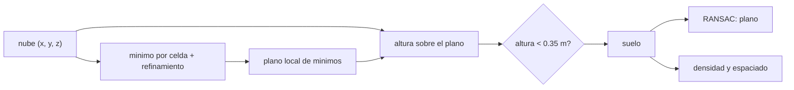

# B57-C30 — Nubes de puntos tridimensionales

<!-- nav:top -->
[🏠 Programa](../../../../README.md) · [📚 Bloque B57](../../../tronco-comun/B57-observacion-terrestre-y-geociencias-orbitales.md) · [← Anterior: B57-C29 — Correcciones atmosféricas en altimetría](../B57-C29-correcciones-atmosfericas-en-altimetria/CLASE.md) · [Siguiente: B57-C31 — Errores y validación de modelos de elevación →](../B57-C31-errores-y-validacion-de-modelos-de-elevacion/CLASE.md)
<!-- /nav -->

## 1. Ubicación, nivel y alcance

Clase 30 del bloque B57 (ampliación). Un LiDAR entrega millones de puntos `(x, y, z)` sin etiquetar. Antes de usarlos hay que separar el suelo de la vegetación y los edificios, ajustar superficies y entender la densidad. Aquí generas una nube **sintética** con suelo inclinado, árboles y un edificio, filtras el suelo con un mínimo por celda, ajustas un plano con RANSAC y mides la densidad. Ninguna nube real se procesa.

## 2. Por qué esta clase existe

Un modelo de terreno malo hace que las pendientes y las alturas de los árboles salgan mal. La decisión central: **¿cómo se separa el suelo del resto con la menor contaminación y qué densidad de puntos hace falta?**

## 3. Lo que podrás hacer al terminar

1. Describir una nube de puntos y su densidad.
2. Aplicar un filtro de suelo (mínimo por celda y refinamiento del plano) y medir su recall y contaminación.
3. Ajustar un plano con RANSAC y medir su error de pendiente.
4. Comparar el ajuste con y sin filtro de suelo.
5. Calcular el espaciado medio de los puntos del suelo.

La evidencia es la **ficha de una nube de puntos** del ejercicio 12 (sección 20).

## 4. Con qué llegas y cómo comprobarlo

1. ¿Qué es un punto `(x, y, z)`?
2. ¿Qué es un plano?
3. ¿Qué es un valor atípico?
4. ¿Qué es el recall?
5. ¿Qué es un dato sintético?

<details>
<summary>Ver respuestas</summary>

1. Una posición en tres dimensiones. 2. La superficie `z = ax + by + c`. 3. Un dato muy lejos del patrón. 4. La fracción de los elementos buscados que se recuperan. 5. Uno generado por una fórmula.
</details>

Con cuatro o cinco aciertos, sigue; si no, repasa los prerrequisitos.

## 5. Un caso de contexto y casos de referencia

Una nube **sintética** de `100 × 100 m` con terreno inclinado (`0,10` y `0,05`), 40 árboles de `12 m` y un edificio de `10 × 10 × 8 m`. Es el **ejemplo conductor**; no es una nube de ninguna misión ni de ningún lugar.

## 6. Vocabulario

Una **nube de puntos** es un conjunto de posiciones 3D. El **filtro de suelo** clasifica los puntos que están en el terreno. Un **RANSAC** (*random sample consensus*) ajusta un modelo a muestras mínimas aleatorias y elige el que más puntos explica. El **recall** es la fracción del suelo verdadero recuperada; la **contaminación** es la fracción de lo clasificado como suelo que no lo es. La **densidad** es puntos por metro cuadrado.

## 7. Modelo mental: buscar el piso de un bosque

Para ver el piso del bosque ignoras los troncos y copas y miras lo más bajo en cada rincón; con esos puntos bajos ajustas una superficie.



*Descripción textual:* el mínimo por celda da una superficie de referencia, la altura sobre ella separa suelo de lo demás y sobre el suelo se ajusta un plano y se mide la densidad.

Analogía: buscar el piso de un bosque ignorando las copas. Límite: en una ladera muy empinada o con mucha maleza baja, el mínimo por celda falla.

## 8. La explicación, paso a paso

### 8.1 La nube

La nube sintética tiene `27500` puntos en 1 ha (`2,75 puntos/m²`).

### 8.2 Filtrar el suelo

El filtro (plano inicial por mínimo en celdas de 5 m, refinado tres veces con los puntos a menos de 1,2; 0,7 y 0,35 m) clasifica `20003` puntos como suelo con un recall de `1,000` y una contaminación de `0,01%`: los puntos de tronco bajo y de maleza sintética que caen bajo el umbral.

### 8.3 RANSAC

Sobre el suelo filtrado, RANSAC recupera pendientes `0,1000` y `0,0500` (verdaderas: 0,1000 y 0,0500) con error máximo `0,0000` y `99,6%` de inliers. Sobre toda la nube, sin filtrar, el error máximo es `0,0002`: aquí el suelo es el 73 % de los puntos y RANSAC lo encuentra igual; con menos suelo (un bosque denso o una ciudad) fallaría.

### 8.4 Densidad

El suelo tiene `2,00 puntos/m²`, un espaciado medio de `0,71 m`. Con esa densidad un MDT puede tener celdas de 1 m, pero no detalles menores que el espaciado.

## 9. Magnitudes, símbolos y unidades

| Símbolo | Qué es | Unidad | Valor / nota |
|---|---|---|---|
| `N` | puntos de la nube | — | 27500 (sintética) |
| `ρ` | densidad | puntos/m² | 2,75 |
| `recall` | suelo recuperado | — | 1,000 |
| pendiente | plano ajustado | — | 0,100; 0,050 |

## 10. Convenciones y referencias

Coordenadas planas en metros; `z` hacia arriba; pendientes como tangentes; celda de 5 m y umbral de 0,35 m ilustrativos; sin puntos bajo el suelo.

## 11. De dónde sale lo que afirmamos

| ID | Fuente | Localizador | Respalda | Estado |
|---|---|---|---|---|
| — | Sin fuente externa | — | relaciones estándar que verifica el laboratorio | No se consultó una fuente para esta clase |

**Límites de las fuentes.** No se consultó ninguna fuente para esta clase: el filtro por mínimo en celdas y RANSAC se tratan como métodos conocidos que verifica el laboratorio contra la verdad sintética. La nube es sintética.

## 12. Cómo ver los resultados

| Magnitud | Valor |
|---|---|
| recall del suelo | 1,000 |
| contaminación | 0,01% |
| error de pendiente con filtro / sin filtro | 0,0000 / 0,0002 |
| espaciado del suelo | 0,71 m |

Descripción larga: el filtro recupera casi todo el suelo con muy poca contaminación, y RANSAC acierta la pendiente con y sin filtro porque el suelo domina la nube.

## 13. Ejemplo trabajado: la densidad

**Paso 1 · Puntos.** `27500` en total.

**Paso 2 · Área.** `100 × 100 = 10 000 m²`.

**Paso 3 · Densidad.** `2,75 puntos/m²`.

## 14. Distintas formas de abordar el problema

**Por mínimo por celda:** simple, falla en laderas. **Por RANSAC:** robusto a valores atípicos. **Por clasificación aprendida:** necesita etiquetas. Cada uno tiene un régimen de validez.

## 15. Práctica guiada

**Ejercicio 1 · con los pasos indicados.** Calcula la densidad de `5000` puntos en `50 × 50 m`. *Pasos:* puntos entre área.

<details><summary>Solución comentada</summary>

`2 puntos/m²`.
</details>

**Ejercicio 2 · con una pista.** ¿Qué espaciado medio da esa densidad?

<details><summary>Solución comentada</summary>

`1/√2 = 0,71 m`.
</details>

**Ejercicio 3 · casi autónomo.** ¿Qué es un recall de 0,95?

<details><summary>Solución comentada</summary>

Que se recupera el 95 % del suelo verdadero.
</details>

## 16. Práctica autónoma, transferencia e integrador

**Ejercicio 4.** ¿Por qué conviene una celda mayor que el árbol más grueso?

<details><summary>Solución comentada</summary>

Para que haya al menos un punto de suelo por celda.
</details>

**Ejercicio 5.** ¿Por qué RANSAC resiste los valores atípicos?

<details><summary>Solución comentada</summary>

Porque elige el modelo respaldado por más puntos, no el mejor promedio.
</details>

**Ejercicio 6.** ¿Qué pasa si el umbral de altura sube a 1 m?

<details><summary>Solución comentada</summary>

Sube el recall pero entra más vegetación baja: sube la contaminación.
</details>

**Ejercicio 7.** ¿Qué pasa en una ladera de 45° con celdas de 5 m?

<details><summary>Solución comentada</summary>

El mínimo de la celda queda muy por debajo del suelo local y el filtro falla.
</details>

**Ejercicio 8.** Explica por qué el tejado de un edificio no es suelo aunque sea un plano.

<details><summary>Solución comentada</summary>

Porque RANSAC ajusta planos, no distingue qué plano es el terreno; se necesita el filtro previo.
</details>

**Ejercicio 9 · transferencia.** **Transferencia.** Se pide la altura de los árboles. ¿Cómo la calculas?

<details><summary>Solución comentada</summary>

Altura = `z` del punto menos la `z` del terreno bajo él (MDT); un buen filtro de suelo es esencial.
</details>

**Ejercicio 10 · transferencia.** **Transferencia.** Una nube real tiene puntos bajo el suelo (ruido). ¿Qué haces?

<details><summary>Solución comentada</summary>

Eliminarlos antes del filtro con un criterio estadístico documentado.
</details>

**Ejercicio 11 · transferencia.** **Transferencia.** ¿Qué datos reales harían falta para validar este método?

<details><summary>Solución comentada</summary>

Nubes con clasificación de referencia hecha independientemente, con procedencia.
</details>

**Ejercicio 12 · integrador.** **Integrador.** Elabora tu *ficha de una nube de puntos*: la tabla de recall y contaminación del filtro, el error de pendiente con y sin filtro y la densidad del suelo.

<details><summary>Solución modelo</summary>

Secciones 8.1 a 8.4 con las cifras de la ejecución, rotulando la nube como sintética.
</details>

## 17. Laboratorio: filtro de suelo y plano por RANSAC

El script [nubes_puntos.py](nubes_puntos.py) genera una nube sintética de suelo, árboles y edificio, filtra el suelo por mínimo en celdas, ajusta un plano con RANSAC y mide la densidad (**comprueba** recall > 0,90, contaminación < 5 % y error de pendiente < 0,01).

**Datos:** nube **sintética**; sin fuentes consultadas. **Predice antes de ejecutar:** ¿mejorará mucho el ajuste del plano al filtrar el suelo antes? (poco aquí: el suelo es el 73 % de la nube y RANSAC ya lo encuentra; ver 8.3.) **Ejecución del 2026-11-09 (Python 3.12.9):**

```text
Python 3.12.9 ; numpy 2.4.4
Nube sintetica: 27500 puntos en 100 x 100 m (2.75 puntos/m2)
Filtro de suelo: puntos clasificados como suelo = 20003 ; recall del suelo = 1.000 ; contaminacion (no suelo en el suelo) = 0.01 %
RANSAC sobre el suelo filtrado: pendiente x = 0.1000 (0.1000) ; y = 0.0500 (0.0500) ; error maximo = 0.0000 ; fraccion de inliers = 0.996
RANSAC sobre toda la nube (sin filtrar): error maximo = 0.0002
Densidad del suelo = 2.00 puntos/m2 -> espaciado medio = 0.71 m
Pruebas superadas.
```

```bash
python programa/clases/B57/B57-C30-nubes-de-puntos-tridimensionales/nubes_puntos.py
```

**Límites:** terreno suave, sin maleza densa ni puntos bajo el suelo.

## 18. Errores frecuentes y cómo corregirlos

**Ajustar el plano sobre toda la nube sin comprobar que el suelo domina.** Si el suelo no domina, el plano puede ser un tejado (8.3).

**Elegir una celda menor que la copa.** Puede quedar sin suelo (ejercicio 4).

**Ignorar la contaminación del suelo.** Sesga las alturas (8.2).

**Presentar la nube como real.** Es sintética (sección 5).

## 19. Cómo sabrás que vas bien

Tras la sección 8: ¿qué resultado esperabas y cuál obtuviste? Si dudas, repasa el ejemplo 13. Tras el laboratorio: ¿qué comprueba? (ver la sección 17).

## 20. Qué entregas y cómo se evalúa

El producto es tu **ficha de una nube de puntos** (ejercicio 12).

| Criterio | Inicial | En desarrollo | Logrado | Destacado |
|---|---|---|---|---|
| Conceptos | Los confunde | Parciales | Conceptos de la clase | Explica los límites |
| Cálculo | Sin unidades | Con errores | Tablas completas con unidades | Calcula casos nuevos |
| Numérico | Sin comprobar | Un caso | Contraste con el caso analítico | Interpreta las diferencias |
| Fuentes | Sin fuente | Sin fecha | Fuentes con fecha | Declara lo no consultado |
| Límites | No los nombra | Uno | Tres | Discute qué falta del modelo |

**Condiciones críticas (no se compensan con promedio):** rotular la nube como sintética; declarar el criterio del filtro y su contaminación; citar solo lo consultado (aquí, nada).

## 21. Ética, seguridad y límites

Clase educativa: las nubes reales pueden revelar objetos y personas; su uso requiere cumplir las normas de privacidad y de licencia de los datos. Accesibilidad: tablas equivalentes a las gráficas, fórmulas en texto, ejercicios sin conexión.

## 22. Para cerrar y seguir

El filtro recupera el `100%` del suelo con `0,0%` de contaminación y RANSAC acierta la pendiente con error `0,000`. Queda una pregunta: ¿cómo se declara el error de un modelo de elevación?

**Glosario español–inglés.** nube de puntos · *point cloud*; filtro de suelo · *ground filtering*; RANSAC · *random sample consensus (RANSAC)*; densidad de puntos · *point density*; modelo de terreno · *digital terrain model (DTM)*.

**Continuidad.** [B57-C31](../B57-C31-errores-y-validacion-de-modelos-de-elevacion/CLASE.md) estudia errores y validación de modelos de elevación.

**Referencias:** ver sección 11.

<!-- nav:bottom -->
---

[← Anterior: B57-C29 — Correcciones atmosféricas en altimetría](../B57-C29-correcciones-atmosfericas-en-altimetria/CLASE.md) · [📚 Bloque B57](../../../tronco-comun/B57-observacion-terrestre-y-geociencias-orbitales.md) · [Siguiente: B57-C31 — Errores y validación de modelos de elevación →](../B57-C31-errores-y-validacion-de-modelos-de-elevacion/CLASE.md)
<!-- /nav -->
