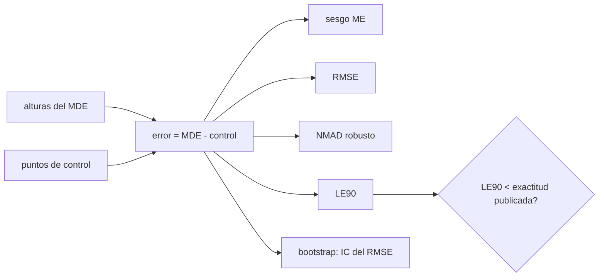

# B57-C31 — Errores y validación de modelos de elevación

<!-- nav:top -->
[🏠 Programa](../../../../README.md) · [📚 Bloque B57](../../../tronco-comun/B57-observacion-terrestre-y-geociencias-orbitales.md) · [← Anterior: B57-C30 — Nubes de puntos tridimensionales](../B57-C30-nubes-de-puntos-tridimensionales/CLASE.md) · [Siguiente: B57-C32 — Sitios de calibración terrestres →](../B57-C32-sitios-de-calibracion-terrestres/CLASE.md)
<!-- /nav -->

## 1. Ubicación, nivel y alcance

Clase 31 del bloque B57 (ampliación). Un modelo de elevación solo es útil con su error conocido y validado contra puntos de control de mayor exactitud. Calculas las métricas habituales (sesgo, RMSE, MAE, NMAD, LE90), ves cómo un 3 % de valores atípicos distorsiona unas y no otras, y estimas un intervalo de confianza con remuestreo. La exactitud vertical de Copernicus DEM (menor que 4 m al 90 %) es la de la página consultada; los errores son **sintéticos**.

## 2. Por qué esta clase existe

Decir «el MDE tiene 4 m de error» sin definir la métrica ni los puntos de control no significa nada. La decisión central: **¿qué métrica y qué intervalo de confianza reporto para que mi validación sea comparable y honesta?**

## 3. Lo que podrás hacer al terminar

1. Calcular ME, RMSE, MAE, NMAD y LE90 de un conjunto de errores.
2. Verificar `LE90 = 1,645 σ` y `NMAD ≈ σ` en una gaussiana.
3. Medir el efecto de valores atípicos en cada métrica.
4. Estimar un intervalo de confianza del RMSE por remuestreo.
5. Declarar si un modelo cumple una exactitud publicada.

La evidencia es la **ficha de validación de un modelo de elevación** del ejercicio 12 (sección 20).

## 4. Con qué llegas y cómo comprobarlo

1. ¿Qué es el error de un MDE?
2. ¿Qué es un percentil?
3. ¿Qué es una mediana?
4. ¿Qué es el remuestreo (bootstrap)?
5. ¿Qué es un dato sintético?

<details>
<summary>Ver respuestas</summary>

1. La altura del modelo menos la del punto de control. 2. El valor bajo el cual cae un porcentaje de los datos. 3. El valor central. 4. Repetir el cálculo con muestras con reemplazo para ver su variabilidad. 5. Uno generado por una fórmula.
</details>

Con cuatro o cinco aciertos, sigue; si no, repasa los prerrequisitos.

## 5. Un caso de contexto y casos de referencia

Un MDE se compara con `400` puntos de control: errores gaussianos con sesgo `0,5 m` y desviación `2,0 m`, y una variante con `3 %` de valores atípicos de `±20 m` (**sintéticos**). La referencia publicada: exactitud vertical absoluta de Copernicus DEM inferior a `4 m` al 90 % (LE90; consultada). Es el **ejemplo conductor**.

## 6. Vocabulario

El **sesgo (ME)** es el error medio. El **RMSE** es la raíz del error cuadrático medio. El **NMAD** es `1,4826` veces la mediana de las desviaciones absolutas respecto de la mediana; es robusto a atípicos. El **LE90** es el error lineal al 90 %: el valor bajo el cual está el 90 % de los errores absolutos. Un **punto de control** es una altura de referencia de mayor exactitud. El **bootstrap** estima la incertidumbre de una métrica remuestreando.

## 7. Modelo mental: medir una regla con una regla mejor

Validar un MDE es compararlo con una regla más exacta; las métricas resumen cuánto difieren y qué tan parejas son esas diferencias.



*Descripción textual:* los errores frente a puntos de control se resumen con varias métricas, algunas sensibles y otras robustas a atípicos, y se comparan con la exactitud especificada, con intervalos de confianza.

Analogía: verificar una balanza con pesas patrón. Límite: las pesas patrón también tienen error.

## 8. La explicación, paso a paso

### 8.1 Una gaussiana sin sesgo

Con 200 000 errores gaussianos de `σ = 2 m`: RMSE `2,002`, NMAD `2,008` y LE90 `3,298` (teoría `1,645σ = 3,290`).

### 8.2 Los 400 puntos de control

| caso | ME | RMSE | MAE | NMAD | LE90 |
|---|---|---|---|---|---|
| sin atípicos | 0,207 | 2,161 | 1,721 | 2,176 | 3,619 |
| con 3 % de atípicos | 0,084 | 4,071 | 2,283 | 2,282 | 4,049 |

El sesgo impuesto es 0,5 m; los 400 puntos lo estiman en `0,21 m` con un error estándar de unos 0,10 m: el propio sesgo estimado tiene incertidumbre. Los atípicos inflan el RMSE y casi no mueven el NMAD ni el LE90: el RMSE es la métrica más frágil.

### 8.3 Incertidumbre de la métrica

El intervalo de confianza del 95 % del RMSE por bootstrap es `[2,007, 2,309]`; el error estándar bootstrap es `0,076` y el analítico `σ/√(2n) = 0,071`. Con 400 puntos la métrica se conoce a unos `±0,2 m`.

### 8.4 ¿Cumple 4 m?

Sin atípicos, `LE90 = 3,62 m`: cumple `< 4 m`. Con atípicos, `LE90 = 4,05 m`: no cumple. Declarar solo la métrica favorable es incorrecto; hay que reportar sesgo, RMSE, NMAD y LE90 y cómo se trataron los atípicos.

## 9. Magnitudes, símbolos y unidades

| Símbolo | Qué es | Unidad | Valor / nota |
|---|---|---|---|
| `ME` | sesgo | m | 0,21 |
| `RMSE` | raíz del error cuadrático medio | m | 2,16; 4,07 (con atípicos) |
| `NMAD` | desviación absoluta mediana normalizada | m | 2,18 |
| `LE90` | error lineal al 90 % | m | 3,62 (publicado < 4) |

## 10. Convenciones y referencias

Error = modelo − control (positivo si el modelo es más alto); puntos de control sin error propio; LE90 calculado sobre `|e|` sin quitar el sesgo; unidades en metros.

## 11. De dónde sale lo que afirmamos

| ID | Fuente | Localizador | Respalda | Estado |
|---|---|---|---|---|
| S1 | Copernicus Data Space, *Copernicus DEM (GLO-30 y GLO-90)* | https://dataspace.copernicus.eu/explore-data/data-collections/copernicus-contributing-missions/collections-description/COP-DEM | exactitud vertical absoluta inferior a 4 m (LE90) y relativa inferior a 2 m (pendientes ≤ 20 %) o a 4 m (pendientes > 20 %). | Consultada 2026-11-09 |

**Límites de las fuentes.** La página consultada no decía con qué puntos de control se obtuvo la exactitud ni cómo se trataron los atípicos. Los errores del laboratorio son sintéticos; no se valida ningún MDE real.

## 12. Cómo ver los resultados

| Magnitud | Valor |
|---|---|
| RMSE sin / con atípicos | 2,16 / 4,07 m |
| NMAD sin / con atípicos | 2,18 / 2,28 m |
| LE90 sin / con atípicos | 3,62 / 4,05 m |

Descripción larga: el RMSE se duplica con un 3 % de atípicos mientras el NMAD casi no cambia.

## 13. Ejemplo trabajado: el LE90 de una gaussiana

**Paso 1 · Cuantil.** Para el 90 % de `|e|` en una normal sin sesgo, el cuantil es `1,645 σ`.

**Paso 2 · Valor.** `1,645 × 2,0 = 3,290 m`.

**Paso 3 · Simulación.** `3,298 m`.

## 14. Distintas formas de abordar el problema

**RMSE:** estándar, sensible a atípicos. **NMAD:** robusta. **LE90:** comparable con especificaciones. **Bootstrap:** incertidumbre de la métrica. Un buen informe usa varias.

## 15. Práctica guiada

**Ejercicio 1 · con los pasos indicados.** Calcula el LE90 de errores gaussianos con `σ = 1,5 m` y sin sesgo. *Pasos:* `1,645σ`.

<details><summary>Solución comentada</summary>

`2,47 m`.
</details>

**Ejercicio 2 · con una pista.** Si 5 errores valen `−1, 0, 1, 2, 2`, calcula el sesgo.

<details><summary>Solución comentada</summary>

`0,8`.
</details>

**Ejercicio 3 · casi autónomo.** Calcula el RMSE de los mismos cinco errores.

<details><summary>Solución comentada</summary>

`√((1+0+1+4+4)/5) = √2 = 1,41`.
</details>

## 16. Práctica autónoma, transferencia e integrador

**Ejercicio 4.** ¿Por qué el RMSE es mayor o igual que el MAE?

<details><summary>Solución comentada</summary>

Porque cuadrar pesa más los errores grandes (desigualdad de Jensen).
</details>

**Ejercicio 5.** ¿Qué métrica elegirías para comparar con una especificación al 90 %?

<details><summary>Solución comentada</summary>

El LE90.
</details>

**Ejercicio 6.** ¿Por qué NMAD y no la desviación estándar con atípicos?

<details><summary>Solución comentada</summary>

Porque la mediana ignora los atípicos y la desviación estándar los incluye.
</details>

**Ejercicio 7.** Con 100 puntos en vez de 400, ¿cómo cambia el error estándar del RMSE?

<details><summary>Solución comentada</summary>

Sube al doble: `1/√(n)`.
</details>

**Ejercicio 8.** Explica por qué los puntos de control deben ser más exactos que el MDE.

<details><summary>Solución comentada</summary>

Porque su propio error se suma al que se mide.
</details>

**Ejercicio 9 · transferencia.** **Transferencia.** Un informe dice «error 3 m» sin más. ¿Qué le pides?

<details><summary>Solución comentada</summary>

La métrica, el número y distribución de los puntos de control, el sesgo y el tratamiento de atípicos.
</details>

**Ejercicio 10 · transferencia.** **Transferencia.** Un MDE se validó solo en terreno plano. ¿Vale para montañas?

<details><summary>Solución comentada</summary>

No necesariamente: el error depende de la pendiente (S1 da cifras distintas por pendiente).
</details>

**Ejercicio 11 · transferencia.** **Transferencia.** ¿Qué datos reales harían falta?

<details><summary>Solución comentada</summary>

Puntos de control con procedencia, fecha y exactitud declarada, repartidos en tipos de terreno.
</details>

**Ejercicio 12 · integrador.** **Integrador.** Elabora tu *ficha de validación de un modelo de elevación*: la tabla de métricas con y sin atípicos, el intervalo de confianza del RMSE y la conclusión sobre el cumplimiento de 4 m.

<details><summary>Solución modelo</summary>

Secciones 8.2 a 8.4 con las cifras de la ejecución, rotulando los errores como sintéticos.
</details>

## 17. Laboratorio: métricas de error de un modelo de elevación

El script [validacion_mde.py](validacion_mde.py) calcula ME, RMSE, MAE, NMAD y LE90 sobre errores sintéticos con y sin atípicos y estima un intervalo del RMSE por bootstrap (**comprueba** NMAD ≈ σ (3 %), LE90 ≈ 1,645σ (4 %) y que los atípicos inflan el RMSE más de 1,5 veces el NMAD).

**Datos:** exactitud del Copernicus DEM publicada (S1); errores **sintéticos**. **Predice antes de ejecutar:** ¿qué métrica cambia más con los atípicos? (el RMSE.) **Ejecución del 2026-11-09 (Python 3.12.9):**

```text
Python 3.12.9 ; numpy 2.4.4
Gaussiana sin sesgo (sigma = 2 m, 200000 puntos): RMSE = 2.002 ; NMAD = 2.008 ; LE90 = 3.298 (teoria 1.645 sigma = 3.290)
400 puntos, sesgo 0.5 m, sin atipicos: ME = 0.207 ; RMSE = 2.161 ; MAE = 1.721 ; NMAD = 2.176 ; LE90 = 3.619
400 puntos con 3 % de atipicos de +-20 m: ME = 0.084 ; RMSE = 4.071 ; MAE = 2.283 ; NMAD = 2.282 ; LE90 = 4.049
IC 95 % del RMSE (bootstrap) sin atipicos = [2.007, 2.309] ; error estandar bootstrap = 0.076 ; analitico sigma/sqrt(2n) = 0.071
Cumple LE90 < 4 m: sin atipicos = True ; con atipicos = False
Pruebas superadas.
```

```bash
python programa/clases/B57/B57-C31-errores-y-validacion-de-modelos-de-elevacion/validacion_mde.py
```

**Límites:** errores independientes y puntos de control sin error.

## 18. Errores frecuentes y cómo corregirlos

**Reportar solo el RMSE.** Se corrige con 8.2.

**Mezclar LE90 y desviación estándar.** Son métricas distintas (sección 6).

**Validar con pocos puntos.** Reporta el intervalo (8.3).

**Presentar los errores como de un MDE real.** Son sintéticos (sección 5).

## 19. Cómo sabrás que vas bien

Tras la sección 8: ¿qué resultado esperabas y cuál obtuviste? Si dudas, repasa el ejemplo 13. Tras el laboratorio: ¿qué comprueba? (ver la sección 17).

## 20. Qué entregas y cómo se evalúa

El producto es tu **ficha de validación de un modelo de elevación** (ejercicio 12).

| Criterio | Inicial | En desarrollo | Logrado | Destacado |
|---|---|---|---|---|
| Conceptos | Los confunde | Parciales | Conceptos de la clase | Explica los límites |
| Cálculo | Sin unidades | Con errores | Tablas completas con unidades | Calcula casos nuevos |
| Numérico | Sin comprobar | Un caso | Contraste con el caso analítico | Interpreta las diferencias |
| Fuentes | Sin fuente | Sin fecha | Fuentes con fecha | Declara lo no consultado |
| Límites | No los nombra | Uno | Tres | Discute qué falta del modelo |

**Condiciones críticas (no se compensan con promedio):** rotular los errores como sintéticos; reportar varias métricas con intervalo; citar solo lo consultado.

## 21. Ética, seguridad y límites

Clase educativa: una validación incompleta puede dar falsa confianza a quien usa el modelo para decisiones de riesgo. Accesibilidad: tablas equivalentes a las gráficas, fórmulas en texto, ejercicios sin conexión.

## 22. Para cerrar y seguir

Con 3 % de atípicos el RMSE pasa de `2,16` a `4,07 m` mientras el NMAD queda en `2,28 m`. Queda una pregunta: ¿cómo se calibra el propio sensor?

**Glosario español–inglés.** error lineal al 90 % · *linear error at 90 % (LE90)*; raíz del error cuadrático medio · *root mean square error (RMSE)*; desviación absoluta mediana normalizada · *normalized median absolute deviation (NMAD)*; punto de control · *control point*; remuestreo · *bootstrap*.

**Continuidad.** [B57-C32](../B57-C32-sitios-de-calibracion-terrestres/CLASE.md) estudia sitios de calibración terrestres.

**Referencias:** ver sección 11.

<!-- nav:bottom -->
---

[← Anterior: B57-C30 — Nubes de puntos tridimensionales](../B57-C30-nubes-de-puntos-tridimensionales/CLASE.md) · [📚 Bloque B57](../../../tronco-comun/B57-observacion-terrestre-y-geociencias-orbitales.md) · [Siguiente: B57-C32 — Sitios de calibración terrestres →](../B57-C32-sitios-de-calibracion-terrestres/CLASE.md)
<!-- /nav -->
