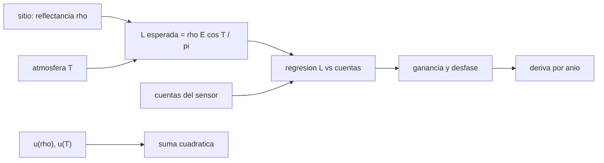

# B57-C32 — Sitios de calibración terrestres

<!-- nav:top -->
[🏠 Programa](../../../../README.md) · [📚 Bloque B57](../../../tronco-comun/B57-observacion-terrestre-y-geociencias-orbitales.md) · [← Anterior: B57-C31 — Errores y validación de modelos de elevación](../B57-C31-errores-y-validacion-de-modelos-de-elevacion/CLASE.md) · [Siguiente: B57-C33 — Deforestación y cambio de uso del suelo →](../B57-C33-deforestacion-y-cambio-de-uso-del-suelo/CLASE.md)
<!-- /nav -->

## 1. Ubicación, nivel y alcance

Clase 32 del bloque B57 (ampliación). Un sensor en vuelo envejece: sus detectores cambian y su ganancia deriva. Se verifica mirando una superficie terrestre estable y de reflectancia conocida, un sitio de calibración, y comparando lo que el sensor registra con lo que debería registrar. Calculas la radiancia esperada de un sitio **ilustrativo**, estimas ganancia y desfase por regresión, propagas la incertidumbre del sitio y detectas una deriva lenta. No se usa ninguna página de un sitio real: todo es modelo.

## 2. Por qué esta clase existe

Sin calibración, una serie de décadas confunde la deriva del instrumento con cambios de la Tierra. La decisión central: **¿cuánta incertidumbre del sitio y cuántas pasadas hacen falta para detectar una deriva de décimas de porcentaje por año?**

## 3. Lo que podrás hacer al terminar

1. Calcular la radiancia esperada de un sitio de reflectancia conocida.
2. Estimar ganancia y desfase por regresión de radiancia contra cuentas.
3. Combinar incertidumbres independientes por suma cuadrática y verificarlo con Monte Carlo.
4. Estimar una deriva de ganancia por regresión anual.
5. Explicar por qué el sitio debe ser estable, uniforme y bien caracterizado.

La evidencia es la **ficha de calibración con un sitio terrestre** del ejercicio 12 (sección 20).

## 4. Con qué llegas y cómo comprobarlo

1. ¿Qué es la ganancia de un sensor?
2. ¿Qué es una regresión lineal?
3. ¿Qué es una suma cuadrática?
4. ¿Qué es una deriva?
5. ¿Qué es un dato sintético?

<details>
<summary>Ver respuestas</summary>

1. El factor que convierte cuentas en radiancia. 2. El ajuste de una recta por mínimos cuadrados. 3. La raíz de la suma de los cuadrados de componentes independientes. 4. Un cambio lento y sistemático en el tiempo. 5. Uno generado por una fórmula.
</details>

Con cuatro o cinco aciertos, sigue; si no, repasa los prerrequisitos.

## 5. Un caso de contexto y casos de referencia

Un sitio desértico hipotético de reflectancia `0,35` (incertidumbre `2 %`) con transmitancia atmosférica `0,85` (incertidumbre `3 %`), observado en `40` pasadas por un sensor de ganancia `0,040` y deriva de `−0,30 %/año` (**sintéticos**). Es el **ejemplo conductor**.

## 6. Vocabulario

La **calibración vicaria** usa una superficie conocida en vez de una fuente a bordo. La **ganancia** y el **desfase** relacionan cuentas con radiancia. La **incertidumbre combinada** de errores independientes es la raíz de la suma de sus cuadrados. Un **sitio invariante** es una superficie estable en décadas. La **deriva** es un cambio lento y sistemático de la respuesta del sensor.

## 7. Modelo mental: verificar una balanza con una pesa patrón

Pones siempre la misma pesa en la balanza: si la lectura cambia lentamente, la balanza deriva. La pesa debe ser muy estable y conocida.



*Descripción textual:* la reflectancia y la atmósfera del sitio dan la radiancia esperada; su regresión contra las cuentas da ganancia y desfase; repetida cada año da la deriva, y las incertidumbres del sitio se combinan en cuadratura.

Analogía: controlar una balanza con la misma pesa cada día. Límite: el sitio también cambia con la humedad y el viento.

## 8. La explicación, paso a paso

### 8.1 Radiancia esperada

Para `ρ = 0,35`, `E = 1550 W m⁻² µm⁻¹`, cenital 30° y `T = 0,85`, `L = ρ E cosθ T/π = 127,116 W m⁻² sr⁻¹ µm⁻¹`. Su incertidumbre combinada es `3,606%` (suma cuadrática de 2 % y 3 %); un Monte Carlo da `3,608%` (razón `1,001`).

### 8.2 Ganancia y desfase

Con 40 pasadas a distinto ángulo solar, la regresión estima `ganancia = 0,04002` (verdadera 0,04000, error `+0,038 %`) y `desfase = 0,0312` (verdadero 0,08). El desfase se estima peor que la ganancia: está correlacionado con ella y las radiancias del sitio quedan lejos del origen, así que una pequeña diferencia de ganancia se compensa con un desfase distinto.

### 8.3 Deriva

Repitiendo la calibración cada año durante 10 años, la pendiente de la ganancia relativa es `-0,303 %/año` (verdadera `−0,30 %/año`). La incertidumbre de `3,6%` de la radiancia esperada no impide ver la deriva solo si es constante entre años; si cambiara de un año a otro, se confundiría con deriva.

### 8.4 Lectura

Un sitio sirve si es estable, uniforme, extenso, de alto brillo y con cielo despejado. La incertidumbre sistemática del sitio acota la exactitud absoluta de la calibración; la repetibilidad (ruido entre pasadas) acota la detección de deriva.

## 9. Magnitudes, símbolos y unidades

| Símbolo | Qué es | Unidad | Valor / nota |
|---|---|---|---|
| `ρ` | reflectancia del sitio | adimensional | 0,35 ± 2 % (ilustrativa) |
| `T` | transmitancia atmosférica | adimensional | 0,85 ± 3 % (ilustrativa) |
| `g` | ganancia | W m⁻² sr⁻¹ µm⁻¹ por cuenta | 0,04002 |
| `u` | incertidumbre combinada | — | 3,61% |
| deriva | cambio anual de la ganancia | %/año | -0,30 |

## 10. Convenciones y referencias

Radiancia espectral en una banda; superficie lambertiana; errores del sitio independientes; deriva lineal; 40 pasadas por año.

## 11. De dónde sale lo que afirmamos

| ID | Fuente | Localizador | Respalda | Estado |
|---|---|---|---|---|
| — | Sin fuente externa | — | relaciones estándar que verifica el laboratorio | No se consultó una fuente para esta clase |

**Límites de las fuentes.** No se consultó ninguna fuente de sitios de calibración (RadCalNet u otros): reflectancia, irradiancia, transmitancia y deriva son ilustrativas. El método de regresión se contrasta con la ganancia verdadera de la simulación.

## 12. Cómo ver los resultados

| Magnitud | Valor |
|---|---|
| radiancia esperada | 127,116 W m⁻² sr⁻¹ µm⁻¹ |
| incertidumbre combinada (analítica / Monte Carlo) | 3,61% / 3,61% |
| error de la ganancia | +0,038 % |
| deriva estimada | -0,303 %/año |

Descripción larga: la ganancia se recupera con error de décimas de porcentaje y la deriva de 0,3 %/año se estima con una precisión similar.

## 13. Ejemplo trabajado: la incertidumbre combinada

**Paso 1 · Componentes.** `u(ρ) = 2 %`, `u(T) = 3 %`.

**Paso 2 · Cuadratura.** `√(0,02² + 0,03²) = √0,0013`.

**Paso 3 · Resultado.** `3,606%`; el Monte Carlo da `3,608%`.

## 14. Distintas formas de abordar el problema

**Por sitio:** barato y repetible, con incertidumbre de la atmósfera. **Por calibrador a bordo:** controla el instrumento pero envejece. **Por luna o estrellas:** referencia independiente. Una calibración robusta combina varias.

## 15. Práctica guiada

**Ejercicio 1 · con los pasos indicados.** Calcula la suma cuadrática de `3 %` y `4 %`. *Pasos:* raíz de la suma de cuadrados.

<details><summary>Solución comentada</summary>

`5 %`.
</details>

**Ejercicio 2 · con una pista.** Si la reflectancia del sitio sube de 0,35 a 0,40, ¿cuánto cambia la radiancia esperada?

<details><summary>Solución comentada</summary>

Sube `0,40/0,35 = 14,3 %`.
</details>

**Ejercicio 3 · casi autónomo.** ¿Qué radiancia esperaría un sitio de reflectancia 0,50 con los mismos parámetros?

<details><summary>Solución comentada</summary>

`127,116 × 0,50/0,35 = 6,5` aprox. (proporcional a `ρ`).
</details>

## 16. Práctica autónoma, transferencia e integrador

**Ejercicio 4.** ¿Por qué se usan pasadas a distintos ángulos solares para ajustar ganancia y desfase?

<details><summary>Solución comentada</summary>

Porque un rango de radiancias hace posible separar ganancia de desfase.
</details>

**Ejercicio 5.** ¿Qué pasa si el sitio cambia su reflectancia un 1 % por año?

<details><summary>Solución comentada</summary>

Aparece como una falsa deriva de la ganancia.
</details>

**Ejercicio 6.** Si la ganancia verdadera deriva `−0,3 %/año`, ¿cuánto vale en 10 años?

<details><summary>Solución comentada</summary>

`−3 %` acumulado.
</details>

**Ejercicio 7.** ¿Cuántas pasadas hacen falta para bajar el ruido de la ganancia a la mitad?

<details><summary>Solución comentada</summary>

Cuatro veces más: 160.
</details>

**Ejercicio 8.** Explica por qué la incertidumbre del sitio acota la exactitud absoluta pero no necesariamente la detección de deriva.

<details><summary>Solución comentada</summary>

Porque un error sistemático constante afecta todos los años igual y se cancela en la tendencia.
</details>

**Ejercicio 9 · transferencia.** **Transferencia.** El sitio tiene viento que mueve arena y cambia la rugosidad. ¿Qué efecto esperas?

<details><summary>Solución comentada</summary>

Cambios de reflectancia direccional que añaden ruido o falsa deriva; hay que caracterizar la anisotropía.
</details>

**Ejercicio 10 · transferencia.** **Transferencia.** Dos sensores se calibran con el mismo sitio. ¿Qué se gana al compararlos?

<details><summary>Solución comentada</summary>

Se pueden intercalibrar: las diferencias relativas cancelan parte de la incertidumbre común del sitio.
</details>

**Ejercicio 11 · transferencia.** **Transferencia.** ¿Qué datos reales harían falta para esta clase?

<details><summary>Solución comentada</summary>

Mediciones in situ del sitio con procedencia, atmósfera medida, y registros de cuentas del sensor.
</details>

**Ejercicio 12 · integrador.** **Integrador.** Elabora tu *ficha de calibración con un sitio terrestre*: la radiancia esperada con su incertidumbre combinada, la ganancia y el desfase estimados y la deriva con su error.

<details><summary>Solución modelo</summary>

Secciones 8.1 a 8.3 con las cifras de la ejecución, rotulando los parámetros como ilustrativos.
</details>

## 17. Laboratorio: calibración vicaria y deriva

El script [calibracion.py](calibracion.py) calcula la radiancia esperada de un sitio, estima ganancia y desfase por regresión, combina incertidumbres y estima una deriva (**comprueba** la ganancia dentro de 1 %, la incertidumbre combinada simulada frente a la analítica con 5 % y la deriva con 0,15 %/año).

**Datos:** todo **sintético / ilustrativo**; sin fuentes consultadas. **Predice antes de ejecutar:** ¿cuánto da la incertidumbre combinada de 2 % y 3 %? (3,6 %.) **Ejecución del 2026-11-09 (Python 3.12.9):**

```text
Python 3.12.9 ; numpy 2.4.4
Radiancia esperada del sitio (rho = 0.35) = 127.116 W m^-2 sr^-1 um^-1
Incertidumbre combinada de la radiancia esperada: analitica = 3.606 % ; Monte Carlo = 3.608 % ; razon = 1.001
Calibracion con 40 pasadas: ganancia = 0.04002 (verdadera 0.04000) ; error = +0.038 % ; desfase = 0.0312 (verdadero 0.0800)
Deriva estimada de la ganancia = -0.303 %/anio (verdadera -0.30 %/anio)
Pruebas superadas.
```

```bash
python programa/clases/B57/B57-C32-sitios-de-calibracion-terrestres/calibracion.py
```

**Límites:** sitio estable y errores independientes.

## 18. Errores frecuentes y cómo corregirlos

**Sumar incertidumbres en lugar de usar cuadratura.** Son independientes (8.1).

**Confundir cambio del sitio con deriva.** Ejercicio 5.

**Calibrar con una sola radiancia.** No separa ganancia y desfase (ejercicio 4).

**Presentar los valores como de un sitio real.** Son ilustrativos (sección 5).

## 19. Cómo sabrás que vas bien

Tras la sección 8: ¿qué resultado esperabas y cuál obtuviste? Si dudas, repasa el ejemplo 13. Tras el laboratorio: ¿qué comprueba? (ver la sección 17).

## 20. Qué entregas y cómo se evalúa

El producto es tu **ficha de calibración con un sitio terrestre** (ejercicio 12).

| Criterio | Inicial | En desarrollo | Logrado | Destacado |
|---|---|---|---|---|
| Conceptos | Los confunde | Parciales | Conceptos de la clase | Explica los límites |
| Cálculo | Sin unidades | Con errores | Tablas completas con unidades | Calcula casos nuevos |
| Numérico | Sin comprobar | Un caso | Contraste con el caso analítico | Interpreta las diferencias |
| Fuentes | Sin fuente | Sin fecha | Fuentes con fecha | Declara lo no consultado |
| Límites | No los nombra | Uno | Tres | Discute qué falta del modelo |

**Condiciones críticas (no se compensan con promedio):** rotular el sitio como ilustrativo; no atribuir valores a RadCalNet ni a un sitio real; citar solo lo consultado (aquí, nada).

## 21. Ética, seguridad y límites

Clase educativa: una calibración mal documentada contamina series climáticas durante años; la procedencia y la incertidumbre deben quedar declaradas. Accesibilidad: tablas equivalentes a las gráficas, fórmulas en texto, ejercicios sin conexión.

## 22. Para cerrar y seguir

La radiancia esperada de `127,12` tiene una incertidumbre combinada de `3,6%`, la ganancia se estima con error de `+0,04 %` y la deriva sintética de `−0,30 %/año` se recupera como `-0,30`. Queda una pregunta: ¿cómo se mide el cambio de uso del suelo, como la deforestación?

**Glosario español–inglés.** calibración vicaria · *vicarious calibration*; sitio invariante · *pseudo-invariant site*; ganancia · *gain*; deriva · *drift*; incertidumbre combinada · *combined uncertainty*.

**Continuidad.** [B57-C33](../B57-C33-deforestacion-y-cambio-de-uso-del-suelo/CLASE.md) estudia deforestación y cambio de uso del suelo.

**Referencias:** ver sección 11.

<!-- nav:bottom -->
---

[← Anterior: B57-C31 — Errores y validación de modelos de elevación](../B57-C31-errores-y-validacion-de-modelos-de-elevacion/CLASE.md) · [📚 Bloque B57](../../../tronco-comun/B57-observacion-terrestre-y-geociencias-orbitales.md) · [Siguiente: B57-C33 — Deforestación y cambio de uso del suelo →](../B57-C33-deforestacion-y-cambio-de-uso-del-suelo/CLASE.md)
<!-- /nav -->
