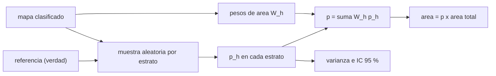

# B57-C33 — Deforestación y cambio de uso del suelo

<!-- nav:top -->
[🏠 Programa](../../../../README.md) · [📚 Bloque B57](../../../tronco-comun/B57-observacion-terrestre-y-geociencias-orbitales.md) · [← Anterior: B57-C32 — Sitios de calibración terrestres](../B57-C32-sitios-de-calibracion-terrestres/CLASE.md) · [Siguiente: B57-C34 — Alertas tempranas y ética en el monitoreo de desastres →](../B57-C34-alertas-tempranas-y-etica-en-el-monitoreo-de-desastres/CLASE.md)
<!-- /nav -->

## 1. Ubicación, nivel y alcance

Clase 33 del bloque B57 (ampliación). Contar los píxeles marcados como «pérdida de bosque» en un mapa no da el área de pérdida, porque el mapa tiene errores de omisión y comisión. Un diseño con muestreo estratificado y una referencia permite estimar el área sin sesgo y con intervalo de confianza. Lo simulas con un mundo **sintético** de verdad conocida. El estimador es conocimiento general **no consultado** en esta sesión.

## 2. Por qué esta clase existe

Las cifras de deforestación orientan políticas y compromisos. La decisión central: **¿cómo estimo el área de cambio con su intervalo, sin fiarme del conteo directo de un mapa imperfecto?**

## 3. Lo que podrás hacer al terminar

1. Distinguir el área mapeada del área estimada.
2. Calcular el estimador estratificado con pesos de área y su intervalo.
3. Verificar con repeticiones que el estimador es insesgado y que el intervalo cubre cerca de 95 %.
4. Medir el sesgo del conteo directo del mapa.
5. Declarar los supuestos del muestreo (referencia sin error, muestreo aleatorio).

La evidencia es la **ficha de deforestación** del ejercicio 12 (sección 20).

## 4. Con qué llegas y cómo comprobarlo

1. ¿Qué es un error de omisión?
2. ¿Qué es un error de comisión?
3. ¿Qué es un estrato?
4. ¿Qué es un intervalo de confianza?
5. ¿Qué es un dato sintético?

<details>
<summary>Ver respuestas</summary>

1. Un cambio real que el mapa no marca. 2. Un cambio que el mapa marca y no existe. 3. Un grupo de celdas con una característica común, aquí la clase del mapa. 4. Un rango que cubre el valor verdadero con una probabilidad dada. 5. Uno generado por una fórmula.
</details>

Con cuatro o cinco aciertos, sigue; si no, repasa los prerrequisitos.

## 5. Un caso de contexto y casos de referencia

Un mundo **sintético** de `400 × 400` celdas de `30 m` con una pérdida verdadera de `4,0 %` de las celdas. El mapa omite `30 %` de las pérdidas y marca por error el `0,5 %` del bosque estable (**ilustrativos**). Se muestrean 100, 150 y 100 celdas por estrato (pérdida, bosque estable, no bosque). Es el **ejemplo conductor**; no es ningún país ni región.

## 6. Vocabulario

Un **estrato** es una clase del mapa. El **peso** `W_h` es la fracción del área total de cada estrato. El **estimador estratificado** es `p = Σ W_h p_h`, con `p_h` medido en la muestra de referencia. La **varianza** es `Σ W_h² p_h(1−p_h)/(n_h−1)`. La **cobertura** del intervalo es la fracción de repeticiones en que contiene el valor verdadero. La **referencia** es la clasificación de mayor calidad que se toma como verdad.

## 7. Modelo mental: una encuesta por barrios

Para saber cuántos fuman en una ciudad no cuentas los fumadores que ves en la calle; encuestas por barrios, ponderas por tamaño y calculas el margen de error. Aquí los barrios son las clases del mapa.



*Descripción textual:* el mapa define los estratos y sus pesos, una muestra por estrato se compara con la referencia, y la combinación ponderada da el área estimada con su intervalo.

Analogía: una encuesta por barrios con ponderación por población. Límite: si la referencia también tiene error, el estimador queda sesgado.

## 8. La explicación, paso a paso

### 8.1 Mapa frente a verdad

La pérdida verdadera es `4,000 %` de las celdas (`5,760 km²` de `144,0 km²`). El conteo directo del mapa da `3,204 %`: un sesgo de `-0,796` puntos porcentuales. El mapa omite más de lo que agrega, y mide mal el área.

### 8.2 El estimador

Los pesos de los estratos (pérdida, bosque estable, no bosque) son `0,0320; 0,7680; 0,2000`. Con una muestra de 350 celdas, el estimador estratificado da `5,412 % ± 2,222` (IC 95 %), o `7,793 km²`.

### 8.3 Repeticiones

Repetido 1000 veces, el estimador tiene sesgo `-0,0285` puntos y desviación `0,788` puntos; el intervalo cubre la verdad en `88,9%` de las repeticiones, algo por debajo del 95 % nominal: en estratos donde la proporción es pequeña la aproximación normal del intervalo es optimista. El estimador corrige el sesgo del mapa porque usa la referencia dentro de cada estrato.

### 8.4 Límites

Se supone una referencia sin error, un muestreo aleatorio en cada estrato y estratos bien definidos. En la práctica la referencia (imágenes de alta resolución, intérpretes) tiene error, y las muestras pequeñas dan intervalos anchos para clases raras como la pérdida.

## 9. Magnitudes, símbolos y unidades

| Símbolo | Qué es | Unidad | Valor / nota |
|---|---|---|---|
| `W_h` | peso de área del estrato | — | 0,0320; 0,7680; 0,2000 |
| `p` | proporción de pérdida estimada | — | 5,41 % ± 2,22 |
| `A` | área de pérdida | km² | 7,793 |
| sesgo del mapa | mapa − verdad | puntos porcentuales | -0,80 |

## 10. Convenciones y referencias

Celdas de 30 m (0,0009 km²); tres estratos del mapa; referencia sin error; IC 95 % con 1,96 error estándar; área en km².

## 11. De dónde sale lo que afirmamos

| ID | Fuente | Localizador | Respalda | Estado |
|---|---|---|---|---|
| — | Sin fuente externa | — | relaciones estándar que verifica el laboratorio | No se consultó una fuente para esta clase |

**Límites de las fuentes.** No se consultó ninguna fuente para esta clase: el estimador estratificado se trata como método conocido que verifica la simulación (sesgo y cobertura). El mundo es sintético y sus errores de clasificación, ilustrativos.

## 12. Cómo ver los resultados

| Magnitud | Valor |
|---|---|
| pérdida verdadera / en el mapa | 4,00 % / 3,20 % |
| estimador estratificado | 5,41 % ± 2,22 |
| cobertura del IC | 88,9% |

Descripción larga: el conteo del mapa subestima la pérdida y el estimador estratificado la recupera, con un intervalo cuya cobertura es algo menor que la nominal.

## 13. Ejemplo trabajado: el estimador con tres estratos

**Paso 1 · Pesos.** `W = (0,0320; 0,7680; 0,2000)`.

**Paso 2 · Proporciones en la muestra.** `p_h` por estrato.

**Paso 3 · Suma ponderada.** `p = Σ W_h p_h = 5,412 %`.

## 14. Distintas formas de abordar el problema

**Por conteo del mapa:** simple, sesgado. **Por estimador estratificado:** insesgado con referencia. **Por matriz de confusión:** equivalente, con las proporciones de área. Los tres comparten las mismas cifras.

## 15. Práctica guiada

**Ejercicio 1 · con los pasos indicados.** Un mapa marca 5 % de pérdida y omite el 30 % de la pérdida verdadera, sin comisión. ¿Cuál es la pérdida verdadera? *Pasos:* `5 %/0,7`.

<details><summary>Solución comentada</summary>

`7,14 %`.
</details>

**Ejercicio 2 · con una pista.** Si los pesos son `0,03`, `0,77` y `0,20` y las proporciones de pérdida en la muestra `0,70`, `0,02`, `0,00`, calcula `p`.

<details><summary>Solución comentada</summary>

`0,021 + 0,0154 + 0 = 0,0364`.
</details>

**Ejercicio 3 · casi autónomo.** ¿Qué área es ese `p` en 14,4 km²?

<details><summary>Solución comentada</summary>

`0,524 km²`.
</details>

## 16. Práctica autónoma, transferencia e integrador

**Ejercicio 4.** ¿Por qué se estratifica por la clase del mapa?

<details><summary>Solución comentada</summary>

Para muestrear más donde el fenómeno es raro (la pérdida) y reducir la varianza.
</details>

**Ejercicio 5.** ¿Qué pasa con el IC si se duplica la muestra de cada estrato?

<details><summary>Solución comentada</summary>

Se reduce en `√2`.
</details>

**Ejercicio 6.** ¿Qué pasa si la referencia tiene errores?

<details><summary>Solución comentada</summary>

El estimador se sesga; hay que declararlo o corregirlo.
</details>

**Ejercicio 7.** Explica por qué el mapa subestima aquí la pérdida.

<details><summary>Solución comentada</summary>

Porque omite el 30 % de las pérdidas y solo agrega un 0,5 % de falsas del bosque estable.
</details>

**Ejercicio 8.** Dos años seguidos dan 3,5 % y 3,8 % con IC de ±0,6. ¿Hay cambio real?

<details><summary>Solución comentada</summary>

No necesariamente: la diferencia es menor que los intervalos.
</details>

**Ejercicio 9 · transferencia.** **Transferencia.** Un país informa «área deforestada» con el conteo de píxeles de su mapa. ¿Qué le preguntas?

<details><summary>Solución comentada</summary>

La exactitud del mapa y si estimó el área con una muestra de referencia y su intervalo.
</details>

**Ejercicio 10 · transferencia.** **Transferencia.** ¿Qué consecuencias tiene sobrestimar o subestimar?

<details><summary>Solución comentada</summary>

Subestimar oculta pérdidas; sobrestimar puede generar sanciones o compromisos erróneos. Ambos afectan a personas y se declaran con su incertidumbre.
</details>

**Ejercicio 11 · transferencia.** **Transferencia.** ¿Qué datos reales harían falta?

<details><summary>Solución comentada</summary>

Un mapa de cambio con fecha y procedencia, una muestra de referencia con protocolo documentado y su calidad.
</details>

**Ejercicio 12 · integrador.** **Integrador.** Elabora tu *ficha de deforestación*: la comparación entre pérdida verdadera, mapa y estimador con su intervalo, y la cobertura simulada del intervalo.

<details><summary>Solución modelo</summary>

Secciones 8.1 a 8.3 con las cifras de la ejecución y los supuestos de 8.4.
</details>

## 17. Laboratorio: área de cambio con muestreo estratificado

El script [deforestacion.py](deforestacion.py) genera un mundo sintético con un mapa imperfecto, estima el área de pérdida con muestreo estratificado y mide el sesgo y la cobertura por repeticiones (**comprueba** que la cobertura del IC está entre 85 y 99 %, que el conteo del mapa está sesgado más de 0,3 puntos y que el estimador es insesgado).

**Datos:** mapa, verdad y errores **sintéticos / ilustrativos**; estimador no consultado. **Predice antes de ejecutar:** ¿el mapa sobrestima o subestima la pérdida? (subestima.) **Ejecución del 2026-11-09 (Python 3.12.9):**

```text
Python 3.12.9 ; numpy 2.4.4
Verdad: perdida = 4.000 % de las celdas (5.760 km2 de 144.0 km2)
Conteo directo del mapa: 3.204 % (sesgo -0.796 puntos porcentuales)
Pesos de los estratos (perdida, bosque estable, no bosque): [0.032, 0.768, 0.2]
Estimador estratificado (una muestra de 350 celdas): 5.412 % +- 2.222 (IC 95 %) = 7.793 km2
1000 repeticiones: sesgo = -0.0285 puntos ; desviacion = 0.788 puntos ; cobertura del IC 95 % = 88.9 %
Pruebas superadas.
```

```bash
python programa/clases/B57/B57-C33-deforestacion-y-cambio-de-uso-del-suelo/deforestacion.py
```

**Límites:** referencia sin error y muestreo aleatorio simple por estrato.

## 18. Errores frecuentes y cómo corregirlos

**Contar píxeles del mapa como área verdadera.** Está sesgado (8.1).

**Dar el área sin intervalo.** Se corrige con 8.2.

**Usar una referencia dudosa sin declararlo.** Ejercicio 6.

**Presentar el mundo como real.** Es sintético (sección 5).

## 19. Cómo sabrás que vas bien

Tras la sección 8: ¿qué resultado esperabas y cuál obtuviste? Si dudas, repasa el ejemplo 13. Tras el laboratorio: ¿qué comprueba? (ver la sección 17).

## 20. Qué entregas y cómo se evalúa

El producto es tu **ficha de deforestación** (ejercicio 12).

| Criterio | Inicial | En desarrollo | Logrado | Destacado |
|---|---|---|---|---|
| Conceptos | Los confunde | Parciales | Conceptos de la clase | Explica los límites |
| Cálculo | Sin unidades | Con errores | Tablas completas con unidades | Calcula casos nuevos |
| Numérico | Sin comprobar | Un caso | Contraste con el caso analítico | Interpreta las diferencias |
| Fuentes | Sin fuente | Sin fecha | Fuentes con fecha | Declara lo no consultado |
| Límites | No los nombra | Uno | Tres | Discute qué falta del modelo |

**Condiciones críticas (no se compensan con promedio):** rotular el mundo como sintético; reportar el área con intervalo; no atribuir cifras a ningún país; citar solo lo consultado (aquí, nada).

## 21. Ética, seguridad y límites

Clase educativa: las cifras de deforestación afectan a comunidades y a compromisos internacionales; deben publicarse con su método, incertidumbre y referencia, y sin acusar a personas por detecciones automáticas. Accesibilidad: tablas equivalentes a las gráficas, fórmulas en texto, ejercicios sin conexión.

## 22. Para cerrar y seguir

El mapa cuenta `3,20 %` de pérdida frente a `4,00 %` verdadero, y el estimador estratificado da `5,41 % ± 2,22` con una cobertura de `89%`. Queda una pregunta: ¿cómo se emite una alerta temprana y con qué responsabilidad?

**Glosario español–inglés.** deforestación · *deforestation*; muestreo estratificado · *stratified sampling*; error de omisión · *omission error*; error de comisión · *commission error*; cobertura del intervalo · *interval coverage*.

**Continuidad.** [B57-C34](../B57-C34-alertas-tempranas-y-etica-en-el-monitoreo-de-desastres/CLASE.md) estudia alertas tempranas y ética en el monitoreo de desastres.

**Referencias:** ver sección 11.

<!-- nav:bottom -->
---

[← Anterior: B57-C32 — Sitios de calibración terrestres](../B57-C32-sitios-de-calibracion-terrestres/CLASE.md) · [📚 Bloque B57](../../../tronco-comun/B57-observacion-terrestre-y-geociencias-orbitales.md) · [Siguiente: B57-C34 — Alertas tempranas y ética en el monitoreo de desastres →](../B57-C34-alertas-tempranas-y-etica-en-el-monitoreo-de-desastres/CLASE.md)
<!-- /nav -->
