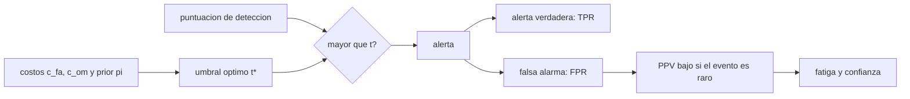

# B57-C34 — Alertas tempranas y ética en el monitoreo de desastres

<!-- nav:top -->
[🏠 Programa](../../../../README.md) · [📚 Bloque B57](../../../tronco-comun/B57-observacion-terrestre-y-geociencias-orbitales.md) · [← Anterior: B57-C33 — Deforestación y cambio de uso del suelo](../B57-C33-deforestacion-y-cambio-de-uso-del-suelo/CLASE.md) · [Siguiente: B58-C01 — Clasificación de cuerpos menores →](../../../tronco-comun/B58-asteroides-cometas-y-defensa-planetaria.md#b58-c01)
<!-- /nav -->

## 1. Ubicación, nivel y alcance

Clase 34 del bloque B57 (ampliación) y cierre del bloque. Emitir una alerta afecta a personas: una omisión puede costar vidas y una falsa alarma erosiona la confianza. Con una teoría de decisión simple calculas el umbral que minimiza el costo esperado, ves por qué, cuando el evento es raro, la mayoría de las alertas pueden ser falsas aunque el detector sea bueno, y reflexionas sobre criterios éticos y de comunicación. Todo con datos **sintéticos**; ningún sistema real se describe ni se evalúa.

## 2. Por qué esta clase existe

Un detector excelente puede producir una mayoría de falsas alarmas si el evento es raro, y las alertas repetidas y falsas se ignoran. La decisión central: **¿qué umbral y qué comunicación equilibran el costo de omitir y el de alarmar en falso, y quién decide?**

## 3. Lo que podrás hacer al terminar

1. Calcular las tasas de falsa alarma y de detección de una regla de umbral.
2. Calcular el umbral óptimo que minimiza un costo esperado con costos asimétricos.
3. Calcular el valor predictivo positivo y entender su dependencia de la frecuencia del evento.
4. Estimar cuántas falsas alarmas esperar por año en una red.
5. Discutir criterios éticos de comunicación y responsabilidad en alertas.

La evidencia es la **ficha de alertas y ética** del ejercicio 12 (sección 20).

## 4. Con qué llegas y cómo comprobarlo

1. ¿Qué es una falsa alarma?
2. ¿Qué es una omisión?
3. ¿Qué es una probabilidad a priori?
4. ¿Qué es un costo esperado?
5. ¿Qué es un dato sintético?

<details>
<summary>Ver respuestas</summary>

1. Una alerta cuando no hay evento. 2. Un evento sin alerta. 3. La probabilidad del evento antes de ver el dato. 4. El promedio de los costos ponderado por su probabilidad. 5. Uno generado por una fórmula.
</details>

Con cuatro o cinco aciertos, sigue; si no, repasa los prerrequisitos.

## 5. Un caso de contexto y casos de referencia

Una puntuación de detección vale 0 en promedio sin evento y `3` con evento (desviación 1), con una probabilidad de evento de `1 %` por ventana y costos `1` por falsa alarma y `100` por omisión (**ilustrativos**). Es el **ejemplo conductor**; no es un sistema real.

## 6. Vocabulario

La **tasa de falsa alarma** (FPR) es la fracción de ventanas sin evento con alerta; la **tasa de detección** (TPR), la de ventanas con evento con alerta. El **valor predictivo positivo** (PPV) es la fracción de alertas que corresponden a un evento. El **umbral óptimo** minimiza el costo esperado. El **tiempo de aviso** es el intervalo entre la alerta y el evento. La **fatiga de alertas** es la pérdida de atención ante alertas repetidas que no se cumplen.

## 7. Modelo mental: el pastor y el lobo

Si el pastor grita «¡lobo!» por cada sombra, nadie le cree cuando llega el lobo; si nunca grita, pierde las ovejas. El umbral decide cuándo gritar.



*Descripción textual:* la puntuación se compara con un umbral; los costos y la frecuencia del evento fijan el umbral óptimo, y la rareza del evento hace que el valor predictivo de la alerta sea bajo.

Analogía: el pastor y el lobo. Límite: en una alerta real, la decisión involucra instituciones, comunicación y confianza, no solo un umbral.

## 8. La explicación, paso a paso

### 8.1 El umbral óptimo

Con `d' = 3`, `π = 0,01`, `c_fa = 1` y `c_om = 100`, el umbral óptimo analítico es `t* = d'/2 + ln[c_fa(1−π)/(c_om π)]/d' = 1,4966`; la búsqueda numérica da `1,4966`. Casi coincide con el umbral de igual error (`d'/2 = 1,50`) porque la mayor gravedad de omitir (100 veces) se compensa con la rareza del evento (1 %): `c_om π ≈ c_fa (1−π)`, y el término logarítmico casi se anula.

### 8.2 Tres umbrales

| umbral | FPR | TPR | PPV | costo esperado |
|---|---|---|---|---|
| óptimo (`1,50`) | 6,724% | 93,36% | 12,3% | 0,1329 |
| `d'/2` (1,50) | 6,681% | 93,32% | 12,4% | 0,1329 |
| 2,5 | 0,621% | 69,15% | 52,9% | 0,3147 |

Con el umbral óptimo, solo `12,3%` de las alertas corresponde a un evento. Con 200 000 ventanas simuladas, el PPV medido es `11,8%`.

### 8.3 La carga de falsas alarmas

Hay `7,4` falsas alarmas por cada alerta verdadera. En una red de 100 sitios con una ventana diaria, el umbral óptimo daría unas `2430` falsas alarmas al año. Eso exige un protocolo para verificarlas y comunicar con claridad.

### 8.4 Más allá del número

El umbral óptimo depende de costos que valoran personas, no solo la física: ¿cuánto cuesta una evacuación innecesaria para una familia sin recursos? Quién decide los costos, cómo se comunica la incertidumbre, cómo se verifica antes de alertar y cómo se evalúa lo ocurrido son decisiones éticas e institucionales. Esta clase no emite ni evalúa ninguna alerta.

## 9. Magnitudes, símbolos y unidades

| Símbolo | Qué es | Unidad | Valor / nota |
|---|---|---|---|
| `d'` | separación de las dos distribuciones | — | 3 (sintética) |
| `π` | probabilidad del evento por ventana | — | 0,01 (ilustrativa) |
| `t*` | umbral óptimo | — | 1,497 |
| PPV | valor predictivo positivo | — | 12,3% |
| falsas/año | falsas alarmas en 100 sitios | — | 2430 |

## 10. Convenciones y referencias

Puntuación normalizada; ventana de decisión de duración fija; costos en unidades arbitrarias; evento y no-evento exhaustivos y excluyentes.

## 11. De dónde sale lo que afirmamos

| ID | Fuente | Localizador | Respalda | Estado |
|---|---|---|---|---|
| — | Sin fuente externa | — | relaciones estándar que verifica el laboratorio | No se consultó una fuente para esta clase |

**Límites de las fuentes.** No se consultó ninguna fuente para esta clase: la teoría de decisión con umbral gaussiano es un resultado conocido que verifica el laboratorio; no se consultaron marcos de alerta temprana de instituciones. Los costos son ilustrativos.

## 12. Cómo ver los resultados

| Magnitud | Valor |
|---|---|
| umbral óptimo | 1,497 (igual error: 1,50) |
| TPR / FPR con el óptimo | 93,36% / 6,724% |
| PPV con el óptimo | 12,3% |
| falsas alarmas por año (100 sitios) | 2430 |

Descripción larga: aunque la detección es alta, menos de la mitad de las alertas son verdaderas porque el evento es raro.

## 13. Ejemplo trabajado: el valor predictivo positivo

**Paso 1 · Con evento.** `π TPR = 0,01 × 0,9336`.

**Paso 2 · Sin evento.** `(1−π) FPR = 0,99 × 0,06724`.

**Paso 3 · Cociente.** `PPV = 12,3%`.

## 14. Distintas formas de abordar el problema

**Por umbral único:** simple. **Por alertas escalonadas (vigilancia, aviso, alarma):** comunican grados de certeza. **Por verificación humana:** reduce falsas alarmas a costa de tiempo. Cada diseño trae un compromiso entre tiempo, certeza y confianza.

## 15. Práctica guiada

**Ejercicio 1 · con los pasos indicados.** Calcula `d'/2` para `d' = 3`. *Pasos:* divide.

<details><summary>Solución comentada</summary>

`1,5`.
</details>

**Ejercicio 2 · con una pista.** ¿Por qué aquí el umbral óptimo casi coincide con `d'/2`?

<details><summary>Solución comentada</summary>

Porque `c_om π = 100 × 0,01 = 1` casi iguala a `c_fa (1−π) = 0,99`: el costo de omitir y la rareza del evento se compensan.
</details>

**Ejercicio 3 · casi autónomo.** Si el costo de omitir subiera a 1000, ¿el umbral óptimo subiría o bajaría?

<details><summary>Solución comentada</summary>

Bajaría: conviene alertar con más facilidad, a costa de más falsas alarmas.
</details>

## 16. Práctica autónoma, transferencia e integrador

**Ejercicio 4.** Si los costos fueran iguales (1 y 1) y `π = 0,5`, ¿cuál es el umbral óptimo?

<details><summary>Solución comentada</summary>

`d'/2 = 1,5`.
</details>

**Ejercicio 5.** Calcula el PPV con `π = 0,01`, `TPR = 0,9`, `FPR = 0,01`.

<details><summary>Solución comentada</summary>

`0,009/(0,009 + 0,0099) = 47,6 %`.
</details>

**Ejercicio 6.** ¿Qué PPV tendría con `π = 0,1` y los mismos TPR y FPR?

<details><summary>Solución comentada</summary>

`0,09/(0,09 + 0,009) = 90,9 %`.
</details>

**Ejercicio 7.** Explica por qué un evento raro baja el PPV aunque el detector sea bueno.

<details><summary>Solución comentada</summary>

Porque las ventanas sin evento son muchísimas y hasta una pequeña FPR da muchas alertas falsas.
</details>

**Ejercicio 8.** Si se quiere PPV de 90 % con `π = 0,01`, ¿qué FPR hace falta aproximadamente con TPR 0,9?

<details><summary>Solución comentada</summary>

`PPV = 0,9 → FPR ≈ 0,0009/0,99 ≈ 0,09 %`.
</details>

**Ejercicio 9 · transferencia.** **Transferencia.** Una alerta llega con 10 minutos de aviso. ¿Qué ganancia hay frente a 2 horas?

<details><summary>Solución comentada</summary>

Menos tiempo para actuar; el costo de una omisión sube si la acción necesita más tiempo, y cambia la política.
</details>

**Ejercicio 10 · transferencia.** **Transferencia.** Un municipio pobre debe evacuar con cada alerta. ¿Qué consideras al fijar el umbral?

<details><summary>Solución comentada</summary>

El costo real de evacuar para esa población, apoyos disponibles y la confianza futura; la decisión debe ser participativa.
</details>

**Ejercicio 11 · transferencia.** **Transferencia.** ¿Por qué esta clase no basta para diseñar un sistema de alerta?

<details><summary>Solución comentada</summary>

Faltan validación con datos reales, protocolos institucionales, comunicación y marco legal.
</details>

**Ejercicio 12 · integrador.** **Integrador.** Elabora tu *ficha de alertas y ética*: la tabla de tres umbrales con FPR, TPR, PPV y costo, la carga anual de falsas alarmas y una reflexión ética de media página sobre quién decide los costos.

<details><summary>Solución modelo</summary>

Secciones 8.1 a 8.4 con las cifras de la ejecución y una reflexión que mencione participación, comunicación de la incertidumbre y verificación.
</details>

## 17. Laboratorio: umbral de decisión, falsas alarmas y valor predictivo

El script [alertas.py](alertas.py) calcula el umbral óptimo con costos asimétricos, las tasas de detección y falsa alarma, el valor predictivo y la carga anual de falsas alarmas (**comprueba** el umbral numérico frente al analítico (0,01) y el PPV simulado frente al analítico (5 %)).

**Datos:** todo **sintético / ilustrativo**; sin fuentes consultadas. **Predice antes de ejecutar:** ¿qué fracción de las alertas será verdadera? (menos de la mitad.) **Ejecución del 2026-11-09 (Python 3.12.9):**

```text
Python 3.12.9 ; numpy 2.4.4
Umbral optimo: analitico = 1.4966 ; numerico = 1.4966 ; umbral de igual error (d'/2) = 1.50
Umbral optimo: FPR = 6.724 % ; TPR = 93.36 % ; PPV = 12.3 % ; costo esperado = 0.1329
Umbral d'/2: FPR = 6.681 % ; TPR = 93.32 % ; PPV = 12.4 % ; costo esperado = 0.1329
Umbral 2.5: FPR = 0.621 % ; TPR = 69.15 % ; PPV = 52.9 % ; costo esperado = 0.3147
Simulacion de 200000 ventanas con el umbral optimo: PPV = 11.8 % (error relativo 3.8%) ; falsas alarmas por 1000 ventanas = 67.18 ; falsas por cada alerta verdadera = 7.45
Con 100 sitios y una ventana diaria: 2430 falsas alarmas por anio con el umbral optimo
Pruebas superadas.
```

```bash
python programa/clases/B57/B57-C34-alertas-tempranas-y-etica-en-el-monitoreo-de-desastres/alertas.py
```

**Límites:** dos gaussianas de igual varianza y costos fijos; sin dinámica de confianza.

## 18. Errores frecuentes y cómo corregirlos

**Confundir TPR con PPV.** Son distintos (8.2).

**Fijar el umbral solo por física.** Los costos son humanos (8.4).

**Ignorar la carga de falsas alarmas.** Se calcula en 8.3.

**Presentar el sistema como real.** Es sintético (sección 5).

## 19. Cómo sabrás que vas bien

Tras la sección 8: ¿qué resultado esperabas y cuál obtuviste? Si dudas, repasa el ejemplo 13. Tras el laboratorio: ¿qué comprueba? (ver la sección 17).

## 20. Qué entregas y cómo se evalúa

El producto es tu **ficha de alertas y ética** (ejercicio 12).

| Criterio | Inicial | En desarrollo | Logrado | Destacado |
|---|---|---|---|---|
| Conceptos | Los confunde | Parciales | Conceptos de la clase | Explica los límites |
| Cálculo | Sin unidades | Con errores | Tablas completas con unidades | Calcula casos nuevos |
| Numérico | Sin comprobar | Un caso | Contraste con el caso analítico | Interpreta las diferencias |
| Fuentes | Sin fuente | Sin fecha | Fuentes con fecha | Declara lo no consultado |
| Límites | No los nombra | Uno | Tres | Discute qué falta del modelo |

**Condiciones críticas (no se compensan con promedio):** rotular el sistema como sintético; no presentar el umbral como recomendación para ninguna institución; reconocer que los costos son decisiones éticas; citar solo lo consultado (aquí, nada).

## 21. Ética, seguridad y límites

Clase educativa y de cierre del bloque: no se emite ni se evalúa ninguna alerta. Las alertas reales corresponden a las instituciones competentes y deben comunicar incertidumbre, ser verificables, considerar a las poblaciones más vulnerables y evaluarse después de cada evento. Accesibilidad: tablas equivalentes a las gráficas, fórmulas en texto, ejercicios sin conexión.

## 22. Para cerrar y seguir

Con el umbral óptimo `1,50` se detecta el `93%` de los eventos, pero solo `12%` de las alertas es verdadera, con unas `2430` falsas alarmas al año en 100 sitios. Con esto termina el bloque B57, que recorrió desde la radiación que ve un sensor hasta la responsabilidad de avisar; el siguiente es B58.

**Glosario español–inglés.** alerta temprana · *early warning*; tasa de falsa alarma · *false alarm rate*; valor predictivo positivo · *positive predictive value (PPV)*; umbral óptimo · *optimal threshold*; fatiga de alertas · *alert fatigue*.

**Continuidad.** Cierra el bloque; el siguiente es [B58](../../../tronco-comun/B58-asteroides-cometas-y-defensa-planetaria.md).

**Referencias:** ver sección 11.

<!-- nav:bottom -->
---

[← Anterior: B57-C33 — Deforestación y cambio de uso del suelo](../B57-C33-deforestacion-y-cambio-de-uso-del-suelo/CLASE.md) · [📚 Bloque B57](../../../tronco-comun/B57-observacion-terrestre-y-geociencias-orbitales.md) · [Siguiente: B58-C01 — Clasificación de cuerpos menores →](../../../tronco-comun/B58-asteroides-cometas-y-defensa-planetaria.md#b58-c01)
<!-- /nav -->
