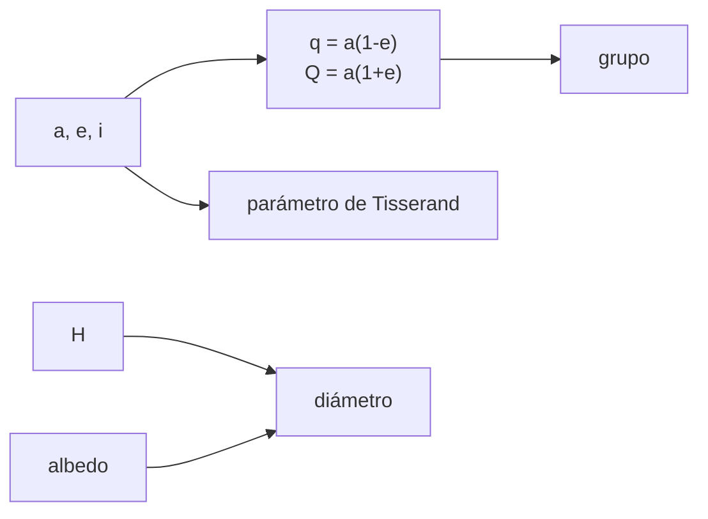

# B58-C01 — Clasificación de cuerpos menores

<!-- nav:top -->
[🏠 Programa](../../../../README.md) · [📚 Bloque B58](../../../tronco-comun/B58-asteroides-cometas-y-defensa-planetaria.md) · [← Anterior: B57-C34 — Alertas tempranas y ética en el monitoreo de desastres](../../B57/B57-C34-alertas-tempranas-y-etica-en-el-monitoreo-de-desastres/CLASE.md) · [Siguiente: B58-C02 — Dinámica de asteroides →](../B58-C02-dinamica-de-asteroides/CLASE.md)
<!-- /nav -->

## 1. Ubicación, nivel y alcance

Clase 1 del bloque B58 (nivel N3). Abre el bloque: antes de calcular riesgos hay que decir de qué cuerpo se habla. Aquí clasificas cuerpos menores por sus elementos orbitales (grupos Atira, Aten, Apollo y Amor), distingues un asteroide de un cuerpo de tipo cometario con el parámetro de Tisserand y estimas un diámetro a partir de la magnitud absoluta `H` y el albedo. Trabajas con doce objetos **sintéticos**.

## 2. Por qué esta clase existe

La pregunta que organiza el bloque es *¿qué es este objeto y qué tan cerca pasa?* Un mismo punto de luz puede ser un asteroide del cinturón principal sin ningún interés para la defensa planetaria o un objeto cercano a la Tierra. La decisión central de esta clase: **¿en qué grupo cae un objeto con estos elementos y qué incertidumbre arrastra su tamaño?**

## 3. Lo que podrás hacer al terminar

1. Calcular el perihelio `q` y el afelio `Q` a partir de `a` y `e`.
2. Asignar un objeto a Atira, Aten, Apollo, Amor o «no cercano a la Tierra» con los criterios de la fuente.
3. Calcular el parámetro de Tisserand respecto a Júpiter e interpretarlo.
4. Estimar el diámetro con `H` y el albedo, y explicar la ambigüedad entre ambos.
5. Contrastar el código con casos de frontera analíticos.
6. Rotular el catálogo como sintético y no leerlo como una lista real.

La evidencia es la **ficha de clasificación** del ejercicio 12 (sección 20).

## 4. Con qué llegas y cómo comprobarlo

1. ¿Qué relaciona el semieje mayor `a` y la excentricidad `e` con el perihelio?
2. ¿Qué es una unidad astronómica?
3. ¿Qué mide la magnitud absoluta `H` de un asteroide?
4. ¿Qué es un dato sintético?
5. ¿Por qué una cifra con fuente lleva fecha?

<details>
<summary>Ver respuestas</summary>

1. `q = a(1 − e)`. 2. La distancia media Tierra–Sol, 149 597 870,7 km por definición de la IAU. 3. Su brillo reducido a 1 au del Sol y de la Tierra, a fase cero. 4. Un valor inventado para el ejemplo, no medido. 5. Porque la página puede cambiar.
</details>

Con cuatro o cinco aciertos, sigue; si no, repasa los prerrequisitos.

## 5. Un caso de contexto y casos de referencia

El ejemplo conductor es la tabla de doce objetos sintéticos. Con los criterios de la fuente [S3] el laboratorio obtiene: Amor = 3, Apollo = 3, Aten = 2, Atira = 2, no NEO = 2. Además, para `H = 22` y albedo `0,14` el diámetro es `141.4 m`, que coincide con los «unos 140 m» que dice la fuente. Todo objeto es **sintético**; la clase no clasifica ningún cuerpo real.

## 6. Vocabulario

Un **cuerpo menor** es un asteroide o cometa. Un **objeto cercano a la Tierra** (NEO) tiene perihelio `q < 1,3 au` [S3]. Los **grupos** Atira, Aten, Apollo y Amor dividen a los asteroides cercanos según `a`, `q` y `Q`. El **parámetro de Tisserand** `T_J` es una cantidad casi conservada en un encuentro con Júpiter. La **magnitud absoluta** `H` mide el brillo intrínseco. El **albedo** `p` es la fracción de luz reflejada.

## 7. Modelo mental: ordenar una biblioteca por dos números



*Descripción textual:* los elementos orbitales dan perihelio y afelio, que fijan el grupo; con `a`, `e`, `i` se calcula `T_J`; con `H` y el albedo se estima el diámetro.

Analogía: Como ordenar libros por estante y por altura: dos datos bastan para asignar una etiqueta. Límite: la etiqueta no dice nada de lo que hay dentro ni de si el objeto pasará cerca; para eso hace falta la órbita completa (C05, C07).

## 8. La explicación, paso a paso

### 8.1 De los elementos al perihelio y al afelio

Con `a` y `e` se tiene `q = a(1 − e)` y `Q = a(1 + e)`. El objeto SINT-03 tiene `a = 1,20 au` y `e = 0,45`, de modo que `q = 0.660 au` y `Q = 1.740 au`: su órbita cruza la de la Tierra.

### 8.2 Criterios de grupo

Según [S3], un objeto es NEO si `q < 1,3 au`. Entre los NEO, **Atira**: `a < 1,0` y `Q < 0,983 au` (órbita dentro de la terrestre); **Aten**: `a < 1,0` y `Q > 0,983`; **Apollo**: `a > 1,0` y `q < 1,017`; **Amor**: `a > 1,0` y `1,017 < q < 1,3`. El laboratorio aplica estos cortes y obtiene Amor = 3, Apollo = 3, Aten = 2, Atira = 2, no NEO = 2. Los umbrales `0,983` y `1,017` son el afelio y el perihelio de la Tierra aproximados por la fuente.

### 8.3 El parámetro de Tisserand

`T_J = a_J/a + 2 cos i · √((a/a_J)(1 − e²))` con `a_J = 5,2044 au` (valor aproximado del autor, no consultado). Una órbita circular coplanar en `a_J` da exactamente `3`. Por convención de uso general (no consultada aquí) `T_J > 3` sugiere asteroide y `T_J < 3` un cuerpo de tipo cometario. SINT-09 tiene `T_J = 2.566`: su órbita es excéntrica e inclinada y se parece a la de un cometa de la familia de Júpiter.

### 8.4 El diámetro a partir de H

`D = 1329 km / √p · 10^(−H/5)`. Con `H = 22` y `p = 0,14` el resultado es `141.4 m`. La fuente [S3] dice que `H ≤ 22,0` corresponde aproximadamente a 140 m o más con ese albedo, y el cálculo lo confirma.

### 8.5 La ambigüedad albedo–diámetro

Con `H = 20` fijo, un albedo oscuro `0,05` da `594 m` y uno brillante `0,30` da `243 m`: el cociente es `√6 = 2.4495`. Sin una medida del albedo (infrarrojo, radar) el tamaño tiene un factor de incertidumbre de casi 2,5. Esto reaparece en C10 y C15.

## 9. Magnitudes, símbolos y unidades

| Símbolo | Qué es | Unidad | Valor / nota |
|---|---|---|---|
| `a` | semieje mayor | au | 0,5–3,5 en la tabla |
| `e` | excentricidad | — | 0,02–0,65 |
| `i` | inclinación | grados | 1–30 |
| `q`, `Q` | perihelio, afelio | au | `a(1∓e)` |
| `T_J` | parámetro de Tisserand | — | 3 = frontera |
| `H` | magnitud absoluta | mag | 13–26 (sintético) |
| `p` | albedo geométrico | — | 0,14 por defecto |
| `D` | diámetro | m | 141.4 para H = 22 |

## 10. Convenciones y referencias

Elementos heliocéntricos respecto a la eclíptica; ángulos en grados en las tablas y radianes en el cálculo; `1 au = 149 597 870,7 km`. Datos sintéticos; sin época ni incertidumbre (las incertidumbres entran en C08).

## 11. De dónde sale lo que afirmamos

| ID | Fuente | Localizador | Respalda | Estado |
|---|---|---|---|---|
| S3 | CNEOS/JPL, *NEO Groups* (grupos de objetos cercanos a la Tierra) | [https://cneos.jpl.nasa.gov/about/neo_groups.html](https://cneos.jpl.nasa.gov/about/neo_groups.html) | grupos Atira/Aten/Apollo/Amor, `q < 1,3 au`, definición de PHA (`MOID ≤ 0,05 au`, `H ≤ 22`) y la equivalencia `H ≤ 22 ≈ 140 m` con albedo 0,14 | Página leída el 2026-11-09 (resumen extraído de la página) |

No consultado: el valor de `a_J`, la convención `T_J = 3` y la fórmula `D(H, p)` provienen de la memoria del autor y se verifican solo con casos analíticos del laboratorio.

Límites: ninguna fuente respalda las clases sintéticas ni los albedos usados.

## 12. Cómo ver la clasificación

| Magnitud | Valor |
|---|---|
| Atira / Aten / Apollo / Amor / no NEO | 2 / 2 / 3 / 3 / 2 |
| `D` con `H = 22`, `p = 0,14` | 141.4 m |
| `T_J` circular en `a_J` | 3,000000000000 |
| cociente de diámetros `p` 0,05/0,30 | 2.4495 |

Descripción larga: de los doce objetos, 3 son Apollo y 2 no son cercanos a la Tierra.

## 13. Ejemplo trabajado: clasificar SINT-04

**Paso 1 · Elementos.** `a = 1,50 au`, `e = 0,30`, `i = 12°`.

**Paso 2 · Perihelio y afelio.** `q = 1,05 au`, `Q = 1,95 au`.

**Paso 3 · Grupo.** `a > 1` y `1,017 < q = 1,05 < 1,3`: **Amor**.

**Paso 4 · Tisserand.** `T_J = 4.471`, mayor que 3: asteroidal.

**Paso 5 · Tamaño.** `H = 19,5`, `p = 0,14` → `D = 447 m`.

## 14. Distintas formas de resolver lo mismo

**Por reglas:** los cortes de la fuente. **Por Tisserand:** separa asteroides de cuerpos cometarios. **Por tamaño:** `H` y albedo. Las tres miradas son complementarias: el grupo no dice si el objeto es peligroso (eso depende del MOID, C05) ni de qué tamaño es.

## 15. Práctica guiada

**Ejercicio 1 · con los pasos indicados.** Calcula `q` y `Q` de un objeto con `a = 0,90 au` y `e = 0,30`. *Pasos:* aplica las dos fórmulas.

<details><summary>Solución comentada</summary>

`q = 0,63 au`, `Q = 1,17 au` (sección 8.1).
</details>

**Ejercicio 2 · con una pista.** ¿A qué grupo pertenece el objeto del ejercicio 1? *Pista:* compara `Q` con `0,983 au`.

<details><summary>Solución comentada</summary>

`a < 1` y `Q = 1,17 > 0,983`: **Aten** (sección 8.2).
</details>

**Ejercicio 3 · casi autónomo.** Estima el diámetro de un objeto con `H = 22` y albedo `0,14`.

<details><summary>Solución comentada</summary>

`141.4 m` (sección 8.4).
</details>

## 16. Práctica autónoma, transferencia e integrador

**Ejercicio 4 · autónomo.** Clasifica `a = 1,20`, `e = 0,45`.

<details><summary>Solución comentada</summary>

`q = 0,66 < 1,017` y `a > 1`: Apollo.
</details>

**Ejercicio 5 · autónomo.** Clasifica `a = 2,00`, `e = 0,34`.

<details><summary>Solución comentada</summary>

`q = 1,32 ≥ 1,3`: no es NEO.
</details>

**Ejercicio 6 · autónomo.** Calcula `T_J` para `a = 5,2044`, `e = 0`, `i = 0`.

<details><summary>Solución comentada</summary>

`3` exacto (sección 8.3).
</details>

**Ejercicio 7 · autónomo.** ¿Cuál es el cociente de diámetros entre albedo 0,05 y 0,30 con el mismo `H`?

<details><summary>Solución comentada</summary>

`√6 = 2.4495`.
</details>

**Ejercicio 8 · autónomo.** ¿Qué diámetro resulta con `H = 20` y `p = 0,05`?

<details><summary>Solución comentada</summary>

`594 m`.
</details>

**Ejercicio 9 · transferencia.** **Transferencia.** Un colega afirma que todo Apollo es «potencialmente peligroso». Respóndele.

<details><summary>Solución comentada</summary>

No: PHA exige `MOID ≤ 0,05 au` y `H ≤ 22` [S3]; el grupo solo usa `a` y `q`.
</details>

**Ejercicio 10 · transferencia.** **Transferencia.** Un objeto de `H = 24` se mide con radar y resulta de 30 m. ¿Qué albedo implica?

<details><summary>Solución comentada</summary>

Despejando `p = (1329·10^(−H/5)/D)²` con `D` en km: `p = (1329·10^(−4,8)/0,030)² ≈ 0,49`.
</details>

**Ejercicio 11 · transferencia.** **Transferencia.** ¿Por qué un objeto con `T_J < 3` puede no ser un cometa?

<details><summary>Solución comentada</summary>

Es un criterio estadístico; un asteroide extinto o dormido puede tener órbita cometaria.
</details>

**Ejercicio 12 · integrador.** **Integrador.** Elabora tu *ficha de clasificación*: tabla de `q`, `Q`, grupo, `T_J` y `D` de cinco objetos sintéticos, con su incertidumbre de tamaño.

<details><summary>Solución comentada</summary>

Secciones 8.1–8.5; incluye el rótulo «sintético».
</details>

## 17. Laboratorio: clasificación de doce objetos sintéticos

El script [clasificacion.py](clasificacion.py) clasifica doce objetos sintéticos, calcula `T_J` y `D` y comprueba casos de frontera (**comprueba** `D(22) = 140 ± 2 m`, `T_J = 3`, cociente `√6` y cortes de grupo).

**Datos:** doce objetos **sintéticos**; criterios de [S3]; `a_J` aproximado, no consultado. **Predice antes de ejecutar:** ¿Cuántos objetos serán Apollo? (cuenta con la tabla de la sección 5.) **Ejecución del 2026-11-09:**

```text
Python 3.12.9 (biblioteca estandar)
objeto       a     e     i     H      q      Q grupo      T_J      D[m]
SINT-01   0.75  0.20     5  21.0  0.600  0.900 Atira    7.680     224.1
SINT-02   0.90  0.30    10  23.5  0.630  1.170 Aten     6.564      70.9
SINT-03   1.20  0.45     8  18.0  0.660  1.740 Apollo   5.186     892.2
SINT-04   1.50  0.30    12  19.5  1.050  1.950 Amor     4.471     447.2
SINT-05   1.10  0.05     2  26.0  1.045  1.155 Amor     5.649      22.4
SINT-06   2.70  0.15    10  15.0  2.295  3.105 no NEO   3.330    3551.9
SINT-07   2.20  0.60    20  20.5  0.880  3.520 Apollo   3.343     282.1
SINT-08   3.20  0.05     3  13.0  3.040  3.360 no NEO   3.191    8922.0
SINT-09   3.50  0.65    30  16.5  1.225  5.775 Amor     2.566    1780.2
SINT-10   1.05  0.10     1  22.0  0.945  1.155 Apollo   5.850     141.4
SINT-11   0.98  0.02     1  24.0  0.960  1.000 Aten     6.178      56.3
SINT-12   0.50  0.30     5  25.0  0.350  0.650 Atira   10.998      35.5
Conteo por grupo: Amor=3, Apollo=3, Aten=2, Atira=2, no NEO=2
D(H=22, p=0.14) = 141.4 m (dato de la fuente: ~140 m)
D(H=20): p=0.05 -> 594 m ; p=0.30 -> 243 m ; cociente = 2.4495 (sqrt(6) = 2.4495)
T_J de una orbita circular coplanar en a = aJ: 3.000000000000
Pruebas superadas.
```

```bash
python programa/clases/B58/B58-C01-clasificacion-de-cuerpos-menores/clasificacion.py
```

**Límites:** solo dos cuerpos y elementos sin incertidumbre; no se decide si un objeto es PHA.

## 18. Errores frecuentes y cómo corregirlos

**Confundir el grupo con la peligrosidad.** Se corrige con la sección 14.

**Tomar el diámetro como único.** Se corrige con 8.5.

**Usar `a` en vez de `q` para Apollo y Amor.** Se corrige con 8.2.

**Presentar los objetos sintéticos como reales.** Se corrige con la sección 10.

## 19. Cómo sabrás que vas bien

Tras la sección 8: ¿qué grupo esperabas para SINT-10 y cuál obtuviste? Si dudas, repasa el ejemplo 13. Tras el laboratorio: ¿qué comprueba? (ver la sección 17).

## 20. Qué entregas y cómo se evalúa

El producto es tu **ficha de clasificación** (ejercicio 12).

| Criterio | Inicial | En desarrollo | Logrado | Destacado |
|---|---|---|---|---|
| Conceptos | Los confunde | Parciales | Conceptos de la clase | Explica los límites |
| Cálculo | Sin unidades | Con errores | Tablas completas | Calcula casos nuevos |
| Numérico | Sin comprobar | Un caso | Contraste con el análisis | Interpreta las diferencias |
| Fuentes | Sin fuente | Sin fecha | Fuentes con fecha | Declara lo no consultado |
| Límites | No los nombra | Uno | Tres | Discute qué falta del modelo |

**Condiciones críticas (no se compensan con promedio):** rotular los objetos como sintéticos; no presentar el diámetro como único; citar solo lo consultado.

## 21. Ética, seguridad y límites

Clase educativa: los modelos son simplificados y los datos, sintéticos; nada de lo calculado evalúa un objeto real ni sustituye a los sistemas oficiales de monitoreo y alerta.  Accesibilidad: tablas equivalentes a las gráficas, fórmulas en texto, ejercicios sin conexión.

## 22. Para cerrar y seguir

Los cortes de la fuente separan doce objetos en Amor = 3, Apollo = 3, Aten = 2, Atira = 2, no NEO = 2, y el albedo deja un factor de `√6` en el tamaño. Queda una pregunta: ¿cómo se mueve un asteroide a lo largo del tiempo?

**Glosario español–inglés.** cuerpo menor · *small body*; objeto cercano a la Tierra · *near-Earth object*; perihelio · *perihelion*; afelio · *aphelion*; albedo · *albedo*; parámetro de Tisserand · *Tisserand parameter*.

**Continuidad.** [B58-C02](../B58-C02-dinamica-de-asteroides/CLASE.md) estudia dinámica de asteroides.

**Referencias:** ver sección 11.

<!-- nav:bottom -->
---

[← Anterior: B57-C34 — Alertas tempranas y ética en el monitoreo de desastres](../../B57/B57-C34-alertas-tempranas-y-etica-en-el-monitoreo-de-desastres/CLASE.md) · [📚 Bloque B58](../../../tronco-comun/B58-asteroides-cometas-y-defensa-planetaria.md) · [Siguiente: B58-C02 — Dinámica de asteroides →](../B58-C02-dinamica-de-asteroides/CLASE.md)
<!-- /nav -->
