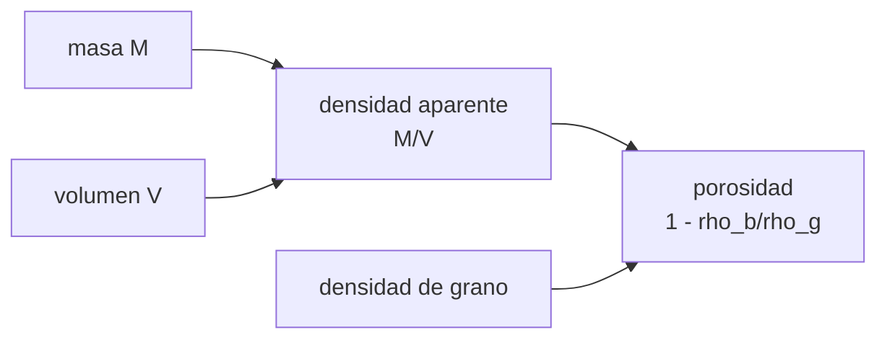

# B58-C03 — Composición de asteroides

<!-- nav:top -->
[🏠 Programa](../../../../README.md) · [📚 Bloque B58](../../../tronco-comun/B58-asteroides-cometas-y-defensa-planetaria.md) · [← Anterior: B58-C02 — Dinámica de asteroides](../B58-C02-dinamica-de-asteroides/CLASE.md) · [Siguiente: B58-C04 — Núcleos y colas cometarias →](../B58-C04-nucleos-y-colas-cometarias/CLASE.md)
<!-- /nav -->

## 1. Ubicación, nivel y alcance

Clase 3 del bloque B58 (nivel N3). Un asteroide se conoce por su masa, su tamaño y su densidad, y de ellas se infiere cuánto vacío contiene. Aquí calculas la densidad aparente de un cuerpo **sintético**, la porosidad que resulta según el material del grano, la densidad de una mezcla de minerales y cómo los errores de tamaño y densidad se transmiten a la masa.

## 2. Por qué esta clase existe

La densidad aparente de un asteroide es casi siempre menor que la de sus rocas: la diferencia es **porosidad**, y de ella depende cuánta energía hace falta para desviarlo o fragmentarlo (C17). La decisión central: **¿cuánto de lo que parece masa es vacío, y cuánta incertidumbre arrastra la masa?**

## 3. Lo que podrás hacer al terminar

1. Calcular el volumen y la densidad aparente de un elipsoide.
2. Obtener la porosidad para una densidad de grano dada.
3. Calcular la densidad de grano de una mezcla en masa y en volumen.
4. Propagar la incertidumbre del diámetro y de la densidad a la masa.
5. Comparar la propagación lineal con Monte Carlo.
6. Rotular las densidades como ilustrativas.

La evidencia es la **ficha de densidad y porosidad** del ejercicio 12 (sección 20).

## 4. Con qué llegas y cómo comprobarlo

1. ¿Qué es la densidad?
2. ¿Cuál es el volumen de una esfera de diámetro `D`?
3. ¿Qué es una fracción en masa?
4. ¿Qué es un dato ilustrativo?
5. ¿Qué mide una incertidumbre relativa?

<details>
<summary>Ver respuestas</summary>

1. Masa por unidad de volumen. 2. `πD³/6`. 3. Masa de un componente dividida por la masa total. 4. Un valor propuesto para el ejemplo, no medido. 5. El cociente entre la desviación y el valor.
</details>

Con cuatro o cinco aciertos, sigue; si no, repasa los prerrequisitos.

## 5. Un caso de contexto y casos de referencia

El ejemplo conductor es un elipsoide sintético de `300 × 250 × 200 m` y masa `1,2 × 10¹¹ kg`. Su volumen es `6.283e+07 m³`, su densidad aparente `1910 kg/m³` y su diámetro equivalente `493 m`. Si el grano fuera del material A (`3300 kg/m³`), la porosidad sería `0.42`. Todo es **sintético**: ningún asteroide real tiene estos valores.

## 6. Vocabulario

La **densidad aparente** (*bulk*) es la masa total sobre el volumen total. La **densidad de grano** es la de la roca sin huecos. La **porosidad** `φ = 1 − ρ_b/ρ_g` es la fracción de vacío. Un **cúmulo de escombros** (*rubble pile*) es un cuerpo hecho de fragmentos unidos por gravedad. La **propagación de errores** traslada la incertidumbre de las entradas a la salida.

## 7. Modelo mental: una esponja



*Descripción textual:* la masa y el volumen dan la densidad aparente; con la densidad de grano se obtiene la porosidad.

Analogía: Como una esponja: pesa menos que la goma de que está hecha porque está llena de huecos. Límite: un asteroide puede tener huecos de todos los tamaños, y la porosidad macroscópica no es la microscópica.

## 8. La explicación, paso a paso

### 8.1 Volumen y densidad aparente

`V = 4πabc/3 = 6.283e+07 m³` y `ρ_b = M/V = 1909.9 kg/m³`. El diámetro equivalente es el de la esfera de igual volumen, `493.2 m`.

### 8.2 Porosidad

Con `ρ_g = 3300` la porosidad es `0.421`; con `2700`, `0.293`; con `7500`, `0.745`. El resultado depende del material supuesto: sin composición no hay porosidad. Los tres granos son **ilustrativos** y no se atribuyen a ningún asteroide.

### 8.3 Densidad de una mezcla

Con fracciones en masa `f_i`, `1/ρ_g = Σ f_i/ρ_i` (media armónica). Para 70/25/5 % se obtiene `3211.51 kg/m³`. Por volúmenes (cada volumen es `f_i/ρ_i` de una masa total de 1 kg) el resultado es `3211.51`: la misma cantidad por dos vías.

### 8.4 Propagación a la masa

Con `M = πD³ρ/6`, `σ_M/M = √((3σ_D/D)² + (σ_ρ/ρ)²)`. Para `σ_D/D = 10 %` y `σ_ρ/ρ = 15 %`: lineal `0.3354`; Monte Carlo (200 000 ensayos) `0.3458`. La diferencia es el término no lineal de `D³`, que la fórmula lineal omite.

### 8.5 Lectura

Un error de 10 % en el diámetro se convierte en 30 % en la masa. Por eso la ambigüedad albedo–diámetro de C01 (factor 2,4) se convierte en un factor cercano a 15 en la masa.

## 9. Magnitudes, símbolos y unidades

| Símbolo | Qué es | Unidad | Valor / nota |
|---|---|---|---|
| `a, b, c` | semiejes | m | 300, 250, 200 |
| `V` | volumen | m³ | 6.283e+07 |
| `M` | masa (sintética) | kg | 1,2 × 10¹¹ |
| `ρ_b` | densidad aparente | kg/m³ | 1910 |
| `ρ_g` | densidad de grano | kg/m³ | 3300 / 2700 / 7500 (ilustrativos) |
| `φ` | porosidad | — | 0–1 |
| `f_i` | fracción en masa | — | 0,70 / 0,25 / 0,05 |

## 10. Convenciones y referencias

SI; elipsoide de semiejes alineados; datos sintéticos; semilla 20261109.

## 11. De dónde sale lo que afirmamos

| ID | Fuente | Localizador | Respalda | Estado |
|---|---|---|---|---|
| — | Sin fuente externa | — | relaciones estándar que verifica el laboratorio | No se consultó una fuente para esta clase |

No consultado: ninguna densidad ni composición publicada; los tres granos son valores propuestos para el ejemplo.

Límites: la clase no dice de qué están hechos los asteroides reales; para eso habría que citar artículos primarios de espectroscopia, meteoritos y misiones.

## 12. Cómo ver la porosidad según el grano

| Magnitud | Valor |
|---|---|
| grano A (3300) | 0.421 |
| grano B (2700) | 0.293 |
| grano C (7500) | 0.745 |
| lineal / Monte Carlo de `σ_M/M` | 0.3354 / 0.3458 |

Descripción larga: la porosidad crece con la densidad de grano supuesta, de `0.29` a `0.75`.

## 13. Ejemplo trabajado: porosidad del cuerpo sintético

**Paso 1 · Volumen.** `V = 6.283e+07 m³`.

**Paso 2 · Densidad aparente.** `ρ_b = 1,2×10¹¹/V = 1909.9 kg/m³`.

**Paso 3 · Porosidad con grano A.** `φ = 1 − 1909.9/3300 = 0.421`.

**Paso 4 · Lectura.** Si el grano fuera A, esa fracción del volumen sería hueco; sin composición medida, la cifra es condicional.

## 14. Distintas formas de resolver lo mismo

**Analítica:** propagación lineal. **Numérica:** Monte Carlo, que incluye la no linealidad. **Mezcla:** armónica o por volúmenes, equivalentes. Se usa la lineal para estimar rápido y Monte Carlo para comprobarla.

## 15. Práctica guiada

**Ejercicio 1 · con los pasos indicados.** Calcula el volumen de una esfera de `D = 400 m`.

<details><summary>Solución comentada</summary>

`πD³/6 = 3,351 × 10⁷ m³`.
</details>

**Ejercicio 2 · con una pista.** Con `ρ = 2000`, ¿cuál es su masa? *Pista:* `ρ V`.

<details><summary>Solución comentada</summary>

`6.702e+10 kg`.
</details>

**Ejercicio 3 · casi autónomo.** Calcula la porosidad si `ρ_b = 1500` y `ρ_g = 3000`.

<details><summary>Solución comentada</summary>

`0,5`.
</details>

## 16. Práctica autónoma, transferencia e integrador

**Ejercicio 4 · autónomo.** Mezcla 50/50 en masa de `2000` y `4000 kg/m³`.

<details><summary>Solución comentada</summary>

`1/ρ = 0,5/2000 + 0,5/4000 = 3,75×10⁻⁴`; `ρ = 2667`.
</details>

**Ejercicio 5 · autónomo.** Mezcla 50/50 **en volumen** de las mismas: ¿cuál es la densidad?

<details><summary>Solución comentada</summary>

Media aritmética: `3000 kg/m³`; distinta de la anterior porque cambia la definición de fracción.
</details>

**Ejercicio 6 · autónomo.** Propaga `σ_D/D = 5 %`, `σ_ρ/ρ = 10 %` a la masa.

<details><summary>Solución comentada</summary>

`√(0,15² + 0,10²) = 0,180`.
</details>

**Ejercicio 7 · autónomo.** ¿Qué aporta más al error de masa, el diámetro o la densidad?

<details><summary>Solución comentada</summary>

El diámetro: el factor 3 triplica su peso en la suma cuadrática.
</details>

**Ejercicio 8 · autónomo.** Un cuerpo de `ρ_b = 2000` tiene `φ = 0,3`. ¿Cuánto vale `ρ_g`?

<details><summary>Solución comentada</summary>

`ρ_g = ρ_b/(1 − φ) = 2857 kg/m³`.
</details>

**Ejercicio 9 · transferencia.** **Transferencia.** Un colega dice que un asteroide poroso es «menos masivo y por tanto más fácil de desviar». Respóndele.

<details><summary>Solución comentada</summary>

Para una misma masa la porosidad cambia cómo absorbe la energía; para un mismo tamaño, es menos masivo. Hay que fijar la variable (C17).
</details>

**Ejercicio 10 · transferencia.** **Transferencia.** ¿Por qué la porosidad medida depende de la composición supuesta?

<details><summary>Solución comentada</summary>

Porque `ρ_g` entra en la fórmula; con otro grano, otra porosidad.
</details>

**Ejercicio 11 · transferencia.** **Transferencia.** ¿Qué medida independiente reduciría el error de masa?

<details><summary>Solución comentada</summary>

Una medida de masa por seguimiento gravitacional de un satélite o de una nave, o del tamaño por radar.
</details>

**Ejercicio 12 · integrador.** **Integrador.** Elabora tu *ficha de densidad y porosidad*: volumen, densidad aparente, porosidad para tres granos, mezcla y propagación.

<details><summary>Solución comentada</summary>

Secciones 8.1–8.4.
</details>

## 17. Laboratorio: densidad, porosidad y propagación

El script [composicion.py](composicion.py) calcula densidad aparente, porosidad y mezcla, y compara la propagación lineal con Monte Carlo (**comprueba** media armónica = por volúmenes con 10⁻¹² y diferencia lineal–Monte Carlo menor que 15 %).

**Datos:** cuerpo **sintético**, densidades **ilustrativas**; semilla `20261109`. **Predice antes de ejecutar:** ¿Será mayor o menor la incertidumbre de Monte Carlo que la lineal? **Ejecución del 2026-11-09:**

```text
Python 3.12.9 (biblioteca estandar)
Volumen del elipsoide = 6.2832e+07 m^3 ; diametro equivalente = 493.2 m
Densidad aparente = 1909.9 kg/m^3 (masa sintetica 1.20e+11 kg)
  porosidad si el grano es material A: 0.421
  porosidad si el grano es material B: 0.293
  porosidad si el grano es material C: 0.745
Densidad de grano de la mezcla (70/25/5 % en masa): armonica = 3211.505 ; por volumenes = 3211.505 kg/m^3
Masa M = pi/6 D^3 rho con D = 400 m y rho = 2000: M0 = 6.702e+10 kg
Incertidumbre relativa de M (D 10 %, rho 15 %): lineal = 0.3354 ; Monte Carlo = 0.3458
Pruebas superadas.
```

```bash
python programa/clases/B58/B58-C03-composicion-de-asteroides/composicion.py
```

**Límites:** elipsoide homogéneo, errores gaussianos independientes, porosidad macroscópica solamente.

## 18. Errores frecuentes y cómo corregirlos

**Confundir densidad aparente con densidad de grano.** Se corrige con 8.1–8.2.

**Promediar densidades con las fracciones equivocadas.** Se corrige con 8.3.

**Propagar el error del diámetro como lineal.** Se corrige con 8.4.

**Atribuir los granos a un asteroide real.** Se corrige con la sección 10.

## 19. Cómo sabrás que vas bien

Tras la sección 8: ¿qué porosidad esperabas con el grano B y cuál obtuviste? Si dudas, repasa el ejemplo 13. Tras el laboratorio: ¿qué comprueba? (ver la sección 17).

## 20. Qué entregas y cómo se evalúa

El producto es tu **ficha de densidad y porosidad** (ejercicio 12).

| Criterio | Inicial | En desarrollo | Logrado | Destacado |
|---|---|---|---|---|
| Conceptos | Los confunde | Parciales | Conceptos de la clase | Explica los límites |
| Cálculo | Sin unidades | Con errores | Tablas completas | Calcula casos nuevos |
| Numérico | Sin comprobar | Un caso | Contraste con el análisis | Interpreta las diferencias |
| Fuentes | Sin fuente | Sin fecha | Fuentes con fecha | Declara lo no consultado |
| Límites | No los nombra | Uno | Tres | Discute qué falta del modelo |

**Condiciones críticas (no se compensan con promedio):** rotular los materiales como ilustrativos; no atribuir una composición a un asteroide real; citar solo lo consultado.

## 21. Ética, seguridad y límites

Clase educativa: los modelos son simplificados y los datos, sintéticos; nada de lo calculado evalúa un objeto real ni sustituye a los sistemas oficiales de monitoreo y alerta.  Accesibilidad: tablas equivalentes a las gráficas, fórmulas en texto, ejercicios sin conexión.

## 22. Para cerrar y seguir

El cuerpo sintético tiene densidad aparente `1910 kg/m³` y, según el grano, porosidad de `0.29` a `0.75`; un 10 % de error de tamaño pesa 30 % en la masa. Queda una pregunta: ¿qué cambia en un cometa?

**Glosario español–inglés.** densidad aparente · *bulk density*; densidad de grano · *grain density*; porosidad · *porosity*; cúmulo de escombros · *rubble pile*; propagación de errores · *error propagation*.

**Continuidad.** [B58-C04](../B58-C04-nucleos-y-colas-cometarias/CLASE.md) estudia núcleos y colas cometarias.

**Referencias:** ver sección 11.

<!-- nav:bottom -->
---

[← Anterior: B58-C02 — Dinámica de asteroides](../B58-C02-dinamica-de-asteroides/CLASE.md) · [📚 Bloque B58](../../../tronco-comun/B58-asteroides-cometas-y-defensa-planetaria.md) · [Siguiente: B58-C04 — Núcleos y colas cometarias →](../B58-C04-nucleos-y-colas-cometarias/CLASE.md)
<!-- /nav -->
