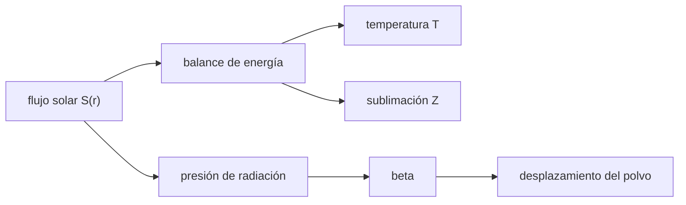

# B58-C04 — Núcleos y colas cometarias

<!-- nav:top -->
[🏠 Programa](../../../../README.md) · [📚 Bloque B58](../../../tronco-comun/B58-asteroides-cometas-y-defensa-planetaria.md) · [← Anterior: B58-C03 — Composición de asteroides](../B58-C03-composicion-de-asteroides/CLASE.md) · [Siguiente: B58-C05 — Órbitas cercanas a la Tierra →](../B58-C05-orbitas-cercanas-a-la-tierra/CLASE.md)
<!-- /nav -->

## 1. Ubicación, nivel y alcance

Clase 4 del bloque B58 (nivel N3). Un cometa es un asteroide que se activa cuando el hielo sublima. Aquí resuelves el balance de energía de hielo de agua en un núcleo **sintético** a distintas distancias del Sol, calculas el parámetro `β` de la presión de radiación sobre granos de polvo y el desplazamiento relativo del polvo, que dibuja la cola.

## 2. Por qué esta clase existe

La actividad de un cometa cambia su órbita (empujes no gravitacionales) y su brillo, y decide qué se observa. La decisión central: **¿a qué distancia del Sol el hielo empieza a sublimar de forma apreciable y qué tamaño de grano barre la radiación?**

## 3. Lo que podrás hacer al terminar

1. Plantear el balance de energía de un elemento de superficie con sublimación.
2. Resolverlo por bisección y comprobar el residuo.
3. Calcular `β` para granos de distinto tamaño.
4. Obtener el desplazamiento de un grano en la cola y compararlo con la integración numérica.
5. Separar núcleo, coma, cola de polvo y cola de iones.
6. Declarar los datos recordados y no consultados.

La evidencia es la **ficha de la cola cometaria** del ejercicio 12 (sección 20).

## 4. Con qué llegas y cómo comprobarlo

1. ¿Qué dice la ley de Stefan–Boltzmann?
2. ¿Qué es el calor latente?
3. ¿Cómo varía el flujo solar con la distancia?
4. ¿Qué es la presión de radiación?
5. ¿Qué es la bisección?

<details>
<summary>Ver respuestas</summary>

1. Un cuerpo negro emite `σT⁴` por unidad de superficie. 2. Energía por kilogramo para cambiar de fase. 3. Como `1/r²`. 4. El empuje de los fotones sobre un cuerpo que los absorbe o dispersa. 5. Un método que encierra la raíz en un intervalo y lo parte por la mitad.
</details>

Con cuatro o cinco aciertos, sigue; si no, repasa los prerrequisitos.

## 5. Un caso de contexto y casos de referencia

El ejemplo conductor es un elemento subsolar de un núcleo **sintético** (albedo `0,04`, emisividad `0,9`). Sin sublimación llegaría a `400 K` a 1 au; con sublimación de hielo de agua se queda en `205 K`, y `93 %` de la energía absorbida se gasta en sublimar. A 5 au todavía gasta `12 %`, porque la caída es gradual. Un grano de 1 µm y 1000 kg/m³ tiene `β = 0.574`.

## 6. Vocabulario

La **sublimación** es el paso de sólido a gas. La **coma** es la atmósfera de gas y polvo que rodea al núcleo. La **cola de polvo** es el polvo empujado por la radiación; la **cola de iones**, el gas ionizado arrastrado por el viento solar (no se calcula aquí). `β` es el cociente entre la fuerza de radiación y la de gravedad solares. Una **fuerza no gravitacional** es un empuje por la salida de gas que altera la órbita.

## 7. Modelo mental: una olla con agua hirviendo



*Descripción textual:* el flujo solar entra en un balance que reparte la energía entre emisión térmica y sublimación; el mismo flujo, como presión de radiación, da `β` y el desplazamiento del polvo.

Analogía: Como una olla: al llegar al punto de ebullición el calor extra no sube la temperatura sino que evapora. Límite: el hielo cometario sublima gradualmente, no hay un umbral brusco, y la superficie real no es isotérmica.

## 8. La explicación, paso a paso

### 8.1 El balance de energía

Para un elemento subsolar: `(1 − A) S = ε σ T⁴ + L Z(T)`, con `S = L_☉/(4π r²)`. `Z = P_v √(m/(2π k_B T))` es el flujo de masa sublimada, `P_v = 3,56×10¹² exp(−6141,667/T) Pa` la presión de vapor y `L = 2,83×10⁶ J/kg` el calor latente. Las constantes de la presión de vapor son ajustes recordados, no consultados.

### 8.2 Solución por bisección

El miembro derecho aumenta con `T` y el izquierdo no depende de ella, así que la raíz es única. El laboratorio parte el intervalo `[50, 500] K` 200 veces y comprueba que el residuo relativo es menor que `10⁻⁹`.

### 8.3 Resultados por distancia

A `1.0 au`: `T = 204.7 K` (sin sublimación `400.0 K`), `Z = 4.30e-04 kg m⁻² s⁻¹`, fracción de energía a sublimar `0.9314`.
A `1.5 au`: `T = 198.7 K` (sin sublimación `326.6 K`), `Z = 1.77e-04 kg m⁻² s⁻¹`, fracción de energía a sublimar `0.8630`.
A `2.0 au`: `T = 194.4 K` (sin sublimación `282.9 K`), `Z = 8.97e-05 kg m⁻² s⁻¹`, fracción de energía a sublimar `0.7771`.
A `3.0 au`: `T = 187.6 K` (sin sublimación `231.0 K`), `Z = 2.90e-05 kg m⁻² s⁻¹`, fracción de energía a sublimar `0.5651`.
A `5.0 au`: `T = 173.5 K` (sin sublimación `178.9 K`), `Z = 2.13e-06 kg m⁻² s⁻¹`, fracción de energía a sublimar `0.1151`.

La temperatura baja con la distancia y la sublimación gasta más de la mitad de la energía hasta unos 3 au y todavía una décima parte a 5 au; el valor exacto depende del albedo, la rotación y la composición, que aquí son ilustrativos.

### 8.4 La presión de radiación

`β = 3 L_☉ Q_pr/(16π c GM ρ s)` con `Q_pr = 1`. Para `ρ = 1000 kg/m³`: `s = 0,1 µm → 5.742`, `1 µm → 0.574`, `10 µm → 0.0574`. Es inversamente proporcional a `ρ s`, así que los granos pequeños sienten mucho más la radiación. Con `β > 1` el grano escapa del Sol; con `β` pequeño sigue casi la órbita del cometa.

### 8.5 El desplazamiento del polvo

Visto desde el cometa, un grano liberado en reposo siente la aceleración relativa `β g`, con `g = GM/r²`. En 1 día el desplazamiento es `½ β g t² = 1.271e+07 m`; integrando por separado grano y cometa con RK4 se obtiene `1.271e+07 m` (diferencia relativa `7.0e-05`). Para tiempos largos la curvatura de las órbitas deforma la cola y esta aproximación deja de valer.

## 9. Magnitudes, símbolos y unidades

| Símbolo | Qué es | Unidad | Valor / nota |
|---|---|---|---|
| `S` | flujo solar | W/m² | `L_☉/(4πr²)` |
| `A`, `ε` | albedo, emisividad | — | 0,04 / 0,9 (ilustrativos) |
| `T` | temperatura | K | 205 a 1 au |
| `Z` | flujo de masa sublimada | kg m⁻² s⁻¹ | 4.30e-04 a 1 au |
| `β` | fuerza de radiación / gravedad | — | 0.574 (1 µm) |
| `ρ`, `s` | densidad y radio del grano | kg/m³, m | 1000; 10⁻⁷–10⁻⁵ |
| `t` | tiempo | s | 86 400 |

## 10. Convenciones y referencias

SI; elemento subsolar en equilibrio; polvo esférico con `Q_pr = 1`; cometa y polvo en reposo radial inicial. Sin datos de un cometa real.

## 11. De dónde sale lo que afirmamos

| ID | Fuente | Localizador | Respalda | Estado |
|---|---|---|---|---|
| — | Sin fuente externa | — | relaciones estándar que verifica el laboratorio | No se consultó una fuente para esta clase |

No consultado: la presión de vapor, el calor latente, `L_☉`, `GM`, `c`, `σ`, `k_B` y la unidad astronómica son valores recordados por el autor; el laboratorio verifica la coherencia interna (bisección con residuo, `β` con aritmética propia y RK4).

Límites: sin fuente externa no se afirma nada sobre un cometa real.

## 12. Cómo ver la temperatura y la sublimación

| Magnitud | Valor |
|---|---|
| T a 1.0 au | 204.7 K (93.14 % a sublimar) |
| T a 1.5 au | 198.7 K (86.30 % a sublimar) |
| T a 2.0 au | 194.4 K (77.71 % a sublimar) |
| T a 3.0 au | 187.6 K (56.51 % a sublimar) |
| T a 5.0 au | 173.5 K (11.51 % a sublimar) |

Descripción larga: la temperatura baja de `205 K` a 1 au a `174 K` a 5 au y la fracción de energía en sublimar cae de `93 %` a `12 %` (gradualmente, sin umbral).

## 13. Ejemplo trabajado: el balance a 1 au

**Paso 1 · Flujo.** `S = L_☉/(4π r²) = 1361 W/m²` aproximadamente.

**Paso 2 · Sin sublimación.** `T = 400 K`.

**Paso 3 · Con sublimación.** `T = 205 K` y `Z = 4.30e-04 kg m⁻² s⁻¹`.

**Paso 4 · Fracción.** `L Z/((1 − A)S) = 0.93`.

**Paso 5 · Lectura.** Más de la mitad de la energía absorbida sublima hielo.

## 14. Distintas formas de resolver lo mismo

**Balance:** muestra cuándo el hielo sublima. **`β`:** muestra qué granos barre la radiación. **Desplazamiento:** convierte `β` en una longitud en la cola. Las tres son piezas de un modelo mínimo; un cometa real exige conducción, rotación, mezcla de volátiles y la interacción con el viento solar.

## 15. Práctica guiada

**Ejercicio 1 · con los pasos indicados.** Calcula `S` a 2 au. *Pasos:* `1361/4` aproximado.

<details><summary>Solución comentada</summary>

`≈ 340 W/m²`.
</details>

**Ejercicio 2 · con una pista.** ¿Qué temperatura da el cuerpo negro a 5 au con `A = 0,04` y `ε = 0,9`? *Pista:* sección 8.3.

<details><summary>Solución comentada</summary>

`178.9 K`.
</details>

**Ejercicio 3 · casi autónomo.** ¿Qué fracción de la energía se gasta en sublimar a 1 au?

<details><summary>Solución comentada</summary>

`0.93`.
</details>

## 16. Práctica autónoma, transferencia e integrador

**Ejercicio 4 · autónomo.** Calcula `β` para un grano de `s = 1 µm` y `ρ = 1000`.

<details><summary>Solución comentada</summary>

`0.574`.
</details>

**Ejercicio 5 · autónomo.** ¿Cuánto vale `β` si el grano es 10 veces mayor?

<details><summary>Solución comentada</summary>

`0.0574`; baja diez veces.
</details>

**Ejercicio 6 · autónomo.** ¿Qué grano tiene `β = 1` con `ρ = 1000`?

<details><summary>Solución comentada</summary>

`s = 0,574 µm` (`β ∝ 1/s`).
</details>

**Ejercicio 7 · autónomo.** Desplazamiento en 1 día de un grano de `β = 0,574` a 1 au.

<details><summary>Solución comentada</summary>

`1.27e+07 m`.
</details>

**Ejercicio 8 · autónomo.** ¿Por qué `T` a 1 au baja con la sublimación?

<details><summary>Solución comentada</summary>

Porque parte de la energía absorbida se gasta en el cambio de fase y el resto debe emitirse a menor temperatura.
</details>

**Ejercicio 9 · transferencia.** **Transferencia.** ¿Por qué un cometa activo puede cambiar de órbita sin ser empujado por un planeta?

<details><summary>Solución comentada</summary>

El gas que sale ejerce un empuje reactivo (fuerza no gravitacional); su tamaño depende de `Z`.
</details>

**Ejercicio 10 · transferencia.** **Transferencia.** Un colega dice que a 3 au no hay actividad. Respóndele con el laboratorio.

<details><summary>Solución comentada</summary>

A 3 au la sublimación gasta `57 %` de la energía, así que la afirmación es falsa en este modelo; además otros volátiles sublimarían más lejos (no calculado).
</details>

**Ejercicio 11 · transferencia.** **Transferencia.** ¿Qué cambiaría si el núcleo rotara muy rápido?

<details><summary>Solución comentada</summary>

La temperatura subsolar bajaría y la actividad se repartiría sobre la superficie.
</details>

**Ejercicio 12 · integrador.** **Integrador.** Elabora tu *ficha de la cola cometaria*: `T` y `Z` a cinco distancias, `β` de tres granos y el desplazamiento de un día.

<details><summary>Solución comentada</summary>

Secciones 8.3–8.5.
</details>

## 17. Laboratorio: balance térmico y presión de radiación

El script [cometa.py](cometa.py) resuelve el balance a cinco distancias, calcula `β` y compara el desplazamiento con RK4 (**comprueba** residuo < 10⁻⁹, `β(1 µm) = 0,574 ± 0,002` y diferencia < 10⁻³).

**Datos:** núcleo **sintético**; constantes recordadas, no consultadas. **Predice antes de ejecutar:** ¿Qué fracción de la energía irá a sublimar a 5 au: despreciable o apreciable? (se esperaba menos de 1 %.) **Ejecución del 2026-11-09:**

```text
Python 3.12.9 (biblioteca estandar)
 r[au]      T[K]  T sin subl.     Z[kg/m2/s]    E a sublim.     residuo
   1.0    204.69       400.02      4.301e-04         0.9314    -2.6e-15
   1.5    198.71       326.62      1.771e-04         0.8630    -3.5e-15
   2.0    194.36       282.86      8.970e-05         0.7771     1.7e-16
   3.0    187.55       230.95      2.899e-05         0.5651    -1.3e-15
   5.0    173.51       178.89      2.127e-06         0.1151    -1.3e-15
beta(rho = 1000 kg/m3, s = 0.1 um) = 5.7424
beta(rho = 1000 kg/m3, s = 1.0 um) = 0.5742
beta(rho = 1000 kg/m3, s = 10.0 um) = 0.0574
Desplazamiento en 1 dia: integrado = 1.2711e+07 m ; (1/2) beta g t^2 = 1.2710e+07 m ; diferencia relativa = 7.03e-05
Pruebas superadas.
```

```bash
python programa/clases/B58/B58-C04-nucleos-y-colas-cometarias/cometa.py
```

**Límites:** sin conducción, rotación, mezcla de volátiles ni cola de iones; un solo elemento subsolar.

## 18. Errores frecuentes y cómo corregirlos

**Creer que la sublimación empieza de golpe.** Se corrige con 8.3.

**Confundir cola de polvo y de iones.** Se corrige con la sección 6.

**Olvidar que `β` depende del tamaño del grano.** Se corrige con 8.4.

**Tratar las constantes recordadas como consultadas.** Se corrige con la sección 11.

## 19. Cómo sabrás que vas bien

Tras la sección 8: ¿qué fracción esperabas a 3 au y cuál obtuviste? Si dudas, repasa el ejemplo 13. Tras el laboratorio: ¿qué comprueba? (ver la sección 17).

## 20. Qué entregas y cómo se evalúa

El producto es tu **ficha de la cola cometaria** (ejercicio 12).

| Criterio | Inicial | En desarrollo | Logrado | Destacado |
|---|---|---|---|---|
| Conceptos | Los confunde | Parciales | Conceptos de la clase | Explica los límites |
| Cálculo | Sin unidades | Con errores | Tablas completas | Calcula casos nuevos |
| Numérico | Sin comprobar | Un caso | Contraste con el análisis | Interpreta las diferencias |
| Fuentes | Sin fuente | Sin fecha | Fuentes con fecha | Declara lo no consultado |
| Límites | No los nombra | Uno | Tres | Discute qué falta del modelo |

**Condiciones críticas (no se compensan con promedio):** rotular el núcleo como sintético; no presentar las constantes recordadas como consultadas; no describir un cometa real.

## 21. Ética, seguridad y límites

Clase educativa: los modelos son simplificados y los datos, sintéticos; nada de lo calculado evalúa un objeto real ni sustituye a los sistemas oficiales de monitoreo y alerta.  Accesibilidad: tablas equivalentes a las gráficas, fórmulas en texto, ejercicios sin conexión.

## 22. Para cerrar y seguir

El hielo de agua de un núcleo sintético gasta en sublimar casi toda la energía a 1 au y todavía una décima parte a 5 au; un grano de 1 µm tiene `β = 0.57`. Queda una pregunta: ¿qué órbitas hacen que un objeto pase cerca de la Tierra?

**Glosario español–inglés.** sublimación · *sublimation*; coma · *coma*; cola de polvo · *dust tail*; presión de radiación · *radiation pressure*; fuerza no gravitacional · *non-gravitational force*.

**Continuidad.** [B58-C05](../B58-C05-orbitas-cercanas-a-la-tierra/CLASE.md) estudia órbitas cercanas a la Tierra.

**Referencias:** ver sección 11.

<!-- nav:bottom -->
---

[← Anterior: B58-C03 — Composición de asteroides](../B58-C03-composicion-de-asteroides/CLASE.md) · [📚 Bloque B58](../../../tronco-comun/B58-asteroides-cometas-y-defensa-planetaria.md) · [Siguiente: B58-C05 — Órbitas cercanas a la Tierra →](../B58-C05-orbitas-cercanas-a-la-tierra/CLASE.md)
<!-- /nav -->
