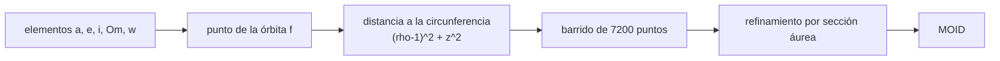

# B58-C05 — Órbitas cercanas a la Tierra

<!-- nav:top -->
[🏠 Programa](../../../../README.md) · [📚 Bloque B58](../../../tronco-comun/B58-asteroides-cometas-y-defensa-planetaria.md) · [← Anterior: B58-C04 — Núcleos y colas cometarias](../B58-C04-nucleos-y-colas-cometarias/CLASE.md) · [Siguiente: B58-C06 — Astrometría de objetos menores →](../B58-C06-astrometria-de-objetos-menores/CLASE.md)
<!-- /nav -->

## 1. Ubicación, nivel y alcance

Clase 5 del bloque B58 (nivel N3). Un objeto cercano a la Tierra solo importa para la defensa planetaria si su órbita pasa cerca de la terrestre. Aquí calculas la **distancia mínima de intersección orbital** (MOID) entre una órbita sintética y una circunferencia de 1 au, la verificas con tres casos analíticos y aplicas el criterio de objeto potencialmente peligroso. Usas el propagador kepleriano de dos cuerpos de C02.

## 2. Por qué esta clase existe

Dos órbitas pueden cruzarse en proyección sin que los cuerpos coincidan nunca, y pueden no cruzarse y estar a una distancia pequeña. El MOID separa los casos geométricamente. La decisión central: **¿qué tan cerca pueden llegar las órbitas y qué objetos merecen seguimiento prioritario?**

## 3. Lo que podrás hacer al terminar

1. Definir el MOID y distinguirlo de una distancia de acercamiento.
2. Calcular el MOID numéricamente por barrido y refinamiento.
3. Contrastarlo con tres casos analíticos.
4. Aplicar el criterio PHA de la fuente.
5. Convertir au a kilómetros y a radios terrestres.
6. Declarar la simplificación de la Tierra circular.

La evidencia es la **ficha de MOID** del ejercicio 12 (sección 20).

## 4. Con qué llegas y cómo comprobarlo

1. ¿Qué es una elipse en términos de `a` y `e`?
2. ¿Qué es la inclinación?
3. ¿Qué es un nodo?
4. ¿Qué es una unidad astronómica?
5. ¿Qué es un caso analítico de control?

<details>
<summary>Ver respuestas</summary>

1. Una curva con semieje mayor `a` y excentricidad `e`; `q = a(1−e)`. 2. El ángulo entre el plano orbital y la eclíptica. 3. El punto donde la órbita cruza la eclíptica. 4. 149 597 870,7 km. 5. Un resultado exacto con el que se compara el código.
</details>

Con cuatro o cinco aciertos, sigue; si no, repasa los prerrequisitos.

## 5. Un caso de contexto y casos de referencia

El ejemplo conductor son cinco órbitas sintéticas. SINT-D (`a = 1,5 au`, `e = 0,5`, `i = 20°`) cruza la órbita terrestre en proyección (`q = 0,75 au`) y aun así su MOID es `0.0211 au` (`3161996 km` aprox.), no cero, porque cruza el plano de la eclíptica lejos de la Tierra. Los casos de control dan `0.0800` (coplanar exterior), `0.1200` (coplanar interior) y `0.2000 au` (circular inclinada).

## 6. Vocabulario

El **MOID** es la distancia mínima entre dos órbitas, no entre los cuerpos. Un **PHA** es un asteroide cercano a la Tierra con `MOID ≤ 0,05 au` y `H ≤ 22` [S3]. Un **nodo** es un cruce con el plano de referencia. Una **sección áurea** es un método de minimización de funciones de una variable sin derivadas.

## 7. Modelo mental: dos autopistas



*Descripción textual:* se recorre la órbita del asteroide, se mide en cada punto la distancia a la circunferencia terrestre, se toma el mínimo del barrido y se refina localmente.

Analogía: Como dos autopistas: un cruce a distinto nivel no es una colisión posible aunque se crucen en el mapa. Límite: el MOID ignora el tiempo: dos órbitas cercanas no implican que los cuerpos coincidan en la misma fecha.

## 8. La explicación, paso a paso

### 8.1 El punto de la órbita

Para una anomalía verdadera `f`, `r = a(1−e²)/(1+e cos f)` y el punto se rota al marco eclíptico con `Ω`, `i`, `ω`. Se usa la función `rot3` del propagador común, escrito en la biblioteca estándar.

### 8.2 La distancia a la órbita terrestre

Si la Tierra se aproxima por una circunferencia de radio 1 en el plano `z = 0`, la distancia mínima de un punto `(x, y, z)` a ella es `√((ρ−1)² + z²)`, con `ρ = √(x²+y²)`. No hay que barrer el ángulo de la Tierra.

### 8.3 Barrido y refinamiento

Se evalúa `d(f)` en 7200 valores, se toman los seis mejores y se refina con sección áurea 80 veces. Duplicar o reducir la resolución no cambia el resultado hasta `10⁻⁹ au`.

### 8.4 Tres casos analíticos

(i) Coplanar exterior: `MOID = q − 1`. SINT-A: `0.080000` frente a `0.080000`. (ii) Coplanar interior: `MOID = 1 − Q`. SINT-B: `0.120000` frente a `0.120000`. (iii) Circular inclinada de radio `a`: la distancia al cuadrado es `a² − 2ρ + 1`, mínima en el nodo, donde `ρ = a`, así que `MOID = |a−1|`; SINT-C: `0.200000`.

### 8.5 PHA

El criterio de la fuente exige también `H ≤ 22`. SINT-A (`H = 21`, MOID `0.080`) no es PHA; SINT-D (`H = 21,5`, MOID `0.021`) es PHA; SINT-E (`H = 24`, MOID `0.0650 au`) no es PHA: su MOID supera `0,05 au` y además es pequeño. Los PHA reales se determinan con las dos elipses reales, no con una Tierra circular.

## 9. Magnitudes, símbolos y unidades

| Símbolo | Qué es | Unidad | Valor / nota |
|---|---|---|---|
| `a, e, i, Ω, ω` | elementos orbitales | au, —, rad | ver tabla |
| `f` | anomalía verdadera | rad | 0–2π |
| `ρ, z` | radio cilíndrico y altura | au | — |
| `MOID` | distancia mínima entre órbitas | au | 0.0211 (SINT-D) |
| `H` | magnitud absoluta | mag | 21–24 (sintético) |
| `1 au` | unidad astronómica | km | 149 597 870,7 |

## 10. Convenciones y referencias

Marco eclíptico heliocéntrico; Tierra circular de 1 au en el plano de la eclíptica; ángulos en radianes en el cálculo. Órbitas sintéticas; el MOID real depende de la época de los elementos.

## 11. De dónde sale lo que afirmamos

| ID | Fuente | Localizador | Respalda | Estado |
|---|---|---|---|---|
| S3 | CNEOS/JPL, *NEO Groups* (grupos de objetos cercanos a la Tierra) | [https://cneos.jpl.nasa.gov/about/neo_groups.html](https://cneos.jpl.nasa.gov/about/neo_groups.html) | definición de PHA: `MOID ≤ 0,05 au` y `H ≤ 22` | Página leída el 2026-11-09 (resumen extraído de la página) |

No consultado: los algoritmos de MOID de la literatura; el método de barrido y sección áurea es propio y se valida con casos analíticos.

Límites: la fuente respalda el criterio PHA, no el método ni los valores sintéticos.

## 12. Cómo ver el MOID de los cinco objetos

| Magnitud | Valor |
|---|---|
| SINT-A | 0.08000 au (no PHA) |
| SINT-B | 0.12000 au (no PHA) |
| SINT-C | 0.20000 au (no PHA) |
| SINT-D | 0.02114 au (PHA) |
| SINT-E | 0.06505 au (no PHA) |

Descripción larga: solo los objetos con MOID ≤ 0,05 au y `H ≤ 22` se señalan como PHA.

## 13. Ejemplo trabajado: el MOID de SINT-C

**Paso 1 · Geometría.** Órbita circular de `a = 1,2 au` inclinada 30°.

**Paso 2 · Distancia.** `d² = a² − 2ρ + 1`, con `ρ ≤ a`.

**Paso 3 · Mínimo.** En el nodo, `ρ = a`, luego `d = |a − 1| = 0,2 au`.

**Paso 4 · Laboratorio.** `0.200000 au`.

## 14. Distintas formas de resolver lo mismo

**Analítica:** casos coplanares y circulares. **Numérica:** barrido con refinamiento. El análisis sirve de control; el barrido, para el caso general. Una tercera vía sería minimizar con las dos elipses (no hecha aquí).

## 15. Práctica guiada

**Ejercicio 1 · con los pasos indicados.** Calcula `q` y `Q` de SINT-A. *Pasos:* `a(1∓e)`.

<details><summary>Solución comentada</summary>

`q = 1.080`, `Q = 1.920 au`.
</details>

**Ejercicio 2 · con una pista.** ¿Cuál es el MOID de una órbita coplanar con `q = 1,2`? *Pista:* sección 8.4.

<details><summary>Solución comentada</summary>

`0,2 au`.
</details>

**Ejercicio 3 · casi autónomo.** Convierte `0,05 au` a km.

<details><summary>Solución comentada</summary>

`7,48 × 10⁶ km` (unos 1170 radios terrestres de 6371 km).
</details>

## 16. Práctica autónoma, transferencia e integrador

**Ejercicio 4 · autónomo.** ¿Cuál es el MOID de una órbita coplanar con `Q = 0,7`?

<details><summary>Solución comentada</summary>

`0,3 au`.
</details>

**Ejercicio 5 · autónomo.** ¿Por qué SINT-D cruza en proyección y no tiene MOID cero?

<details><summary>Solución comentada</summary>

Porque al cruzar la circunferencia en proyección está a distinta altura sobre el plano.
</details>

**Ejercicio 6 · autónomo.** Decide si un objeto de `MOID = 0,04` y `H = 22,5` es PHA.

<details><summary>Solución comentada</summary>

No: `H > 22` [S3].
</details>

**Ejercicio 7 · autónomo.** ¿Qué pasa con el MOID de una circular de `a = 1,0` e `i = 10°`?

<details><summary>Solución comentada</summary>

Es cero: coincide en el nodo.
</details>

**Ejercicio 8 · autónomo.** Con 3600 y 14 400 puntos, ¿difiere el MOID de SINT-D?

<details><summary>Solución comentada</summary>

Menos de `10⁻⁹ au` (comprobado en el laboratorio).
</details>

**Ejercicio 9 · transferencia.** **Transferencia.** Un colega dice que MOID pequeño implica impacto cercano. Respóndele.

<details><summary>Solución comentada</summary>

El MOID es geométrico y no incluye el tiempo; hace falta que ambos cuerpos lleguen a la vez (C08, C09).
</details>

**Ejercicio 10 · transferencia.** **Transferencia.** ¿Qué cambiaría con la excentricidad real de la Tierra?

<details><summary>Solución comentada</summary>

El MOID variaría unos `10⁻²` au como mucho; debe calcularse con las dos elipses.
</details>

**Ejercicio 11 · transferencia.** **Transferencia.** ¿Qué efecto tiene la incertidumbre orbital sobre el MOID?

<details><summary>Solución comentada</summary>

Lo vuelve una distribución; se propaga con la covarianza (C08).
</details>

**Ejercicio 12 · integrador.** **Integrador.** Elabora tu *ficha de MOID*: tabla de cinco objetos, tres casos analíticos y decisión de PHA.

<details><summary>Solución comentada</summary>

Secciones 8.3–8.5.
</details>

## 17. Laboratorio: MOID numérico y casos analíticos

El script [moid.py](moid.py) calcula el MOID de cinco órbitas sintéticas por barrido y sección áurea y lo contrasta con tres casos analíticos (**comprueba** 10⁻⁶ au y estabilidad ante la resolución).

**Datos:** órbitas **sintéticas**; criterio PHA de [S3]; Tierra circular, simplificación declarada. **Predice antes de ejecutar:** ¿Cuál de los cinco objetos tendrá el MOID más pequeño? **Ejecución del 2026-11-09:**

```text
Python 3.12.9 (biblioteca estandar)
objeto        q       Q  i[deg]      H   MOID[au]   MOID[km]   PHA
SINT-A    1.080   1.920     0.0   21.0   0.080000   11967830    no
SINT-B    0.720   0.880     0.0   23.0   0.120000   17951744    no
SINT-C    1.200   1.200    30.0   20.0   0.200000   29919574    no
SINT-D    0.750   2.250    20.0   21.5   0.021137    3161996    si
SINT-E    0.990   2.610     5.0   24.0   0.065049    9731263    no
Casos analiticos: coplanar exterior q-1 = 0.080000 ; coplanar interior 1-Q = 0.120000 ; circular inclinada |a-1| = 0.200000
Pruebas superadas.
```

```bash
python programa/clases/B58/B58-C05-orbitas-cercanas-a-la-tierra/moid.py
```

**Límites:** Tierra circular y coplanar; elementos fijos; sin época ni incertidumbre.

## 18. Errores frecuentes y cómo corregirlos

**Confundir MOID con distancia de acercamiento.** Se corrige con la sección 7.

**Olvidar la altura `z` en la distancia.** Se corrige con 8.2.

**Declarar PHA sin comprobar `H`.** Se corrige con 8.5.

**Tomar la Tierra circular como real.** Se corrige con la sección 10.

## 19. Cómo sabrás que vas bien

Tras la sección 8: ¿qué MOID esperabas para SINT-E y cuál obtuviste? Si dudas, repasa el ejemplo 13. Tras el laboratorio: ¿qué comprueba? (ver la sección 17).

## 20. Qué entregas y cómo se evalúa

El producto es tu **ficha de MOID** (ejercicio 12).

| Criterio | Inicial | En desarrollo | Logrado | Destacado |
|---|---|---|---|---|
| Conceptos | Los confunde | Parciales | Conceptos de la clase | Explica los límites |
| Cálculo | Sin unidades | Con errores | Tablas completas | Calcula casos nuevos |
| Numérico | Sin comprobar | Un caso | Contraste con el análisis | Interpreta las diferencias |
| Fuentes | Sin fuente | Sin fecha | Fuentes con fecha | Declara lo no consultado |
| Límites | No los nombra | Uno | Tres | Discute qué falta del modelo |

**Condiciones críticas (no se compensan con promedio):** rotular las órbitas como sintéticas; no presentar la Tierra circular como real; citar solo lo consultado.

## 21. Ética, seguridad y límites

Clase educativa: los modelos son simplificados y los datos, sintéticos; nada de lo calculado evalúa un objeto real ni sustituye a los sistemas oficiales de monitoreo y alerta.  Accesibilidad: tablas equivalentes a las gráficas, fórmulas en texto, ejercicios sin conexión.

## 22. Para cerrar y seguir

El barrido reproduce tres casos analíticos con `10⁻⁶ au` y entrega MOID de `0.021 au` para un objeto que cruza en proyección. Queda una pregunta: ¿cómo se miden las posiciones que alimentan una órbita?

**Glosario español–inglés.** MOID · *minimum orbit intersection distance*; objeto potencialmente peligroso · *potentially hazardous asteroid*; nodo · *node*; sección áurea · *golden-section search*; anomalía verdadera · *true anomaly*.

**Continuidad.** [B58-C06](../B58-C06-astrometria-de-objetos-menores/CLASE.md) estudia astrometría de objetos menores.

**Referencias:** ver sección 11.

<!-- nav:bottom -->
---

[← Anterior: B58-C04 — Núcleos y colas cometarias](../B58-C04-nucleos-y-colas-cometarias/CLASE.md) · [📚 Bloque B58](../../../tronco-comun/B58-asteroides-cometas-y-defensa-planetaria.md) · [Siguiente: B58-C06 — Astrometría de objetos menores →](../B58-C06-astrometria-de-objetos-menores/CLASE.md)
<!-- /nav -->
