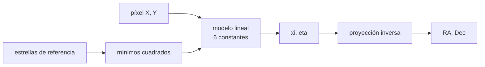

# B58-C06 — Astrometría de objetos menores

<!-- nav:top -->
[🏠 Programa](../../../../README.md) · [📚 Bloque B58](../../../tronco-comun/B58-asteroides-cometas-y-defensa-planetaria.md) · [← Anterior: B58-C05 — Órbitas cercanas a la Tierra](../B58-C05-orbitas-cercanas-a-la-tierra/CLASE.md) · [Siguiente: B58-C07 — Determinación de órbitas →](../B58-C07-determinacion-de-orbitas/CLASE.md)
<!-- /nav -->

## 1. Ubicación, nivel y alcance

Clase 6 del bloque B58 (nivel N3). Toda órbita parte de posiciones en el cielo. Aquí conviertes píxeles en coordenadas ecuatoriales con la proyección gnomónica, ajustas las seis constantes de placa con estrellas de referencia y mides el error de posición de un asteroide, todo con datos **sintéticos**.

## 2. Por qué esta clase existe

Una órbita no puede ser mejor que sus posiciones: un error de décimas de segundo de arco se amplifica al propagar. La decisión central: **¿con qué exactitud puedo asignar coordenadas a un objeto en una imagen y qué la limita?**

## 3. Lo que podrás hacer al terminar

1. Aplicar y invertir la proyección gnomónica.
2. Plantear el modelo lineal de seis constantes de placa.
3. Resolver el ajuste por mínimos cuadrados.
4. Calcular escala, rotación y RMS del residuo.
5. Estimar el error de posición de un objeto.
6. Relacionar velocidad aparente y arrastre en la exposición.

La evidencia es la **ficha de astrometría** del ejercicio 12 (sección 20).

## 4. Con qué llegas y cómo comprobarlo

1. ¿Qué son la ascensión recta y la declinación?
2. ¿Qué es un segundo de arco?
3. ¿Qué es un residuo?
4. ¿Qué es un mínimo cuadrado?
5. ¿Qué es un centroide?

<details>
<summary>Ver respuestas</summary>

1. Las coordenadas ecuatoriales: longitud y latitud celestes. 2. 1/3600 de grado, unos `4,85×10⁻⁶ rad`. 3. La diferencia entre el dato y el modelo. 4. El ajuste que minimiza la suma de los cuadrados de los residuos. 5. La posición del centro de una imagen estelar en el detector.
</details>

Con cuatro o cinco aciertos, sigue; si no, repasa los prerrequisitos.

## 5. Un caso de contexto y casos de referencia

El ejemplo conductor es un campo sintético de 2048 × 2048 px con escala `1,00 ″/px` y giro de `12°`. Sin ruido el ajuste recupera escala `1.000000000 ″/px` y rotación `12.000000000°`. Con centroides de `0,10 px` y catálogo de `0,02″`, el RMS del residuo es `0.113″` (esperado `0.102″`) y la posición de un asteroide sintético queda a `0.144″` de la verdadera.

## 6. Vocabulario

La **proyección gnomónica** (tangente) lleva el cielo a un plano tangente en un punto. Las **coordenadas estándar** `(ξ, η)` son las del plano. Las **constantes de placa** son los seis coeficientes de la relación lineal entre píxel y `(ξ, η)`. La **astrometría** es la medición de posiciones. El **arrastre** es la traza que deja un objeto que se mueve durante la exposición.

## 7. Modelo mental: un mapa con cuadrícula



*Descripción textual:* las estrellas de referencia fijan por mínimos cuadrados las constantes que llevan los píxeles a coordenadas estándar; la proyección inversa da la ascensión recta y la declinación.

Analogía: Como calzar un plano de calles sobre una foto aérea usando puntos conocidos. Límite: el modelo lineal supone un campo pequeño y sin distorsión; en campos grandes hay términos de orden superior.

## 8. La explicación, paso a paso

### 8.1 La proyección gnomónica

Con tangente en `(α₀, δ₀)`: `D = sin δ sin δ₀ + cos δ cos δ₀ cos(α−α₀)`, `ξ = cos δ sin(α−α₀)/D`, `η = (sin δ cos δ₀ − cos δ sin δ₀ cos(α−α₀))/D`. La inversa devuelve `α, δ`. El laboratorio verifica la ida y vuelta: `0.0e+00 ″`.

### 8.2 Las constantes de placa

Se escribe `ξ = aX + bY + c` y `η = dX + eY + f`, con `(X, Y)` el píxel medido desde el centro. Las ecuaciones normales son un sistema 3×3 por cada coordenada, que el laboratorio resuelve por eliminación gaussiana.

### 8.3 Escala y rotación

La escala es `√|ae − bd|` y la rotación `atan2(d, a)`. Sin ruido: `1.000000000 ″/px` y `12.000000000°`. Con ruido: `1.00002 ″/px` y `11.9991°`.

### 8.4 Residuos

El RMS del residuo, con `N−6` grados de libertad para 80 ecuaciones, es `0.1135 ″`, cercano a `√(0,10² + 0,02²) = 0.1020 ″`: el ajuste no añade error por encima del ruido.

### 8.5 Un objeto en movimiento

El asteroide sintético, medido con `0,10 px`, cae a `0.144″` de su posición verdadera (RA, Dec verdaderas `150.157560°`, `19.939460°`). Un objeto de `10 ″/min` recorre `200″` en 20 min; si la exposición es larga deja una traza y el centroide deja de ser un punto.

## 9. Magnitudes, símbolos y unidades

| Símbolo | Qué es | Unidad | Valor / nota |
|---|---|---|---|
| `α, δ` | ascensión recta y declinación | grado | (150°, +20°) centro |
| `ξ, η` | coordenadas estándar | rad | — |
| `X, Y` | píxel desde el centro | px | −1024 a 1024 |
| `a…f` | constantes de placa | rad/px, rad | — |
| escala | tamaño angular por píxel | ″/px | 1,00 (sintética) |
| `σ` | error de centroide | px | 0,10 |

## 10. Convenciones y referencias

Marco ecuatorial; ángulos en grados en las tablas y radianes en el cálculo; segundos de arco con `1 rad = 206 264,806 ″`. Datos sintéticos; no hay época calendario ni catálogo real.

## 11. De dónde sale lo que afirmamos

| ID | Fuente | Localizador | Respalda | Estado |
|---|---|---|---|---|
| — | Sin fuente externa | — | relaciones estándar que verifica el laboratorio | No se consultó una fuente para esta clase |

No consultado: el formato de observaciones del Minor Planet Center (la página no estuvo accesible, 403) ni ningún catálogo estelar real; el laboratorio verifica la proyección con su inversa y el ajuste con un caso sin ruido.

Límites: ninguna fuente externa respalda esta clase.

## 12. Cómo ver el residuo del ajuste

| Magnitud | Valor |
|---|---|
| escala (sin ruido) | 1.000000000 ″/px |
| escala (con ruido) | 1.00002 ″/px |
| RMS del residuo | 0.1135 ″ |
| error del asteroide | 0.144 ″ |

Descripción larga: el residuo del ajuste coincide con el ruido inyectado, `0.113″` frente a `0.102″`.

## 13. Ejemplo trabajado: convertir un píxel en coordenadas

**Paso 1 · Píxel.** `(1500,3; 700,2)` → `X = 476,3`, `Y = −323,8`.

**Paso 2 · Estándar.** `ξ, η` con el modelo de placa.

**Paso 3 · Inversa.** `(α, δ) = (150.157560°, 19.939460°)`.

**Paso 4 · Incertidumbre.** Con `0,10 px`, el error típico es unas décimas de segundo de arco; aquí `0.144″`.

## 14. Distintas formas de resolver lo mismo

**Seis constantes:** modelo lineal, simple y rápido. **Con distorsión:** términos de orden superior para campos grandes. **Con el catálogo real:** el error del catálogo entra en la placa. Aquí solo la primera vía.

## 15. Práctica guiada

**Ejercicio 1 · con los pasos indicados.** Convierte `0,1 px` a segundos de arco con escala `1″/px`. *Pasos:* multiplica.

<details><summary>Solución comentada</summary>

`0,1″`.
</details>

**Ejercicio 2 · con una pista.** ¿Cuántos radianes son `1″`? *Pista:* sección 9.

<details><summary>Solución comentada</summary>

`4,848×10⁻⁶ rad`.
</details>

**Ejercicio 3 · casi autónomo.** Calcula la escala de placa si `a = 4,5×10⁻⁶` y `e = 4,5×10⁻⁶` con `b = d = 0`.

<details><summary>Solución comentada</summary>

`4,5×10⁻⁶ rad/px = 0,93″/px`.
</details>

## 16. Práctica autónoma, transferencia e integrador

**Ejercicio 4 · autónomo.** ¿Qué significa un RMS del residuo mucho mayor que el ruido esperado?

<details><summary>Solución comentada</summary>

Que el modelo es insuficiente (distorsión) o hay estrellas mal identificadas.
</details>

**Ejercicio 5 · autónomo.** ¿Cuántos grados de libertad tiene el ajuste con 40 estrellas?

<details><summary>Solución comentada</summary>

`80 − 6 = 74`.
</details>

**Ejercicio 6 · autónomo.** ¿Qué le pasa al error de posición si se duplica el ruido de centroide?

<details><summary>Solución comentada</summary>

Se duplica, aproximadamente.
</details>

**Ejercicio 7 · autónomo.** Si el objeto se mueve `10″/min` y la exposición es de 60 s, ¿cuánto se arrastra?

<details><summary>Solución comentada</summary>

`10″`.
</details>

**Ejercicio 8 · autónomo.** ¿Por qué se resta el centro del detector?

<details><summary>Solución comentada</summary>

Para que `c` y `f` sean pequeñas y el ajuste esté mejor condicionado.
</details>

**Ejercicio 9 · transferencia.** **Transferencia.** ¿Por qué la astrometría de un campo grande necesita más constantes?

<details><summary>Solución comentada</summary>

Porque la distorsión óptica y la proyección dejan de ser lineales.
</details>

**Ejercicio 10 · transferencia.** **Transferencia.** Un colega dice que más estrellas de referencia reducen el error sin límite. Respóndele.

<details><summary>Solución comentada</summary>

El error del ajuste baja como `1/√N`, pero el del catálogo y la distorsión no.
</details>

**Ejercicio 11 · transferencia.** **Transferencia.** ¿Qué efecto tiene un error sistemático de catálogo en la órbita?

<details><summary>Solución comentada</summary>

Se propaga como un sesgo a todas las posiciones (C07).
</details>

**Ejercicio 12 · integrador.** **Integrador.** Elabora tu *ficha de astrometría*: escala, rotación, RMS y error del objeto, con el rótulo «sintético».

<details><summary>Solución comentada</summary>

Secciones 8.3–8.5.
</details>

## 17. Laboratorio: astrometría con constantes de placa

El script [astrometria.py](astrometria.py) proyecta, ajusta seis constantes de placa con 40 estrellas sintéticas y mide el error de un asteroide (**comprueba** ida y vuelta de 10⁻⁹, escala y rotación sin ruido con 10⁻⁹ y RMS entre 0,7 y 1,2 veces el esperado).

**Datos:** campo, estrellas y asteroide **sintéticos**; semilla `20261109`; ningún catálogo real. **Predice antes de ejecutar:** ¿Será el RMS del residuo mayor o menor que 0,10″? **Ejecución del 2026-11-09:**

```text
Python 3.12.9 (biblioteca estandar)
Ida y vuelta de la proyeccion: 0.00e+00 arcsec
Sin ruido: escala = 1.0000000000 arcsec/px ; rotacion = 12.0000000000 deg (verdad 1.0 ; 12.0)
Con ruido (40 estrellas): escala = 1.00002 arcsec/px ; rotacion = 11.9991 deg
RMS del residuo = 0.1135 arcsec ; esperado = 0.1020 arcsec
Asteroide sintetico: verdad (RA, Dec) = (150.157560, 19.939460) deg ; medido = (150.157588, 19.939430) deg ; error = 0.144 arcsec
Un objeto de 10 arcsec/min recorre 200 arcsec (200 px) en 20 min
Pruebas superadas.
```

```bash
python programa/clases/B58/B58-C06-astrometria-de-objetos-menores/astrometria.py
```

**Límites:** sin distorsión, refracción ni movimiento propio; campo pequeño.

## 18. Errores frecuentes y cómo corregirlos

**Olvidar que el catálogo tiene error.** Se corrige con 8.4.

**Mezclar píxeles y radianes.** Se corrige con la sección 9.

**Usar el modelo lineal en campos grandes.** Se corrige con la sección 14.

**Presentar el objeto sintético como observado.** Se corrige con la sección 10.

## 19. Cómo sabrás que vas bien

Tras la sección 8: ¿qué RMS esperabas y cuál obtuviste? Si dudas, repasa el ejemplo 13. Tras el laboratorio: ¿qué comprueba? (ver la sección 17).

## 20. Qué entregas y cómo se evalúa

El producto es tu **ficha de astrometría** (ejercicio 12).

| Criterio | Inicial | En desarrollo | Logrado | Destacado |
|---|---|---|---|---|
| Conceptos | Los confunde | Parciales | Conceptos de la clase | Explica los límites |
| Cálculo | Sin unidades | Con errores | Tablas completas | Calcula casos nuevos |
| Numérico | Sin comprobar | Un caso | Contraste con el análisis | Interpreta las diferencias |
| Fuentes | Sin fuente | Sin fecha | Fuentes con fecha | Declara lo no consultado |
| Límites | No los nombra | Uno | Tres | Discute qué falta del modelo |

**Condiciones críticas (no se compensan con promedio):** rotular el campo como sintético; no presentar la posición simulada como observada; declarar lo no consultado.

## 21. Ética, seguridad y límites

Clase educativa: los modelos son simplificados y los datos, sintéticos; nada de lo calculado evalúa un objeto real ni sustituye a los sistemas oficiales de monitoreo y alerta.  Accesibilidad: tablas equivalentes a las gráficas, fórmulas en texto, ejercicios sin conexión.

## 22. Para cerrar y seguir

El ajuste de seis constantes deja un residuo de `0.113″` y una posición del objeto a `0.14″`. Queda una pregunta: ¿cómo se convierten esas posiciones en una órbita?

**Glosario español–inglés.** proyección gnomónica · *gnomonic projection*; constantes de placa · *plate constants*; astrometría · *astrometry*; centroide · *centroid*; residuo · *residual*.

**Continuidad.** [B58-C07](../B58-C07-determinacion-de-orbitas/CLASE.md) estudia determinación de órbitas.

**Referencias:** ver sección 11.

<!-- nav:bottom -->
---

[← Anterior: B58-C05 — Órbitas cercanas a la Tierra](../B58-C05-orbitas-cercanas-a-la-tierra/CLASE.md) · [📚 Bloque B58](../../../tronco-comun/B58-asteroides-cometas-y-defensa-planetaria.md) · [Siguiente: B58-C07 — Determinación de órbitas →](../B58-C07-determinacion-de-orbitas/CLASE.md)
<!-- /nav -->
